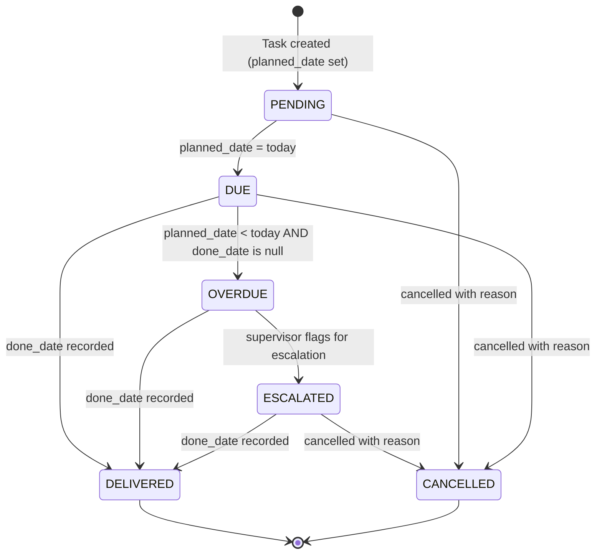
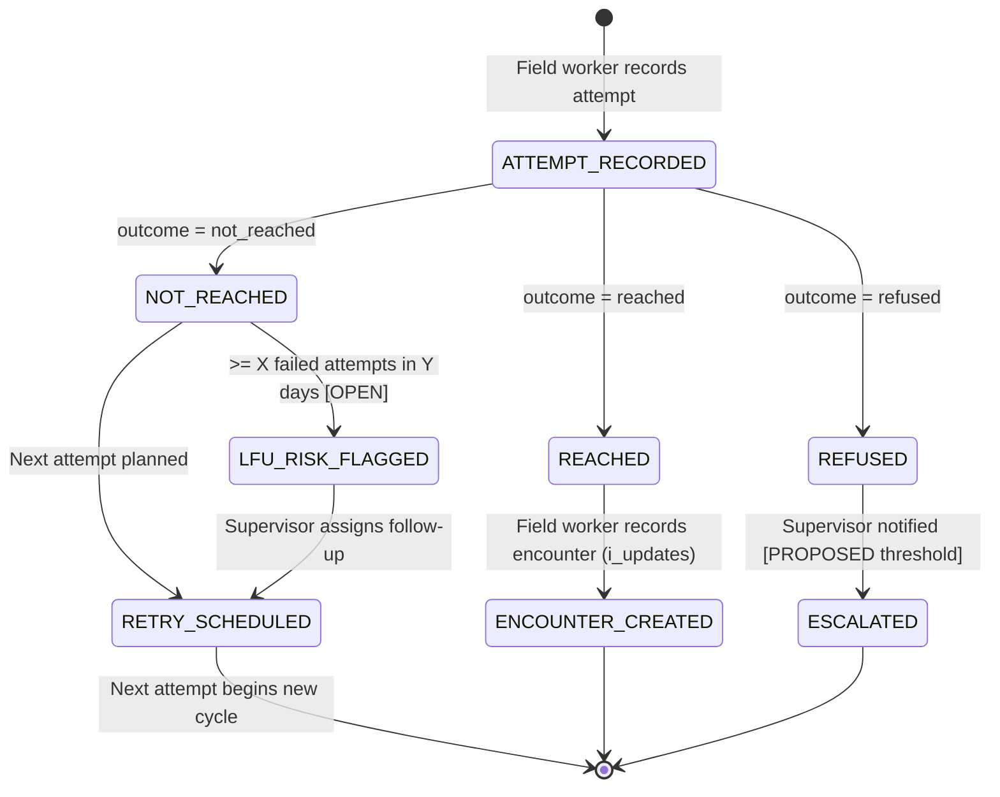

# Product Requirements Document — CSC 2.0
## Community Support Centre Management System

---

## Document Metadata

| Field | Value |
|---|---|
| Document ID | DOC-01 |
| Title | CSC 2.0 — Community Support Centre Management System |
| Version | v0.1.1 |
| Status | **DRAFT** |
| Classification | Internal — Not for distribution |
| Owners | TBD [OPEN] |
| Created | 2026-11-02 |
| Last Updated | 2026-11-02 |
| **Shared Glossary** | See `SHARED_GLOSSARY.md` (canonical terms, role codes, ID namespace) |

### Version History

| Version | Date | Author | Summary |
|---|---|---|---|
| v0.1.0 | 2026-11-02 | TBD [OPEN] | Initial draft from XLSForm domain analysis |

### Change Log

| Change ID | Version | Section | Description |
|---|---|---|---|
| CHG-001 | v0.1.0 | All | Initial document creation |

### Diff Summary vs Childcare Predecessor

| Dimension | Childcare Predecessor | CSC 2.0 |
|---|---|---|
| Primary population | Children in care | PLHIV / KP clients at ART Centres |
| Key entity | Child case | Client CRF (Sections A–J) |
| Repeat structure | Case reviews | i_updates repeat (follow-up visits) + j5_plan repeat |
| Service tracking | Placement/care plan | Planned vs delivered services (j5_plan) |
| Family tracking | Guardian linkage | b2_members repeat (family HIV history) |
| Death recording | Rare / incidental | Explicit Section H with ARTC reporting workflow |
| Verification | Social worker sign-off | j_doc_* yn declarations + j1_checked date |
| KP typology | Not applicable | fsw/msm/tgh/pwid with cross-gender validation |
| Follow-up trigger | Age-based | a13_client_type = '2' unlocks Section I |
| Offline support | [UNVERIFIED] | Required — field workers operate offline [PROPOSED] |

---

## 1. Purpose, Problem Statement, Vision, Non-Goals

### 1.1 Purpose

This document specifies the functional requirements for **CSC 2.0**, a case management system supporting Community Support Centre (CSC) field workers and supervisors who deliver social protection and care services to People Living with HIV (PLHIV) and Key Populations (KP) registered at ART Centres across India.

### 1.2 Problem Statement

CSC field workers currently manage client records via paper CRFs and spreadsheets. This creates:

1. **No actionable worklist** — Field workers cannot determine, without manual review, which clients are overdue for contact, which planned services are pending, or which clients have died and require ARTC notification. [SOURCE]
2. **Lost follow-up signal** — A client registered as Follow-up (a13_client_type='2') requires Section I updates (i_updates), but paper systems do not enforce this or surface overdue repeat visits. [SOURCE]
3. **Planned ≠ Delivered gap** — j5_plan entries represent intent; delivered services are a separate event. No system currently reconciles them. [SOURCE]
4. **Supervisor blindness** — Supervisors cannot see, across multiple field workers, which clients are overdue, which tasks are unowned, or where field workers are blocked. [PROPOSED]
5. **Fragile verification** — j_doc_* declarations (HIV report, address proof, ART card) are yes/no claims on paper; there is no audit trail confirming documents were seen. [SOURCE]

### 1.3 Vision

> **"The right field worker knows, at the start of every day, exactly who needs action, why it is due, and what completing it looks like — and their supervisor sees the same picture."**

The primary question the system must answer at every screen:

> **"Who needs action today, why, who owns it, and what completes it?"** [PROPOSED]

### 1.4 Non-Goals

| Non-Goal | Rationale |
|---|---|
| Electronic Medical Records (EMR) / clinical decision support | CSC is a social protection system, not a clinical system [PROPOSED] |
| ART Centre MIS replacement | CSC integrates with ARTC data; it does not replace ARTC MIS [PROPOSED] |
| Real-time laboratory result ingestion | Lab values are entered manually by field workers [SOURCE] |
| Microservices, Kafka, Kubernetes, multi-region deployment | Explicitly out of scope [PROPOSED] |
| Verified document repository | j_doc_* are declarations, not verified document uploads [SOURCE] |
| Kobo/ODK runtime replacement | Kobo is the source specification; CSC 2.0 is the case management system [PROPOSED] |
| Biometric identification | No biometric capture in scope [ASSUMPTION] |
| Payment / financial disbursement | Referral tracking only; not payment processing [PROPOSED] |
| Public-facing beneficiary portal | Internal staff system only [PROPOSED] |

---

## 2. Users and Roles

### 2.1 Role Definitions

| Role | Definition | Source Tag |
|---|---|---|
| **field_worker** | CSC outreach worker who registers clients, records contact attempts, visits clients, and plans/delivers services | [PROPOSED] |
| **supervisor** | Manages one or more field workers; reviews overdue tasks; approves escalations; ensures coverage | [PROPOSED] |
| **state_reviewer** | State/district level staff; read-only; cross-district reporting and trend analysis | [PROPOSED] |
| **administrator** | Manages users, configures lookup tables, assigns roles; no clinical or case access required | [PROPOSED] |
| **leadership** | Strategic reporting dashboards; no administrative access; no PII access | [PROPOSED] |

> [!IMPORTANT]
> **Leadership ≠ Administrator.** Leadership sees aggregated dashboards. Administrators manage system configuration. These are separate roles with separate permission sets. [PROPOSED]

### 2.2 Jobs-to-be-Done (JTBD) by Role

#### Field Worker

| # | When I… | I want to… | So that… |
|---|---|---|---|
| FW-1 | Start my workday | See a prioritised list of clients who need action today | I spend time on the highest-priority visits, not on finding who to visit |
| FW-2 | Attempt to contact a client | Record the attempt outcome (reached / not reached / refused) even if unsuccessful | The system knows contact was tried and can escalate if repeated failures occur |
| FW-3 | Successfully visit a client (Follow-up type) | Record an i_updates entry covering visit date, ART status, weight, CD4, social entitlements, stigma | The client's follow-up record is up to date and next action is automatically computed |
| FW-4 | Plan a future service | Create a j5_plan entry with planned date, purpose, category, and service | My plan is visible to my supervisor and generates a future worklist item |
| FW-5 | Deliver a planned service | Mark the j5_plan entry as done with a done_date and done_purpose | The system closes the planned task and records the outcome |
| FW-6 | Register a new client | Complete Sections A–J baseline CRF for a new registration (a13_client_type='1') | The client enters the system and generates an initial care plan |
| FW-7 | Learn a client has died | Record Section H death information including ARTC reporting and death certificate availability | The system updates client lifecycle state and notifies supervisor for ARTC follow-up |
| FW-8 | Work in an area with no internet | Draft records offline and sync when connectivity returns | I do not lose work due to connectivity gaps |

#### Supervisor

| # | When I… | I want to… | So that… |
|---|---|---|---|
| SV-1 | Start my workday | See all overdue clients across my field workers with owner names | I can intervene before clients fall through the cracks |
| SV-2 | Review a field worker's caseload | See open tasks, contact attempts, planned vs delivered services | I can provide targeted coaching and redistribute load |
| SV-3 | A client has been LFU for >X days | Receive an alert and assign it to a field worker for follow-up | Clients are not silently lost |
| SV-4 | A death is recorded | See it immediately and confirm ARTC notification was completed | The ARTC reporting obligation (Section H) is fulfilled |
| SV-5 | Approve an escalation | Mark it resolved and record the resolution action | Escalations are tracked end-to-end |

#### State Reviewer

| # | When I… | I want to… | So that… |
|---|---|---|---|
| SR-1 | Need a monthly report | Export district-level summaries of registrations, follow-ups, deaths, services delivered | I can submit statutory reports without manual aggregation |
| SR-2 | Spot a district with low follow-up rates | Drill into that district's client list | I can identify systemic problems |
| SR-3 | Need KP typology breakdown | Filter by kp (fsw/msm/tgh/pwid) and service category | I can report on KP-specific programme performance |

#### Administrator

| # | When I… | I want to… | So that… |
|---|---|---|---|
| AD-1 | Onboard a new field worker | Create their account, assign role, link to CSC and district | They can log in and access only their assigned clients |
| AD-2 | Need to update the list of ART Centres | Edit the lookup table without a code deployment | Field workers see current ARTC names and codes |
| AD-3 | A user leaves the organisation | Deactivate their account and reassign their open tasks | No orphaned records or access gaps |

#### Leadership

| # | When I… | I want to… | So that… |
|---|---|---|---|
| LD-1 | Attend a board review | See programme KPIs (registrations, follow-up rate, deaths, services) in a dashboard | I can speak to programme performance without requesting ad-hoc reports |
| LD-2 | Compare districts | See a ranked table of districts by key metric | I can direct resources to underperforming areas |

---

## 3. Scope Matrix

| Feature Area | Description | MVP | Later | Out-of-Scope |
|---|---|---|---|---|
| **Client Registration (Sections A–H, J baseline)** | New client CRF capture, all sections | ✅ MVP | | |
| **Follow-up Client Update (Section I — i_updates)** | Repeat visit recording for a13_client_type='2' | ✅ MVP | | |
| **Planned Services (j5_plan repeat)** | Creating and tracking planned service entries | ✅ MVP | | |
| **Delivered Services & Outcomes** | Marking j5_plan entries as done with outcome | ✅ MVP | | |
| **Contact Attempt Recording** | Non-encounter contact attempts (reached/not/refused) | ✅ MVP | | |
| **Worklist / Action Queue** | Prioritised daily list of due and overdue clients | ✅ MVP | | |
| **Death Recording (Section H)** | Capture death details and ARTC reporting flag | ✅ MVP | | |
| **Supervisor Overdue Dashboard** | Cross-field-worker overdue view for supervisors | ✅ MVP | | |
| **Offline Draft / Sync** | Field worker can draft offline, sync later | ✅ MVP | | |
| **Verification Declarations (j_doc_*)** | Capture yn declarations; audit trail of who recorded when | ✅ MVP | | |
| **Family Member Repeat (b2_members)** | Capture and display family HIV history | ✅ MVP | | |
| **Referral Repeat (d5_referrals)** | Capture referral entries linked to client | ✅ MVP | | |
| **Google Sheets Mirror (Apps Script)** | Read-only mirror to Sheets for reporting | | ✅ Later | |
| **State Reviewer Reports** | District/state level aggregated exports | | ✅ Later | |
| **Leadership Dashboard** | Strategic KPI dashboard | | ✅ Later | |
| **Document Upload / Storage** | Actual file uploads for HIV report, address proof, ART card | | | ✅ Out |
| **Clinical Decision Support** | Drug interaction alerts, clinical protocols | | | ✅ Out |
| **ART Centre MIS Integration (live)** | Real-time data pull from ARTC MIS | | | ✅ Out |
| **Biometric Identification** | Fingerprint or face matching | | | ✅ Out |
| **Payment / Disbursement** | Financial transactions | | | ✅ Out |
| **Multi-region / Kubernetes** | Distributed infrastructure | | | ✅ Out |
| **Kobo/ODK Runtime** | Running surveys via ODK protocol | | | ✅ Out |

---

## 4. Core Journeys

### J1: Worklist → Identify Due Client → Record Contact Attempt → Schedule Next

**Goal:** Field worker starts their day, selects the highest-priority client, attempts contact, and leaves the system in a correct state regardless of outcome.

```
Given  the field worker is logged in and has assigned clients
When   they open the Worklist screen
Then   clients are sorted by urgency (overdue first, then due today, then upcoming)
  And  each row shows: client name, last contact date, days overdue, owner, next planned action

Given  the field worker selects a client from the worklist
When   they view the client profile
Then   they see: current ART status, last follow-up date, open planned services, recent contact attempts

Given  the field worker attempts to call or visit a client
When   they record the contact attempt
Then   they must enter: attempt_date (≤ today), attempt_method (call/visit/proxy), outcome (reached/not_reached/refused)
  And  if outcome = not_reached or refused, the system prompts: "Schedule next attempt or escalate?"
  And  the attempt is saved immediately, even in offline mode

Given  the outcome is "not_reached" three times within [X days] [OPEN — threshold TBD]
When   the system evaluates the contact history
Then   the client is flagged as "At Risk of LFU" and an alert appears on the supervisor worklist

Given  the field worker wants to schedule the next contact attempt
When   they create the next attempt plan
Then   they must enter: planned_date (> today), method, purpose
  And  this generates a worklist item on the planned_date
```

---

### J2: Record Encounter (Successful Contact — Follow-up Client)

**Goal:** Field worker has successfully visited a Follow-up client (a13_client_type='2') and records the encounter as an i_updates entry.

```
Given  the client has a13_client_type = '2' (Follow-up Client)
  And  the field worker has successfully made contact
When   they open "Record Visit" for this client
Then   the system presents the i_updates form with:
       ia_visit_date (required, ≤ today),
       ib_place (required),
       ic_art_status (required),
       ie_regimen (required if ic_art_status = 2),
       id_cd4 (if client age ≥ 18, 0–5000),
       id_cd4_pct (if client age < 18, 0–100),
       if_weight (1–200 kg),
       ig_height (30–230 cm),
       ih_muac (if age < 5),
       ii_sws_any (yn),
       ii_sws (select_multiple, if ii_sws_any = yes),
       ij_se (social entitlements),
       ik_stigma (yn),
       ik_stigma_from (required if ik_stigma = yes),
       il_att (on ATT)

Given  the field worker completes the i_updates form
When   they submit
Then   the visit is recorded with: observation_date = ia_visit_date, recorded_at = server_acceptance_timestamp
  And  the client's worklist status updates to "Visited — next due in [X days]" [OPEN — interval]
  And  the prior contact attempt (if any) is marked as resolved

Given  the client's age < 18 and field worker enters id_cd4 (adult field)
When   validation runs
Then   the system rejects the entry and shows: "Use CD4 % for clients under 18"

Given  the client's age ≥ 18 and field worker enters id_cd4_pct (child field)
When   validation runs
Then   the system rejects the entry and shows: "Use CD4 count for clients 18 and over"
```

---

### J3: Plan Next Action (j5_plan Entry)

**Goal:** Field worker creates a planned service entry that becomes a future worklist item.

```
Given  the field worker is viewing a client profile
When   they select "Plan Service"
Then   they must enter:
       j5_planned_date (required, > today for new plans),
       j5_purpose (required),
       j5_cat (service category, required),
       j5_service (select_multiple, required if j5_cat ≠ '')

Given  the planned service entry is saved
When   the planned_date arrives
Then   the client appears in the field worker's worklist with action label "Deliver planned service: [j5_purpose]"

Given  the field worker delivers the service
When   they record the service delivery
Then   they must enter: delivery_date / j5_done_date (≤ today), delivery_purpose / j5_done_purpose [SOURCE]
  And  an explicit delivered_service record is created; a planned service becomes DELIVERED only through this explicit delivered-service record (j5_done_date alone NEVER changes service status) [PROPOSED]
  And  the planned service item transitions status to "DELIVERED" and leaves the active worklist [PROPOSED]

Given  a planned service entry is overdue (j5_planned_date < today and j5_done_date is null)
When   the system evaluates the worklist
Then   the entry is marked "OVERDUE" in the field worker's worklist
  And  it appears in the supervisor's overdue dashboard with the owning field worker's name

Given  the field worker needs to cancel a planned service
When   they select "Cancel Plan"
Then   they must enter a cancellation reason
  And  the entry is archived with status = CANCELLED (never deleted)
```

---

### J4: Supervisor Reviews Overdue Clients

**Goal:** Supervisor has a cross-field-worker view of all overdue tasks and can take action.

```
Given  the supervisor is logged in
When   they open the Supervisor Dashboard
Then   they see a table of all clients under their field workers that are:
       (a) overdue for a follow-up visit (last i_updates > [X days] ago),
       (b) have overdue planned services (j5_planned_date < today, j5_done_date null),
       (c) flagged as At Risk of LFU (≥3 failed contact attempts in [X days])
  And  each row shows: client name, assigned field worker, days overdue, last action taken

Given  the supervisor sees an overdue client
When   they select "Reassign"
Then   they can assign the client to a different field worker
  And  the previous field worker loses the worklist item
  And  the new field worker gains it

Given  the supervisor sees a client flagged for ARTC death notification not yet completed
When   they select the client
Then   they see Section H details and the h4_reported flag
  And  they can mark ARTC notification as confirmed, with confirmation date

Given  the supervisor wants to contact a field worker about an overdue client
When   they select "Add Note"
Then   they can record a supervisor note attached to the client record, visible to the field worker
```

---

### J5: Client Registration / Baseline CRF

**Goal:** Field worker registers a new client or completes a baseline CRF for an existing referral.

```
Given  the field worker has met a new client or referral
When   they select "New Registration"
Then   the system creates a draft CRF with a server-assigned client_id (not editable by field worker)
  And  presents Section A — Basic Profile

Given  the field worker is completing Section A
When   they enter a06_abha
Then   the system validates against regex: ^[0-9]{14}$ or XX-XXXX-XXXX-XXXX format
  And  rejects invalid entries with a clear error message

Given  the field worker selects a14_kp = 'fsw' (female sex worker)
When   the system checks cross-gender validation
Then   it rejects if a05_gender = '1' (male) with: "FSW typology requires female gender"

Given  the field worker selects a14_kp = 'msm' (men who have sex with men)
When   the system checks cross-gender validation
Then   it rejects if a05_gender ≠ '1' (male) with: "MSM typology requires male gender"

Given  the field worker selects a14_kp = 'tgh' (transgender)
When   the system checks cross-gender validation
Then   it requires a05_gender = '3' (transgender)

Given  a13_client_type = '2' (Follow-up Client)
When   the CRF is saved
Then   Section I (i_updates) is unlocked and a follow-up visit entry is required

Given  the client age < 18
When   Section A is displayed
Then   a16_caretaker and a17_orphan fields are shown as required
  And  a18_in_school is shown (age 5–17 only)

Given  the client age < 5
When   Sections C and I are displayed
Then   c_muac and ih_muac fields are shown
  And  c12b_cd4_pct is used (not c12b_cd4_count)

Given  the field worker reaches Section J (Verification)
When   they complete j_doc_hiv, j_doc_addr, j_doc_art declarations
Then   the system records: declaration_value (yn), declared_by (user_id), declared_at (server_timestamp)
  And  these are NOT treated as verified documents — only as declarations [SOURCE]

Given  the field worker submits the complete CRF
When   the server accepts it
Then   the client enters lifecycle state: ACTIVE
  And  worklist items are generated based on client_type and planned services
  And  a confirmation screen shows the client_id, CSC name, and next planned action
```

---

## 5. Functional Requirements

| Req ID | Description | Priority | Source |
|---|---|---|---|
| PRD-001 | The system SHALL present a prioritised daily worklist to each field worker showing clients due or overdue for action | Must Have | [PROPOSED] |
| PRD-002 | The worklist SHALL be sortable and filterable by: days overdue, client type, KP typology, district, assigned field worker | Must Have | [PROPOSED] |
| PRD-003 | The system SHALL allow a field worker to record a contact attempt with: date (≤ today), method (call/visit/proxy), outcome (reached/not_reached/refused), notes | Must Have | [PROPOSED] |
| PRD-004 | A Contact Attempt SHALL NOT be the same entity as an Encounter; they are distinct records | Must Have | [PROPOSED] |
| PRD-005 | The system SHALL enforce that ia_visit_date (i_updates) is ≤ today (server date, not device date) | Must Have | [SOURCE] |
| PRD-006 | The system SHALL require ic_art_status in every i_updates entry | Must Have | [SOURCE] |
| PRD-007 | The system SHALL show ie_regimen in i_updates if and only if ic_art_status = 2 | Must Have | [SOURCE] |
| PRD-008 | The system SHALL display id_cd4 (count, 0–5000) for i_updates entries where the client's age ≥ 18 | Must Have | [SOURCE] |
| PRD-009 | The system SHALL display id_cd4_pct (percentage, 0–100) for i_updates entries where client age < 18 | Must Have | [SOURCE] |
| PRD-010 | The system SHALL enforce if_weight in range 1–200 kg in i_updates | Must Have | [SOURCE] |
| PRD-011 | The system SHALL enforce ig_height in range 30–230 cm in i_updates | Must Have | [SOURCE] |
| PRD-012 | The system SHALL require ik_stigma_from if ik_stigma = yes in i_updates | Must Have | [SOURCE] |
| PRD-013 | Section I (i_updates) SHALL be unlocked if and only if a13_client_type = '2' | Must Have | [SOURCE] |
| PRD-014 | The system SHALL allow creation of j5_plan entries with: j5_planned_date (required), j5_purpose (required), j5_cat (required), j5_service (required if cat ≠ '') | Must Have | [SOURCE] |
| PRD-015 | A j5_plan entry SHALL transition from PLANNED → DELIVERED when j5_done_date and j5_done_purpose are recorded | Must Have | [SOURCE] |
| PRD-016 | A j5_plan entry SHALL be marked OVERDUE if j5_planned_date < today and j5_done_date is null | Must Have | [PROPOSED] |
| PRD-017 | Overdue planned services SHALL appear on the supervisor dashboard with the owning field worker identified | Must Have | [PROPOSED] |
| PRD-018 | The system SHALL enforce that j5_done_date ≤ today | Must Have | [SOURCE] |
| PRD-019 | The system SHALL support cancellation of planned services with a mandatory reason; cancelled entries are archived, never deleted | Must Have | [PROPOSED] |
| PRD-020 | The system SHALL capture a06_abha and validate against regex ^[0-9]{14}$ or XX-XXXX-XXXX-XXXX pattern | Must Have | [SOURCE] |
| PRD-021 | The system SHALL enforce cross-gender validation for KP typology: fsw requires gender ≠ 1; msm requires gender = 1; tgh requires gender = 3 | Must Have | [SOURCE] |
| PRD-022 | The system SHALL enforce a04_age in range 0–120 | Must Have | [SOURCE] |
| PRD-023 | The system SHALL show a16_caretaker and a17_orphan as required fields when client age < 18 | Must Have | [SOURCE] |
| PRD-024 | The system SHALL enforce a11_pin against regex ^[1-9][0-9]{5}$ | Must Have | [SOURCE] |
| PRD-025 | The system SHALL enforce a11_phone against regex ^[6-9][0-9]{9}$ | Must Have | [SOURCE] |
| PRD-026 | The system SHALL show a12_* permanent/alt address fields if and only if a12_same = 'no' | Must Have | [SOURCE] |
| PRD-027 | The system SHALL enforce a20_marital: code 6 ("N/A") only when age < 15; codes other than 6 only when age ≥ 15 | Must Have | [SOURCE] |
| PRD-028 | The system SHALL enforce a18_education: code 7 (no schooling) required when age < 5; other codes required when age ≥ 5 | Must Have | [SOURCE] |
| PRD-029 | The system SHALL enforce a15_typ_other = 'anc' only when gender = '2' (female) | Must Have | [SOURCE] |
| PRD-030 | The system SHALL capture b2_members as a repeat entity table (not flat columns), with fields: b2_name, b2_relation, b2_age, b2_gender, b2_living, b2_hiv, b2_hiv_date (if hiv=1 or 2), b2_cd4 (if hiv=1 and living=1), b2_vl (if hiv=1 and living=1), b2_art (if hiv=1 and living=1), b2_idtype, b2_idno, b2_at_csc, b2_csc_id | Must Have | [SOURCE] |
| PRD-031 | The system SHALL calculate and store b3_total_plhiv and b4_total_ictc as derived values from b2_members | Must Have | [SOURCE] |
| PRD-032 | The system SHALL capture d5_referrals as a repeat entity table (not flat columns) with: d5_scheme, d5_entitlement | Must Have | [SOURCE] |
| PRD-033 | The system SHALL capture j5_plan as a repeat entity table (not flat columns) | Must Have | [SOURCE] |
| PRD-034 | The system SHALL capture Section H death information: h1_death_date (≤ today), h2_reason, h2_reason_other (if reason=5), h3_info_date (≤ today and ≥ h1_death_date), h4_reported, h5_artc_death_date (if reported=yes), h6_place, h7_lfu, h8_certificate | Must Have | [SOURCE] |
| PRD-035 | When a death is recorded (h0_deceased = yes), the client SHALL transition to lifecycle state DECEASED | Must Have | [PROPOSED] |
| PRD-036 | When a death is recorded and h4_reported = no (not yet reported to ARTC), an alert SHALL appear on the supervisor dashboard | Must Have | [PROPOSED] |
| PRD-037 | The system SHALL record j_doc_hiv, j_doc_addr, j_doc_art as declarations (yn) with: declared_by (user_id), declared_at (server_timestamp); these are NOT verified document uploads | Must Have | [SOURCE] |
| PRD-038 | The system SHALL record j1_checked (date ≤ today), j2_clh, j3_coord, j4_comments in Section J | Must Have | [SOURCE] |
| PRD-039 | The system SHALL support offline draft creation; drafts SHALL sync to the server when connectivity is restored | Must Have | [PROPOSED] |
| PRD-040 | The system SHALL distinguish: observation_date (when the event occurred) from recorded_at (server acceptance timestamp) | Must Have | [PROPOSED] |
| PRD-041 | The system SHALL distinguish: local_draft (not yet server-accepted) from server_accepted (canonical record) | Must Have | [PROPOSED] |
| PRD-042 | The supervisor SHALL have a cross-field-worker dashboard showing all overdue tasks, LFU flags, and unconfirmed deaths | Must Have | [PROPOSED] |
| PRD-043 | The supervisor SHALL be able to reassign a client from one field worker to another with an audit entry | Must Have | [PROPOSED] |
| PRD-044 | The system SHALL flag a client as "At Risk of LFU" after [X] consecutive failed contact attempts within [Y] days [OPEN — thresholds] | Must Have | [PROPOSED] |
| PRD-045 | The system SHALL enforce c2_confirm_date ≤ today and c2_confirm_date required if c1_hiv_confirmed = yes | Must Have | [SOURCE] |
| PRD-046 | The system SHALL enforce c7_preart_date ≤ today and ≥ c2_confirm_date | Must Have | [SOURCE] |
| PRD-047 | The system SHALL enforce c9_art_date ≤ today and ≥ c2_confirm_date, required if c8_art_status = 1 | Must Have | [SOURCE] |
| PRD-048 | The system SHALL enforce c10_height in range 30–230 cm and c11_weight in range 1–200 kg | Must Have | [SOURCE] |
| PRD-049 | The system SHALL enforce c_muac > 0 and ≤ 30 cm, shown only when client age < 5 | Must Have | [SOURCE] |
| PRD-050 | The system SHALL enforce c12b_cd4_count in range 0–5000 for adults (age ≥ 18) | Must Have | [SOURCE] |
| PRD-051 | The system SHALL enforce c12b_cd4_pct in range 0–100% for children (age < 18) | Must Have | [SOURCE] |
| PRD-052 | The system SHALL enforce c13b_vl_count ≥ 0 | Must Have | [SOURCE] |
| PRD-053 | The system SHALL enforce b2_cd4 in range 0–5000 for b2 family members | Must Have | [SOURCE] |
| PRD-054 | The system SHALL enforce b2_vl ≥ 0 for b2 family members | Must Have | [SOURCE] |
| PRD-055 | The system SHALL enforce e1_sexwork as required if kp = fsw, msm, or tgh | Must Have | [SOURCE] |
| PRD-056 | The system SHALL enforce e2_ost and e3_nsep as required if kp = pwid | Must Have | [SOURCE] |
| PRD-057 | The system SHALL show e5_condom_know only when client age ≥ 15 | Must Have | [SOURCE] |
| PRD-058 | The system SHALL show e9a–e9e substance use fields only when client age ≥ 10 | Must Have | [SOURCE] |
| PRD-059 | The system SHALL enforce f2_from as required if f1_discrimination = yes | Must Have | [SOURCE] |
| PRD-060 | The system SHALL enforce g2_type, g3_certificate, g4_benefit as required if g1_disability = yes | Must Have | [SOURCE] |
| PRD-061 | The system SHALL capture g4_scheme (text) if g1_disability = yes and g4_benefit = yes | Must Have | [SOURCE] |
| PRD-062 | The system SHALL support role-based access control: field_worker sees only assigned clients; supervisor sees assigned field workers' clients; state_reviewer sees read-only district aggregate; administrator manages users and config; leadership sees anonymised dashboards | Must Have | [PROPOSED] |
| PRD-063 | The system SHALL generate a server-assigned, immutable client_id at registration time; field workers cannot modify it | Must Have | [PROPOSED] |
| PRD-064 | All data mutations SHALL be recorded in an audit log: who changed what, from what value, to what value, at what server timestamp | Must Have | [PROPOSED] |
| PRD-065 | The system SHALL expose a Google Sheets mirror via Apps Script for read-only reporting | Should Have | [PROPOSED] |
| PRD-066 | The system SHALL provide state reviewer exports (CSV or Sheets) of: registrations by district/month, follow-ups, deaths, services by category | Should Have | [PROPOSED] |
| PRD-067 | The leadership dashboard SHALL display anonymised aggregates; no individual PII visible to leadership role | Should Have | [PROPOSED] |
| PRD-068 | The system SHALL support the a19_occupation_other free-text field when a19_occupation = '14' | Must Have | [SOURCE] |
| PRD-069 | The system SHALL support the a18_in_school field for clients aged 5–17 | Must Have | [SOURCE] |
| PRD-070 | The system SHALL capture a08_consent (required) — consent for home visit; this field SHALL be immutable after first submission [OPEN — confirm immutability requirement] | Must Have | [SOURCE] |

---

## 6. Domain Glossary

| Term | Definition | Source Tag |
|---|---|---|
| **Client** | An individual PLHIV or KP person registered in the CSC system with a unique client_id. Corresponds to a single CRF (Sections A–J). | [SOURCE] |
| **Task** | A discrete unit of work assigned to a field worker with a due date, a purpose, and a completion criterion. Tasks are generated by the system from planned services, overdue follow-ups, and contact attempt failures. | [PROPOSED] |
| **Contact Attempt** | An action by a field worker to reach a client (by phone, visit, or proxy) that may or may not result in an Encounter. Outcome values: reached / not_reached / refused. A failed attempt is still a valid record. Contact Attempt ≠ Encounter. | [PROPOSED] |
| **Encounter** | A successful in-person or confirmed contact with a client resulting in an i_updates entry (for Follow-up Clients) or a baseline CRF update. An encounter has an ia_visit_date (observation date) which may differ from the server acceptance timestamp. | [PROPOSED] |
| **Observation** | A clinical or social measurement (CD4 count, weight, VL, stigma report) captured at a specific observation_date. Observation date ≠ recorded timestamp (server acceptance). | [PROPOSED] |
| **Planned Service** | An entry in the j5_plan repeat table representing an intended future service. Fields: j5_planned_date, j5_purpose, j5_cat, j5_service. A Planned Service ≠ Delivered Service until j5_done_date is recorded. | [SOURCE] |
| **Delivered Service** | A Planned Service entry for which j5_done_date and j5_done_purpose have been recorded. Lifecycle: PLANNED → DELIVERED (or CANCELLED). | [SOURCE] |
| **Referral** | An entry in the d5_referrals repeat table representing an intent to refer the client to a scheme or entitlement. Fields: d5_scheme, d5_entitlement. A referral is an intent record; confirmation of uptake is out of scope [OPEN]. | [SOURCE] |
| **Document Declaration** | A yes/no assertion (j_doc_hiv, j_doc_addr, j_doc_art) made by a field worker that they have sighted a document. It is NOT a verified document upload or a stored copy of the document. | [SOURCE] |
| **Consent** | a08_consent — the client's recorded agreement to home visits. Captured once at registration. [OPEN — whether it can be rescinded and re-recorded.] | [SOURCE] |
| **Follow-up Visit** | An i_updates repeat entry recording a field worker's encounter with a Follow-up Client (a13_client_type = '2'). Mandatory fields: ia_visit_date, ib_place, ic_art_status. | [SOURCE] |
| **LFU (Lost to Follow-Up)** | A client who has not been successfully contacted within a programme-defined window. In Section H (h7_lfu), this refers to whether the deceased was on the MIS/LFU line list. In the system worklist, LFU risk is triggered by repeated failed contact attempts. | [SOURCE] / [PROPOSED] |
| **CRF** | Case Record Form — the structured data collection instrument spanning Sections A–J, implemented as an XLSForm in the source specification. | [SOURCE] |
| **KP** | Key Population — one of: fsw (female sex worker), msm (men who have sex with men), tgh (transgender), pwid (person who injects drugs). | [SOURCE] |
| **PLHIV** | Person Living with HIV. | [SOURCE] |
| **ARTC** | ART Centre — the facility providing antiretroviral therapy to the client. Referenced in a09_artc_name/code and Section C. | [SOURCE] |
| **CSC** | Community Support Centre — the organisational unit providing social support services. Referenced in a10_csc_name/code. | [SOURCE] |
| **CLH** | Community Link Hub — referenced in a10_clh_code and j2_clh. | [SOURCE] |
| **i_updates** | The repeat entity table in Section I capturing Follow-up Client visit records. Each row is one visit. | [SOURCE] |
| **j5_plan** | The repeat entity table in Section J capturing planned service entries. Each row is one planned (or delivered/cancelled) service. | [SOURCE] |
| **b2_members** | The repeat entity table in Section B capturing family member records including HIV status, CD4, VL, and ART history. | [SOURCE] |
| **d5_referrals** | The repeat entity table in Section D capturing referral entries. | [SOURCE] |
| **Local Draft** | A record created on a field worker's device that has not yet been accepted by the server. Local Draft ≠ Server-Accepted Record. | [PROPOSED] |
| **Server Acceptance** | The moment a record is validated and persisted by the Spring Boot API. The recorded_at timestamp is set at this point, regardless of when the observation occurred. | [PROPOSED] |

---

## 7. State Models

### 7.1 Task States



### 7.2 Contact Attempt Outcomes



### 7.3 Client Lifecycle

```mermaid
stateDiagram-v2
    [*] --> DRAFT : Field worker creates local draft CRF
    DRAFT --> ACTIVE : Server accepts completed CRF (registration)
    ACTIVE --> ACTIVE : Encounters, follow-ups, planned services recorded
    ACTIVE --> LFU_RISK : >= X failed contact attempts in Y days [OPEN]
    LFU_RISK --> ACTIVE : Successful contact re-established
    LFU_RISK --> DECEASED : Death recorded (h0_deceased = yes)
    ACTIVE --> DECEASED : Death recorded (h0_deceased = yes)
    ACTIVE --> TRANSFERRED : Client transferred to another CSC [OPEN - in scope?]
    DECEASED --> [*] : Record archived; ARTC notification tracked
    TRANSFERRED --> [*] : Record archived; receiving CSC notified [OPEN]
    DRAFT --> [*] : Draft deleted (not submitted within X days) [OPEN]
```



---

## 8. Success Metrics

| Metric Name | Hypothesis | Measurement Method | Baseline | Target |
|---|---|---|---|---|
| **Worklist Adoption Rate** | Field workers use the system worklist rather than paper to plan daily visits | % of follow-up encounters recorded in system vs paper-based field report | UNKNOWN | ≥ 80% within 3 months of go-live [PROPOSED] |
| **Follow-up Coverage Rate** | More clients receive timely follow-up when worklist surfaces overdue clients | % of Follow-up Clients (a13_client_type='2') with at least one i_updates entry in last [X] days | UNKNOWN | TBD [OPEN] |
| **Contact Attempt Recording Rate** | Field workers record failed attempts, not just successes | Ratio of contact_attempts to encounters per client per month | UNKNOWN | > 1.2 (indicating failures are recorded) [PROPOSED] |
| **Planned Service Delivery Rate** | Planned services are actually delivered, not planned and forgotten | % of j5_plan entries with j5_done_date within [X days] of j5_planned_date | UNKNOWN | TBD [OPEN] |
| **LFU Detection Lead Time** | System detects LFU risk earlier than current paper process | Days from first failed contact attempt to supervisor alert | UNKNOWN | ≤ [X] days [OPEN] |
| **Death ARTC Notification Rate** | Deaths where h0_deceased=yes also have h4_reported=yes within [X days] | % of deceased clients with h4_reported=yes within programme deadline | UNKNOWN | ≥ 95% [PROPOSED] |
| **Data Completeness Score** | Mandatory fields are not left blank | % of submitted CRFs with all required fields populated (server-side validation) | UNKNOWN | ≥ 98% [PROPOSED] |
| **Offline Sync Failure Rate** | Drafts created offline are successfully synced | % of local drafts that fail to sync within 48 hours | UNKNOWN | < 1% [PROPOSED] |
| **Supervisor Dashboard Engagement** | Supervisors use the dashboard daily, not weekly | Supervisor login frequency; time to first overdue-task action | UNKNOWN | TBD [OPEN] |
| **Time-to-Registration** | Digital CRF reduces data entry time vs paper | Median minutes from first field entry to server acceptance | UNKNOWN | TBD [OPEN] |

---

## 9. Data Rules

### 9.1 Missing vs Unknown vs Not-Tested vs Not-Applicable vs Genuine Zero

| Category | Definition | Storage Convention | Domain Examples |
|---|---|---|---|
| **Missing** | Data was not collected; no attempt was made to ask the question | `NULL` in database; no value sent | b2_cd4 when b2_hiv ≠ 1 (field not shown); c12b_cd4_count when c12_cd4_done = no |
| **Unknown** | The question was asked; the respondent did not know or could not answer | Specific coded value (e.g. 'dk' = "Don't Know") where the XLSForm provides it; otherwise `NULL` with a note | g4_benefit accepts 'yndk' — 'dk' is a valid answer meaning "I don't know if I benefit" |
| **Not Tested / Not Done** | A test or assessment was due but was not performed | Coded value 'no' / '0' in the done flag; dependent fields remain NULL | c12_cd4_done = no → c12a_cd4_date and c12b_cd4_count are NULL (not zero) |
| **Not Applicable** | The concept does not apply to this client given their attributes | Field is hidden by XLSForm relevance condition; stored as NULL | c_muac for clients age ≥ 5; id_cd4_pct for clients age ≥ 18; a16_caretaker for clients age ≥ 18 |
| **Genuine Zero** | A measured value of zero is the true clinical reading | Numeric 0 stored as-is | c13b_vl_count = 0 means undetectable viral load — this is meaningful, not missing; b2_cd4 = 0 is valid (0–5000 range) |

### 9.2 Additional Data Integrity Rules

| Rule ID | Rule | Source |
|---|---|---|
| DR-001 | XLSForm range limits (age 0–120, CD4 0–5000, VL ≥ 0, height 30–230, weight 1–200) are system validation limits, NOT clinical policy thresholds. Clinical interpretation is out of scope. | [SOURCE] |
| DR-002 | b2_members, d5_referrals, i_updates, j5_plan MUST be stored as related entity tables. NEVER flatten into parent-row columns. | [SOURCE] |
| DR-003 | j_doc_hiv, j_doc_addr, j_doc_art are boolean declarations (field worker attests document was sighted). They are NOT document checksums, scanned copies, or verified credentials. | [SOURCE] |
| DR-004 | observation_date (e.g. ia_visit_date, h1_death_date) is entered by the field worker and represents when the event occurred. recorded_at is the server-side acceptance timestamp. These MUST be stored as separate columns. | [PROPOSED] |
| DR-005 | Local drafts MUST be distinguished from server-accepted records. A local draft has no server-assigned record_id and no recorded_at timestamp. | [PROPOSED] |
| DR-006 | Calculated fields (b3_total_plhiv, b4_total_ictc) are derived from b2_members at query time or recalculated on sync; they are not editable by users. | [SOURCE] |
| DR-007 | a06_abha (ABHA health ID) is optional. If provided, it must match regex ^[0-9]{14}$ or the dashed format XX-XXXX-XXXX-XXXX. An empty value is valid. | [SOURCE] |
| DR-008 | a11_pin must match ^[1-9][0-9]{5}$ (no leading zero). | [SOURCE] |
| DR-009 | a11_phone must match ^[6-9][0-9]{9}$ (Indian mobile, no leading zero). | [SOURCE] |
| DR-010 | h3_info_date (date information received about death) MUST be ≥ h1_death_date. It is valid for h3_info_date to equal h1_death_date. | [SOURCE] |
| DR-011 | c7_preart_date MUST be ≥ c2_confirm_date. Pre-ART entry cannot precede HIV confirmation. | [SOURCE] |
| DR-012 | c9_art_date MUST be ≥ c2_confirm_date. ART start cannot precede HIV confirmation. | [SOURCE] |

---

## 10. Dependencies, Risks, and Assumptions

| ID | Type | Description | Probability | Impact | Mitigation |
|---|---|---|---|---|---|
| DEP-001 | Dependency | Spring Boot API must be deployed and stable before field worker UI can operate in online mode | High | High | Develop against local mock API in parallel [PROPOSED] |
| DEP-002 | Dependency | PostgreSQL schema must be finalised before Apps Script mirror can be built | Medium | Medium | Mirror is a Later milestone; schema can stabilise first [PROPOSED] |
| DEP-003 | Dependency | ART Centre and CSC lookup tables must be loaded before registration can proceed | High | High | Seed scripts required before UAT [PROPOSED] |
| DEP-004 | Dependency | Field worker devices must support offline-capable browser or native app for offline draft feature | High | High | Confirm device baseline early [OPEN] |
| RISK-001 | Risk | XLSForm range limits (CD4 0–5000, age 0–120) may conflict with real-world edge cases not visible in the source spec | Medium | Medium | Flag as REVIEW ITEMS; do not treat as clinical policy [SOURCE] |
| RISK-002 | Risk | Cross-gender validation for KP typology may be incorrect for edge cases (e.g. intersex clients not captured in gender codes) | Low | High | Require programme team sign-off before enforcement [OPEN] |
| RISK-003 | Risk | Offline sync conflicts if the same client is edited by two field workers concurrently (e.g. after reassignment) | Medium | High | Last-write-wins with conflict log; supervisor resolves conflicts [PROPOSED] |
| RISK-004 | Risk | LFU threshold (X attempts in Y days) is undefined; wrong values will produce alert fatigue or missed escalations | High | High | Must be resolved before MVP launch [OPEN] |
| RISK-005 | Risk | Field workers may not record failed contact attempts (only successes), making the LFU signal incomplete | High | Medium | Training + UX making attempt recording the default path, not an optional step [PROPOSED] |
| RISK-006 | Risk | a13_client_type = '2' (Follow-up) is set at registration and drives Section I; if set incorrectly, Section I may be wrongly required or suppressed | Medium | High | Allow supervisor correction of client_type with audit log [OPEN] |
| RISK-007 | Risk | 15,000 clients is a test scenario assumption; actual scale is unknown | Medium | Low | Architecture designed for this scale; re-evaluate if exceeded [ASSUMPTION] |
| RISK-008 | Risk | Apps Script Sheets mirror (Later milestone) may become the de-facto authority if staff bypass the canonical system | Low | High | Mirror is strictly read-only; enforce via API key scope [PROPOSED] |
| RISK-009 | Risk | Death records may be entered late; h1_death_date may be weeks before server submission | Low | Medium | Enforce h1_death_date ≤ today but not a recency constraint; allow historical dates [PROPOSED] |
| RISK-010 | Risk | ABHA regex may not cover all valid ABHA formats if the national standard changes | Low | Medium | Treat regex as REVIEW ITEM; store raw input alongside validated form [OPEN] |
| ASSM-001 | Assumption | 15,000 clients is the test scenario maximum for performance planning | — | — | [ASSUMPTION] — actual production volume unknown [OPEN] |
| ASSM-002 | Assumption | Kobo/ODK is the source specification only; CSC 2.0 does not run Kobo at runtime | — | — | [ASSUMPTION] — confirmed in scope definition |
| ASSM-003 | Assumption | Field workers operate on Android smartphones with intermittent mobile data | — | — | [ASSUMPTION] — device baseline not confirmed [OPEN] |
| ASSM-004 | Assumption | Each CSC has one or more assigned field workers; a field worker is not shared across CSCs | — | — | [ASSUMPTION] — confirm with programme team [OPEN] |
| ASSM-005 | Assumption | The system will operate in India only; time zone is IST throughout | — | — | [ASSUMPTION] |

---

## 11. Open Decisions

| Decision ID | Question | Options | Owner | Deadline |
|---|---|---|---|---|
| OD-001 | LFU threshold: how many failed contact attempts in how many days triggers the At Risk of LFU flag? | (A) 3 attempts in 30 days; (B) 3 attempts in 14 days; (C) Programme defines per district | Programme Lead | [OPEN] |
| OD-002 | Follow-up interval: how many days after an i_updates entry does the next follow-up become due? | (A) 30 days; (B) 90 days; (C) Configurable per client type or KP | Programme Lead | [OPEN] |
| OD-003 | Can a13_client_type be corrected after registration? If so, who can correct it and what is the process? | (A) Immutable after server acceptance; (B) Supervisor can correct with mandatory reason; (C) Administrator only | Programme + Tech Lead | [OPEN] |
| OD-004 | Should the system track referral uptake (i.e., did the client actually receive the d5_referrals service)? | (A) Out of scope for MVP; (B) Add a confirmation flag to d5_referrals | Programme Lead | [OPEN] |
| OD-005 | Device baseline: will field workers use Android native app, PWA, or browser-only web app for offline capability? | (A) Android native (React Native / Flutter); (B) PWA with service worker; (C) Web-only (no offline) | Tech Lead | Before architecture sign-off |
| OD-006 | a08_consent (home visit consent): is it immutable after first submission, or can a client rescind consent? | (A) Immutable; (B) Supervisor can record rescission with date and reason | Programme + Legal | [OPEN] |
| OD-007 | ARTC death notification deadline: within how many days of h1_death_date must h4_reported = yes? | (A) 7 days; (B) 14 days; (C) Programme-defined | Programme Lead | [OPEN] |
| OD-008 | Is client transfer to another CSC in scope? If yes, what is the transfer workflow and data handover? | (A) In scope MVP; (B) Later milestone; (C) Out of scope | Programme Lead | [OPEN] |
| OD-009 | ABHA validation: if the national ABHA format changes, how quickly must the validation regex be updatable? | (A) Requires code deployment; (B) Admin-configurable regex; (C) Warn-only, never block | Tech Lead | [OPEN] |
| OD-010 | Production client volume: what is the expected number of active clients at go-live and at 12 months? | (A) < 15,000; (B) 15,000–50,000; (C) > 50,000 | Programme Lead + Finance | Before infrastructure sizing |
| OD-011 | Can a dead client's record be reopened (e.g., if the death was incorrectly recorded)? | (A) Never; (B) Administrator only with mandatory reason and audit log; (C) Supervisor with approval | Programme + Tech Lead | [OPEN] |
| OD-012 | Cross-gender KP validation: are there known edge cases (e.g., intersex or non-binary clients) where the current fsw/msm/tgh gender constraints are incorrect? | (A) Constraints are correct as specified; (B) Programme confirms exceptions | Programme Medical Advisor | Before UAT |
| OD-013 | What is the mandatory follow-up interval that makes a client appear on the worklist as "due"? | (A) Fixed interval (e.g., 30/90 days); (B) Set per j5_plan entry; (C) Both | Programme Lead | [OPEN] |
| OD-014 | Should b2_vl = 0 be treated as a genuine zero (undetectable) or as missing? | (A) Genuine zero (as per XLSForm ≥ 0 constraint); (B) Require explicit "undetectable" flag | Medical Advisor | [OPEN] |
| OD-015 | Who owns this PRD? | TBD | Project Sponsor | Immediate |

---

## Self-Check

This section lists every known unmet instruction, unverified claim, and open gap as of v0.1.0.

### Unmet Instructions

| # | Item | Status |
|---|---|---|
| SC-001 | Requirement IDs: document requires PRD-001 through PRD-040+. Delivered PRD-001 through PRD-070. | ✅ Met (exceeded minimum) |
| SC-002 | Mermaid stateDiagram-v2 for Task states, Contact Attempt outcomes, Client lifecycle | ✅ Met (Section 7) |
| SC-003 | 5+ numbered core journeys with Given/When/Then acceptance criteria | ✅ Met (J1–J5, Section 4) |
| SC-004 | JTBD table for each role including leadership (leadership ≠ admin) | ✅ Met (Section 2.2) |
| SC-005 | Scope matrix with MVP/Later/Out-of-Scope | ✅ Met (Section 3) |
| SC-006 | Data rules table: Missing vs Unknown vs Not-tested vs Not-applicable vs Genuine zero | ✅ Met (Section 9) |
| SC-007 | Open Decisions table with ID, question, options, owner, deadline | ✅ Met (Section 11) |
| SC-008 | Dependencies, risks, assumptions table with probability × impact | ✅ Met (Section 10) |
| SC-009 | Success metrics table with baseline (UNKNOWN where not known) | ✅ Met (Section 8) |
| SC-010 | Domain glossary with all 11 specified terms | ✅ Met (Section 6) |
| SC-011 | Diff summary vs Childcare predecessor | ✅ Met (Document Metadata section) |
| SC-012 | Evidence tags applied throughout ([SOURCE], [PROPOSED], [ASSUMPTION], [OPEN], [UNVERIFIED]) | ✅ Met |

### Unverified Claims

| # | Claim | Tag | Resolution Path |
|---|---|---|---|
| UV-001 | Field workers operate on Android smartphones with intermittent mobile data | [ASSUMPTION] | Confirm device baseline with programme team |
| UV-002 | Each CSC has one or more assigned field workers; a field worker is not shared across CSCs | [ASSUMPTION] | Confirm organisational structure |
| UV-003 | 15,000 clients is the test scenario maximum | [ASSUMPTION] | Confirm with programme team and finance |
| UV-004 | Childcare predecessor system details (features, data model, migration needs) | [UNVERIFIED] | Obtain Childcare PRD/spec for accurate diff |
| UV-005 | LFU threshold values (X attempts in Y days) | [OPEN] | OD-001 — programme team decision |
| UV-006 | Follow-up interval (days between required i_updates entries) | [OPEN] | OD-002 — programme team decision |
| UV-007 | ARTC death notification deadline in days | [OPEN] | OD-007 — programme team decision |
| UV-008 | Whether offline capability is required (assumed yes) | [ASSUMPTION] | Confirm with tech lead and field testing |
| UV-009 | Whether client transfer between CSCs is in scope | [OPEN] | OD-008 — programme lead decision |
| UV-010 | Whether cross-gender KP constraints are complete and correct for all client populations | [OPEN] | OD-012 — medical advisor sign-off |
| UV-011 | Whether b2_vl = 0 is genuine zero or should require an explicit undetectable flag | [OPEN] | OD-014 — medical advisor decision |
| UV-012 | Production client volume beyond test scenario | [OPEN] | OD-010 — programme + finance decision |

### Known Gaps in This Document

| # | Gap | Action Required |
|---|---|---|
| GAP-001 | Non-functional requirements (performance SLAs, availability, security, data retention) are not specified | Add Section in v0.2.0 |
| GAP-002 | API contract / interface design (Spring Boot endpoints) not specified | Add Section in v0.2.0 after architecture confirmation |
| GAP-003 | Migration strategy from paper CRFs / existing spreadsheets | Define in v0.2.0 |
| GAP-004 | User interface wireframes / mockups | Reference design spec when available |
| GAP-005 | Internationalisation / language requirements (Hindi, regional languages?) | Clarify with programme team |
| GAP-006 | Data retention and archival policy for deceased / transferred clients | Legal / programme sign-off required |
| GAP-007 | Detailed permission matrix (which role can read/write which field) | Add as appendix in v0.2.0 |
| GAP-008 | Reporting specification (exact columns, aggregations, filters for state reviewer exports) | Define in v0.2.0 |
| GAP-009 | Disaster recovery / backup strategy | Define in non-functional requirements section |
| GAP-010 | Test plan and UAT criteria | Define separately as QA artefact |

---

*End of Document — CSC 2.0 Product Requirements Document v0.1.0 DRAFT*

*This document is CANONICAL for the CSC 2.0 programme as of the version above. All subsequent decisions must be recorded as amendments or new versions. No undocumented assumptions should drive implementation.*
