# 02 — Technical Architecture Document (TAD)
## CSC 2.0 — Community Support Centre Management System

---

## Document Metadata

| Field | Value |
|---|---|
| Document ID | DOC-02 |
| Version | v0.1.1 |
| Status | **DRAFT** |
| Created | 2026-11-02 |
| Last Updated | 2026-11-02 |
| Authors | TBD |
| Reviewers | TBD |
| Approvers | TBD |
| **Shared Glossary** | See `SHARED_GLOSSARY.md` (canonical terms, role codes, ID namespace) |

### Change Log

| Version | Date | Author | Description |
|---|---|---|---|
| v0.1.0 | 2026-11-02 | TBD | Initial canonical draft from XLSForm + stack decisions |

### ADR Index

| ADR ID | Title | Status |
|---|---|---|
| ADR-001 | Spring Boot as Authority (not Next.js BFF) | Accepted |
| ADR-002 | PostgreSQL as Primary Store | Accepted |
| ADR-003 | Sheets as Async Mirror Only | Accepted |
| ADR-004 | Outbox Pattern for Sheets Sync | Accepted |
| ADR-005 | URL-Path Versioning for API | Accepted |
| ADR-006 | Optimistic Locking with Version Column | Accepted |
| ADR-007 | Soft Deletes for Beneficiary Data | Accepted |
| ADR-008 | Cursor-Based Pagination | Accepted |

### Evidence Tag Legend

| Tag | Meaning |
|---|---|
| `[SOURCE]` | Directly from CRF PDF or XLSForm survey/choices |
| `[PROPOSED]` | Design decision made by architecture team |
| `[ASSUMPTION]` | Working assumption — needs validation |
| `[OPEN]` | Needs owner decision before implementation |
| `[UNVERIFIED]` | Cannot confirm without further research |

---

## 1. Context Diagram

> [!NOTE]
> This diagram shows all actors, external systems, and trust boundaries for CSC 2.0. [PROPOSED]

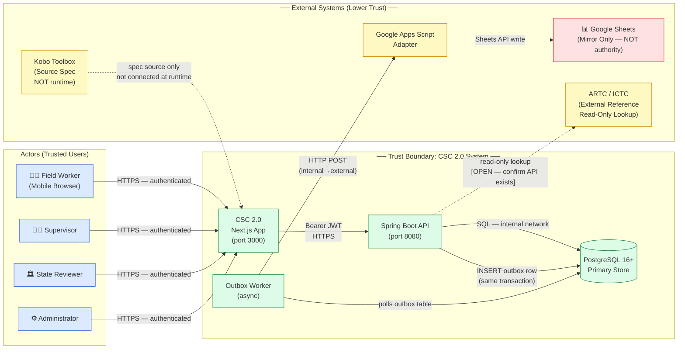

**Trust boundary notes** `[PROPOSED]`:
- All inbound traffic from actors is authenticated via JWT before any data access.
- Google Sheets sits **outside** the trust boundary — writes flow one-way outward only; Sheets can never write back to PostgreSQL.
- ARTC/ICTC integration is a read-only lookup; the authority for client data remains PostgreSQL. `[OPEN — confirm ARTC has a machine-readable API]`
- Kobo Toolbox is the **specification source** for the XLSForm; it is not connected at runtime.

---

## 2. Container Diagram

> [!NOTE]
> Shows internal containers, their responsibilities, technology, and trust levels. [PROPOSED]

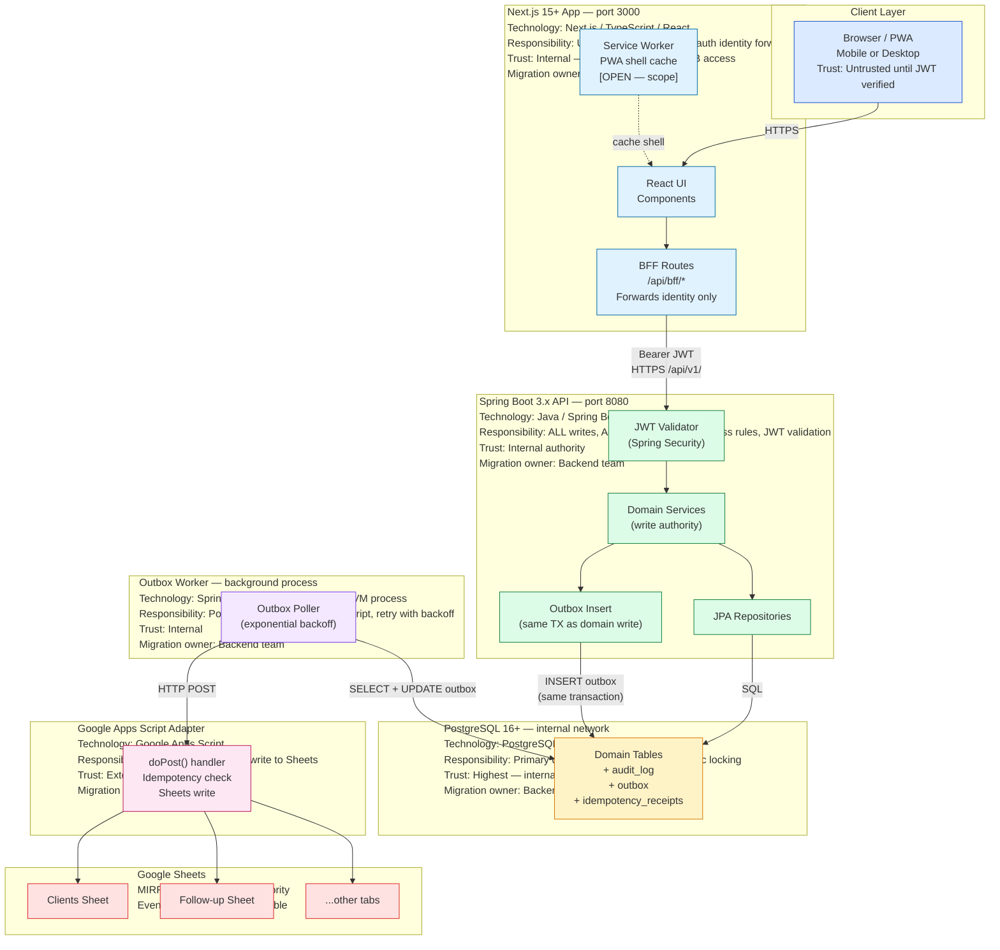

---

## 3. Responsibilities Matrix

### 3.1 Next.js App (port 3000)

| Aspect | Detail |
|---|---|
| **Owns** | UI rendering, routing, form UX, local draft state (IndexedDB), service worker cache shell, BFF proxy routes |
| **Does NOT own** | Business logic, validation rules, data writes, JWT issuance, database access |
| **Writer** | Frontend team |
| **Migration owner** | Frontend team (no DB migrations) |
| **Trust level** | Internal — but treated as untrusted for API calls (JWT required) |

### 3.2 Spring Boot API (port 8080)

| Aspect | Detail |
|---|---|
| **Owns** | ALL business rules, ALL writes, ALL validation, JWT validation, optimistic locking enforcement, audit log, outbox inserts, idempotency enforcement |
| **Does NOT own** | UI rendering, Sheets writes (delegated to outbox worker), ABHA/ARTC external auth |
| **Writer** | Backend team |
| **Migration owner** | Backend team (Flyway for all schema migrations) |
| **Trust level** | Highest internal authority |

### 3.3 PostgreSQL 16+

| Aspect | Detail |
|---|---|
| **Owns** | Persistence, ACID guarantees, Row-Level Security (RLS) by role, referential integrity |
| **Does NOT own** | Business logic, presentation, Sheets sync |
| **Writer** | Spring Boot API only (never Next.js directly, never Apps Script) |
| **Migration owner** | Backend team via Flyway |
| **Trust level** | Highest — internal network only, never exposed to internet |

### 3.4 Outbox Worker

| Aspect | Detail |
|---|---|
| **Owns** | Polling outbox table, dispatching to Apps Script, retry with exponential backoff, marking outbox rows sent/failed |
| **Does NOT own** | Business logic, Sheets schema, PostgreSQL schema changes |
| **Writer** | Backend team |
| **Migration owner** | Backend team |
| **Trust level** | Internal |

### 3.5 Google Apps Script Adapter

| Aspect | Detail |
|---|---|
| **Owns** | Receiving HTTP POST from outbox worker, idempotency check within Sheets, writing to correct Sheets tab |
| **Does NOT own** | Any data authority, business validation, writes back to PostgreSQL |
| **Writer** | Ops / Sheets admin |
| **Migration owner** | Ops / Sheets admin |
| **Trust level** | External — bounded adapter, one-way write |

### 3.6 Google Sheets

| Aspect | Detail |
|---|---|
| **Owns** | Reporting convenience, human-readable mirror of data for supervisors/reviewers |
| **Does NOT own** | Authority over any data; Sheets data may lag behind PostgreSQL |
| **Writer** | Google Apps Script only (via outbox worker) |
| **Migration owner** | Ops / Sheets admin |
| **Trust level** | External, lowest trust — mirror only |

---

## 4. Data Model — Entity Relationship Diagram

> [!IMPORTANT]
> All repeating groups from XLSForm are modelled as separate tables — never as flat JSON columns on the client row. `[SOURCE]` from XLSForm repeats: b2_members, d5_referrals, i_updates, j5_plan.

```mermaid
erDiagram
    users {
        uuid id PK
        varchar email
        varchar name
        varchar role
        jsonb geographic_scope_json
        jsonb programme_scope_json
        boolean active
        timestamptz created_at
    }

    clients {
        uuid id PK
        varchar csc_id
        varchar abha_id
        varchar name
        integer age
        varchar gender
        boolean consent_home_visit
        varchar artc_code
        varchar csc_code
        varchar clh_code
        varchar client_type
        varchar kp_typology
        varchar a13_client_type
        integer version
        timestamptz created_at
        timestamptz updated_at
        uuid created_by FK
        timestamptz deleted_at
    }

    addresses {
        uuid id PK
        uuid client_id FK
        varchar address_type
        varchar door
        varchar street
        varchar village
        varchar block
        varchar district
        varchar state
        varchar pin
        varchar phone
        date addr_verified_on
        date phone_verified_on
    }

    family_members {
        uuid id PK
        uuid client_id FK
        varchar name
        varchar relation
        integer age
        varchar gender
        varchar living_status
        varchar hiv_status
        date hiv_test_date
        integer cd4_count
        integer viral_load
        varchar art_status
        varchar id_type
        varchar id_no
        boolean at_csc
        varchar csc_id
    }

    clinical_baseline {
        uuid id PK
        uuid client_id FK
        boolean hiv_confirmed
        date confirm_date
        varchar ictc_pid
        varchar route_of_transmission
        varchar artc_name
        varchar artc_type
        date preart_date
        varchar art_status
        date art_date
        varchar regimen_at_reg
        varchar current_regimen
        numeric height_cm
        numeric weight_kg
        numeric muac_cm
        integer who_stage
        boolean cd4_done
        date cd4_date
        integer cd4_count
        numeric cd4_pct
        boolean vl_done
        date vl_date
        integer vl_count
        boolean tb_history
        date tb_confirm_date
        boolean att_started
        date att_date
        varchar tb_status
        date tb_complete_date
        boolean tb_family_history
    }

    risk_profile {
        uuid id PK
        uuid client_id FK
        boolean in_sex_work
        boolean on_ost
        boolean nsep_registered
        varchar ost_type
        boolean condom_knowledge
        boolean condom_casual
        boolean condom_regular
        boolean condom_paid
        boolean substance_smoking
        boolean substance_oral
        boolean substance_chewing
        boolean substance_alcohol
        boolean substance_injecting
        boolean has_diabetes
        text diabetes_details
        boolean has_htn
        text htn_details
    }

    stigma_records {
        uuid id PK
        uuid client_id FK
        boolean faced_discrimination
        text discrimination_sources
    }

    disability_records {
        uuid id PK
        uuid client_id FK
        boolean has_disability
        text disability_types
        boolean has_certificate
        boolean receives_benefit
        varchar benefit_scheme
    }

    death_records {
        uuid id PK
        uuid client_id FK
        date date_of_death
        varchar reason
        text reason_other
        date info_received_date
        boolean reported_to_artc
        date artc_death_date
        varchar place_of_death
        text place_other
        boolean was_in_lfu
        boolean certificate_available
        text remarks
    }

    social_protection {
        uuid id PK
        uuid client_id FK
        boolean ever_linked
        text services_availed
        boolean has_entitlement_docs
        text docs_held
        boolean assessment_done
        boolean willing_referred
    }

    scheme_referrals {
        uuid id PK
        uuid client_id FK
        varchar scheme
        varchar entitlement
    }

    follow_up_visits {
        uuid id PK
        uuid client_id FK
        date visit_date
        varchar place
        varchar art_status
        varchar art_regimen
        integer cd4_count
        numeric cd4_pct
        numeric weight_kg
        numeric height_cm
        numeric muac_cm
        boolean sws_linked
        text sws_list
        text social_entitlements
        boolean faced_stigma
        boolean on_att
        text stigma_sources
    }

    planned_services {
        uuid id PK
        uuid client_id FK
        date planned_date
        varchar purpose
        varchar service_category
        text services
        varchar status
        date done_date
        varchar done_purpose
    }

    delivered_services {
        uuid id PK
        uuid client_id FK
        uuid planned_service_id FK
        uuid delivered_by FK
        date delivery_date
        varchar delivery_purpose
        text notes
        timestamptz recorded_at
    }

    document_declarations {
        uuid id PK
        uuid client_id FK
        varchar doc_type
        boolean declared_available
        date declaration_date
    }

    tasks {
        uuid id PK
        uuid client_id FK
        uuid assigned_to_user_id FK
        varchar task_type
        date due_date
        varchar status
        varchar priority
        timestamptz created_at
        timestamptz updated_at
        integer version
    }

    contact_attempts {
        uuid id PK
        uuid task_id FK
        uuid client_id FK
        uuid attempted_by FK
        date attempt_date
        time attempt_time
        varchar place
        varchar outcome
        text notes
        text next_action
        integer version
        timestamptz created_at
    }

    encounters {
        uuid id PK
        uuid task_id FK
        uuid client_id FK
        uuid worker_id FK
        date encounter_date
        varchar place
        varchar encounter_type
        integer duration_minutes
        text notes
        varchar outcome
        integer version
        timestamptz created_at
    }

    consents {
        uuid id PK
        uuid client_id FK
        varchar consent_type
        boolean granted
        timestamptz granted_on
        timestamptz withdrawn_on
        uuid recorded_by FK
        integer version
    }

    audit_log {
        uuid id PK
        varchar entity_type
        uuid entity_id
        varchar action
        uuid actor_id
        varchar actor_role
        jsonb old_value_json
        jsonb new_value_json
        uuid correlation_id
        timestamptz recorded_at
    }

    outbox {
        uuid id PK
        varchar aggregate_type
        uuid aggregate_id
        varchar event_type
        jsonb payload_json
        timestamptz created_at
        integer attempts
        timestamptz last_attempt_at
        varchar status
        uuid correlation_id
    }

    idempotency_receipts {
        uuid id PK
        varchar idempotency_key
        varchar endpoint
        varchar request_hash
        integer response_status
        jsonb response_body_json
        timestamptz created_at
        timestamptz expires_at
    }

    crf_verification {
        uuid id PK
        uuid client_id FK
        date checked_on
        varchar clh_name
        varchar coordinator_name
        text comments
        boolean dln_registered
        varchar dln_name
        integer version
    }

    clients ||--o{ addresses : "has"
    clients ||--o{ family_members : "b2_members repeat"
    clients ||--|| clinical_baseline : "has"
    clients ||--|| risk_profile : "has"
    clients ||--o{ stigma_records : "has"
    clients ||--o{ disability_records : "has"
    clients ||--o| death_records : "has"
    clients ||--|| social_protection : "has"
    clients ||--o{ scheme_referrals : "d5_referrals repeat"
    clients ||--o{ follow_up_visits : "i_updates repeat"
    clients ||--o{ planned_services : "j5_plan repeat"
    clients ||--o{ delivered_services : "explicit delivered service"
    planned_services ||--o| delivered_services : "completed by explicit delivery"
    clients ||--o{ document_declarations : "NOT files"
    clients ||--o{ tasks : "assigned"
    clients ||--o{ contact_attempts : "logged for"
    clients ||--o{ encounters : "recorded for"
    clients ||--o{ consents : "granted by"
    clients ||--o| crf_verification : "verified by"
    tasks ||--o{ contact_attempts : "attempt under"
    tasks ||--o{ encounters : "encounter under"
    users ||--o{ tasks : "assigned to"
    users ||--o{ contact_attempts : "attempted by"
    users ||--o{ encounters : "conducted by"
    users ||--o{ consents : "recorded by"
    clients }o--|| users : "created by"
```

### 4.1 Key Data Model Notes

| Entity | Source | Notes |
|---|---|---|
| `family_members` | `[SOURCE]` b2_members XLSForm repeat | Never flatten into clients table |
| `scheme_referrals` | `[SOURCE]` d5_referrals repeat — triggered when d4_willing='yes' | Separate table |
| `follow_up_visits` | `[SOURCE]` i_updates repeat — triggered when a13_client_type='2' | Separate table |
| planned_services | [SOURCE] j5_plan repeat | Separate table; planned ≠ delivered |
| delivered_services | [PROPOSED] | Explicit delivered-service record; j5_done_date alone NEVER changes service status |
| `document_declarations` | `[SOURCE]` j_doc_hiv, j_doc_addr, j_doc_art | YES/NO declaration only — NOT actual file storage |
| `contact_attempts` | `[PROPOSED]` | Distinct from encounters — attempt ≠ encounter |
| `outbox` | `[PROPOSED]` | Outbox pattern for Sheets sync |
| `idempotency_receipts` | `[PROPOSED]` | Replay-safe for 24 hours |
| `audit_log` | `[PROPOSED]` | Inserted in same transaction as domain write |

### 4.2 Calculated Fields (Application Layer, Not Stored)

> `[SOURCE]` from XLSForm calculated fields — computed at query time, not stored as columns:

| Field | Formula |
|---|---|
| `b3_total_plhiv` | COUNT of family_members WHERE hiv_status = '1' |
| `b4_total_ictc` | COUNT of family_members eligible for ICTC (per XLSForm logic) |
| `ctx_banner` | Display name composed from client fields |
| `b2_f_plhiv` | Female PLHIV count among family_members |
| `b2_f_ictc` | Female ICTC-eligible count among family_members |

### 4.3 Metadata Fields

> `[SOURCE]` XLSForm metadata: `start`, `end`, `deviceid` — observation date ≠ recorded timestamp

All mutable domain entities carry:
- `created_at` — server timestamp of first INSERT (recorded timestamp)
- `updated_at` — server timestamp of last UPDATE
- `observation_date` (where applicable) — date the field event actually occurred `[SOURCE]`
- `deviceid` — captured for audit provenance `[SOURCE]`

---

## 5. Transaction Design

> `[PROPOSED]` All transaction rules below. No distributed transactions.

### 5.1 Optimistic Locking

```
Every mutable entity table has:
  version INTEGER NOT NULL DEFAULT 0

On UPDATE:
  WHERE id = :id AND version = :expected_version
  SET version = version + 1, ...

If 0 rows affected → return HTTP 409 Conflict
```

- Entities with `version`: `clients`, `tasks`, `contact_attempts`, `encounters`, `consents`, `crf_verification`, `outbox`
- `audit_log`, `outbox` entries are immutable (INSERT only)

### 5.2 Idempotency

- All `POST` and `PATCH` endpoints accept `Idempotency-Key: <uuid>` header `[PROPOSED]`
- On receipt: check `idempotency_receipts` for matching key + endpoint
- If found and not expired: return stored response (do not re-execute)
- If not found: execute, store response in `idempotency_receipts`, set `expires_at = NOW() + 24h`
- If found and `status = processing`: return `HTTP 409` with retry hint

### 5.3 Atomic Audit + Outbox

```
BEGIN TRANSACTION;
  -- 1. Domain write (INSERT / UPDATE domain table)
  UPDATE clients SET ... WHERE id = :id AND version = :v;
  
  -- 2. Audit log (always, same transaction)
  INSERT INTO audit_log (entity_type, entity_id, action, actor_id, actor_role,
                         old_value_json, new_value_json, correlation_id, recorded_at)
  VALUES (...);
  
  -- 3. Outbox entry (always, same transaction)
  INSERT INTO outbox (aggregate_type, aggregate_id, event_type, payload_json,
                      created_at, status, correlation_id)
  VALUES (..., 'pending', ...);
COMMIT;
```

- If any step fails → entire transaction rolls back
- No partial audit entries; no orphaned outbox rows
- Apps Script side is eventually consistent — this is acceptable `[PROPOSED]`

### 5.4 No Distributed Transactions

- Spring Boot + PostgreSQL is the single authority `[PROPOSED]`
- The Sheets mirror is updated asynchronously via the outbox
- Sheets data may be seconds to minutes behind PostgreSQL — this is by design `[PROPOSED]`

### 5.5 Soft Deletes

- Beneficiary data is NEVER hard-deleted `[PROPOSED]`
- Set `deleted_at = NOW()` on the `clients` row
- All queries must filter `WHERE deleted_at IS NULL`
- Cascade soft-delete to child tables `[OPEN — confirm cascade policy]`
- Retention period: `[OPEN — 2 years proposed; needs formal policy decision]`

---

## 6. API Conventions

### 6.1 Base Path and Versioning

```
Base path: /api/v1/
Versioning: URL path segment — /v1/, /v2/
Header versioning: NOT used [PROPOSED — see ADR-005]
```

### 6.2 Standard Endpoints Pattern

```
GET    /api/v1/clients                  → paginated list
POST   /api/v1/clients                  → create
GET    /api/v1/clients/{id}             → single record
PATCH  /api/v1/clients/{id}             → partial update (requires version)
DELETE /api/v1/clients/{id}             → soft delete

GET    /api/v1/clients/{id}/family-members
POST   /api/v1/clients/{id}/family-members
...
```

### 6.3 Pagination

```
Cursor-based [PROPOSED — see ADR-008]:

Request:  GET /api/v1/clients?after_id=<uuid>&limit=50
Response: {
  "data": [...],
  "pagination": {
    "has_more": true,
    "next_cursor": "<uuid of last item>",
    "limit": 50
  }
}

Maximum limit: 100
Default limit: 25 [PROPOSED]
```

### 6.4 Error Model

```json
{
  "status": 409,
  "code": "OPTIMISTIC_LOCK_CONFLICT",
  "message": "The record was modified by another user. Please reload and retry.",
  "details": [
    {
      "field": "version",
      "expected": 3,
      "actual": 4
    }
  ],
  "correlation_id": "550e8400-e29b-41d4-a716-446655440000",
  "timestamp": "2026-11-02T07:19:41Z"
}
```

**Standard machine-readable error codes** `[PROPOSED]`:

| HTTP Status | Code | Meaning |
|---|---|---|
| 400 | `VALIDATION_ERROR` | Field-level validation failure |
| 401 | `UNAUTHENTICATED` | Missing or invalid JWT |
| 403 | `UNAUTHORIZED` | JWT valid but role insufficient |
| 404 | `NOT_FOUND` | Resource does not exist |
| 409 | `OPTIMISTIC_LOCK_CONFLICT` | version mismatch |
| 409 | `IDEMPOTENCY_CONFLICT` | Request still processing |
| 422 | `BUSINESS_RULE_VIOLATION` | Valid format, invalid state transition |
| 429 | `RATE_LIMITED` | Too many requests |
| 500 | `INTERNAL_ERROR` | Unexpected server error |
| 503 | `SERVICE_UNAVAILABLE` | Downstream unavailable |

### 6.5 Correlation IDs

- Inbound: read `X-Correlation-ID` header from client; if absent, generate UUID
- Propagate through: Next.js BFF → Spring Boot → audit_log → outbox → Apps Script (as payload field)
- Log correlation ID at every hop
- Return `X-Correlation-ID` in all responses

### 6.6 Authentication

```
Authorization: Bearer <JWT>
```

- JWT issued by: `[OPEN — confirm identity provider: Keycloak? Supabase Auth? custom?]`
- Next.js BFF forwards the JWT header verbatim to Spring Boot `[PROPOSED]`
- Spring Boot validates JWT signature and extracts claims (user ID, role, geographic scope)
- No business logic in Next.js BFF

### 6.7 Request Headers Summary

| Header | Required | Description |
|---|---|---|
| `Authorization` | Yes | `Bearer <JWT>` |
| `Idempotency-Key` | For mutating requests | UUID v4, client-generated |
| `X-Correlation-ID` | Recommended | UUID v4 for tracing |
| `Content-Type` | Yes for POST/PATCH | `application/json` |

---

## 7. Sequence Diagrams

### 7a. Record Contact Attempt — Success Path

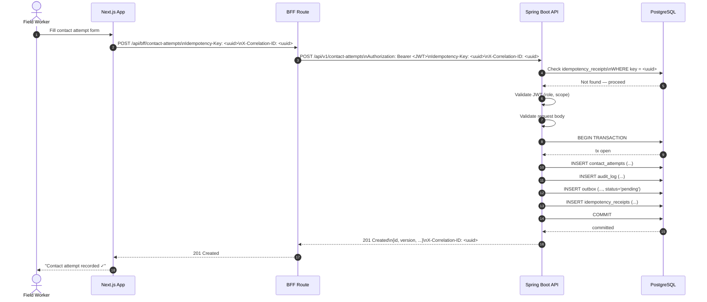

### 7b. Record Contact Attempt — Conflict (Version Mismatch 409)

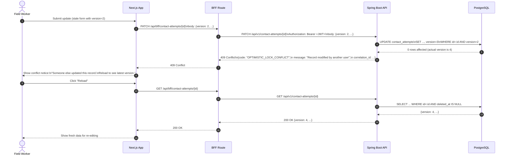

### 7c. Outbox Retry — Apps Script Outage (Exponential Backoff)

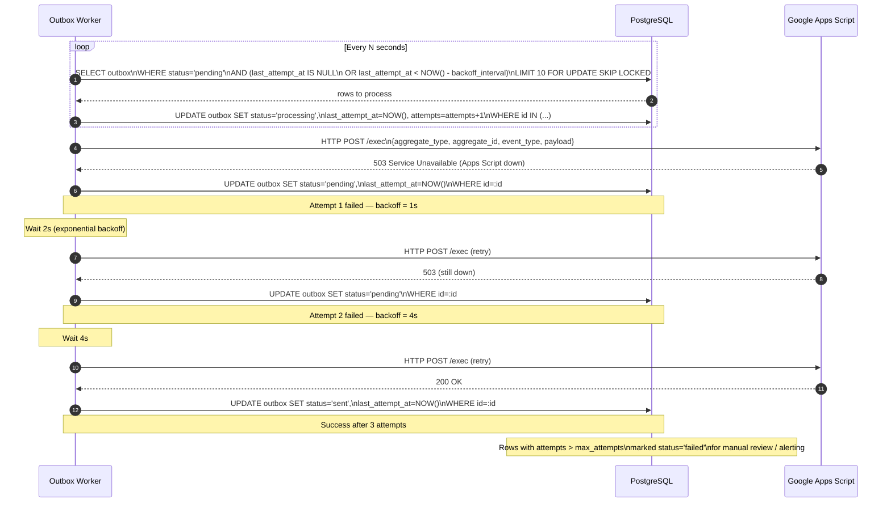

### 7d. Record Encounter — Success Path

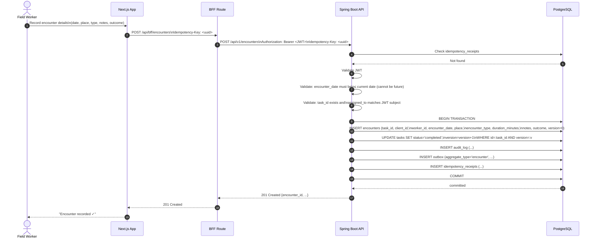

### 7e. BFF Forwards Identity to Spring Boot

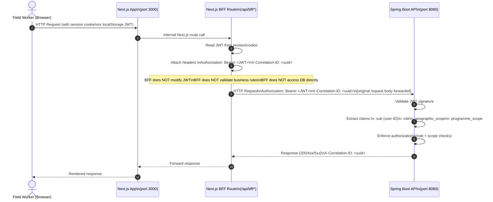

---

## 8. Integration — Sheets Mirror

> [!WARNING]
> Google Sheets is NEVER the authority for any data. Writes flow **one-way**: PostgreSQL → Outbox Worker → Apps Script → Sheets. **No path exists or should ever exist for Sheets to write back to PostgreSQL.** `[PROPOSED]`

### 8.1 Mirror Architecture

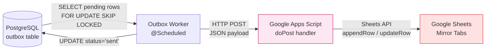

### 8.2 Apps Script Constraints `[UNVERIFIED — verify before implementation]`

| Constraint | Known Value | Status |
|---|---|---|
| Maximum execution time per invocation | ~6 minutes | `[UNVERIFIED]` |
| Quota: UrlFetchApp calls/day | ~20,000 | `[UNVERIFIED]` |
| Quota: Sheets API calls/day | ~50,000 read / ~10,000 write | `[UNVERIFIED]` |
| Authorization header access in doPost | `[OPEN — verify doPost receives Authorization header from UrlFetchApp vs. web app deployment mode]` | `[OPEN]` |
| Web app deployment mode | Execute as: Me vs. User | `[OPEN — affects auth model]` |

### 8.3 Outbox Worker Retry Policy `[PROPOSED]`

| Attempt | Wait Before Retry |
|---|---|
| 1st failure | 1 second |
| 2nd failure | 2 seconds |
| 3rd failure | 4 seconds |
| 4th failure | 8 seconds (max backoff) |
| After max_attempts | Mark status='failed', alert ops |

```
max_attempts: 5 [PROPOSED — configurable via environment variable]
```

### 8.4 Idempotency in Apps Script

- Outbox `id` (UUID) included in payload
- Apps Script checks a "processed IDs" log in Sheets (or a dedicated tab) before writing
- If already processed: return 200 without writing (idempotent replay)

### 8.5 Reconciliation `[OPEN]`

> Daily reconciliation job: diff PostgreSQL data vs. Sheets tabs, report discrepancies.
> Implementation approach, schedule, and alerting channel: `[OPEN — owner to define]`

### 8.6 What Sheets Contains

| Sheets Tab | Source PostgreSQL Table |
|---|---|
| Clients | clients (summary view) |
| Family Members | family_members |
| Follow-up Visits | follow_up_visits |
| Scheme Referrals | scheme_referrals |
| Tasks | tasks |
| Planned Services | planned_services |

---

## 9. Offline Boundary

> [!NOTE]
> CSC 2.0 must support field workers operating in areas with intermittent connectivity. `[ASSUMPTION]`

### 9.1 PWA / Service Worker

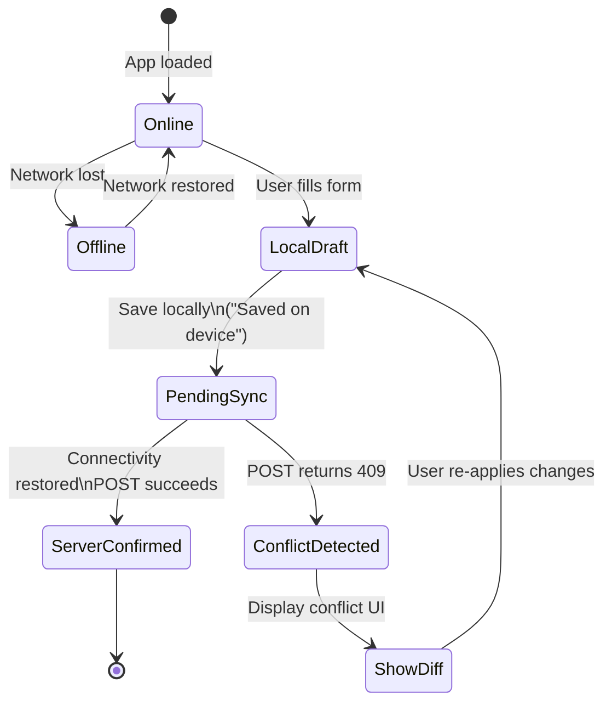

- Service Worker caches: UI shell (HTML/CSS/JS bundles), last-fetched worklist (read-only)
- Scope: `[OPEN — confirm exact offline scope: worklist read-only? or full form submission?]`

### 9.2 Local Draft Storage

- Local drafts stored in **IndexedDB** (or in-memory queue as fallback) `[PROPOSED]`
- Draft state machine:

| State | UI Indicator | Meaning |
|---|---|---|
| `draft` | 📝 "Saved on device" | Stored locally, not sent |
| `pending_sync` | 🔄 "Waiting to sync..." | Queued for submission |
| `syncing` | ⏳ "Syncing..." | HTTP request in flight |
| `confirmed` | ✅ "Confirmed by server" | Server returned 201/200 |
| `conflict` | ⚠️ "Conflict — please review" | Server returned 409 |
| `error` | ❌ "Sync failed" | Non-409 error from server |

> **Local draft ≠ server acceptance**: UI must always show distinct states. Never conflate "saved locally" with "confirmed by server." `[PROPOSED]`

### 9.3 Conflict Resolution

- **Server version always wins** `[PROPOSED]`
- On 409 from server: fetch current server version, display diff to user
- User must explicitly review and re-submit
- Do NOT silently overwrite server data with local draft

---

## 10. Deployment Topology

### 10.1 Option Evaluation

| Option | Description | Cost | Complexity | Backup | SSL | CI/CD | Verdict |
|---|---|---|---|---|---|---|---|
| **A** | Single VPS — Next.js + Spring Boot + PostgreSQL on one VM | Lowest (\$5–10/mo) | Low | Manual or cron | Certbot | GitHub Actions SSH deploy | Viable for MVP `[ASSUMPTION]` |
| **B** | Separate VPS per tier | Low–Medium | Medium | Per-service strategy | Certbot each | More pipelines | Overkill for current scale |
| **C** | PaaS (Render/Railway) per service | Free tier + usage | Low | Managed (Render/Railway) | Included | Native integration | Good balance `[PROPOSED preferred]` |
| **D** | Containerized on VPS (Docker Compose) | Low (\$10–20/mo) | Medium | Volume backups | Traefik/Certbot | Docker Compose pull | Good for reproducibility |
| **E** | Managed PostgreSQL + PaaS app servers | Medium | Low–Medium | Managed daily snapshots | Included | Native integration | Best operational safety |

> `[OPEN — owner to select deployment option before infrastructure provisioning]`
> `[ASSUMPTION — no paid resources committed yet; free tier preferred for initial deployment]`

### 10.2 Environments

| Environment | Purpose | Data | Access |
|---|---|---|---|
| `local` | Developer workstation | Synthetic / anonymized | Developer only |
| `staging` | Integration testing, UAT | Synthetic data only — no real PII | Team + testers |
| `production` | Live system | Real beneficiary data — PII | Authenticated users only |

> `[PROPOSED]` — staging must never contain real PII.

### 10.3 Configuration Management

- All configuration via **environment variables only** — never hardcoded `[PROPOSED]`
- Secret names and required variables catalogued in `DOC-03` (Security and Access Document) `[OPEN — verify against DOC-03 §5 Secrets inventory]`
- Required environment variables (non-exhaustive):

```
# Spring Boot
DATABASE_URL
DATABASE_USERNAME
DATABASE_PASSWORD
JWT_PUBLIC_KEY (or JWKS_URI)
OUTBOX_WORKER_INTERVAL_MS
OUTBOX_MAX_ATTEMPTS
APPS_SCRIPT_WEBHOOK_URL
APPS_SCRIPT_AUTH_TOKEN

# Next.js
NEXT_PUBLIC_API_BASE_URL
NEXTAUTH_SECRET (if using NextAuth)
NEXTAUTH_URL
```

### 10.4 CI/CD Pipeline (Proposed)

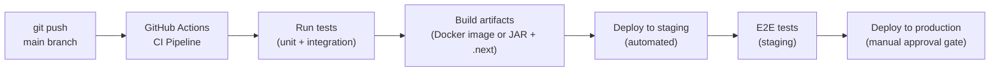

---

## 11. Non-Functional Requirements

> All entries below are hypotheses / targets — not guaranteed SLAs until measured. `[ASSUMPTION]`

| NFR | Target | Basis | Status |
|---|---|---|---|
| API p95 response time | ≤ 500ms under 50 concurrent users | Reasonable for CRUD workload | `[ASSUMPTION — baseline not measured]` |
| Page Time to Interactive (TTI) | ≤ 3s on 4G connection | Mobile field worker scenario | `[ASSUMPTION]` |
| PostgreSQL client rows (test scenario) | 15,000 rows | Scale estimate for pilot | `[ASSUMPTION — not a hard architectural limit]` |
| System availability | 99% uptime during 8am–8pm IST working hours | Working-hours SLA | `[PROPOSED]` |
| Audit log retention | 2 years | Proposed; needs policy decision | `[OPEN]` |
| Soft-delete retention | `[OPEN]` | Needs legal/policy input | `[OPEN]` |
| API rate limiting | `[OPEN — define limits per role]` | Prevent abuse | `[OPEN]` |
| Session timeout | `[OPEN — 30 min idle proposed]` | Security | `[OPEN]` |
| Maximum file size (document uploads — future) | `[OPEN]` | Object storage not yet provisioned | `[OPEN]` |

---

## 12. Architecture Decision Records

### ADR-001: Spring Boot as Authority (Not Next.js BFF)

| Field | Value |
|---|---|
| **ID** | ADR-001 |
| **Title** | Spring Boot as the sole write authority |
| **Status** | Accepted |
| **Date** | 2026-11-02 |

**Context**: The system requires strong data validation, business rule enforcement, and audit logging. Two architectural options exist: place business logic in the Next.js BFF layer (Node.js), or in a dedicated Spring Boot service.

**Decision**: Spring Boot 3.x is the **sole authority** for all writes, all validation, and all business rules. The Next.js BFF is a **thin proxy** that forwards identity (JWT) and routes requests — it contains zero business logic and has no direct database access.

**Consequences**:
- ✅ Clear single authority — no risk of split brain between BFF and API
- ✅ Java ecosystem has mature transaction management, JPA, Spring Security
- ✅ BFF can be replaced or scaled independently
- ⚠️ Two runtimes to deploy and maintain (Node.js + JVM)
- ⚠️ BFF adds one network hop for all requests

**Alternatives Considered**:
- Next.js API routes as full backend: rejected — mixes concerns, harder to audit, no JPA transaction management
- GraphQL gateway: rejected — unnecessary complexity for current scale

---

### ADR-002: PostgreSQL as Primary Store (Not Sheets or SQLite)

| Field | Value |
|---|---|
| **ID** | ADR-002 |
| **Title** | PostgreSQL 16+ as primary relational store |
| **Status** | Accepted |
| **Date** | 2026-11-02 |

**Context**: Data includes multiple related repeating groups (family members, referrals, follow-ups, planned services), requires ACID transactions, row-level security, and audit logging. Alternatives considered include Google Sheets as primary store and SQLite.

**Decision**: PostgreSQL 16+ is the primary store. All entities are properly normalized. Flyway manages migrations.

**Consequences**:
- ✅ Full ACID — critical for version-locked optimistic concurrency
- ✅ Row-level security (RLS) for multi-role access control
- ✅ Mature tooling: pgAdmin, pg_dump, Flyway
- ✅ Can store JSON (jsonb) for flexible audit payloads
- ⚠️ Requires managed PostgreSQL or self-hosted VM
- ⚠️ More operational overhead than SQLite

**Alternatives Considered**:
- Google Sheets as primary: rejected — no transactions, no referential integrity, quota limits, not suitable for 15,000+ client records
- SQLite: rejected — no concurrent multi-user writes, no RLS, not suitable for server deployment
- MongoDB: rejected — no strong ACID multi-document transactions in prior versions; relational model fits the domain

---

### ADR-003: Sheets as Async Mirror Only (Not Authority)

| Field | Value |
|---|---|
| **ID** | ADR-003 |
| **Title** | Google Sheets is a reporting mirror — never a data authority |
| **Status** | Accepted |
| **Date** | 2026-11-02 |

**Context**: Stakeholders use Google Sheets for reporting and supervisory review. Previous documentation contained contradictions about whether Sheets could be a write source. This ADR resolves the contradiction definitively.

**Decision**: Google Sheets is a **read-only mirror** of PostgreSQL data, updated asynchronously via the outbox pattern. No process shall ever write from Sheets back to PostgreSQL. Eventual consistency in Sheets is acceptable.

**Consequences**:
- ✅ Single source of truth (PostgreSQL) eliminates data conflicts
- ✅ Sheets outages do not affect system availability
- ✅ Supervisors can use familiar Sheets UI for reporting without risk
- ⚠️ Sheets may lag behind PostgreSQL by seconds to minutes
- ⚠️ Reconciliation process needed to detect/alert on persistent discrepancies

**Alternatives Considered**:
- Sheets as primary with PostgreSQL as mirror: rejected — Sheets has no ACID, no referential integrity, quota limitations
- Bidirectional sync: rejected — conflict resolution complexity is prohibitive; no clear winner in a conflict

---

### ADR-004: Outbox Pattern for Sheets Sync (Not Direct API Call)

| Field | Value |
|---|---|
| **ID** | ADR-004 |
| **Title** | Outbox pattern for reliable Sheets synchronisation |
| **Status** | Accepted |
| **Date** | 2026-11-02 |

**Context**: Sheets mirror must be kept reasonably up to date. Options: (a) call Apps Script directly in the Spring Boot transaction, (b) call Apps Script after commit, (c) outbox pattern with a background worker.

**Decision**: Use the **outbox pattern**. Every domain write inserts an outbox row in the same PostgreSQL transaction. A background worker polls the outbox and dispatches to Apps Script with exponential backoff retry.

**Consequences**:
- ✅ No lost events — outbox row committed atomically with domain data
- ✅ Apps Script outages do not fail domain writes
- ✅ Retry is durable — survives worker restarts
- ⚠️ Additional complexity: outbox table, worker process, monitoring
- ⚠️ Eventual consistency — Sheets may lag

**Alternatives Considered**:
- Direct synchronous call in transaction: rejected — Apps Script latency (~200–2000ms) extends transaction time; Apps Script downtime causes write failures
- Direct call after commit (no outbox): rejected — if call fails after commit, event is lost permanently
- Message queue (RabbitMQ, Kafka): rejected — adds infrastructure complexity not warranted at current scale (see Architecture Rules: no Kafka unless measured need shown)

---

### ADR-005: URL-Path Versioning for API

| Field | Value |
|---|---|
| **ID** | ADR-005 |
| **Title** | API versioned via URL path segment (/v1/, /v2/) |
| **Status** | Accepted |
| **Date** | 2026-11-02 |

**Context**: API versioning is necessary to support non-breaking evolution. Options: URL path, Accept header, custom header.

**Decision**: Version in URL path: `/api/v1/`, `/api/v2/`. Header versioning is NOT used.

**Consequences**:
- ✅ Explicit, cacheable, easy to test with curl and browser
- ✅ No header negotiation complexity
- ✅ Easy to route at load balancer/reverse proxy level
- ⚠️ Clients must update URLs on major version change
- ⚠️ Cannot serve multiple versions of same resource at same URL

**Alternatives Considered**:
- Accept header versioning (`Accept: application/vnd.csc.v2+json`): rejected — harder to test, harder to cache, confusing for non-expert consumers
- Custom header (`X-API-Version`): rejected — non-standard, not visible in browser address bar

---

### ADR-006: Optimistic Locking with Version Column

| Field | Value |
|---|---|
| **ID** | ADR-006 |
| **Title** | Optimistic locking via integer version column on all mutable entities |
| **Status** | Accepted |
| **Date** | 2026-11-02 |

**Context**: Multiple field workers may edit the same client record concurrently. Conflict detection is required. Options: pessimistic locking (SELECT FOR UPDATE), optimistic locking (version column), last-write-wins (no conflict detection).

**Decision**: Every mutable entity has a `version INTEGER NOT NULL DEFAULT 0` column. On UPDATE, the WHERE clause must match the expected version. If 0 rows affected, return HTTP 409 Conflict. JPA `@Version` annotation used in Spring Boot.

**Consequences**:
- ✅ No lock contention — reads are never blocked
- ✅ Scales well; appropriate for low-to-medium concurrency
- ✅ Conflict is surfaced immediately to the user for resolution
- ⚠️ Client must always include current version in PATCH requests
- ⚠️ High-frequency concurrent updates on same record will see frequent 409s

**Alternatives Considered**:
- Pessimistic locking: rejected — holds database locks for network round-trip duration; blocks other readers/writers; unacceptable for web workload
- Last-write-wins: rejected — silent data loss; unacceptable for medical/social data

---

### ADR-007: Soft Deletes for Beneficiary Data

| Field | Value |
|---|---|
| **ID** | ADR-007 |
| **Title** | Soft deletes (deleted_at timestamp) — never hard delete beneficiary records |
| **Status** | Accepted |
| **Date** | 2026-11-02 |

**Context**: Beneficiary data for HIV+ clients is sensitive and may be required for audit, legal compliance, or programme review. Hard deletion of records could violate retention obligations.

**Decision**: All beneficiary entities use `deleted_at TIMESTAMPTZ` for soft deletion. Hard deletes are prohibited. All queries filter `WHERE deleted_at IS NULL`. Audit log entries for deletions are retained regardless of deleted_at.

**Consequences**:
- ✅ No accidental permanent data loss
- ✅ Audit trail preserved for all "deleted" records
- ✅ Supports regulatory retention requirements
- ⚠️ Queries must always include soft-delete filter (enforce via JPA repository base class)
- ⚠️ Retention policy and eventual hard purge process must be defined `[OPEN]`

**Alternatives Considered**:
- Hard delete: rejected — irreversible; compliance risk; no audit trail
- Archive table: considered — adds complexity; soft delete is simpler and sufficient for current scale

---

### ADR-008: Cursor-Based Pagination (Not Offset)

| Field | Value |
|---|---|
| **ID** | ADR-008 |
| **Title** | Cursor-based pagination using after_id + limit |
| **Status** | Accepted |
| **Date** | 2026-11-02 |

**Context**: List endpoints for clients, tasks, and visits need pagination. Options: offset-based (`?page=3&size=25`), cursor-based (`?after_id=<uuid>&limit=25`), keyset pagination.

**Decision**: Cursor-based pagination using `after_id` (UUID of last item in previous page) and `limit` (max 100). Server returns `next_cursor` and `has_more` in pagination envelope.

**Consequences**:
- ✅ Consistent results — no skipped or duplicated rows when records are inserted/deleted between pages
- ✅ Performs well at scale — uses index seek rather than OFFSET scan
- ✅ Appropriate for 15,000-record test scenario `[ASSUMPTION]`
- ⚠️ Cannot jump to arbitrary page number (no "go to page 47")
- ⚠️ Requires stable sort order (use `id` or `created_at + id` as tiebreaker)

**Alternatives Considered**:
- Offset pagination: rejected — performance degrades at large offsets (`OFFSET 10000`); unstable results under concurrent inserts
- Total count in every response: `[PROPOSED — omit total count by default; add as opt-in header ?include_count=true if needed]`

---

## 13. Dependency / Version Matrix

| Component | Version | Source URL | Access Date | License | Notes |
|---|---|---|---|---|---|
| Next.js | 15.x (latest stable) | https://nextjs.org/docs | 2026-11-02 | MIT | App Router; TypeScript first `[PROPOSED]` |
| React | 19.x (bundled with Next 15) | https://react.dev | 2026-11-02 | MIT | Server Components used in App Router |
| TypeScript | 5.x | https://www.typescriptlang.org | 2026-11-02 | Apache-2.0 | Strict mode enabled `[PROPOSED]` |
| Spring Boot | 3.x (latest GA) | https://spring.io/projects/spring-boot | 2026-11-02 | Apache-2.0 | Java 21 LTS required |
| Java | 21 LTS | https://adoptium.net | 2026-11-02 | GPL+CE | LTS release `[PROPOSED]` |
| Spring Security | 6.x (via Spring Boot BOM) | https://spring.io/projects/spring-security | 2026-11-02 | Apache-2.0 | JWT/OAuth2 resource server |
| Spring Data JPA | 3.x (via Spring Boot BOM) | https://spring.io/projects/spring-data-jpa | 2026-11-02 | Apache-2.0 | Hibernate 6.x under the hood |
| Flyway | 10.x | https://flywaydb.org | 2026-11-02 | Apache-2.0 | SQL-based migrations `[PROPOSED]` |
| PostgreSQL | 16.x | https://www.postgresql.org | 2026-11-02 | PostgreSQL License | Primary store |
| PostgreSQL JDBC Driver | 42.7.x | https://jdbc.postgresql.org | 2026-11-02 | BSD-2-Clause | Matches PG 16 |
| HikariCP | 5.x (via Spring Boot BOM) | https://github.com/brettwooldridge/HikariCP | 2026-11-02 | Apache-2.0 | Connection pooling |
| Google Apps Script | N/A (platform) | https://developers.google.com/apps-script | 2026-11-02 | Google ToS | Bounded adapter only |
| Object Storage | Cloudflare R2 or MinIO | https://www.cloudflare.com/products/r2 / https://min.io | 2026-11-02 | Varies | Future — for actual document files `[OPEN]` |
| Tailwind CSS | 3.x or 4.x | https://tailwindcss.com | 2026-11-02 | MIT | UI styling `[PROPOSED]` |
| Zod | 3.x | https://zod.dev | 2026-11-02 | MIT | TypeScript schema validation in Next.js `[PROPOSED]` |
| Vitest / Jest | Latest | https://vitest.dev | 2026-11-02 | MIT | Frontend unit tests `[PROPOSED]` |
| JUnit 5 | 5.x (via Spring Boot BOM) | https://junit.org/junit5 | 2026-11-02 | EPL-2.0 | Backend unit + integration tests |
| Testcontainers | 1.x | https://testcontainers.com | 2026-11-02 | MIT | PostgreSQL in integration tests `[PROPOSED]` |

> `[UNVERIFIED]` — exact patch versions not pinned at architecture stage; pin in `pom.xml` / `package.json` at implementation time. Lock files (`yarn.lock`, `package-lock.json`, Maven wrapper) must be committed.

---

## 14. Self-Check — Unmet Instructions and Unverified Claims

### 14.1 Instructions Fulfilled ✅

| # | Requirement | Status |
|---|---|---|
| 1 | Document metadata (version, status, owners, changelog, ADR index) | ✅ Included |
| 2 | Context diagram (Mermaid flowchart LR) with actors, systems, trust boundaries | ✅ Included |
| 3 | Container diagram (Mermaid flowchart TD) with tech, responsibility, trust level | ✅ Included |
| 4 | Responsibilities matrix per component | ✅ Included |
| 5 | ERD (Mermaid erDiagram) for ALL specified entities | ✅ Included (24 entities) |
| 6 | Transaction design (optimistic locking, idempotency, atomic audit+outbox, soft deletes) | ✅ Included |
| 7 | API conventions (base path, versioning, pagination, error model, correlation IDs, auth) | ✅ Included |
| 8 | 5 sequence diagrams (contact attempt success, 409 conflict, outbox retry, encounter, BFF identity) | ✅ Included |
| 9 | Sheets mirror integration (constraints, retry, reconciliation, no write-back) | ✅ Included |
| 10 | Offline boundary (PWA, local draft, conflict resolution, state machine) | ✅ Included |
| 11 | Deployment topology options A–E with evaluation | ✅ Included |
| 12 | Non-functional requirements as hypotheses | ✅ Included |
| 13 | ADR-001 through ADR-008 (all 8 ADRs with full fields) | ✅ Included |
| 14 | Dependency/version matrix | ✅ Included |
| 15 | Self-check section | ✅ This section |
| 16 | Evidence tags on all design decisions | ✅ Applied throughout |

### 14.2 Open Items Requiring Owner Decision `[OPEN]`

| # | Item | Section | Owner |
|---|---|---|---|
| O-01 | Deployment option selection (A/B/C/D/E) | §11 | Infrastructure owner |
| O-02 | Identity provider for JWT issuance (Keycloak, Supabase Auth, custom) | §6.6 | Technical lead |
| O-03 | Soft-delete cascade policy for child tables | §5.5 | Data architect |
| O-04 | Audit log and soft-delete retention period (2 years proposed) | §12 | Legal/programme owner |
| O-05 | ARTC/ICTC machine-readable API existence and access | §1 | Integration owner |
| O-06 | Offline scope (worklist read-only vs. full form submission offline) | §9.1 | Product owner |
| O-07 | Apps Script web app deployment mode (execute as Me vs. User) | §8.2 | Ops / Sheets admin |
| O-08 | Reconciliation job for Sheets vs. PostgreSQL diff | §8.5 | Ops / Backend team |
| O-09 | DOC-03 (Security and Access Document) (secret names, environment variable catalogue) | §10.3 | Security lead |
| O-10 | API rate limiting limits per role | §12 | Backend team |
| O-11 | Session timeout duration | §12 | Security lead |
| O-12 | Object storage provider selection (R2 vs. MinIO) and provisioning timeline | §13 | Infrastructure owner |
| O-13 | Total count opt-in behaviour for paginated responses | ADR-008 | Backend team |

### 14.3 Unverified Claims `[UNVERIFIED]`

| # | Claim | Risk | Resolution |
|---|---|---|---|
| UV-01 | Apps Script execution time limit is ~6 minutes | Medium — if lower, retry design may need adjustment | Test with real Apps Script deployment |
| UV-02 | Apps Script quota: 20,000 UrlFetch calls/day | Medium — could bottleneck Sheets sync at scale | Verify in Google Workspace documentation |
| UV-03 | Apps Script doPost receives Authorization header from UrlFetchApp | High — if not, outbox worker auth to Apps Script must use different mechanism | Build proof-of-concept before relying on this |
| UV-04 | Exact patch versions for all dependencies in version matrix | Low — standard practice | Pin in pom.xml/package.json at implementation |

### 14.4 Assumptions to Validate `[ASSUMPTION]`

| # | Assumption | Section | Validation Method |
|---|---|---|---|
| A-01 | 15,000 client rows is the test scenario capacity target | §4, §12 | Confirm with programme team |
| A-02 | No paid infrastructure resources committed yet | §11 | Confirm with project sponsor |
| A-03 | p95 API response ≤ 500ms under 50 concurrent users is achievable | §12 | Load test after first deployment |
| A-04 | TTI ≤ 3s on 4G is achievable with Next.js App Router + code splitting | §12 | Lighthouse / WebPageTest measurement |
| A-05 | Field workers primarily use mobile browsers (not native apps) | §1, §9 | Confirm with field team |
| A-06 | Working hours are 8am–8pm IST for availability SLA | §12 | Confirm with programme team |

---

*End of Technical Architecture Document v0.1.0*

*All evidence tags: `[SOURCE]` from XLSForm/CRF, `[PROPOSED]` design decisions, `[ASSUMPTION]` working assumptions, `[OPEN]` needs owner decision, `[UNVERIFIED]` needs confirmation.*
