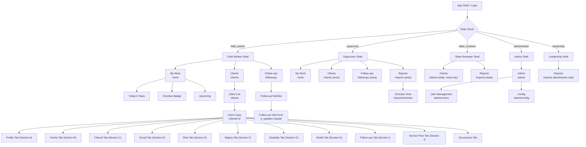

# 04 — Frontend Specification Document
## CSC 2.0 — Community Support Centre Follow-Up Platform

---

## 1. Document Metadata

| Field | Value |
|---|---|
| **Document ID** | DOC-04 |
| **Version** | v0.1.0 |
| **Status** | DRAFT |
| **Owner(s)** | TBD |
| **Created** | 2026-11-02 |
| **Last Updated** | 2026-11-02 |
| **Cross-references** | `MOBILE_DESIGN_SYSTEM_CONTRACT.md` (breakpoints, touch targets, typography tokens — do NOT duplicate here) |
| **Shared Glossary** | See `SHARED_GLOSSARY.md` (canonical terms, role codes, ID namespace) |

> [!NOTE]
> This document is the **canonical frontend specification** for CSC 2.0. All design decisions, screen contracts, and component choices must trace back to either a `[SOURCE]` (XLSForm / MOBILE_DESIGN_SYSTEM_CONTRACT.md), `[PROPOSED]` decision, `[ASSUMPTION]`, `[OPEN]` item, or `[UNVERIFIED]` claim. These tags are used throughout.

### Change Log

| Version | Date | Author | Summary |
|---|---|---|---|
| v0.1.0 | 2026-11-02 | TBD | Initial draft — full specification |

---

## 2. Information Architecture

### 2.1 Navigation Access by Role

| Nav Item | field_worker | supervisor | state_reviewer | administrator | leadership |
|---|---|---|---|---|---|
| **My Work** | ✅ (own scope) | ✅ (area scope) | ❌ | ❌ | ❌ |
| **Clients** | ✅ (own scope) | ✅ (area scope) | ✅ (read-only, state scope) | ❌ | ❌ |
| **Follow-ups** | ✅ (own clients) | ✅ (area clients) | ❌ | ❌ | ❌ |
| **Reports** | ❌ | ✅ (area) | ✅ (state) | ❌ | ✅ (dashboards only) |
| **Admin** | ❌ | ❌ | ❌ | ✅ | ❌ |

### 2.2 Navigation Hierarchy — Mermaid Flowchart



### 2.3 URL Route Map

| Route | Screen | Roles |
|---|---|---|
| `/` | Redirect to `/work` or `/clients` by role | All |
| `/work` | My Work — Worklist Dashboard | field_worker, supervisor |
| `/clients` | Client List | field_worker, supervisor, state_reviewer |
| `/clients/:id` | Client Case (tabbed) | field_worker, supervisor, state_reviewer |
| `/clients/:id/contact` | Record Contact Attempt | field_worker, supervisor |
| `/clients/:id/encounter` | Record Encounter | field_worker, supervisor |
| `/clients/:id/followup/new` | Follow-up Visit Form (i_updates) | field_worker, supervisor |
| `/clients/:id/followup/:visitId` | View / Edit Follow-up Visit | field_worker, supervisor |
| `/clients/:id/plan/new` | Plan Next Action (j5_plan) | field_worker, supervisor |
| `/clients/:id/plan/:planId` | View / Edit Plan Entry | field_worker, supervisor |
| `/followups` | Follow-up Worklist | field_worker, supervisor |
| `/reports` | Reports Dashboard | supervisor, state_reviewer, leadership |
| `/reports/overdue` | Supervisor Overdue View | supervisor |
| `/admin` | Admin Home | administrator |
| `/admin/users` | User Management | administrator |
| `/admin/config` | Configuration | administrator |

---

## 3. Screen Contracts

> **State definitions used throughout:**
> - **loading** — data fetch in flight; show skeleton UI
> - **empty** — fetch complete, zero records exist
> - **filtered-empty** — filters applied, zero matching records
> - **partial** — some data rendered, background fetches still running
> - **stale** — cached data shown, connectivity lost (banner visible)
> - **offline** — no connectivity, showing IndexedDB cache
> - **denied** — 403/404 from API; show friendly message, not raw error
> - **validation** — inline field errors on form fields
> - **conflict** — 409 version mismatch; show diff, prompt user
> - **retry** — network failure; show retry button
> - **local-saved** — saved to device queue, not yet sent to server
> - **server-accepted** — server confirmed receipt

---

### 3a. My Work — Worklist Dashboard

**Route:** `/work`

**Purpose:** Show field_worker / supervisor their task list for today, overdue items, and upcoming scheduled visits.

**Data Sources:**

| Endpoint | Description |
|---|---|
| `GET /api/v1/work/tasks?scope=self&status=overdue` | Overdue tasks for current user |
| `GET /api/v1/work/tasks?scope=self&status=today` | Today's tasks |
| `GET /api/v1/work/tasks?scope=self&status=upcoming` | Upcoming (next 7 days) |
| `GET /api/v1/work/tasks?scope=area&...` | Supervisor area scope variant |

**Actions:**

| Action | Trigger | Navigation |
|---|---|---|
| Open task | Tap task row | → `/clients/:id` or context form |
| Mark complete | Swipe / button on task row | Inline status update |
| Refresh | Pull-to-refresh gesture | Re-fetch all sections |

**Permissions:** field_worker (own scope), supervisor (area scope)

**State Handling:**

| State | UI Behaviour |
|---|---|
| **loading** | Skeleton cards in three sections (Overdue, Today, Upcoming) |
| **empty** | Illustration + bilingual message: "No tasks scheduled / कोई कार्य निर्धारित नहीं" |
| **filtered-empty** | N/A (no filters on this screen) |
| **partial** | Render loaded sections; skeleton for still-loading sections |
| **stale** | Yellow connectivity banner: "Showing cached data / कैश्ड डेटा दिखाया जा रहा है" |
| **offline** | Orange offline banner; data from IndexedDB; offline badge on tasks |
| **denied** | Friendly message: "Access restricted / पहुँच प्रतिबंधित है" with logout option |
| **retry** | Inline retry button per section on network failure |
| **local-saved** | Pending badge on task if associated form saved locally |
| **server-accepted** | Task marked with server-confirmed checkmark, green toast |
| **conflict** | N/A (read-only list) |
| **validation** | N/A (no form entry here) |

**Overdue Badge:** Red badge in top nav / My Work tab showing count of overdue tasks [PROPOSED].

---

### 3b. Client List

**Route:** `/clients`

**Purpose:** Searchable, filterable list of clients within the user's scope.

**Data Sources:**

| Endpoint | Description |
|---|---|
| `GET /api/v1/clients?scope=self&q=&page=&filters=` | Paginated client list |
| `GET /api/v1/clients/filters/meta` | Filter option metadata (districts, statuses, types) |

**Actions:**

| Action | Trigger | Navigation |
|---|---|---|
| Search | Text input (debounced 300ms) | Filter list inline |
| Open client | Tap row | → `/clients/:id` |
| Apply filters | Filter drawer / modal | Refresh list |
| Clear filters | Button | Restore unfiltered list |
| Add new client | FAB (field_worker/supervisor only) | → New client form [OPEN — route TBD] |

**Permissions:** field_worker (own), supervisor (area), state_reviewer (read-only, state)

**State Handling:**

| State | UI Behaviour |
|---|---|
| **loading** | Skeleton list rows (8 rows) |
| **empty** | "No clients found / कोई क्लाइंट नहीं मिला" + Add button if permitted |
| **filtered-empty** | "No results for these filters / इन फ़िल्टर के लिए कोई परिणाम नहीं" + Clear filters button |
| **partial** | First page rendered; pagination loader at bottom |
| **stale** | Connectivity banner; cached list shown |
| **offline** | Offline banner; IndexedDB list (last sync timestamp shown) |
| **denied** | "You don't have access to this client list / आपके पास इस सूची तक पहुँच नहीं है" |
| **retry** | Retry button below error state |
| **local-saved** | N/A (list is read; new entries show "Pending" chip) |
| **server-accepted** | N/A |
| **conflict** | N/A |
| **validation** | Search input: max-length hint if query too long |

**Filter Options [PROPOSED]:** Client type (`a13_client_type`), Follow-up status, District/Area, Last contact date range.

**Search:** Full-text on client name (English + Devanagari), client ID. Minimum 2 characters to trigger. [PROPOSED]

---

### 3c. Client Case — Tabbed Profile View

**Route:** `/clients/:id`

**Purpose:** Full case view across all 10 XLSForm sections [SOURCE] as tabs.

**Data Sources:**

| Endpoint | Description |
|---|---|
| `GET /api/v1/clients/:id` | Full client record |
| `GET /api/v1/clients/:id/family` | b2_members repeat |
| `GET /api/v1/clients/:id/referrals` | d5_referrals repeat |
| `GET /api/v1/clients/:id/followups` | i_updates repeat |
| `GET /api/v1/clients/:id/plan` | j5_plan repeat |
| `GET /api/v1/clients/:id/documents` | j_doc_* declarations |

**Tab Structure [SOURCE — 10 XLSForm sections]:**

| Tab Label (EN / HI) | Section | Notes |
|---|---|---|
| Profile / प्रोफाइल | A — Basic Profile | Core demographic, `a13_client_type` |
| Family / परिवार | B — Family | b2_members repeat — never flat columns |
| Clinical / क्लिनिकल | C — Clinical | Sensitive; role access TBD [OPEN] |
| Social / सामाजिक | D — Social | d5_referrals repeat |
| Risk / जोखिम | E — Risk | |
| Stigma / कलंक | F — Stigma | |
| Disability / विकलांगता | G — Disability | |
| Death / मृत्यु | H — Death | Conditionally visible [OPEN — condition TBD] |
| Follow-ups / अनुवर्ती | I — Follow-up visits | Visible if `a13_client_type='2'` [SOURCE] |
| Service Plan / सेवा योजना | J — Verification + Service Plan | j5_plan + j_doc_* (yes/no only, NOT file uploads) [SOURCE] |
| Documents / दस्तावेज़ | Supplementary | j_doc_* declarations display |

**Actions:**

| Action | Trigger | Roles |
|---|---|---|
| Edit section | Edit button on tab | field_worker, supervisor |
| Add family member | "+ Add" in Family tab | field_worker, supervisor |
| Add referral | "+ Add" in Social tab | field_worker, supervisor |
| Add follow-up visit | "+ Add" in Follow-ups tab | field_worker, supervisor |
| Add plan entry | "+ Add" in Service Plan tab | field_worker, supervisor |
| Record contact attempt | Button in header | field_worker, supervisor |
| Record encounter | Button in header | field_worker, supervisor |

**State Handling:**

| State | UI Behaviour |
|---|---|
| **loading** | Header skeleton + tab content skeleton |
| **empty** | Each tab: "No data entered yet / अभी तक कोई डेटा दर्ज नहीं" |
| **stale** | Banner: "Data may be outdated / डेटा पुराना हो सकता है" |
| **offline** | Offline banner; cached data from IndexedDB |
| **denied** | "Client not found or access denied / क्लाइंट नहीं मिला या पहुँच अस्वीकृत" |
| **conflict** | 409 on save: show field diff, "Server version / आपका संस्करण" comparison, user resolves |
| **local-saved** | Toast: "Saved locally — will sync when online / स्थानीय रूप से सहेजा गया" |
| **server-accepted** | Toast: "Saved successfully / सफलतापूर्वक सहेजा गया" |
| **validation** | Inline field error below input, red border, ARIA `aria-describedby` |

---

### 3d. Record Contact Attempt

**Route:** `/clients/:id/contact`

**Purpose:** Log a contact attempt (outreach or home visit where client was not seen).

**Data Sources:**

| Endpoint | Description |
|---|---|
| `GET /api/v1/clients/:id` | Client header info |
| `POST /api/v1/clients/:id/contacts` | Submit contact attempt |

**Form Fields [PROPOSED — no direct XLSForm source; cross-reference [OPEN]]:**

| Field | Type | Required | Notes |
|---|---|---|---|
| Place of contact | Select | Yes | Home, Facility, Community, Phone, Other |
| Outcome | Select | Yes | Contacted, Not found, Refused, Other |
| Date | Date picker | Yes | Default today |
| Notes | Textarea | No | Max 500 chars |
| Next action | Select | No | Schedule follow-up, Escalate, Close |

**Actions:** Submit, Save Draft (local), Cancel.

**Permissions:** field_worker, supervisor

**State Handling:**

| State | UI Behaviour |
|---|---|
| **loading** | Form skeleton |
| **validation** | Inline errors on required fields |
| **offline** | "Saving locally / स्थानीय रूप से सहेजा जा रहा है" — queued in IndexedDB |
| **local-saved** | Confirmation screen with local-save indicator |
| **server-accepted** | Success screen with server checkmark |
| **conflict** | 409: show conflict resolution UI |
| **retry** | Network failure: show retry button |

---

### 3e. Record Encounter

**Route:** `/clients/:id/encounter`

**Purpose:** Log a direct encounter with the client (face-to-face or service delivery).

**Data Sources:**

| Endpoint | Description |
|---|---|
| `GET /api/v1/clients/:id` | Client header info |
| `POST /api/v1/clients/:id/encounters` | Submit encounter |

**Form Fields [PROPOSED — cross-reference [OPEN]]:**

| Field | Type | Required | Notes |
|---|---|---|---|
| Encounter type | Select | Yes | Home visit, Facility visit, Outreach, Telephonic |
| Place | Select | Yes | Home, Facility, Community, Other |
| Date | Date picker | Yes | Default today |
| Duration (minutes) | Number | No | |
| Notes | Textarea | No | Max 500 chars |
| Outcome / next step | Select | No | Refer, Follow-up, Resolved, Escalate |

**Actions:** Submit, Save Draft, Cancel.

**Permissions:** field_worker, supervisor

**State Handling:** Same pattern as 3d (Contact Attempt).

---

### 3f. Follow-up Visit Form (i_updates repeat)

**Route:** `/clients/:id/followup/new` | `/clients/:id/followup/:visitId`

**Purpose:** Per-visit data entry for Section I fields [SOURCE — i_updates repeat]. Each submission is a new repeat instance.

> [!IMPORTANT]
> `i_updates` is a **repeat group** [SOURCE from XLSForm]. The UI must represent this as individual visit cards, never as flat columns. Each visit is an independent form submission.

**Data Sources:**

| Endpoint | Description |
|---|---|
| `GET /api/v1/clients/:id/followups/:visitId` | Load existing visit for edit |
| `POST /api/v1/clients/:id/followups` | Create new visit |
| `PUT /api/v1/clients/:id/followups/:visitId` | Update existing visit |

**Form Fields [SOURCE — Section I, XLSForm]:**

> [UNVERIFIED] — exact i_updates field list not reproduced here; must be extracted from authoritative XLSForm file. All fields from Section I must be mapped 1:1.

| Field Group | Notes |
|---|---|
| Visit date | Required; default today |
| Visit type | Per XLSForm options |
| Services provided | Per XLSForm; multi-select |
| Referrals made | Link to d5_referrals if applicable |
| Follow-up notes | Free text |
| Next visit scheduled | Date picker; feeds j5_plan [PROPOSED] |

**Bilingual:** All labels display EN + HI simultaneously [SOURCE].

**Actions:** Submit visit, Save draft (local), Cancel (confirm discard).

**Permissions:** field_worker, supervisor

**State Handling:**

| State | UI Behaviour |
|---|---|
| **loading** | Skeleton form |
| **empty** | New form, all fields blank |
| **validation** | Inline errors; focus moves to first error on submit attempt |
| **offline** | Queued in IndexedDB; local-saved indicator |
| **local-saved** | "Visit saved locally / स्थानीय रूप से सहेजा गया" banner + sync pending chip |
| **server-accepted** | "Visit submitted / भेजा गया" toast; navigate back to Follow-ups tab |
| **conflict** | 409: version diff UI; user chooses which version to keep |
| **retry** | Retry button with last-attempt timestamp |

---

### 3g. Plan Next Action (j5_plan)

**Route:** `/clients/:id/plan/new` | `/clients/:id/plan/:planId`

**Purpose:** Schedule a future service visit or action for a client [SOURCE — j5_plan repeat from Section J].

> [!IMPORTANT]
> `j5_plan` is a **repeat group** [SOURCE]. Render as individual plan entries, never flat. `j_doc_*` fields are yes/no declarations only — no file upload UI. [SOURCE]

**Data Sources:**

| Endpoint | Description |
|---|---|
| `GET /api/v1/clients/:id/plan/:planId` | Load existing plan entry |
| `POST /api/v1/clients/:id/plan` | Create new plan entry |
| `PUT /api/v1/clients/:id/plan/:planId` | Update plan entry |

**Form Fields [SOURCE — Section J, XLSForm]:**

| Field | Type | Required | Notes |
|---|---|---|---|
| Planned service | Select | Yes | Per XLSForm options |
| Planned date | Date picker | Yes | |
| Responsible person | Text / Select | No | [OPEN — user lookup or free text?] |
| Notes | Textarea | No | |
| j_doc_* declarations | Toggle (yes/no) | Conditional | Yes/No only — NO file upload [SOURCE] |

**Actions:** Save plan, Cancel.

**Permissions:** field_worker, supervisor

**State Handling:** Same pattern as 3f.

---

### 3h. Supervisor Overdue View

**Route:** `/reports/overdue`

**Purpose:** List of overdue tasks across the supervisor's area with drill-down to individual client cases.

**Data Sources:**

| Endpoint | Description |
|---|---|
| `GET /api/v1/reports/overdue?scope=area` | Area-scoped overdue task list |

**Actions:**

| Action | Trigger | Navigation |
|---|---|---|
| Drill down | Tap row | → `/clients/:id` |
| Filter by worker | Filter control | Refresh list |
| Export | Export button | [OPEN — format TBD] |

**Permissions:** supervisor only

**State Handling:**

| State | UI Behaviour |
|---|---|
| **loading** | Skeleton rows with worker group headers |
| **empty** | "No overdue tasks in your area / आपके क्षेत्र में कोई अतिदेय कार्य नहीं" |
| **filtered-empty** | "No overdue tasks for this worker / इस कार्यकर्ता के लिए कोई अतिदेय कार्य नहीं" |
| **stale** | Connectivity banner |
| **offline** | Offline banner; cached overdue list |
| **denied** | "Access restricted / पहुँच प्रतिबंधित है" |
| **retry** | Retry button |

---

### 3i. Approvals

**Route:** [OPEN — route not defined]

> [!WARNING]
> **[OPEN]** — The approval workflow is not fully defined in any source document. The following is a placeholder specification only. An owner must define the approval states, triggers, and routing before implementation.

**Placeholder Fields:**

| Field | Notes |
|---|---|
| Approval type | [OPEN] |
| Submitted by | [OPEN] |
| Submitted date | [OPEN] |
| Current status | [OPEN] |
| Approve / Reject actions | [OPEN] |
| Comments | [OPEN] |

**State Handling:** All states apply but behaviour is [OPEN] pending workflow definition.

---

### 3j. Family Members (b2_members)

**Route:** Sub-form within `/clients/:id` → Family tab

**Purpose:** Repeatable sub-form for household members linked to the primary client [SOURCE — b2_members repeat].

> [!IMPORTANT]
> `b2_members` is a **repeat group** [SOURCE]. Must NEVER be rendered as flat columns. Each member is a card/accordion row with its own edit form.

**Data Sources:**

| Endpoint | Description |
|---|---|
| `GET /api/v1/clients/:id/family` | All b2_members for client |
| `POST /api/v1/clients/:id/family` | Add new member |
| `PUT /api/v1/clients/:id/family/:memberId` | Update member |
| `DELETE /api/v1/clients/:id/family/:memberId` | Remove member (with confirmation) |

**Form Fields [SOURCE — Section B, XLSForm]:**

> [UNVERIFIED] — exact b2_members field list must be extracted from authoritative XLSForm. All Section B repeat fields must be mapped 1:1.

| Field | Type | Notes |
|---|---|---|
| Name | Text | |
| Relation to index client | Select | |
| Age / DOB | Date or number | |
| HIV status | Select | Sensitive; access control [OPEN] |
| Other Section B fields | Per XLSForm | [UNVERIFIED] |

**Actions:** Add member (+), Edit member, Delete member (confirmation dialog), Cancel.

**Permissions:** field_worker (own clients), supervisor (area clients)

**State Handling:**

| State | UI Behaviour |
|---|---|
| **loading** | Skeleton member cards |
| **empty** | "No family members recorded / कोई परिवार सदस्य दर्ज नहीं" + Add button |
| **validation** | Inline errors on member form |
| **local-saved** | Member card shows "Pending sync / सिंक लंबित" chip |
| **server-accepted** | Chip removed; member card shows confirmed |
| **conflict** | 409: diff view for member data |

---

### 3k. Scheme Referrals (d5_referrals)

**Route:** Sub-form within `/clients/:id` → Social tab

**Purpose:** Repeatable sub-form for scheme referrals [SOURCE — d5_referrals repeat].

> [!IMPORTANT]
> `d5_referrals` is a **repeat group** [SOURCE]. Must NEVER be rendered as flat columns.

**Data Sources:**

| Endpoint | Description |
|---|---|
| `GET /api/v1/clients/:id/referrals` | All d5_referrals for client |
| `POST /api/v1/clients/:id/referrals` | Add new referral |
| `PUT /api/v1/clients/:id/referrals/:refId` | Update referral |
| `DELETE /api/v1/clients/:id/referrals/:refId` | Remove referral |

**Form Fields [SOURCE — Section D, XLSForm]:**

> [UNVERIFIED] — exact d5_referrals field list must be extracted from authoritative XLSForm.

| Field | Type | Notes |
|---|---|---|
| Scheme name | Select / Text | |
| Referral date | Date | |
| Status | Select | Referred, Enrolled, Completed |
| Outcome | Text | |
| Other Section D fields | Per XLSForm | [UNVERIFIED] |

**Actions:** Add referral, Edit, Delete (confirmation), Cancel.

**Permissions:** field_worker, supervisor

**State Handling:** Same pattern as 3j.

---

### 3l. Service Plan (j5_plan list + add form)

**Route:** Sub-screen within `/clients/:id` → Service Plan tab

**Purpose:** Display all j5_plan entries as a list, with ability to add/edit [SOURCE — j5_plan repeat, Section J].

> [!IMPORTANT]
> `j5_plan` is a **repeat group** [SOURCE]. List renders as individual plan cards. `j_doc_*` fields are YES/NO declarations only — no file upload UI anywhere in this screen. [SOURCE]

**Data Sources:**

| Endpoint | Description |
|---|---|
| `GET /api/v1/clients/:id/plan` | All j5_plan entries |
| `POST /api/v1/clients/:id/plan` | Add new plan entry |
| `PUT /api/v1/clients/:id/plan/:planId` | Edit plan entry |

**List Card Fields:**

| Field | Display |
|---|---|
| Planned service | Chip / bold label |
| Planned date | Formatted DD/MM/YYYY |
| Status | Badge (Planned / Completed / Overdue) |
| j_doc_* declarations | Yes/No badges — no upload affordance [SOURCE] |

**Actions:** Add plan entry (→ 3g), Edit entry, Mark complete, Delete (confirmation).

**Permissions:** field_worker, supervisor

**State Handling:**

| State | UI Behaviour |
|---|---|
| **loading** | Skeleton plan cards |
| **empty** | "No service plan entries / कोई सेवा योजना प्रविष्टि नहीं" + Add button |
| **local-saved** | Card shows "Pending sync" chip |
| **server-accepted** | Chip cleared; card confirmed |
| **conflict** | 409 diff UI |

---

### 3m. Beneficiary Registration & Record View / Edit (Enketo-Style CRF)

**Routes:**
- Create: `/clients/new`
- View: `/clients/[id]?tab=registration` (mode=`view`)
- Edit: `/clients/[id]?tab=registration` (mode=`edit`)

**Purpose:** Complete, user-friendly 187-field intake and profile management instrument following the XLSForm CRF specification and KoboToolbox / Enketo paper-form design principles.

**Form Design & Layout Constraints:**
- **Centered Paper Layout:** Framed inside `max-w-4xl mx-auto` container with high-contrast card elevation (`bg-white dark:bg-slate-900 border shadow-sm`), mimicking paper survey aesthetics. Desktop sidebars are eliminated from the form viewport to maximize focus and minimize cognitive clutter.
- **Horizontal Progress Jump Navigation:** Top sticky tab bar listing all active sections (A through J) with completion checkmarks and dynamic validation error badges.
- **Dynamic Relevance & Skipping Engine (`lib/crfLogic.ts`):** Evaluates XLSForm `${field} = 'val'` expressions in real-time. Inactive questions are completely removed from DOM and skipped from validation calculations.
- **Repeat Table Groups:**
  - `B2 Family Members`: Table of dependents/relatives with add/edit/soft-remove and individual HIV status tracking.
  - `D5 Scheme Referrals`: Referral requests with facility, target due date, and status.
  - `J5 Service Plan`: Canonical planned services ('1'..'13') with scheduled review dates.
- **Optimistic Concurrency & Revision History:**
  - Edit mode loads the active `expectedVersion` and revision hash.
  - Requires mandatory `changeReason` and `Idempotency-Key` header.
  - Generates immutable `ProfileRevision` entity, field-level JSON diff, outbox event, and audit event.
  - On 409 Conflict: Detects concurrent server edits, displays a side-by-side field diff against the latest server version, and preserves user draft.

**State Handling:**

| State | UI Behaviour |
|---|---|
| **loading** | Centered paper skeleton card with tab placeholders |
| **validation** | Real-time red border + bilingual error message; horizontal tab badge shows error count |
| **view** | All inputs disabled/read-only; clean data typography; "Edit Record" button in header |
| **edit** | Active inputs with amber "Editing Record" banner; unsaved changes indicator; revision history panel |
| **conflict** | 409 modal showing conflicting fields diff, preserving local inputs with merge/overwrite prompts |
| **server-accepted** | Redirect to `/clients/[id]?tab=registration&created=true` with green confirmation notice |

---

## 4. Design Tokens

> [!NOTE]
> Core tokens (breakpoints, spacing, touch targets, base typography scale) are defined in `MOBILE_DESIGN_SYSTEM_CONTRACT.md` and are **not duplicated here**. This section defines **CSC 2.0-specific semantic tokens only**.

### 4.1 Status Colour Semantic Tokens [PROPOSED]

| Token | Hex (Light) | Hex (Dark) [OPEN] | Usage |
|---|---|---|---|
| `--color-status-overdue` | `#DC2626` (red-600) | [OPEN] | Overdue task badge, row highlight |
| `--color-status-overdue-bg` | `#FEF2F2` (red-50) | [OPEN] | Overdue card background |
| `--color-status-due-today` | `#D97706` (amber-600) | [OPEN] | Today's task badge |
| `--color-status-due-today-bg` | `#FFFBEB` (amber-50) | [OPEN] | Today's task card background |
| `--color-status-upcoming` | `#16A34A` (green-600) | [OPEN] | Upcoming task badge |
| `--color-status-upcoming-bg` | `#F0FDF4` (green-50) | [OPEN] | Upcoming card background |
| `--color-status-completed` | `#64748B` (slate-500) | [OPEN] | Completed task badge |
| `--color-status-completed-bg` | `#F8FAFC` (slate-50) | [OPEN] | Completed card background |
| `--color-status-local-saved` | `#7C3AED` (violet-600) | [OPEN] | Local-saved / pending sync chip |
| `--color-status-offline` | `#EA580C` (orange-600) | [OPEN] | Offline banner |
| `--color-status-stale` | `#CA8A04` (yellow-600) | [OPEN] | Stale data banner |

> [!WARNING]
> All colour tokens must pass WCAG 2.2 AA contrast ratio (≥ 4.5:1 for normal text, ≥ 3:1 for large text / UI components). Verify all hex values in a contrast checker before finalisation.

### 4.2 Typography Scale — CSC 2.0 Specific [PROPOSED]

| Token | English Font | Devanagari Font | Notes |
|---|---|---|---|
| `--font-family-latin` | `system-ui, Inter, sans-serif` | — | Fallback stack [PROPOSED] |
| `--font-family-devanagari` | — | `'Noto Sans Devanagari', sans-serif` | [PROPOSED — Google Fonts; license: OFL] |
| `--font-size-input-min` | `16px` | `16px` | iOS auto-zoom prevention [SOURCE from contract] |

> Font loading strategy [PROPOSED]: Serve Noto Sans Devanagari as a subset (Unicode block U+0900–U+097F) to minimise bundle size. Load with `font-display: swap`.

### 4.3 Density Modes [PROPOSED]

| Mode | When Used | Spacing Multiplier | Line Height |
|---|---|---|---|
| `density-default` | All data entry screens; field worker screens | 1× (spacious, touch-first) | 1.6 |
| `density-compact` | Supervisor dashboard; Reports; Overdue view | 0.75× | 1.4 |

> Density is set as a `data-density` attribute on the `<body>` or layout shell. CSS custom properties cascade from this attribute. [PROPOSED]

---

## 5. Responsive Rules

> Core breakpoint tokens (xs/sm/md/lg/xl) are defined in `MOBILE_DESIGN_SYSTEM_CONTRACT.md` [SOURCE]. This table maps breakpoints to layout changes.

| Breakpoint | Range | Layout Change |
|---|---|---|
| `xs` | 320–359px | Single column; navigation collapsed to bottom tab bar; no sidebar |
| `sm` | 360–479px | Single column; bottom tab bar; card padding increased |
| `md` | 480–767px | Single column [SOURCE — single-column collapse below 768px]; bottom tab bar transitions to top nav possible [PROPOSED] |
| `lg` | 768–1023px | Two-column possible (sidebar + content); top navigation; tab bar hidden |
| `xl` | 1024px+ | Two-column with persistent sidebar; dense table layouts for supervisor views |

**Additional Responsive Rules:**

| Rule | Behaviour | Source |
|---|---|---|
| Minimum viewport height | `min-h-[100dvh]` on root layout | [SOURCE from contract] |
| Sticky bottom bars | Use `env(safe-area-inset-bottom)` padding | [SOURCE from contract] |
| Tabs (Client Case) | Horizontal scroll on xs/sm; sidebar nav on lg+ | [PROPOSED] |
| Data tables | Collapse to stacked cards on xs/sm/md | [PROPOSED] |
| Modals / drawers | Full-screen on xs/sm; centered modal on lg+ | [PROPOSED] |
| Font size inputs | Minimum 16px always | [SOURCE from contract] |

---

## 6. Motion and Reduced Motion

### 6.1 Default Transitions [PROPOSED]

| Element | Animation | Duration | Easing |
|---|---|---|---|
| Page transitions | Fade | 150ms | `ease-out` |
| Drawer / sheet open | Slide up | 200ms | `cubic-bezier(0.32, 0.72, 0, 1)` |
| Toast notifications | Slide in + fade | 150ms | `ease-out` |
| Skeleton to content | Fade in | 150ms | `ease-in` |
| Accordion expand | Height + fade | 200ms | `ease-in-out` |
| Tab switch | Fade | 100ms | `ease-out` |

> [!NOTE]
> No decorative animations on data entry screens. Motion is functional only (orientation, state change feedback). [PROPOSED]

### 6.2 `prefers-reduced-motion` [PROPOSED]

```css
@media (prefers-reduced-motion: reduce) {
  * {
    animation-duration: 0.01ms !important;
    animation-iteration-count: 1 !important;
    transition-duration: 0.01ms !important;
    scroll-behavior: auto !important;
  }
}
```

> All animations are disabled and replaced with instant show/hide. No visual information may be conveyed by motion alone. [PROPOSED]

---

## 7. WCAG 2.2 AA Checklist

| Criterion | Requirement | How Met | Status |
|---|---|---|---|
| **1.4.3 Contrast (Minimum)** | 4.5:1 text, 3:1 UI | Colour tokens designed to target ratios; verify all status tokens before release | ⚠️ Verify tokens |
| **1.4.4 Resize Text** | Up to 200% without loss of content | Fluid typography with rem units; no fixed-height text containers | ✅ |
| **1.4.10 Reflow** | 320px wide without horizontal scroll | Single-column below 768px [SOURCE]; all tables collapse to cards | ✅ |
| **1.4.11 Non-text Contrast** | 3:1 for UI components and focus indicators | Focus ring: 3px solid primary colour with 2px white offset | ⚠️ Verify ring colour |
| **2.1.1 Keyboard** | All functionality keyboard operable | shadcn/ui Radix primitives are keyboard-accessible; custom components must follow pattern | ✅ (shadcn base) [OPEN — custom components] |
| **2.4.3 Focus Order** | Logical focus sequence | Tab order follows DOM order; focus trap in modals | ✅ |
| **2.4.7 Focus Visible** | Focus indicator visible | Visible ring on all interactive elements; `:focus-visible` in global CSS | ✅ |
| **2.4.11 Focus Not Obscured (Minimum)** | WCAG 2.2 new — focused component not entirely hidden | Sticky headers must not fully obscure focused element; scroll-padding-top on container | ⚠️ [OPEN — test required] |
| **2.5.3 Label in Name** | Accessible name contains visible label | Use `aria-label` only when it matches or extends visible text | ✅ |
| **2.5.8 Target Size (Minimum)** | 24×24px minimum (WCAG 2.2) | 44×44px minimum enforced [SOURCE from contract]; 48×48px primary actions [SOURCE] | ✅ |
| **3.1.1 Language of Page** | `lang` attribute on `<html>` | Set `lang="en"` default; change to `lang="hi"` when Hindi active; `lang` on Devanagari spans | ✅ |
| **3.1.2 Language of Parts** | `lang` on non-page-language content | Inline `lang="hi"` on all Devanagari content when page is EN, and vice versa | ✅ |
| **4.1.2 Name, Role, Value** | ARIA on all custom components | shadcn/ui Radix primitives handle this; custom components audited before release | ✅ (shadcn base) [OPEN — custom] |
| **4.1.3 Status Messages** | Status messages announced without focus | All toasts/banners use `role="status"` or `aria-live="polite"` | ✅ |

> [!WARNING]
> WCAG 2.2 adds **2.4.11 Focus Not Obscured** and **2.5.8 Target Size**. Both are newer requirements that need dedicated testing. Mark as [OPEN] for test sign-off.

---

## 8. Keyboard and Focus Order

### 8.1 My Work (`/work`)

```
App nav (skip link) → Tab: [Nav items] → Section: Overdue → Task rows (Enter to open) 
→ Section: Today → Task rows → Section: Upcoming → Task rows → Footer
```

### 8.2 Client List (`/clients`)

```
Skip link → Search input → Filter button → Client rows (Enter to open, Arrow keys to navigate) 
→ Pagination controls → FAB (Add client)
```

### 8.3 Client Case (`/clients/:id`)

```
Skip link → Back button → Client header → Tab list (arrow keys to switch tabs) 
→ Tab panel content → Edit / Add buttons → Footer actions
```

> Tabs follow the ARIA Tabs pattern: `role="tablist"`, `role="tab"`, `role="tabpanel"`. Left/Right arrow keys move between tabs. Enter/Space activates a tab. [PROPOSED]

### 8.4 Forms (Contact Attempt, Encounter, Follow-up Visit, Plan)

```
Skip link → Form title → Field 1 → Field 2 → ... → Field N 
→ Save button → Cancel button
```

> On submit with validation errors: focus moves to first errored field. [PROPOSED]

### 8.5 Modal / Drawer Focus Trap

- On open: focus moves to first interactive element inside the modal/drawer.
- Tab cycles within the modal/drawer only.
- Escape key closes the modal/drawer and returns focus to the trigger element.
- Implemented via Radix UI Dialog / Sheet primitives (shadcn/ui). [PROPOSED]

### 8.6 Conflict Resolution UI (409)

```
Modal: focus trap → Conflict description → "Your version" / "Server version" comparison 
→ Accept server / Keep mine buttons → Confirm
```

---

## 9. Touch Targets

> **Cross-reference:** Touch target minimums are defined in `MOBILE_DESIGN_SYSTEM_CONTRACT.md` [SOURCE]. This section supplements with CSC 2.0 application rules.

| Element | Minimum Size | Notes |
|---|---|---|
| All interactive elements | 44×44px | [SOURCE from contract] |
| Primary field action buttons | 48×48px | [SOURCE from contract] |
| Tab bar items | 48×48px touch area | Bottom nav tabs [PROPOSED] |
| List rows (task / client) | 56px height minimum | Full-width tap [PROPOSED] |
| Inline form field edit icons | 44×44px | Transparent hit area extends beyond icon |
| Close / X buttons on modals | 44×44px | |
| Toggle switches (j_doc_*) | 44×44px (full row tappable) | [PROPOSED] |
| Delete confirmation in repeats | 48×48px | Destructive action needs larger target |

> Spacing between adjacent touch targets: minimum 8px to avoid accidental activation. [PROPOSED]

---

## 10. Bilingual Strategy

### 10.1 Language Support

- **Languages:** English (`en`) and Hindi / हिन्दी (`hi` — Devanagari script) [SOURCE]
- All labels, error messages, placeholders, and UI text must be available in both languages. [SOURCE]
- Labels display both languages simultaneously in data entry forms where space permits [SOURCE — XLSForm bilingual labels]. For space-constrained contexts, active language is shown. [PROPOSED]

### 10.2 Message Catalog Format [PROPOSED]

JSON key-value pairs, one file per language:

```json
// en.json
{
  "my_work.title": "My Work",
  "my_work.section.overdue": "Overdue",
  "my_work.section.today": "Due Today",
  "my_work.section.upcoming": "Upcoming",
  "my_work.empty": "No tasks scheduled",
  "client_list.title": "Clients",
  "client_list.search.placeholder": "Search by name or ID",
  "client_list.empty": "No clients found",
  "client_list.filtered_empty": "No results for these filters",
  "error.access_denied": "Access restricted",
  "error.not_found": "Record not found",
  "error.conflict": "This record was updated by someone else",
  "error.network": "Network error — please retry",
  "status.local_saved": "Saved locally — will sync when online",
  "status.server_accepted": "Saved successfully",
  "status.offline": "You are offline — showing cached data",
  "status.stale": "Data may be outdated"
}
```

```json
// hi.json
{
  "my_work.title": "मेरा काम",
  "my_work.section.overdue": "अतिदेय",
  "my_work.section.today": "आज देय",
  "my_work.section.upcoming": "आगामी",
  "my_work.empty": "कोई कार्य निर्धारित नहीं",
  "client_list.title": "क्लाइंट",
  "client_list.search.placeholder": "नाम या आईडी से खोजें",
  "client_list.empty": "कोई क्लाइंट नहीं मिला",
  "client_list.filtered_empty": "इन फ़िल्टर के लिए कोई परिणाम नहीं",
  "error.access_denied": "पहुँच प्रतिबंधित है",
  "error.not_found": "रिकॉर्ड नहीं मिला",
  "error.conflict": "इस रिकॉर्ड को किसी अन्य ने अपडेट किया है",
  "error.network": "नेटवर्क त्रुटि — कृपया पुनः प्रयास करें",
  "status.local_saved": "स्थानीय रूप से सहेजा गया — ऑनलाइन होने पर सिंक होगा",
  "status.server_accepted": "सफलतापूर्वक सहेजा गया",
  "status.offline": "आप ऑफ़लाइन हैं — कैश्ड डेटा दिखाया जा रहा है",
  "status.stale": "डेटा पुराना हो सकता है"
}
```

> [!NOTE]
> Error text **must** be bilingual. If only one language is available at the time of error, show both keys with a fallback. [PROPOSED]

### 10.3 Date Format

| Language | Format | Example |
|---|---|---|
| English | DD/MM/YYYY | 02/11/2026 |
| Hindi | DD/MM/YYYY with local month names | [OPEN — Indian month names in Devanagari; numeral style TBD] |

### 10.4 Number Format

| Language | Format | Example |
|---|---|---|
| English | 1,234 (Western numerals, comma thousands) | 1,234 |
| Hindi | [OPEN — Indian numbering system (1,23,456) vs Western; Devanagari vs Arabic numerals TBD] | [OPEN] |

### 10.5 i18n Library [OPEN]

| Option | Notes |
|---|---|
| `next-intl` | Next.js App Router native; RSC support | 
| `react-i18next` | More ecosystem plugins; client-side focus |
| **Decision** | [OPEN — library not yet selected] |

### 10.6 Language Switcher [PROPOSED]

- Persistent button in app header / settings.
- Selection saved to `localStorage` key `csc2_lang`.
- On first load: detect browser `navigator.language`; default to `hi` if `hi` or `hi-IN`, else `en`. [PROPOSED]
- Accessible: button has `aria-label="Switch language / भाषा बदलें"`.
- No page reload required; language switch is reactive. [PROPOSED]

### 10.7 `lang` Attribute Strategy

- Default: `<html lang="en">` (or `lang="hi"` when Hindi active).
- Inline bilingual labels: `<span lang="hi">मेरा काम</span>` when inside an English-language page.
- Screen readers must announce language changes correctly. [PROPOSED]

---

## 11. Component Adoption Matrix

| Library | Source | Version | License | Key Components Used | A11y Status | Bundle Cost (est.) | Decision | Remaining [OPEN]s |
|---|---|---|---|---|---|---|---|---|
| **shadcn/ui** | radix-ui primitives + Tailwind CSS; [shadcn.com](https://ui.shadcn.com) | Latest stable | MIT | Button, Input, Select, Textarea, Dialog, Sheet, Tabs, Accordion, Toast, Badge, Skeleton, Form (react-hook-form) | ✅ Radix primitives have strong a11y | ~0 added (copy-paste, tree-shakeable) | **ADOPT** [PROPOSED] | Custom component a11y audit [OPEN] |
| **Motion Primitives** | [OPEN — official source not confirmed; do not use until verified] | [OPEN] | [OPEN] | Animation wrappers | [OPEN] | [OPEN] | **EVALUATE** [OPEN] | Source, license, a11y [OPEN] |
| **Aceternity UI** | [OPEN — "shadcn expanded" label used informally; no official source confirmed] | [OPEN] | [OPEN — not confirmed] | [OPEN] | [OPEN — not confirmed] | [OPEN] | **[OPEN]** — do not use until source verified | License, a11y, official source all [OPEN] |
| **Skiper** | [OPEN — not confirmed] | [OPEN] | [OPEN] | [OPEN] | [OPEN] | [OPEN] | **[OPEN]** | Source, license, a11y all [OPEN] |
| **Watermelon DB** | [watermelondb.dev](https://watermelondb.dev) | Latest stable | MIT | Offline-first local DB | ✅ (DB layer, not UI) | ~100KB gzip [UNVERIFIED] | **EVALUATE** [OPEN] | React Native-first; PWA/browser suitability [OPEN] |
| **TanStack Query v5** | [tanstack.com/query](https://tanstack.com/query) | v5.x | MIT | Server state, cache, offline mutations | N/A (not UI) | ~12KB gzip [UNVERIFIED] | **ADOPT** [PROPOSED] | None |
| **react-hook-form** | [react-hook-form.com](https://react-hook-form.com) | v7.x | MIT | Form state, validation | ✅ | ~10KB gzip [UNVERIFIED] | **ADOPT** [PROPOSED] | Zod integration [PROPOSED] |
| **Zod** | [zod.dev](https://zod.dev) | v3.x | MIT | Schema validation | N/A | ~14KB gzip [UNVERIFIED] | **ADOPT** [PROPOSED] | None |
| **next-intl / react-i18next** | [OPEN — not selected] | [OPEN] | MIT (both) | i18n | N/A | ~15–30KB [UNVERIFIED] | **[OPEN]** | Library selection [OPEN] |

> [!CAUTION]
> **"shadcn expanded" (Aceternity UI, Motion Primitives, Skiper)** — these remain **[OPEN]** until official sources, licenses, and a11y status are confirmed. Do NOT integrate them until this is resolved. Using unverified third-party UI libraries in a health data application poses security and compliance risk.

---

## 12. Client State and Caching

### 12.1 Server State Management [PROPOSED]

- **Library:** TanStack Query v5 (React Query) [PROPOSED]
- **Pattern:** stale-while-revalidate
- **TTL by resource:**

| Resource | staleTime | gcTime |
|---|---|---|
| Worklist / tasks | 60s [PROPOSED] | 5 min |
| Client list | 120s [PROPOSED] | 10 min |
| Client case | 300s [PROPOSED] | 30 min |
| Follow-up visits | 60s [PROPOSED] | 10 min |
| Reports | 300s [PROPOSED] | 15 min |

### 12.2 Scroll and Filter Restoration [PROPOSED]

- Scroll position saved to `sessionStorage` keyed by route + query params.
- Filter state saved to `sessionStorage` per route.
- Restored on back-navigation; cleared on forward-navigation to a new entity.

### 12.3 Offline Queue [PROPOSED]

- **Storage:** IndexedDB, one database per user account (`csc2_queue_<userId>`).
- **Queue entry structure:**

```typescript
interface QueueEntry {
  id: string;           // UUID
  userId: string;
  clientId: string;
  type: 'contact_attempt' | 'encounter' | 'followup_visit' | 'plan_entry' | 'family_member' | 'referral';
  payload: Record<string, unknown>;
  createdAt: ISO8601String;
  lastAttemptAt: ISO8601String | null;
  status: 'pending' | 'syncing' | 'failed' | 'confirmed';
  serverVersion: number | null;  // for conflict detection
  retryCount: number;
}
```

- **Persistence:** Survives page refresh; cleared only after `status='confirmed'` from server.
- **Sync trigger:** On reconnect, on app foreground, on manual retry.
- **Conflict on sync:** 409 response → show diff UI (§3c state: conflict); NO silent overwrite. User must choose server version or local version. [PROPOSED]

### 12.4 Optimistic Updates [PROPOSED]

- Immediate UI update on mutation; rolled back if server returns error.
- TanStack Query `useMutation` with `onMutate` / `onError` / `onSettled`.
- Offline fallback: mutation queued in IndexedDB when no connectivity.

---

## 13. Performance Budgets

> All values are **hypotheses / working assumptions** pending measurement in staging environment.

| Metric | Target | Basis |
|---|---|---|
| First Contentful Paint (FCP) | ≤ 1.5s on 4G | [ASSUMPTION] |
| Time to Interactive (TTI) | ≤ 3.0s on 4G | [ASSUMPTION] |
| Largest Contentful Paint (LCP) | ≤ 2.5s on 4G | [ASSUMPTION] |
| Cumulative Layout Shift (CLS) | < 0.1 | [ASSUMPTION] |
| Initial JS bundle (gzipped) | ≤ 200KB | [PROPOSED] |
| Per-route JS chunk (gzipped) | ≤ 80KB | [PROPOSED] |
| Total page weight (initial load) | ≤ 500KB | [PROPOSED] |
| Noto Sans Devanagari subset | ≤ 60KB | [PROPOSED — subset U+0900–U+097F] |

### 13.1 Test Method [PROPOSED]

| Tool | When | Scope |
|---|---|---|
| Lighthouse CI | Every PR merge to staging | FCP, TTI, LCP, CLS, a11y score |
| WebPageTest | Weekly or on major release | 4G simulation, real device |
| Bundle analyser (`@next/bundle-analyzer`) | PR review | JS chunk size |
| axe-core (Playwright) | CI on every PR | WCAG 2.2 AA automated checks |

> [!NOTE]
> Performance budgets are **hypotheses** at this stage [ASSUMPTION]. They must be validated against real device testing on the network conditions typical for field workers (rural 3G/4G India). Budgets should be revised after first field testing sprint. [PROPOSED]

---

## 14. Self-Check — Unmet Instructions and Unverified Claims

### 14.1 [OPEN] Items Requiring Owner Decision

| # | Item | Location | Required Action |
|---|---|---|---|
| O-01 | PWA / service worker scope — is offline support in scope? | §2 Stack | Owner decision |
| O-02 | Approval workflow — states, triggers, routing not defined | §3i | Owner / BA to specify |
| O-03 | Clinical tab (Section C) role access — which roles can view/edit clinical data? | §3c tab table | Owner / clinical team |
| O-04 | Death tab (Section H) — visibility condition not defined | §3c tab table | Owner / BA |
| O-05 | Hindi month names for date display | §10.3 | Localisation team |
| O-06 | Indian number format — 1,23,456 vs 1,234,567; Devanagari vs Arabic numerals | §10.4 | Localisation team |
| O-07 | i18n library selection (next-intl vs react-i18next) | §10.5, §11 | Tech lead |
| O-08 | Motion Primitives — official source, license, a11y not confirmed | §11 | Library owner to verify |
| O-09 | Aceternity UI — official source, license, a11y not confirmed | §11 | Library owner to verify |
| O-10 | Skiper — not confirmed | §11 | Library owner to verify |
| O-11 | Watermelon DB — PWA/browser suitability not confirmed | §11 | Tech lead |
| O-12 | Approvals route not defined | §3i, §2.3 | Owner to specify |
| O-13 | Dark mode colour tokens — not specified | §4.1 | Design team |
| O-14 | Export format for Supervisor Overdue View | §3h | Product owner |
| O-15 | New client form route not defined | §3b | Tech lead / BA |
| O-16 | Responsible person field in j5_plan — user lookup or free text? | §3g | BA |
| O-17 | WCAG 2.4.11 Focus Not Obscured — test required | §7 | QA team |
| O-18 | Custom component a11y audit (non-shadcn components) | §7, §11 | QA / Dev |

### 14.2 [UNVERIFIED] Claims

| # | Claim | Location | How to Verify |
|---|---|---|---|
| U-01 | Exact i_updates field list | §3f | Extract from authoritative XLSForm file |
| U-02 | Exact b2_members field list | §3j | Extract from authoritative XLSForm file |
| U-03 | Exact d5_referrals field list | §3k | Extract from authoritative XLSForm file |
| U-04 | Watermelon DB bundle ~100KB gzip | §11 | Measure in test build |
| U-05 | TanStack Query ~12KB gzip | §11 | Measure in test build |
| U-06 | react-hook-form ~10KB gzip | §11 | Measure in test build |
| U-07 | Zod ~14KB gzip | §11 | Measure in test build |
| U-08 | FCP ≤ 1.5s on 4G | §13 | WebPageTest on staging |
| U-09 | TTI ≤ 3.0s on 4G | §13 | WebPageTest on staging |
| U-10 | Noto Sans Devanagari subset ≤ 60KB | §4.2 | Measure in build |

### 14.3 Instructions Not Fully Addressed

| # | Instruction | Reason | Mitigation |
|---|---|---|---|
| I-01 | "partial" state for My Work — some data, some loading | Addressed in §3a but background-fetch behaviour depends on i18n library resolution [O-07] | Re-visit after O-07 resolved |
| I-02 | Full field-by-field specification of all 10 XLSForm sections | XLSForm field lists are [UNVERIFIED] (U-01–U-03); cannot enumerate without source file | Resolve U-01–U-03 |
| I-03 | Approvals screen full contract | [OPEN] — workflow not defined (O-02) | Resolve O-02 |
| I-04 | Component adoption matrix bundle sizes | Sizes are [UNVERIFIED] estimates (U-04–U-10) | Measure in real build |

---

*End of Document — CSC 2.0 Frontend Specification v0.1.0 DRAFT*

*Cross-reference: `MOBILE_DESIGN_SYSTEM_CONTRACT.md` for all base design tokens, breakpoints, touch targets, and typography scale.*
