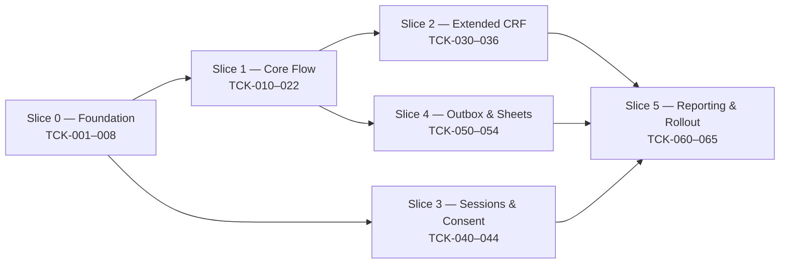

# Feature Ticket List — CSC 2.0
## Community Support Centre Follow-Up Platform

---

## Document Metadata

| Field | Value | Evidence Tag |
|---|---|---|
| **Document ID** | DOC-05 | `[PROPOSED]` |
| **Document Title** | Feature Ticket List — CSC 2.0 | `[PROPOSED]` |
| **Subtitle** | Community Support Centre Follow-Up Platform | `[PROPOSED]` |
| **Version** | v0.1.0 | `[PROPOSED]` |
| **Status** | **DRAFT** | `[PROPOSED]` |
| **Classification** | Internal — Technical Specification & Implementation Plan | `[PROPOSED]` |
| **Scope Covered in this Document** | Slices 0 through 5 (Full End-to-End Vertical Slice Catalog, 44 Tickets) | `[PROPOSED]` |
| **Created Date** | 2026-11-02 | `[PROPOSED]` |
| **Shared Glossary** | See `SHARED_GLOSSARY.md` (canonical terms, role codes, ID namespace) | `[SOURCE]` |
| **Traceability Documents** | DOC-01 (PRD), DOC-02 (TAD), DOC-03 (SEC), DOC-04 (FSD) | `[PROPOSED]` |

### Change Log

| Version | Date | Author | Summary of Changes | Evidence Tag |
|---|---|---|---|---|
| v0.1.0 | 2026-11-02 | Principal Technical Writer | Initial release covering Slices 0 through 5 with strict evidence tagging, zero invented clinical rules, and mandatory 10-point DoD. | `[PROPOSED]` |

---

## Slice Navigation Index (Phase 1.4)

| Slice | Title | Tickets Included | Direct Link | Slice File Link |
|---|---|---|---|---|
| **Slice 0** | Foundation | TCK-001 through TCK-008 (8 tickets) | [Go to Slice 0](#slice-0--foundation-tck-001-through-tck-008) | [`slices/SLICE_0_FOUNDATION.md`](file:///d:/OneDrive%20-%20INDIA%20HIV%20AIDS%20ALLIANCE/Desktop/Software%20Development/CSC%202.0/docs/slices/SLICE_0_FOUNDATION.md) |
| **Slice 1** | CSC-VS1 Core Flow | TCK-010 through TCK-022 (13 tickets) | [Go to Slice 1](#slice-1--csc-vs1-core-flow-tck-010-through-tck-022) | [`slices/SLICE_1_CORE_FLOW.md`](file:///d:/OneDrive%20-%20INDIA%20HIV%20AIDS%20ALLIANCE/Desktop/Software%20Development/CSC%202.0/docs/slices/SLICE_1_CORE_FLOW.md) |
| **Slice 2** | Documents & Extended CRF | TCK-030 through TCK-036 (7 tickets) | [Go to Slice 2](#slice-2--documents--extended-crf-sections-tck-030-through-tck-036) | [`slices/SLICE_2_DOCUMENTS_EXTENDED_CRF.md`](file:///d:/OneDrive%20-%20INDIA%20HIV%20AIDS%20ALLIANCE/Desktop/Software%20Development/CSC%202.0/docs/slices/SLICE_2_DOCUMENTS_EXTENDED_CRF.md) |
| **Slice 3** | Onboarding, Sessions & Consent | TCK-040 through TCK-044 (5 tickets) | [Go to Slice 3](#slice-3--onboarding-sessions--consent-tck-040-through-tck-044) | [`slices/SLICE_3_ONBOARDING_SESSIONS_CONSENT.md`](file:///d:/OneDrive%20-%20INDIA%20HIV%20AIDS%20ALLIANCE/Desktop/Software%20Development/CSC%202.0/docs/slices/SLICE_3_ONBOARDING_SESSIONS_CONSENT.md) |
| **Slice 4** | Outbox Worker & Sheets Mirror | TCK-050 through TCK-054 (5 tickets) | [Go to Slice 4](#slice-4--outbox-worker-and-sheets-mirror-tck-050-through-tck-054) | [`slices/SLICE_4_OUTBOX_SHEETS_MIRROR.md`](file:///d:/OneDrive%20-%20INDIA%20HIV%20AIDS%20ALLIANCE/Desktop/Software%20Development/CSC%202.0/docs/slices/SLICE_4_OUTBOX_SHEETS_MIRROR.md) |
| **Slice 5** | Reporting, Reconciliation & Rollout | TCK-060 through TCK-065 (6 tickets) | [Go to Slice 5](#slice-5--reporting-reconciliation-drill-and-rollout-tck-060-through-tck-065) | [`slices/SLICE_5_REPORTING_ROLLOUT.md`](file:///d:/OneDrive%20-%20INDIA%20HIV%20AIDS%20ALLIANCE/Desktop/Software%20Development/CSC%202.0/docs/slices/SLICE_5_REPORTING_ROLLOUT.md) |
| **Governance** | DoD & Evidence Scheme | 10-point checklist & evidence labels | [Go to DoD](#definition-of-done-10-point-checklist) | Included in all slice documents |

---

## Definition of Done (10-point checklist)

A ticket is **DONE** when ALL of the following criteria are verified and true: `[PROPOSED]`

1. **Unit Tests:** All unit tests pass with mocks and zero network/filesystem I/O (labelled `UNIT`). `[PROPOSED]`
2. **Real Database Integration Tests:** All integration tests pass against a real PostgreSQL 16+ instance using Testcontainers or equivalent (labelled `REAL DATABASE`); H2 or in-memory DBs are strictly NOT acceptable. `[PROPOSED]`
3. **API Contract Tests:** API contract tests pass (e.g., Spring Cloud Contract or Pact) verifying request/response payload schema and header compliance (labelled `CONTRACT`). `[PROPOSED]`
4. **Browser / E2E Tests:** End-to-end browser tests pass (Playwright or Cypress) against a running staging/dev environment for any UI modifications (labelled `BROWSER`). `[PROPOSED]`
5. **Concurrency Verification:** Concurrency test executed against real database for any write path, verifying that conflicting requests resolve via optimistic locking (`version` mismatch returning 409) or idempotency caching (labelled `CONCURRENCY`). `[PROPOSED]`
6. **Security & Permission Verification:** Permission boundary test executed verifying that any role or actor attempting access outside assigned geographic scope or role permission receives HTTP 404 or HTTP 403 per DOC-03 policy (labelled `SECURITY`). `[PROPOSED]`
7. **Offline & Failure Verification:** Offline queuing, connectivity failure handling, retry logic, and draft preservation verified per ticket specification. `[PROPOSED]`
8. **Telemetry Verification:** Telemetry events emitted and verified in the staging environment log/metric collector. `[PROPOSED]`
9. **Evidence Labels Attached:** Evidence labels are present and linked in the pull request / ticket close comment (`UNIT ✅`, `REAL DATABASE ✅`, `CONTRACT ✅`, `BROWSER ✅`, `CONCURRENCY ✅`, `SECURITY ✅`, `STAGING ✅`). `[PROPOSED]`
10. **Build Sufficiency Rule:** A passing build or a `READY` deployment alone is NEVER sufficient for marking a ticket as DONE. `[PROPOSED]`

---

## Evidence Label Scheme

| Label | Meaning | Evidence Tag |
|---|---|---|
| **UNIT** | Isolated unit test with mocks; no I/O or network dependencies. | `[PROPOSED]` |
| **REAL DATABASE** | Integration test against a real PostgreSQL 16+ instance (Testcontainers or test harness); H2/in-memory NOT acceptable. | `[PROPOSED]` |
| **CONTRACT** | API contract test (e.g., Spring Cloud Contract, OpenAPI validator, or Pact) verifying request/response shape. | `[PROPOSED]` |
| **BROWSER** | End-to-end browser test (Playwright or Cypress) against a running dev/staging web application. | `[PROPOSED]` |
| **CONCURRENCY** | Two concurrent requests that would conflict are sent; system must resolve correctly (optimistic lock, 409 Conflict, idempotency receipt). | `[PROPOSED]` |
| **SECURITY** | Permission boundary test: role or actor that MUST NOT access attempts access; system returns 404 or 403 per DOC-03 policy. | `[PROPOSED]` |
| **STAGING** | Manually verified in the staging environment against synthetic test data. | `[PROPOSED]` |
| **LIVE USER VERIFIED** | Verified by a real field worker or supervisor in the target operational environment. | `[PROPOSED]` |

---

## Dependency Graph

```mermaid
flowchart TD
    subgraph S0["Slice 0 — Foundation [PROPOSED]"]
        TCK001["TCK-001: PostgreSQL Schema Bootstrap"]
        TCK002["TCK-002: Spring Boot Scaffold"]
        TCK003["TCK-003: Next.js Scaffold"]
        TCK004["TCK-004: CI/CD Pipeline"]
        TCK005["TCK-005: Authentication: Login & Session"]
        TCK006["TCK-006: RBAC Permission Matrix"]
        TCK007["TCK-007: Audit Log"]
        TCK008["TCK-008: Idempotency Receipts"]

        TCK001 --> TCK002
        TCK002 --> TCK005
        TCK003 --> TCK005
        TCK005 --> TCK006
        TCK001 --> TCK007
        TCK001 --> TCK008
        TCK002 --> TCK004
    end

    subgraph S1["Slice 1 — CSC-VS1 Core Flow [PROPOSED]"]
        TCK010["TCK-010: My Work Worklist Screen"]
        TCK011["TCK-011: Client List & Search"]
        TCK012["TCK-012: Registration (CRF Sec A)"]
        TCK013["TCK-013: Registration (CRF Sec B-D)"]
        TCK014["TCK-014: Registration (CRF Sec E-H)"]
        TCK015["TCK-015: Registration (CRF Sec I-J) & Submit"]
        TCK016["TCK-016: Record Contact Attempt"]
        TCK017["TCK-017: Record Encounter (i_updates)"]
        TCK018["TCK-018: Plan Next Action (j5_plan)"]
        TCK019["TCK-019: Mark Service Delivered"]
        TCK020["TCK-020: Cancel Planned Service"]
        TCK021["TCK-021: Client Timeline View"]
        TCK022["TCK-022: Supervisor Overdue View"]

        TCK006 --> TCK010
        TCK006 --> TCK011
        TCK008 --> TCK015
        TCK012 --> TCK013 --> TCK014 --> TCK015
        TCK015 --> TCK016
        TCK016 --> TCK017
        TCK017 --> TCK018
        TCK018 --> TCK019
        TCK018 --> TCK020
        TCK016 --> TCK021
        TCK017 --> TCK021
        TCK019 --> TCK021
        TCK010 --> TCK022
    end

    subgraph S2["Slice 2 — Documents & Extended CRF Sections [PROPOSED]"]
        TCK030["TCK-030: Document Declarations (Sec J)"]
        TCK031["TCK-031: Social Protection (Sec D Full)"]
        TCK032["TCK-032: Death Recording (Sec H)"]
        TCK033["TCK-033: Stigma & Discrimination (Sec F)"]
        TCK034["TCK-034: Disability (Sec G)"]
        TCK035["TCK-035: KP Behaviour (Sec E)"]
        TCK036["TCK-036: LFU Risk Flag"]

        TCK015 --> TCK030
        TCK013 --> TCK031
        TCK014 --> TCK032
        TCK014 --> TCK033
        TCK014 --> TCK034
        TCK014 --> TCK035
        TCK016 --> TCK036
        TCK036 --> TCK022
    end

    subgraph S3["Slice 3 — Offline Sync & PWA (Future) [PROPOSED]"]
        S3_SYNC["Offline Sync Queue & PWA Service Worker"]
    end

    subgraph S4["Slice 4 — Outbox & Sheets Mirroring (Future) [PROPOSED]"]
        S4_OUTBOX["Outbox Worker & Apps Script Mirroring"]
    end

    subgraph S5["Slice 5 — Reporting & Administration (Future) [PROPOSED]"]
        S5_ADMIN["Aggregated Reports & User Management"]
    end

    S1 --> S3_SYNC
    S0 --> S4_OUTBOX
    S1 --> S4_OUTBOX
    S2 --> S5_ADMIN
```



---

## Slice 0 — Foundation (TCK-001 through TCK-008)

### TCK-001 — PostgreSQL Schema Bootstrap

| Field | Value | Evidence Tag |
|---|---|---|
| **Slice** | Slice 0 (Foundation) | `[PROPOSED]` |
| **Requirement Traceability** | PRD-001 through PRD-010, ARCH-001, DOC-03 §8 | `[PROPOSED]` |
| **User Value** | As a system engineer, I need a strongly typed relational database schema with referential integrity and audit tracking so that beneficiary records are persisted safely and consistently. | `[PROPOSED]` |
| **Dependencies** | None (Initial foundation ticket) | `[PROPOSED]` |
| **Owner Role** | Backend | `[PROPOSED]` |
| **Estimate** | L (4–5 days) | `[PROPOSED]` |

**Scope (in):**
- Flyway baseline migration (`V001__baseline_schema.sql`) creating relational tables: `clients`, `family_members` (from XLSForm `b2_members`), `referrals` (from XLSForm `d5_referrals`), `encounters` (from XLSForm `i_updates`), `planned_services` (from XLSForm `j5_plan`), `contact_attempts`, `tasks`, `audit_log`, `outbox`, `idempotency_receipts`, `consents`, `document_declarations`. `[PROPOSED]`
- Primary keys configured as UUID with `gen_random_uuid()` defaults across all tables. `[PROPOSED]`
- Foreign key constraints enforced at database level with appropriate cascading / restrict policies. `[PROPOSED]`
- Every beneficiary entity table includes `deleted_at TIMESTAMPTZ NULL` soft-delete column; standard views/queries filter `WHERE deleted_at IS NULL`. `[PROPOSED]`
- Every mutable entity table includes `version INTEGER NOT NULL DEFAULT 0` for optimistic locking. `[PROPOSED]`
- Every entity table includes `recorded_at TIMESTAMPTZ NOT NULL DEFAULT now()` reflecting authoritative server acceptance time. `[PROPOSED]`
- Explicit separation of `observation_date DATE` (e.g., encounter date, measurement date) from `recorded_at TIMESTAMPTZ`. `[PROPOSED]`
- B-tree and composite indexes on foreign keys, lookup codes, and common filter columns (`assigned_worker_id`, `district`, `due_date`, `status`). `[PROPOSED]`

**Scope (out / not this ticket):**
- Test seed data generation and mock fixtures (handled in test profile configurations). `[PROPOSED]`
- Database partitioning or sharding (out of scope for single-region relational architecture). `[PROPOSED]`
- Application-level business logic or entity mappings. `[PROPOSED]`

**UI Contract:** No UI change. `[PROPOSED]`

**API Contract:** No new API. `[PROPOSED]`

**Data / Migration:**
- Flyway script `src/main/resources/db/migration/V001__baseline_schema.sql`. `[PROPOSED]`
- Tables created: `clients`, `family_members`, `referrals`, `encounters`, `planned_services`, `contact_attempts`, `tasks`, `audit_log`, `outbox`, `idempotency_receipts`, `consents`, `document_declarations`. `[PROPOSED]`

**Permissions:**
- Executed via PostgreSQL administrative migration user during application startup. `[PROPOSED]`
- Application runtime role granted `SELECT, INSERT, UPDATE` on mutable entity tables, `SELECT, INSERT` only on `audit_log` (no UPDATE, no DELETE), and `SELECT, INSERT, UPDATE, DELETE` on `outbox` and `idempotency_receipts`. `[PROPOSED]`

**Offline & Failure Behaviour:**
- Migration executes synchronously on application bootstrap; if migration fails, Spring Boot context startup halts immediately with non-zero exit code. `[PROPOSED]`

**Telemetry:**
- Migration version and execution time recorded in Spring Boot startup logs. `[PROPOSED]`
- Metric: `flyway.migration.duration.seconds`. `[PROPOSED]`

**Tests:**
- UNIT: Validate SQL syntax against PostgreSQL dialect in build verification tests. `[PROPOSED]`
- REAL DATABASE: Apply `V001__baseline_schema.sql` to a fresh PostgreSQL 16 container via Testcontainers; assert all 12 tables exist, verify UUID PK generation, assert foreign key rejection on orphan rows, and verify `deleted_at` nullability. `[PROPOSED]`
- CONTRACT: N/A. `[PROPOSED]`
- BROWSER: N/A. `[PROPOSED]`
- CONCURRENCY: Verify that concurrent transactions updating rows with mismatched `version` fail with constraint/lock violations. `[PROPOSED]`
- SECURITY: Verify that the runtime application role cannot execute `DROP TABLE`, `TRUNCATE`, or `DELETE FROM audit_log`. `[PROPOSED]`

**Acceptance Criteria:**
- Given a clean PostgreSQL 16 database, when Flyway runs, then all 12 schema tables are created with UUID primary keys and foreign key constraints without error. `[PROPOSED]`
- Given an inserted beneficiary row, when `deleted_at` is populated with a timestamp, then standard entity queries filtering on `deleted_at IS NULL` exclude that row while the physical row remains intact. `[PROPOSED]`
- Given an attempt to delete or alter a record in `audit_log` using the application user credentials, then the PostgreSQL engine rejects the operation with permission denied. `[PROPOSED]`

**Deployment / Rollback:**
- Forward-only Flyway migrations; rollback via down migration script or database point-in-time recovery on staging. `[PROPOSED]`

**Evidence to Close:**
- UNIT ✅, REAL DATABASE ✅, CONCURRENCY ✅, SECURITY ✅. `[PROPOSED]`

---

### TCK-002 — Spring Boot Application Scaffold

| Field | Value | Evidence Tag |
|---|---|---|
| **Slice** | Slice 0 (Foundation) | `[PROPOSED]` |
| **Requirement Traceability** | ARCH-002 | `[PROPOSED]` |
| **User Value** | As a backend engineer, I need a standardised Spring Boot service scaffold with database pooling, global error handling, and correlation tracking so that downstream feature tickets can be developed reliably. | `[PROPOSED]` |
| **Dependencies** | TCK-001 (must be DONE first) | `[PROPOSED]` |
| **Owner Role** | Backend | `[PROPOSED]` |
| **Estimate** | M (2–3 days) | `[PROPOSED]` |

**Scope (in):**
- Spring Boot 3.x project setup with Java 21, Gradle/Maven build tooling, and Lombok/MapStruct support. `[PROPOSED]`
- HikariCP database connection pooling configuration tuned for PostgreSQL 16 with validated connection testing. `[PROPOSED]`
- Flyway integration wired to run automatically on application startup. `[PROPOSED]`
- Global exception handler (`@ControllerAdvice`) implementing RFC 7807 / standard problem details: `{type, title, status, detail, instance, correlationId}`. `[PROPOSED]`
- Correlation ID servlet filter: reads `X-Correlation-ID` header if provided, generates a new UUID if absent, attaches to MDC logging context, and returns it in the response header `X-Correlation-ID`. `[PROPOSED]`
- Spring Actuator endpoints enabled: `/actuator/health` exposing liveness and readiness probes checking DB connectivity. `[PROPOSED]`

**Scope (out / not this ticket):**
- Domain business logic, controllers, or repositories. `[PROPOSED]`
- Security authentication filter chain (handled in TCK-005). `[PROPOSED]`

**UI Contract:** No UI change. `[PROPOSED]`

**API Contract:**
- `GET /actuator/health`: returns HTTP 200 `{ "status": "UP", "components": { "db": { "status": "UP" } } }` on healthy state; returns HTTP 503 if DB is unreachable. `[PROPOSED]`
- Global error model: HTTP 4xx/5xx responses conform to: `[PROPOSED]`
  ```json
  {
    "type": "about:blank",
    "title": "Bad Request",
    "status": 400,
    "detail": "Descriptive error message",
    "instance": "/api/v1/resource",
    "correlationId": "f47ac10b-58cc-4372-a567-0e02b2c3d479"
  }
  ```

**Data / Migration:** None. `[PROPOSED]`

**Permissions:**
- `/actuator/health` accessible without authentication for container probes. `[PROPOSED]`
- All other actuator endpoints disabled or restricted to local management port. `[PROPOSED]`

**Offline & Failure Behaviour:**
- If the database connection cannot be established on startup, HikariCP fails after timeout and application terminates. `[PROPOSED]`

**Telemetry:**
- Standardized SLF4J JSON logging with `correlationId`, `thread`, and `timestamp`. `[PROPOSED]`
- Spring Boot Actuator standard metrics exposed at `/actuator/metrics`. `[PROPOSED]`

**Tests:**
- UNIT: Test correlation ID filter populating MDC and setting response header; test global exception handler mapping custom exceptions to RFC 7807 JSON. `[PROPOSED]`
- REAL DATABASE: Start Spring Boot application against Testcontainers PostgreSQL 16; verify `/actuator/health` returns status UP and database check passes. `[PROPOSED]`
- CONTRACT: Assert standard error response payload schema matches RFC 7807 specification. `[PROPOSED]`
- BROWSER: N/A. `[PROPOSED]`
- CONCURRENCY: Subject HikariCP connection pool to 50 concurrent simulated requests; verify zero connection leakages. `[PROPOSED]`
- SECURITY: Verify sensitive actuator endpoints (e.g., `/actuator/env`, `/actuator/beans`) return 403 or 404 to unauthenticated callers. `[PROPOSED]`

**Acceptance Criteria:**
- Given a running application, when `GET /actuator/health` is requested, then HTTP 200 with status UP is returned. `[PROPOSED]`
- Given an incoming request with header `X-Correlation-ID: 12345`, when the response is returned, then header `X-Correlation-ID: 12345` is present and all emitted logs contain `correlationId=12345`. `[PROPOSED]`
- Given an unhandled exception thrown in the controller layer, when caught by global exception handler, then an RFC 7807 JSON payload with `status` and `correlationId` is returned without leaking internal stack traces. `[PROPOSED]`

**Deployment / Rollback:**
- Standard deployment artifact (JAR/container); redeploy previous build on failure. `[PROPOSED]`

**Evidence to Close:**
- UNIT ✅, REAL DATABASE ✅, CONTRACT ✅, CONCURRENCY ✅, SECURITY ✅. `[PROPOSED]`

---

### TCK-003 — Next.js Application Scaffold

| Field | Value | Evidence Tag |
|---|---|---|
| **Slice** | Slice 0 (Foundation) | `[PROPOSED]` |
| **Requirement Traceability** | ARCH-003, UI-001 | `[PROPOSED]` |
| **User Value** | As a frontend engineer, I need a configured Next.js App Router application with a thin BFF layer, global error boundary, and bilingual i18n support so that UI screens can be built efficiently. | `[PROPOSED]` |
| **Dependencies** | None (Independent frontend scaffold) | `[PROPOSED]` |
| **Owner Role** | Frontend | `[PROPOSED]` |
| **Estimate** | M (2–3 days) | `[PROPOSED]` |

**Scope (in):**
- Next.js 14+ setup with TypeScript, App Router (`app/` directory), and Tailwind CSS configured per design system tokens. `[PROPOSED]`
- Thin Backend-For-Frontend (BFF) proxy route (`/api/proxy/[...path]`) forwarding requests to Spring Boot (`http://localhost:8080`), injecting correlation IDs, and extracting/forwarding JWT cookies. `[PROPOSED]`
- Environment variable configuration (`NEXT_PUBLIC_APP_ENV`, `BACKEND_INTERNAL_URL`) with strict runtime schema validation; zero secrets stored in code or repository. `[PROPOSED]`
- Health check route: `GET /api/health` returning `{ "status": "ok" }`. `[PROPOSED]`
- Global error boundary component catching client-side rendering errors and presenting a friendly fallback screen. `[PROPOSED]`
- Internationalization (i18n) foundation using `next-intl` (or equivalent) with English (`en`) and Hindi (`hi`) message bundle stubs. `[PROPOSED]`

**Scope (out / not this ticket):**
- Service worker and full offline IndexedDB sync engine (deferred to Slice 3). `[PROPOSED]`
- Feature screen implementations (My Work, Client Registration). `[PROPOSED]`

**UI Contract:**
- Global shell with header, responsive content viewport, and locale toggle stub. `[PROPOSED]`
- Fallback error boundary screen displaying user-friendly error message, refresh button, and correlation ID reference. `[PROPOSED]`

**API Contract:**
- `GET /api/health`: returns HTTP 200 `{ "status": "ok" }`. `[PROPOSED]`
- BFF proxy convention: `ANY /api/proxy/*` forwards to `${BACKEND_INTERNAL_URL}/api/v1/*`. `[PROPOSED]`

**Data / Migration:** None. `[PROPOSED]`

**Permissions:**
- `/api/health` publicly accessible. `[PROPOSED]`
- BFF proxy enforces session validation once authentication is configured. `[PROPOSED]`

**Offline & Failure Behaviour:**
- When upstream Spring Boot API is unreachable, BFF proxy returns HTTP 502 with RFC 7807 standard error structure to Next.js client. `[PROPOSED]`

**Telemetry:**
- Client-side error logging capturing unhandled exceptions and routing errors. `[PROPOSED]`

**Tests:**
- UNIT: Test i18n message loader returning correct Hindi/English strings; test environment variable validation rejecting missing mandatory configs. `[PROPOSED]`
- REAL DATABASE: N/A. `[PROPOSED]`
- CONTRACT: Verify BFF proxy preserves request headers and translates 502 upstream errors cleanly. `[PROPOSED]`
- BROWSER: Verify `/api/health` returns ok; verify global error boundary renders fallback UI on simulated component crash. `[PROPOSED]`
- CONCURRENCY: N/A. `[PROPOSED]`
- SECURITY: Verify that browser client cannot read server-only environment variables and that upstream stack traces are stripped by BFF proxy. `[PROPOSED]`

**Acceptance Criteria:**
- Given the Next.js development server running, when `GET /api/health` is requested, then HTTP 200 `{ "status": "ok" }` is returned. `[PROPOSED]`
- Given a locale selection of `hi`, when text strings render, then values are loaded from the Hindi dictionary file. `[PROPOSED]`
- Given an unhandled React rendering exception in a page, when the boundary catches it, then the fallback error UI is shown without white-screening the browser. `[PROPOSED]`

**Deployment / Rollback:**
- Containerized Node.js service; redeploy previous container tag on failure. `[PROPOSED]`

**Evidence to Close:**
- UNIT ✅, CONTRACT ✅, BROWSER ✅, SECURITY ✅. `[PROPOSED]`

---

### TCK-004 — CI/CD Pipeline

| Field | Value | Evidence Tag |
|---|---|---|
| **Slice** | Slice 0 (Foundation) | `[PROPOSED]` |
| **Requirement Traceability** | ARCH-004 | `[PROPOSED]` |
| **User Value** | As a development team, we need an automated build and test pipeline so that defective code, failing tests, or schema violations cannot be deployed to staging or production. | `[PROPOSED]` |
| **Dependencies** | TCK-001, TCK-002, TCK-003 (must be DONE first) | `[PROPOSED]` |
| **Owner Role** | DevOps | `[PROPOSED]` |
| **Estimate** | M (2–3 days) | `[PROPOSED]` |

**Scope (in):**
- GitHub Actions CI workflow triggered on pull requests and merges to main branch. `[PROPOSED]`
- Automated pipeline stages: Linting & Static Analysis → Unit Testing → Integration Testing (against real PostgreSQL service container) → Artifact Build → Staging Deployment. `[PROPOSED]`
- Separate environment configurations: local / staging / production. `[ASSUMPTION]`
- Secrets injected strictly via GitHub Actions secrets and environment variables; zero hardcoded secrets. `[PROPOSED]`
- Strict pipeline gating: pipeline fails immediately on any lint, unit, integration, or contract test failure. `[PROPOSED]`
- Production deployment gate: production deployment blocked unless staging deployment and end-to-end tests are green. `[PROPOSED]`

**Scope (out / not this ticket):**
- Complex multi-region orchestrations, Kubernetes Helm configurations, or service meshes (explicitly out of scope). `[PROPOSED]`
- Load testing or automated penetration testing stages. `[PROPOSED]`

**UI Contract:** No UI change. `[PROPOSED]`

**API Contract:** No new API. `[PROPOSED]`

**Data / Migration:**
- CI executes Flyway schema validation and migration against an ephemeral PostgreSQL 16 container during the integration stage. `[PROPOSED]`

**Permissions:**
- Pipeline configuration files (`.github/workflows/*`) protected via GitHub branch protection rules requiring code owner approval. `[PROPOSED]`

**Offline & Failure Behaviour:**
- If any build step or test fails, the workflow aborts, marks the commit red, and prevents branch merge. `[PROPOSED]`

**Telemetry:**
- CI build duration, test pass/fail counts, and deployment logs recorded in GitHub Actions run history. `[PROPOSED]`

**Tests:**
- UNIT: Pipeline YAML syntax validation and linter execution. `[PROPOSED]`
- REAL DATABASE: Automated pipeline spin-up of real PostgreSQL 16 service container executing Spring Boot integration test suite. `[PROPOSED]`
- CONTRACT: Verification of OpenAPI schema contract during build step. `[PROPOSED]`
- BROWSER: Headless browser Playwright smoke test executed as part of CI test suite. `[PROPOSED]`
- CONCURRENCY: N/A. `[PROPOSED]`
- SECURITY: Secret scanner (e.g., Gitleaks or Trivy) runs in CI to detect inadvertent credentials in git history. `[PROPOSED]`

**Acceptance Criteria:**
- Given a pull request with a failing unit or integration test, when CI runs, then the pipeline fails and merge is blocked. `[PROPOSED]`
- Given a pull request with all tests passing and real PostgreSQL integration tests green, when CI finishes, then the pull request is marked eligible for review. `[PROPOSED]`
- Given a commit to `main`, when staging deploy succeeds, then artifact is tagged for production deployment. `[PROPOSED]`

**Deployment / Rollback:**
- Pipeline configuration committed directly to repository; rollback via git revert. `[PROPOSED]`

**Evidence to Close:**
- UNIT ✅, REAL DATABASE ✅, CONTRACT ✅, BROWSER ✅, SECURITY ✅. `[PROPOSED]`

---

### TCK-005 — Authentication: Login and Session

| Field | Value | Evidence Tag |
|---|---|---|
| **Slice** | Slice 0 (Foundation) | `[PROPOSED]` |
| **Requirement Traceability** | PRD-062, SEC-001, DOC-03 §3 | `[PROPOSED]` |
| **User Value** | As a field worker, supervisor, or reviewer, I need to log in securely with my credentials and maintain a safe session so that beneficiary data is protected from unauthorized access. | `[PROPOSED]` |
| **Dependencies** | TCK-001, TCK-002, TCK-003 (must be DONE first) | `[PROPOSED]` |
| **Owner Role** | Full-stack | `[PROPOSED]` |
| **Estimate** | L (4–5 days) | `[PROPOSED]` |

**Scope (in):**
- Spring Boot authentication endpoint (`POST /api/v1/auth/login`) verifying username and password against hashed password in `users` table (Argon2id or BCrypt). `[PROPOSED]`
- Cryptographically signed JWT issued by Spring Boot upon successful credential verification. `[PROPOSED]`
- Next.js BFF sets JWT inside an `HttpOnly`, `Secure`, `SameSite=Strict` cookie (`csc_session`). `[OPEN — cookie vs Bearer token in mobile web, see OD-004]`
- Spring Boot independently re-validates JWT signature, expiration, and claims on every API request via a Spring Security filter; Spring Boot does NOT trust BFF-asserted identity headers. `[PROPOSED]`
- Session expiry and renewal handling. `[OPEN — session TTL duration TBD]`
- Logout flow (`POST /api/v1/auth/logout`): invalidates session and clears cookie; UI checks for unsent local drafts and warns the user before proceeding to prevent silent data wipe. `[PROPOSED]`

**Scope (out / not this ticket):**
- Self-registration / public signup (users provisioned administratively). `[PROPOSED]`
- Multi-factor authentication via SMS/TOTP. `[PROPOSED]`
- Password reset self-service workflows. `[PROPOSED]`

**UI Contract:**
- Screen: Login (`/login`). `[PROPOSED]`
- States:
  - `empty`: Clean login form with username and password inputs. `[PROPOSED]`
  - `loading`: Sign-in button shows spinner; inputs disabled. `[PROPOSED]`
  - `error`: Inline alert displaying "Invalid username or password" (no username enumeration). `[PROPOSED]`
  - `offline`: Banner indicating device is offline and login requires server connectivity. `[PROPOSED]`
  - `draft-warning-modal`: Dialog triggered when clicking logout with unsynced local drafts: "You have unsynced drafts on this device. Logging out will prevent syncing them until you log back in. Proceed?" `[PROPOSED]`

**API Contract:**
- `POST /api/v1/auth/login`: `[PROPOSED]`
  - Request: `{ "username": "fw_user", "password": "SecurePassword123!" }`
  - Response (200 OK): `{ "token": "jwt...", "user": { "id": "uuid", "name": "Worker Name", "role": "field_worker" } }`
  - Error (401 Unauthorized): `{ "title": "Unauthorized", "detail": "Invalid username or password" }`
- `POST /api/v1/auth/logout`: `[PROPOSED]`
  - Response (200 OK): `{ "status": "logged_out" }`
- `GET /api/v1/auth/me`: `[PROPOSED]`
  - Response (200 OK): Returns current authenticated user profile and roles.

**Data / Migration:**
- Seed migration or user table columns ensuring `username`, `password_hash`, `role`, `active` exist on `users`. `[PROPOSED]`

**Permissions:**
- `/api/v1/auth/login` is public. `[PROPOSED]`
- `/api/v1/auth/me` and `/api/v1/auth/logout` require valid authenticated session. `[PROPOSED]`

**Offline & Failure Behaviour:**
- Initial login requires active network connectivity; cannot authenticate against server while offline. `[PROPOSED]`
- If user attempts logout while local drafts exist in browser storage, UI blocks instant wipe and prompts user with confirmation modal. `[PROPOSED]`

**Telemetry:**
- Events: `auth.login.success`, `auth.login.failure`, `auth.logout`. `[PROPOSED]`
- Metric: `counter.auth.login.failures`. `[PROPOSED]`

**Tests:**
- UNIT: Test JWT token generation, claims extraction, signature validation, and expiration calculation. `[PROPOSED]`
- REAL DATABASE: Test login against test user in PostgreSQL container; assert password verification succeeds and updates last login timestamp. `[PROPOSED]`
- CONTRACT: Verify `/api/v1/auth/login` request and response payload structure against OpenAPI specification. `[PROPOSED]`
- BROWSER: Playwright test verifying: successful login redirects to `/work`; bad credentials display error; logout triggers draft warning modal if dirty state simulated. `[PROPOSED]`
- CONCURRENCY: Send 20 concurrent login requests for the same user; assert consistent token generation without locking. `[PROPOSED]`
- SECURITY: Submit malformed or expired JWT; assert Spring Security returns 401 Unauthorized; test constant-time credential comparison to prevent timing attacks. `[PROPOSED]`

**Acceptance Criteria:**
- Given valid user credentials, when submitted to `/login`, then user is authenticated, HttpOnly cookie is set, and user is redirected to `/work`. `[PROPOSED]`
- Given invalid user credentials, when submitted, then HTTP 401 is returned and error message "Invalid username or password" is shown without indicating whether username exists. `[PROPOSED]`
- Given unsent local drafts stored in browser cache, when user clicks logout, then a confirmation warning modal is presented before the session is cleared. `[PROPOSED]`

**Deployment / Rollback:**
- Standard application redeployment; rollback does not affect database state. `[PROPOSED]`

**Evidence to Close:**
- UNIT ✅, REAL DATABASE ✅, CONTRACT ✅, BROWSER ✅, CONCURRENCY ✅, SECURITY ✅. `[PROPOSED]`

---

### TCK-006 — RBAC: Permission Matrix Enforcement

| Field | Value | Evidence Tag |
|---|---|---|
| **Slice** | Slice 0 (Foundation) | `[PROPOSED]` |
| **Requirement Traceability** | PRD-062, SEC-001, DOC-03 §4 | `[PROPOSED]` |
| **User Value** | As an organization, I need strict role-based and geographic access controls so that workers only see clients within their authorized scope and beneficiary privacy is guaranteed. | `[PROPOSED]` |
| **Dependencies** | TCK-001, TCK-005 (must be DONE first) | `[PROPOSED]` |
| **Owner Role** | Backend | `[PROPOSED]` |
| **Estimate** | L (4–5 days) | `[PROPOSED]` |

**Scope (in):**
- Spring Security interceptor and method-level authorization (`@PreAuthorize`) enforcing permissions across all endpoints. `[PROPOSED]`
- Role hierarchy and scope enforcement: `[PROPOSED]`
  - `field_worker`: Sees only clients where `assigned_worker_id = actor.id`. `[PROPOSED]`
  - `supervisor`: Sees clients and tasks assigned to field workers within their assigned supervisor cluster/district. `[PROPOSED]`
  - `state_reviewer`: Read-only aggregate and client inspection for their assigned district/state. `[PROPOSED]`
  - `administrator`: User management, system configuration, audit review. `[PROPOSED]`
  - `leadership`: Anonymised dashboard reports only; strictly zero access to client PII or individual CRFs. `[PROPOSED]`
- Deny-by-default architecture: any endpoint without explicit role mapping returns HTTP 403 Forbidden. `[PROPOSED]`
- Object-level security policy: access attempts to client records outside the actor's assigned geography or scope return HTTP 404 Not Found (not 403) to prevent entity ID enumeration. `[PROPOSED per DOC-03 §4]`
- Negative boundary test suite asserting cross-worker and cross-district denial. `[PROPOSED]`

**Scope (out / not this ticket):**
- User management UI for assigning roles (handled in Slice 5). `[PROPOSED]`
- Dynamic permission rule configuration engine. `[PROPOSED]`

**UI Contract:**
- On HTTP 403 or 404 from API, UI displays clean access denied / not found state without exposing backend details or raw stack traces. `[PROPOSED]`

**API Contract:**
- Standard error responses: `[PROPOSED]`
  - Unauthenticated: HTTP 401 Unauthorized.
  - Insufficient role: HTTP 403 Forbidden `{ "title": "Forbidden", "detail": "Access denied" }`.
  - Client record out of scope: HTTP 404 Not Found `{ "title": "Not Found", "detail": "Resource not found" }`.

**Data / Migration:**
- Verify `users` table columns: `role` (enum / varchar), `geographic_scope_json` (array of district/CSC codes), and `active` (boolean). `[PROPOSED]`

**Permissions:**
- Enforces canonical role codes: `field_worker`, `supervisor`, `state_reviewer`, `administrator`, `leadership`. `[SOURCE]`

**Offline & Failure Behaviour:**
- Enforced strictly on server API on every request; offline cached views must respect locally cached user scope. `[PROPOSED]`

**Telemetry:**
- Events: `security.access.denied`, `security.object.not_found_enumeration_blocked`. `[PROPOSED]`
- Metric: `counter.security.access_denied`. `[PROPOSED]`

**Tests:**
- UNIT: Test security expression evaluators and role-checking helper methods. `[PROPOSED]`
- REAL DATABASE: Query client repository with actor context; assert `field_worker` A cannot retrieve client assigned to `field_worker` B. `[PROPOSED]`
- CONTRACT: N/A. `[PROPOSED]`
- BROWSER: N/A. `[PROPOSED]`
- CONCURRENCY: Rapid concurrent requests with alternating user tokens assert no thread-local leakage of security contexts. `[PROPOSED]`
- SECURITY: Comprehensive negative matrix test: `field_worker` attempts to access supervisor report -> 403; `field_worker` attempts to access another worker's client -> 404; `leadership` attempts to fetch individual client CRF -> 403. `[PROPOSED]`

**Acceptance Criteria:**
- Given a `field_worker` logged in, when requesting client data for a client assigned to another worker, then the system returns HTTP 404 Not Found. `[PROPOSED]`
- Given a `leadership` user logged in, when requesting an individual client CRF endpoint, then HTTP 403 Forbidden is returned. `[PROPOSED]`
- Given a request without an authentication token, then HTTP 401 Unauthorized is returned. `[PROPOSED]`

**Deployment / Rollback:**
- Redeployment of application code; no schema change required. `[PROPOSED]`

**Evidence to Close:**
- UNIT ✅, REAL DATABASE ✅, CONCURRENCY ✅, SECURITY ✅. `[PROPOSED]`

---

### TCK-007 — Audit Log

| Field | Value | Evidence Tag |
|---|---|---|
| **Slice** | Slice 0 (Foundation) | `[PROPOSED]` |
| **Requirement Traceability** | PRD-064, ARCH-005, DOC-03 §8, SEC-002 | `[PROPOSED]` |
| **User Value** | As a compliance auditor, I need an immutable audit log of all data modifications so that every change to beneficiary records is fully traceable and tamper-evident. | `[PROPOSED]` |
| **Dependencies** | TCK-001, TCK-002 (must be DONE first) | `[PROPOSED]` |
| **Owner Role** | Backend | `[PROPOSED]` |
| **Estimate** | M (2–3 days) | `[PROPOSED]` |

**Scope (in):**
- Implementation of transactional audit logging writing to `audit_log` table. `[PROPOSED]`
- Application PostgreSQL role granted `INSERT` privilege only on `audit_log` (zero `UPDATE`, zero `DELETE` privileges). `[PROPOSED]`
- Audit capture on every beneficiary entity write (CREATE, UPDATE, DELETE/soft-delete): `[PROPOSED]`
  - `actor_id` (UUID of user performing mutation)
  - `actor_role` (Role of user)
  - `action` (`CREATE`, `UPDATE`, `SOFT_DELETE`)
  - `entity_type` (e.g., `client`, `encounter`, `planned_service`)
  - `entity_id` (UUID of affected entity)
  - `old_value_json` (JSON representation of prior state; null on CREATE)
  - `new_value_json` (JSON representation of updated state; null on hard delete)
  - `correlation_id` (UUID from request tracking)
  - `recorded_at` (`TIMESTAMPTZ` server timestamp)
  - `ip_address_hash` (One-way salted hash of client IP)
- Atomicity: Audit entry write and domain entity write MUST execute within the identical database transaction; if audit fails, the transaction rolls back. `[PROPOSED]`
- Audit records for soft-deleted entities are retained indefinitely. `[PROPOSED]`

**Scope (out / not this ticket):**
- Audit log search, reporting, and export UI (deferred to Slice 5). `[PROPOSED]`

**UI Contract:** No UI change. `[PROPOSED]`

**API Contract:** No public write API; internal database aspect / repository listener. `[PROPOSED]`

**Data / Migration:**
- Verify `audit_log` table definition and database role permissions from TCK-001. `[PROPOSED]`

**Permissions:**
- Application database user restricted to `INSERT` and `SELECT` on `audit_log`. `[PROPOSED]`

**Offline & Failure Behaviour:**
- If writing the audit record fails for any reason, the entire transaction rolls back and HTTP 500 error is returned to caller. `[PROPOSED]`

**Telemetry:**
- Metric: `counter.audit.entries.created`. `[PROPOSED]`

**Tests:**
- UNIT: Test JSON diff generator producing accurate delta between old and new entity states. `[PROPOSED]`
- REAL DATABASE: Perform client update in PostgreSQL container; assert corresponding row inserted in `audit_log` with matching diff and actor ID. `[PROPOSED]`
- CONTRACT: N/A. `[PROPOSED]`
- BROWSER: N/A. `[PROPOSED]`
- CONCURRENCY: Test high-throughput concurrent entity updates; assert every update produces exactly one audit record with sequential timestamps. `[PROPOSED]`
- SECURITY: Attempt direct SQL `UPDATE audit_log SET ...` or `DELETE FROM audit_log ...` using application runtime DB connection; verify PostgreSQL throws permission denied error. `[PROPOSED]`

**Acceptance Criteria:**
- Given a client record update, when the transaction commits, then an audit log record is created in the same transaction containing the old and new state diffs. `[PROPOSED]`
- Given an audit log failure (e.g., simulated DB constraint violation), when the service attempts an update, then the domain entity modification is completely rolled back. `[PROPOSED]`
- Given an application database connection, when executing an `UPDATE` or `DELETE` statement against `audit_log`, then PostgreSQL rejects the query with permission denied. `[PROPOSED]`

**Deployment / Rollback:**
- Application code deployment; no state changes requiring rollback. `[PROPOSED]`

**Evidence to Close:**
- UNIT ✅, REAL DATABASE ✅, CONCURRENCY ✅, SECURITY ✅. `[PROPOSED]`

---

### TCK-008 — Idempotency Receipt Infrastructure

| Field | Value | Evidence Tag |
|---|---|---|
| **Slice** | Slice 0 (Foundation) | `[PROPOSED]` |
| **Requirement Traceability** | ARCH-006, TAD §4 | `[PROPOSED]` |
| **User Value** | As a field worker working with unstable mobile connectivity, I need API mutations to be idempotent so that retried form submissions do not create duplicate clients, visits, or service plans. | `[PROPOSED]` |
| **Dependencies** | TCK-001, TCK-002 (must be DONE first) | `[PROPOSED]` |
| **Owner Role** | Backend | `[PROPOSED]` |
| **Estimate** | M (2–3 days) | `[PROPOSED]` |

**Scope (in):**
- `idempotency_receipts` table: `key UUID PRIMARY KEY`, `actor_id UUID NOT NULL`, `request_hash VARCHAR NOT NULL`, `response_status INTEGER NOT NULL`, `response_body JSONB NOT NULL`, `created_at TIMESTAMPTZ NOT NULL DEFAULT now()`. `[PROPOSED]`
- Spring Boot middleware / interceptor intercepting mutating requests (`POST`, `PUT`, `PATCH`) with header `Idempotency-Key: <UUID>`. `[PROPOSED]`
- Execution flow: `[PROPOSED]`
  - Check for existing receipt matching `(key, actor_id)`.
  - If found: return cached `response_status` and `response_body` immediately without re-executing domain logic.
  - If not found: execute business transaction, store resulting HTTP status and response body in `idempotency_receipts`, and commit.
- Configurable receipt Time-To-Live (TTL) with scheduled cleanup of expired receipts. `[OPEN — TTL duration TBD]`
- Payload validation: if same key is reused with a different request payload, return HTTP 422 Unprocessable Entity. `[PROPOSED]`

**Scope (out / not this ticket):**
- Client-side auto-retry engine (handled in Slice 3). `[PROPOSED]`

**UI Contract:** No UI change. `[PROPOSED]`

**API Contract:**
- Request Header: `Idempotency-Key: <UUID>` (mandatory on creation endpoints). `[PROPOSED]`
- Response on duplicate submission: Returns original HTTP status code (e.g., 201 Created) and cached JSON body, with additional header `X-Cache: IDEMPOTENT-HIT`. `[PROPOSED]`
- Response on key reuse with altered payload: HTTP 422 Unprocessable Entity `{ "title": "Idempotency Conflict", "detail": "Idempotency key reused with mismatched payload" }`. `[PROPOSED]`

**Data / Migration:**
- Table `idempotency_receipts` verified from TCK-001; index on `created_at` for TTL cleanup. `[PROPOSED]`

**Permissions:**
- Idempotency receipts scoped strictly to the authenticated `actor_id`. `[PROPOSED]`

**Offline & Failure Behaviour:**
- Protects server against mobile client automatic reconnect retries; network drops during response delivery will safely replay response on client retry. `[PROPOSED]`

**Telemetry:**
- Events: `idempotency.hit`, `idempotency.miss`, `idempotency.payload_mismatch`. `[PROPOSED]`
- Metric: `counter.idempotency.hits`. `[PROPOSED]`

**Tests:**
- UNIT: Test interceptor logic, hash generation, and receipt serialisation. `[PROPOSED]`
- REAL DATABASE: Execute two identical POST requests with identical `Idempotency-Key` against Testcontainers PostgreSQL; assert database contains exactly 1 created entity and both requests receive identical response. `[PROPOSED]`
- CONTRACT: Verify header `Idempotency-Key` contract across sample endpoint. `[PROPOSED]`
- BROWSER: N/A. `[PROPOSED]`
- CONCURRENCY: Send two identical POST requests concurrently with identical `Idempotency-Key`; verify row-level lock or unique constraint prevents duplicate entity insertion and exactly one execution occurs. `[PROPOSED]`
- SECURITY: Send request with `Idempotency-Key` previously used by User A from User B's session; assert system does not return User A's cached response. `[PROPOSED]`

**Acceptance Criteria:**
- Given a mutating API request with an `Idempotency-Key`, when submitted a second time with identical payload, then the cached response is returned without creating duplicate database rows. `[PROPOSED]`
- Given two concurrent requests with the identical `Idempotency-Key`, when evaluated by the server, then exactly one execution succeeds and both callers receive the valid response. `[PROPOSED]`
- Given an `Idempotency-Key` resubmitted with altered payload parameters, then HTTP 422 Unprocessable Entity is returned. `[PROPOSED]`

**Deployment / Rollback:**
- Application code deployment; no state rollback complications. `[PROPOSED]`

**Evidence to Close:**
- UNIT ✅, REAL DATABASE ✅, CONTRACT ✅, CONCURRENCY ✅, SECURITY ✅. `[PROPOSED]`

---

## Slice 1 — CSC-VS1 Core Flow (TCK-010 through TCK-022)

### TCK-010 — My Work Worklist Screen

| Field | Value | Evidence Tag |
|---|---|---|
| **Slice** | Slice 1 (CSC-VS1 Core Flow) | `[PROPOSED]` |
| **Requirement Traceability** | PRD-001, PRD-042, UI-010 | `[PROPOSED]` |
| **User Value** | As a field worker, I need a prioritized daily worklist showing my assigned tasks grouped by urgency so that I know exactly which clients require contact or follow-up today. | `[PROPOSED]` |
| **Dependencies** | TCK-003, TCK-006 (must be DONE first) | `[PROPOSED]` |
| **Owner Role** | Full-stack | `[PROPOSED]` |
| **Estimate** | L (4–5 days) | `[PROPOSED]` |

**Scope (in):**
- Route: `/work` displaying prioritized tasks assigned to the authenticated user. `[PROPOSED]`
- Grouping and sort order: Overdue tasks (top) → Due Today → Upcoming. `[PROPOSED]`
- Task card attributes: Client name, CSC ID, task type (e.g., Follow-up Visit, Contact Attempt), due date, and days overdue badge (with warning colour token). `[PROPOSED]`
- Supervisor perspective: Supervisors accessing `/work` view tasks for all field workers in their assigned supervisory cluster with worker filter dropdown. `[PROPOSED]`
- Full screen state coverage: `loading`, `empty` (zero tasks), `filtered-empty`, `partial`, `offline` (displays cached tasks with persistent stale-data warning banner), and `denied` (role unauthorized). `[PROPOSED]`
- Quick-action buttons on task cards: "Record Attempt" (navigates to `/clients/:id/contact`) and "Record Visit" (navigates to `/clients/:id/encounter`). `[PROPOSED]`

**Scope (out / not this ticket):**
- Bulk reassignment of tasks (handled in TCK-022). `[PROPOSED]`
- Background offline sync queue processing (handled in Slice 3). `[PROPOSED]`

**UI Contract:**
- Route: `/work`. `[PROPOSED]`
- Visual specifications conform to `MOBILE_DESIGN_SYSTEM_CONTRACT.md` (touch targets ≥ 48px, 16px base font). `[SOURCE]`
- States: `loading` (skeleton task cards), `empty` (zero tasks illustration), `filtered-empty` ("No tasks match filter"), `offline` (top banner: "Offline — showing cached tasks"), `denied` (friendly 403 message). `[PROPOSED]`

**API Contract:**
- `GET /api/v1/worklist`: `[PROPOSED]`
  - Query parameters: `status` (default: `active`), `sort` (default: `urgency`), `worker_id` (optional for supervisor).
  - Response (200 OK): `[PROPOSED]`
    ```json
    {
      "items": [
        {
          "taskId": "uuid",
          "clientId": "uuid",
          "clientName": "Beneficiary Name",
          "cscId": "CSC-MH-00123",
          "taskType": "FOLLOW_UP_VISIT",
          "dueDate": "2026-11-02",
          "daysOverdue": 2,
          "urgency": "OVERDUE",
          "assignedWorkerName": "Worker Name"
        }
      ],
      "totalCount": 1
    }
    ```

**Data / Migration:**
- Composite index on `tasks(assigned_to_user_id, due_date, status)` to ensure sub-50ms worklist retrieval. `[PROPOSED]`

**Permissions:**
- `field_worker`: can only fetch tasks where `assigned_to_user_id = actor.id`. `[PROPOSED]`
- `supervisor`: can fetch tasks for field workers within their assigned district/cluster. `[PROPOSED]`
- Other roles receive HTTP 403 Forbidden. `[PROPOSED]`

**Offline & Failure Behaviour:**
- When offline, worklist loads from local IndexedDB cache; if cache is empty, renders offline empty state. `[PROPOSED]`
- Banner clearly alerts user that task data may not reflect recent server changes. `[PROPOSED]`

**Telemetry:**
- Events: `worklist.viewed`, `worklist.filter_changed`, `worklist.task_clicked`. `[PROPOSED]`
- Metric: `counter.worklist.views`. `[PROPOSED]`

**Tests:**
- UNIT: Worklist component rendering; task sorting logic (overdue first); days overdue calculation. `[PROPOSED]`
- REAL DATABASE: Query tasks table with Testcontainers; assert field worker retrieves only assigned active tasks sorted by due date ascending. `[PROPOSED]`
- CONTRACT: Verify `/api/v1/worklist` schema against OpenAPI contract. `[PROPOSED]`
- BROWSER: Playwright test: Log in as field worker; verify overdue section renders at top; click "Record Attempt" navigates to contact attempt form. `[PROPOSED]`
- CONCURRENCY: N/A. `[PROPOSED]`
- SECURITY: Field worker passes another worker's ID in `worker_id` query param; assert server ignores param and returns only actor's own tasks. `[PROPOSED]`

**Acceptance Criteria:**
- Given a field worker with 2 overdue tasks and 1 task due today, when navigating to `/work`, then the 2 overdue tasks appear first with overdue badges followed by today's task. `[PROPOSED]`
- Given zero assigned active tasks, when the page loads, then a clean empty state with "No pending tasks" is displayed. `[PROPOSED]`
- Given no internet connectivity, when `/work` loads, then cached tasks are displayed with an amber offline warning banner. `[PROPOSED]`

**Deployment / Rollback:**
- Application code deployment; rollback via container redeploy. `[PROPOSED]`

**Evidence to Close:**
- UNIT ✅, REAL DATABASE ✅, CONTRACT ✅, BROWSER ✅, SECURITY ✅. `[PROPOSED]`

---

### TCK-011 — Client List / Search Screen

| Field | Value | Evidence Tag |
|---|---|---|
| **Slice** | Slice 1 (CSC-VS1 Core Flow) | `[PROPOSED]` |
| **Requirement Traceability** | PRD-062, UI-011 | `[PROPOSED]` |
| **User Value** | As a field worker or supervisor, I need to search and filter clients so that I can quickly review a beneficiary's status, history, and scheduled actions. | `[PROPOSED]` |
| **Dependencies** | TCK-003, TCK-006 (must be DONE first) | `[PROPOSED]` |
| **Owner Role** | Full-stack | `[PROPOSED]` |
| **Estimate** | M (2–3 days) | `[PROPOSED]` |

**Scope (in):**
- Route: `/clients` with paginated list of accessible clients. `[PROPOSED]`
- Search functionality: Partial search on `client_id` (CSC ID), beneficiary name, or phone number. `[PROPOSED]`
- Filter controls: Filter by assigned worker (for supervisor), client status (`ACTIVE`, `DECEASED`, `TRANSFERRED`), and district. `[PROPOSED]`
- Client list card row attributes: CSC ID, beneficiary name, last contact date, next scheduled action / due date. `[PROPOSED]`
- Scroll position and filter state restoration: Back-navigation from `/clients/:id` preserves query string, scroll position, and active filters. `[PROPOSED]`
- States: `loading`, `empty`, `filtered-empty`, `stale` (offline), and `denied`. `[PROPOSED]`

**Scope (out / not this ticket):**
- CSV / Excel export of client list (Slice 5). `[PROPOSED]`
- Bulk editing or batch operations. `[PROPOSED]`

**UI Contract:**
- Route: `/clients`. `[PROPOSED]`
- States: `loading` (table/card skeletons), `empty` ("No clients registered"), `filtered-empty` ("No clients match current filters"), `stale` (offline banner). `[PROPOSED]`
- Mobile responsive layout: Card list on mobile viewport (< 640px); tabular layout on desktop. `[PROPOSED]`

**API Contract:**
- `GET /api/v1/clients`: `[PROPOSED]`
  - Query parameters: `page` (int, default 0), `size` (int, default 20), `q` (string), `status` (string), `worker_id` (uuid), `district` (string).
  - Response (200 OK): `[PROPOSED]`
    ```json
    {
      "items": [
        {
          "id": "uuid",
          "cscId": "CSC-MH-00123",
          "name": "Synthetic Client",
          "phone": "0000000000",
          "lastContactDate": "2026-10-25",
          "nextActionDate": "2026-11-05",
          "nextActionType": "FOLLOW_UP_VISIT",
          "status": "ACTIVE"
        }
      ],
      "page": 0,
      "size": 20,
      "totalElements": 1,
      "totalPages": 1
    }
    ```

**Data / Migration:**
- Trigram or B-tree indexes on `clients(csc_id)`, `clients(name)`, and `addresses(phone)`. `[PROPOSED]`

**Permissions:**
- `field_worker`: returns clients assigned to actor only. `[PROPOSED]`
- `supervisor`: returns clients in supervisor's assigned cluster. `[PROPOSED]`
- `state_reviewer`: returns read-only client list for designated district/state. `[PROPOSED]`

**Offline & Failure Behaviour:**
- In offline mode, search operates against locally cached client records in IndexedDB. `[PROPOSED]`

**Telemetry:**
- Events: `clients.search_performed`, `clients.filter_applied`, `clients.card_clicked`. `[PROPOSED]`

**Tests:**
- UNIT: Test search debounce logic and query parameter serialization. `[PROPOSED]`
- REAL DATABASE: Test paginated search query in PostgreSQL container; verify partial match on phone and name. `[PROPOSED]`
- CONTRACT: Verify paginated response structure matches OpenAPI spec. `[PROPOSED]`
- BROWSER: Playwright test: Search by name; verify matching card displays; click card, navigate back, assert scroll position and search input preserved. `[PROPOSED]`
- CONCURRENCY: N/A. `[PROPOSED]`
- SECURITY: Verify actor cannot retrieve clients outside geographic scope by manipulating query parameters. `[PROPOSED]`

**Acceptance Criteria:**
- Given a search query matching a client's partial phone number, when executed, then only matching accessible clients are listed. `[PROPOSED]`
- Given an active search and scroll position, when user navigates into a client record and clicks back, then the search terms, active page, and scroll offset are restored. `[PROPOSED]`

**Deployment / Rollback:**
- Application code deployment; redeploy previous version on error. `[PROPOSED]`

**Evidence to Close:**
- UNIT ✅, REAL DATABASE ✅, CONTRACT ✅, BROWSER ✅, SECURITY ✅. `[PROPOSED]`

---

### TCK-012 — Client Registration (CRF Section A)

| Field | Value | Evidence Tag |
|---|---|---|
| **Slice** | Slice 1 (CSC-VS1 Core Flow) | `[PROPOSED]` |
| **Requirement Traceability** | PRD-001, PRD-003, PRD-063, PRD-068, PRD-069, PRD-070, UI-012 | `[PROPOSED]` |
| **User Value** | As a field worker, I need to capture a client's baseline demographic and identity information in Section A with validation so that the beneficiary is enrolled accurately. | `[PROPOSED]` |
| **Dependencies** | TCK-003, TCK-006 (must be DONE first) | `[PROPOSED]` |
| **Owner Role** | Full-stack | `[PROPOSED]` |
| **Estimate** | L (4–5 days) | `[PROPOSED]` |

**Scope (in):**
- UI form and validation for CRF Section A fields: `[SOURCE]`
  - `a01_age` (integer, constraint: 0–120) `[SOURCE]`
  - `a02_sex` (choice: male, female, transgender) `[SOURCE]`
  - `a03_dob` (date, constraint: ≤ today) `[SOURCE]`
  - `a04_name` (text, required) `[SOURCE]`
  - Address fields: `a05_village`, `a06_district`, `a07_state` `[SOURCE]`
  - `a08_consent`: Client's recorded agreement for home visits; mandatory for registration; captured and immutable after submission. `[OPEN per OD-001]` `[SOURCE]`
  - Facility codes: `a09_artc_name`/`a09_artc_code`, `a10_csc_name`/`a10_csc_code`/`a10_clh_code`, `a11_asha_anm_name` `[SOURCE]`
  - Contact & identity: `a12_phone` (10 digits), `a13_client_type` ('1' = Registration, '2' = Follow-up) `[SOURCE]`
  - Identifiers: `a14_uid` (optional), `a15_abha` (14-digit numeric pattern validation) `[SOURCE]`
  - Demographics: `a16_marital`, `a17_education`, `a18_in_school` (conditional: displayed and required if and only if age between 5 and 17) `[SOURCE]`, `a19_occupation` (+ `a19_occupation_other` required if `a19_occupation = '14'`) `[SOURCE]`
- Server assigns authoritative `client_id` (CSC ID) on creation; client ID is immutable. `[PROPOSED per PRD-063]`
- Form draft saved locally in browser storage immediately on input change; restored on reload. `[PROPOSED per PRD-039]`

**Scope (out / not this ticket):**
- Sections B through J capture (handled in TCK-013, TCK-014, TCK-015). `[PROPOSED]`
- Government ABHA portal online verification API (out of scope). `[PROPOSED]`

**UI Contract:**
- Route: `/clients/new/section-a` (Wizard Step 1). `[PROPOSED]`
- Inline field validation with error messages on blur and submit. `[PROPOSED]`
- Conditional rendering: `a18_in_school` appears only when `a01_age` ∈ [5, 17]; `a19_occupation_other` appears only when occupation = '14'. `[SOURCE]`
- States: `editing`, `validating`, `local-saved` (indicator icon: "Draft saved on device"). `[PROPOSED]`

**API Contract:**
- Validated via client registration payload or section-level draft validation endpoint: `POST /api/v1/validation/section-a`. `[PROPOSED]`

**Data / Migration:**
- Database mapping into `clients` and `addresses` tables per schema. `[PROPOSED]`

**Permissions:**
- `field_worker` and `supervisor` can capture Section A registration. `[PROPOSED]`

**Offline & Failure Behaviour:**
- Field input changes are debounced and stored into IndexedDB draft storage; persists across browser restarts and offline periods. `[PROPOSED]`

**Telemetry:**
- Events: `registration.section_a.started`, `registration.section_a.completed`, `registration.draft_saved`. `[PROPOSED]`

**Tests:**
- UNIT: Test age validation (0–120); test future date rejection on `a03_dob`; test conditional requirement for `a18_in_school` when age is 12 vs 25; test ABHA regex. `[PROPOSED]`
- REAL DATABASE: Validate persistence of Section A fields into `clients` and `addresses` tables in PostgreSQL container. `[PROPOSED]`
- CONTRACT: Validate Section A JSON schema contract. `[PROPOSED]`
- BROWSER: Playwright test: Enter age 10 -> verify in-school question appears; enter age 30 -> verify in-school question disappears; enter invalid phone -> assert error message. `[PROPOSED]`
- CONCURRENCY: N/A. `[PROPOSED]`
- SECURITY: Attempt submission with missing mandatory consent `a08_consent`; assert validation rejection. `[PROPOSED]`

**Acceptance Criteria:**
- Given a beneficiary aged 12, when viewing Section A, then `a18_in_school` is visible and required. `[SOURCE]`
- Given a date of birth in the future, when submitted, then validation blocks submission with "Date of birth cannot be in the future". `[SOURCE]`
- Given registration data entered without internet, then draft state is saved to local storage with visual confirmation. `[PROPOSED]`

**Deployment / Rollback:**
- Application code deployment; redeploy previous tag on failure. `[PROPOSED]`

**Evidence to Close:**
- UNIT ✅, REAL DATABASE ✅, CONTRACT ✅, BROWSER ✅, SECURITY ✅. `[PROPOSED]`

---

### TCK-013 — Client Registration (CRF Sections B–D)

| Field | Value | Evidence Tag |
|---|---|---|
| **Slice** | Slice 1 (CSC-VS1 Core Flow) | `[PROPOSED]` |
| **Requirement Traceability** | PRD-045 through PRD-056, PRD-002, UI-013 | `[PROPOSED]` |
| **User Value** | As a field worker, I need to record family members, clinical baseline, and initial social scheme referrals so that the client's care and household context is established. | `[PROPOSED]` |
| **Dependencies** | TCK-012 (must be DONE first) | `[PROPOSED]` |
| **Owner Role** | Full-stack | `[PROPOSED]` |
| **Estimate** | L (4–5 days) | `[PROPOSED]` |

**Scope (in):**
- Section B (Family / Household): `[SOURCE]`
  - `b1_kp`: Key Population typology choice (`fsw`, `msm`, `tgh`, `pwid`, `general`, `other`). `[SOURCE]`
  - `b2_members` repeating group: Dynamic subform adding household members with `b2_name`, `b2_age`, `b2_sex`, `b2_relation`, `b2_hiv`, `b2_art_status`, `b2_art_date`, `b2_cd4` (range 0–5000), `b2_vl` (≥ 0). `[SOURCE]`
  - Architectural mandate: `b2_members` stored as child rows in `family_members` table, NEVER as flat columns on client row. `[SOURCE]`
- Section C (Clinical Baseline): `[SOURCE]`
  - `c1_hiv_confirmed`, `c2_confirm_date` (constraint: ≤ today, required if `c1_hiv_confirmed = yes`). `[SOURCE]`
  - `c7_preart_date` (constraint: ≤ today, ≥ `c2_confirm_date`). `[SOURCE]`
  - `c8_art_status`, `c9_art_date` (constraint: ≤ today, ≥ `c2_confirm_date` if `c8_art_status = 1`). `[SOURCE]`
  - Measurements: `c10_height` (30–230 cm), `c11_weight` (1–200 kg), `c_muac` (> 0 and ≤ 30 cm, visible if and only if client age < 5). `[SOURCE]`
  - Baseline tests: `c12b_cd4_count` (0–5000 for adults) / `c12b_cd4_pct` (0–100 for children < 18), `c13b_vl_count` (≥ 0). `[SOURCE]`
- Section D (Social Protection & Referrals): `[SOURCE]`
  - `d1_socialprot`, `d2_scheme_name`, `d3_enrolment_date`, `d4_benefit_amount`. `[SOURCE]`
  - `d5_referrals` repeating group: Dynamic subform capturing `d5_scheme` and `d5_entitlement`. `[SOURCE]`
  - Architectural mandate: `d5_referrals` stored as child rows in `referrals` table, NEVER as flat columns. `[SOURCE]`

**Scope (out / not this ticket):**
- Sections E through J (handled in TCK-014 and TCK-015). `[PROPOSED]`
- External lab information system integration. `[PROPOSED]`

**UI Contract:**
- Routes: `/clients/new/section-b`, `/clients/new/section-c`, `/clients/new/section-d` (Wizard Steps 2, 3, 4). `[PROPOSED]`
- Repeatable row components for `b2_members` and `d5_referrals` with "Add Member" / "Add Referral" and "Remove" controls. `[PROPOSED]`
- Dynamic validation: `c_muac` visible only when client age < 5; adult CD4 vs child CD4 percentage toggled by age. `[SOURCE]`

**API Contract:**
- Child entity structures embedded in registration payload or draft endpoints. `[PROPOSED]`

**Data / Migration:**
- Mapped to `family_members` and `referrals` child tables linked via foreign key `client_id`. `[PROPOSED]`

**Permissions:**
- `field_worker` and `supervisor`. `[PROPOSED]`

**Offline & Failure Behaviour:**
- Repeatable rows and clinical inputs persist in local IndexedDB draft storage. `[PROPOSED]`

**Telemetry:**
- Events: `registration.section_b.completed`, `registration.section_c.completed`, `registration.section_d.completed`. `[PROPOSED]`

**Tests:**
- UNIT: Test date cross-validation (`c7_preart_date` ≥ `c2_confirm_date`); test MUAC visibility condition (age < 5); test `b2_cd4` range (0–5000). `[PROPOSED]`
- REAL DATABASE: Persist registration containing 3 family members and 2 referrals into Testcontainers PostgreSQL; assert child rows exist in `family_members` and `referrals` tables linked by `client_id`. `[PROPOSED]`
- CONTRACT: Verify child repeat JSON schema matching array of objects. `[PROPOSED]`
- BROWSER: Playwright test: Add 2 family members in subform; enter age 3 for client and verify MUAC field renders; assert validation blocks `c9_art_date` earlier than `c2_confirm_date`. `[PROPOSED]`
- CONCURRENCY: N/A. `[PROPOSED]`
- SECURITY: Verify child entity creation inherits actor's organizational scope. `[PROPOSED]`

**Acceptance Criteria:**
- Given a client registration, when 2 family members are entered, then 2 distinct rows are persisted in `family_members` table with valid foreign keys. `[SOURCE]`
- Given an ART start date earlier than HIV confirmation date, when submitted, then validation fails with an explicit error. `[SOURCE]`
- Given a client aged 3 years, then MUAC input is displayed and validated between 0 and 30 cm. `[SOURCE]`

**Deployment / Rollback:**
- Application code deployment; redeploy previous tag on failure. `[PROPOSED]`

**Evidence to Close:**
- UNIT ✅, REAL DATABASE ✅, CONTRACT ✅, BROWSER ✅, SECURITY ✅. `[PROPOSED]`

---

### TCK-014 — Client Registration (CRF Sections E–H)

| Field | Value | Evidence Tag |
|---|---|---|
| **Slice** | Slice 1 (CSC-VS1 Core Flow) | `[PROPOSED]` |
| **Requirement Traceability** | PRD-055 through PRD-061, PRD-002, UI-014 | `[PROPOSED]` |
| **User Value** | As a field worker, I need to capture risk behaviour, stigma, disability, and death details with appropriate conditional rules so that vulnerable beneficiaries receive tailored support. | `[PROPOSED]` |
| **Dependencies** | TCK-013 (must be DONE first) | `[PROPOSED]` |
| **Owner Role** | Full-stack | `[PROPOSED]` |
| **Estimate** | L (4–5 days) | `[PROPOSED]` |

**Scope (in):**
- Section E (Behaviour / Risk Profile): `[SOURCE]`
  - `e1_sexwork`: Required if KP typology is `fsw`, `msm`, or `tgh`. `[SOURCE]`
  - `e2_ost` and `e3_nsep`: Required if KP typology is `pwid`. `[SOURCE]`
  - `e4_sti`: History of sexually transmitted infections. `[SOURCE]`
  - `e5_condom_know`, `e6_condom_use`, `e7_condom_source`: Shown and evaluated only when client age ≥ 15. `[SOURCE]`
  - `e8_fp`: Family planning services. `[SOURCE]`
  - `e9a`–`e9e`: Substance use indicators (smoking, oral, chewing, alcohol, injecting) shown and evaluated only when client age ≥ 10. `[SOURCE]`
- Section F (Stigma & Discrimination): `[SOURCE]`
  - `f1_discrimination`: Yes/No indicator. `[SOURCE]`
  - `f2_from`: Source of discrimination; mandatory if and only if `f1_discrimination = yes`. `[SOURCE]`
  - `f3_type`, `f4_support`. `[SOURCE]`
- Section G (Disability): `[SOURCE]`
  - `g1_disability`: Yes/No indicator. `[SOURCE]`
  - `g2_type`, `g3_certificate`, `g4_benefit`: Mandatory if and only if `g1_disability = yes`. `[SOURCE]`
  - `g4_scheme`: Free text name of scheme; required if and only if `g1_disability = yes` AND `g4_benefit = yes`. `[SOURCE]`
- Section H (Death Record): `[SOURCE]`
  - Baseline capture for clients registered deceased: `h1_death_date`, `h2_place`, `h3_cause`, `h4_informed`, `h5_cert_issued`, `h6_dsr_notified`, `h7_lfu`, `h8_notes`. `[SOURCE]`

**Scope (out / not this ticket):**
- Operational death notification events during ongoing follow-up (handled in TCK-032). `[PROPOSED]`

**UI Contract:**
- Routes: `/clients/new/section-e`, `/clients/new/section-f`, `/clients/new/section-g`, `/clients/new/section-h` (Wizard Steps 5–8). `[PROPOSED]`
- Conditional visibility triggers dynamically update form fields based on previously selected age and KP typology. `[PROPOSED]`

**API Contract:**
- Integrated into full CRF payload and draft validation endpoints. `[PROPOSED]`

**Data / Migration:**
- Database mapping into `risk_profile`, `stigma_records`, `disability_records`, and `death_records` tables. `[PROPOSED]`

**Permissions:**
- `field_worker` and `supervisor`. `[PROPOSED]`

**Offline & Failure Behaviour:**
- Local draft caching in IndexedDB persists all inputs offline. `[PROPOSED]`

**Telemetry:**
- Events: `registration.section_e.completed`, `registration.section_f.completed`, `registration.section_g.completed`. `[PROPOSED]`

**Tests:**
- UNIT: Test conditional display of substance questions (`age < 10` -> hidden, `age ≥ 10` -> visible); test `f2_from` required when `f1_discrimination = yes`; test `g4_scheme` required when `g4_benefit = yes`. `[PROPOSED]`
- REAL DATABASE: Persist Sections E–H entities into Testcontainers PostgreSQL; verify relational foreign keys to `clients`. `[PROPOSED]`
- CONTRACT: Validate JSON payload contract for Sections E–H. `[PROPOSED]`
- BROWSER: Playwright test: Register client with KP = `pwid`; verify OST and NSEP questions appear; toggle `f1_discrimination` to Yes -> verify source question appears and blocks next until answered. `[PROPOSED]`
- CONCURRENCY: N/A. `[PROPOSED]`
- SECURITY: Verify actor permissions enforced on data submission. `[PROPOSED]`

**Acceptance Criteria:**
- Given a client aged 8, when viewing Section E, then substance use questions (`e9a`–`e9e`) and condom questions (`e5`–`e7`) are hidden. `[SOURCE]`
- Given `f1_discrimination = yes`, when user attempts to proceed without selecting `f2_from`, then validation halts progression. `[SOURCE]`
- Given `g1_disability = yes` and `g4_benefit = yes`, then `g4_scheme` is required. `[SOURCE]`

**Deployment / Rollback:**
- Application code deployment; redeploy previous tag on failure. `[PROPOSED]`

**Evidence to Close:**
- UNIT ✅, REAL DATABASE ✅, CONTRACT ✅, BROWSER ✅, SECURITY ✅. `[PROPOSED]`

---

### TCK-015 — Client Registration (CRF Sections I–J) + Submit

| Field | Value | Evidence Tag |
|---|---|---|
| **Slice** | Slice 1 (CSC-VS1 Core Flow) | `[PROPOSED]` |
| **Requirement Traceability** | PRD-003, PRD-037, PRD-038, PRD-040, PRD-041, UI-015 | `[PROPOSED]` |
| **User Value** | As a field worker, I need to complete Sections I and J and submit the full Case Record Form with idempotency so that the beneficiary registration is finalized on the server without duplication. | `[PROPOSED]` |
| **Dependencies** | TCK-008, TCK-014 (must be DONE first) | `[PROPOSED]` |
| **Owner Role** | Full-stack | `[PROPOSED]` |
| **Estimate** | XL (> 5 days) | `[PROPOSED]` |

**Scope (in):**
- Section I (`i_updates` repeat subform): `[SOURCE]`
  - Displayed and unlocked IF AND ONLY IF `a13_client_type = '2'` (Follow-up Client). `[SOURCE]`
  - Fields per repeat entry: `ia_visit_date` (constraint: ≤ today) `[SOURCE]`, `ib_place`, `ic_art_status` (mandatory), `id_cd4`, `ie_vl`, `if_notes`, `ig_next_visit`. `[SOURCE]`
  - Stored as child rows in `encounters` table, NEVER as flat columns on client row. `[SOURCE]`
- Section J (Verification & Planning): `[SOURCE]`
  - Administrative verification: `j1_checked`, `j2_clh`, `j3_coord`, `j4_comments`. `[SOURCE]`
  - `j5_plan` repeating group: Planned service entries with `j5_planned_date`, `j5_purpose`, `j5_cat`, `j5_service`, `j5_done_date` (≤ today), `j5_done_purpose`. Stored as child rows in `planned_services` table. `[SOURCE]`
  - Document Declarations: `j_doc_hiv`, `j_doc_addr`, `j_doc_art` captured as yes/no boolean declarations indicating field worker sighted documents; strictly NOT file uploads. `[SOURCE]`
- Submission & Server Acceptance: `[PROPOSED]`
  - Endpoint: `POST /api/v1/clients` accepting full CRF payload.
  - Mandatory client-generated `Idempotency-Key: <UUID>` header.
  - Server assigns unique, immutable `client_id` (CSC ID).
  - Server sets authoritative `recorded_at` timestamp on acceptance (distinct from `observation_date` / `ia_visit_date`).
  - Entire CRF persisted in a single atomic database transaction across `clients`, `family_members`, `referrals`, `encounters`, `planned_services`, `document_declarations`, and `audit_log`.
  - On submission success, client-side draft is purged from IndexedDB.

**Scope (out / not this ticket):**
- File upload attachments (explicitly excluded by architecture). `[PROPOSED]`
- Offline sync engine automatic background drain (Slice 3). `[PROPOSED]`

**UI Contract:**
- Routes: `/clients/new/section-i`, `/clients/new/section-j`, `/clients/new/review` (Final Submission Screen). `[PROPOSED]`
- Review screen presents summary of all sections with edit links back to specific steps. `[PROPOSED]`
- States: `reviewing`, `submitting` (spinner, submit button disabled), `server-accepted` (success modal displaying generated CSC ID), `conflict` (409 version mismatch), `retry` (network error with retry button preserving draft). `[PROPOSED]`

**API Contract:**
- `POST /api/v1/clients`: `[PROPOSED]`
  - Header: `Idempotency-Key: <UUID>`
  - Request body: Full CRF JSON payload containing Sections A through J.
  - Response (201 Created): `[PROPOSED]`
    ```json
    {
      "id": "uuid",
      "cscId": "CSC-DL-2026-00042",
      "recordedAt": "2026-11-02T10:15:30.123Z",
      "version": 0,
      "status": "ACTIVE"
    }
    ```
  - Error (409 Conflict): Duplicate key with mismatched payload or concurrent registration conflict.

**Data / Migration:**
- Atomic inserts across all 10 domain entities and `audit_log`. `[PROPOSED]`

**Permissions:**
- `field_worker` and `supervisor`. `[PROPOSED]`

**Offline & Failure Behaviour:**
- If network fails during submit, draft remains intact in local storage; worker can retry when reconnected using the identical `Idempotency-Key` to avoid double creation. `[PROPOSED]`

**Telemetry:**
- Events: `registration.submitted`, `registration.server_accepted`, `registration.conflict`. `[PROPOSED]`
- Metric: `timer.registration.submit_duration`. `[PROPOSED]`

**Tests:**
- UNIT: Test full payload validator; test Section I locking when `a13_client_type = '1'`. `[PROPOSED]`
- REAL DATABASE: Send full CRF payload to Spring Boot service against Testcontainers PostgreSQL; assert client row created, family members inserted in `family_members`, encounters inserted in `encounters`, and audit log written in same transaction. `[PROPOSED]`
- CONTRACT: Verify full CRF submission request/response schema against OpenAPI spec. `[PROPOSED]`
- BROWSER: Playwright test: Complete wizard steps A through J; review on summary screen; submit; assert success modal shows assigned CSC ID and local draft is cleared. `[PROPOSED]`
- CONCURRENCY: Submit two identical POST requests concurrently with identical `Idempotency-Key`; assert exactly one client created in database and both requests receive 201 Created. `[PROPOSED]`
- SECURITY: Submit registration with an assigned worker ID from an outside district; assert server overrides or rejects per actor scope. `[PROPOSED]`

**Acceptance Criteria:**
- Given a client with `a13_client_type = '1'` (Registration Client), when viewing Section I, then Section I is locked and no `i_updates` rows can be submitted. `[SOURCE]`
- Given a valid full CRF submission with an `Idempotency-Key`, when the server accepts it, then HTTP 201 Created with a generated CSC ID and server `recorded_at` timestamp is returned. `[PROPOSED]`
- Given a network timeout on submission, when user clicks retry with the same idempotency key, then the server returns the previously created client without creating a second record. `[PROPOSED]`

**Deployment / Rollback:**
- Application code deployment; no state rollback complications. `[PROPOSED]`

**Evidence to Close:**
- UNIT ✅, REAL DATABASE ✅, CONTRACT ✅, BROWSER ✅, CONCURRENCY ✅, SECURITY ✅. `[PROPOSED]`

---

### TCK-016 — Record Contact Attempt

| Field | Value | Evidence Tag |
|---|---|---|
| **Slice** | Slice 1 (CSC-VS1 Core Flow) | `[PROPOSED]` |
| **Requirement Traceability** | PRD-004, PRD-005, UI-016 | `[PROPOSED]` |
| **User Value** | As a field worker, I need to log every contact attempt (whether successful, unsuccessful, or refused) so that client outreach history is transparent and LFU risk is monitored. | `[PROPOSED]` |
| **Dependencies** | TCK-011, TCK-006 (must be DONE first) | `[PROPOSED]` |
| **Owner Role** | Full-stack | `[PROPOSED]` |
| **Estimate** | M (2–3 days) | `[PROPOSED]` |

**Scope (in):**
- Screen and API for recording a contact attempt against an existing client. `[PROPOSED]`
- Fields: `[PROPOSED]`
  - `attempt_date` (date, constraint: ≤ today) `[SOURCE]`
  - `method` (choice: `visit`, `phone`, `proxy`) `[PROPOSED]`
  - `outcome` (choice: `reached`, `not_reached`, `refused`) `[PROPOSED]`
  - `notes` (text, optional) `[PROPOSED]`
- Domain rule: Contact Attempt ≠ Encounter. Recording a contact attempt creates a row in `contact_attempts`; it does NOT create an `encounters` row. `[PROPOSED per PRD-004]`
- A failed or refused contact attempt is a valid, authoritative record. `[PROPOSED]`
- Workflow progression: If `outcome = 'reached'`, UI displays a prompt asking the worker: "Client reached. Proceed to record encounter visit now?" with direct link to TCK-017. `[PROPOSED]`
- Offline support: Attempt saved locally in device queue if offline; synced on reconnection. `[PROPOSED]`

**Scope (out / not this ticket):**
- Automatic clinical encounter generation. `[PROPOSED]`
- Call logging integration with mobile telephony. `[PROPOSED]`

**UI Contract:**
- Route: `/clients/:id/contact`. `[PROPOSED]`
- States: `loading`, `form`, `submitting`, `offline-saved` (banner: "Attempt saved offline"), `success-prompt` (modal if reached: "Proceed to record encounter?"). `[PROPOSED]`

**API Contract:**
- `POST /api/v1/clients/{id}/contact-attempts`: `[PROPOSED]`
  - Header: `Idempotency-Key: <UUID>`
  - Request body: `[PROPOSED]`
    ```json
    {
      "attemptDate": "2026-11-02",
      "method": "PHONE",
      "outcome": "NOT_REACHED",
      "notes": "Phone rang, no response"
    }
    ```
  - Response (201 Created): `{ "id": "uuid", "clientId": "uuid", "recordedAt": "2026-11-02T10:30:00Z" }`

**Data / Migration:**
- Insert into `contact_attempts` table linked by `client_id` and `attempted_by` (actor ID). `[PROPOSED]`

**Permissions:**
- `field_worker` (assigned to client) and `supervisor` (assigned to cluster). `[PROPOSED]`

**Offline & Failure Behaviour:**
- Offline attempt saved to IndexedDB outbox; UI immediately marks task visually pending sync. `[PROPOSED]`

**Telemetry:**
- Events: `contact_attempt.recorded` (with attributes: `method`, `outcome`). `[PROPOSED]`
- Metric: `counter.contact_attempts`. `[PROPOSED]`

**Tests:**
- UNIT: Test validation blocking future attempt date; test outcome enum validation. `[PROPOSED]`
- REAL DATABASE: Insert contact attempt in Testcontainers PostgreSQL; assert row exists in `contact_attempts` and zero rows created in `encounters`. `[PROPOSED]`
- CONTRACT: Verify `/api/v1/clients/{id}/contact-attempts` schema. `[PROPOSED]`
- BROWSER: Playwright test: Record attempt with outcome "Reached" -> assert prompt to record encounter appears; record attempt with outcome "Not Reached" -> assert redirect to worklist. `[PROPOSED]`
- CONCURRENCY: Send two contact attempts for same client simultaneously; assert both persisted without collision. `[PROPOSED]`
- SECURITY: Field worker attempts to record attempt for client assigned to another worker; assert HTTP 404 returned. `[PROPOSED]`

**Acceptance Criteria:**
- Given an attempt date in the future, when submitted, then validation rejects the submission. `[SOURCE]`
- Given a recorded attempt with outcome `not_reached`, when saved, then a row is created in `contact_attempts` and no encounter is created. `[PROPOSED]`
- Given a recorded attempt with outcome `reached`, when saved, then the user is prompted to proceed directly to record an encounter. `[PROPOSED]`

**Deployment / Rollback:**
- Application code deployment; no state rollback complications. `[PROPOSED]`

**Evidence to Close:**
- UNIT ✅, REAL DATABASE ✅, CONTRACT ✅, BROWSER ✅, SECURITY ✅. `[PROPOSED]`

---

### TCK-017 — Record Encounter (i_updates Entry)

| Field | Value | Evidence Tag |
|---|---|---|
| **Slice** | Slice 1 (CSC-VS1 Core Flow) | `[PROPOSED]` |
| **Requirement Traceability** | PRD-006, PRD-040, PRD-041, UI-017 | `[PROPOSED]` |
| **User Value** | As a field worker, I need to record an encounter visit for a follow-up client so that health status, ART adherence, and vital observations are documented. | `[PROPOSED]` |
| **Dependencies** | TCK-016, TCK-008 (must be DONE first) | `[PROPOSED]` |
| **Owner Role** | Full-stack | `[PROPOSED]` |
| **Estimate** | L (4–5 days) | `[PROPOSED]` |

**Scope (in):**
- Screen and API for recording an encounter for Follow-up Clients (`a13_client_type = '2'`). `[SOURCE]`
- Fields mapped directly to XLSForm `i_updates`: `[SOURCE]`
  - `ia_visit_date`: Observation date (constraint: ≤ today). `[SOURCE]`
  - `ib_place`: Place of encounter (home, CSC, phone, clinic). `[SOURCE]`
  - `ic_art_status`: Current ART status (mandatory). `[SOURCE]`
  - `id_cd4`: CD4 count (range 0–5000 for adults). `[SOURCE]`
  - `ie_vl`: Viral load count (≥ 0). `[SOURCE]`
  - `if_notes`: Observation notes. `[SOURCE]`
  - `ig_next_visit`: Proposed next visit date. `[SOURCE]`
- Server assigns authoritative `recorded_at` timestamp on acceptance; server timestamp is distinct from `ia_visit_date`. `[PROPOSED per PRD-040]`
- Creates an `encounters` row linked to `client_id`, `worker_id`, and optional `task_id`. `[PROPOSED]`
- If encounter was preceded by an open contact attempt, marks that attempt outcome as `reached`. `[PROPOSED]`
- Optimistic locking: Client includes entity `version` in payload; if server detects version mismatch, returns HTTP 409 Conflict with server state. `[PROPOSED]`
- Offline support: Draft saved locally; on sync, version conflict is detected and presented to user. `[PROPOSED]`

**Scope (out / not this ticket):**
- Encounters for new registration clients (`a13_client_type = '1'`). `[SOURCE]`
- Direct prescription dispense recording. `[PROPOSED]`

**UI Contract:**
- Route: `/clients/:id/encounter` or `/clients/:id/followup/new`. `[PROPOSED]`
- States: `loading`, `form`, `submitting`, `conflict` (409 modal showing server vs local diff with resolution choices), `offline-saved`. `[PROPOSED]`

**API Contract:**
- `POST /api/v1/clients/{id}/encounters`: `[PROPOSED]`
  - Header: `Idempotency-Key: <UUID>`
  - Request body: `[PROPOSED]`
    ```json
    {
      "taskId": "uuid",
      "iaVisitDate": "2026-11-02",
      "ibPlace": "HOME",
      "icArtStatus": "ON_ART",
      "idCd4": 450,
      "ieVl": 0,
      "ifNotes": "Adherence verified, pill count accurate",
      "igNextVisit": "2026-12-02",
      "clientVersion": 3
    }
    ```
  - Response (201 Created): `{ "id": "uuid", "recordedAt": "2026-11-02T10:45:00Z", "version": 4 }`
  - Error (409 Conflict): `{ "title": "Conflict", "detail": "Client record updated by another transaction", "serverVersion": 4 }`

**Data / Migration:**
- Insert row into `encounters` table; increment `version` on `clients`. `[PROPOSED]`

**Permissions:**
- `field_worker` (assigned to client) and `supervisor`. `[PROPOSED]`

**Offline & Failure Behaviour:**
- Offline draft cached in IndexedDB; when syncing while offline draft has stale `clientVersion`, sync engine flags conflict for user review. `[PROPOSED]`

**Telemetry:**
- Events: `encounter.recorded`, `encounter.conflict_detected`. `[PROPOSED]`
- Metric: `counter.encounters.recorded`. `[PROPOSED]`

**Tests:**
- UNIT: Test `ia_visit_date` validation (must be ≤ today); test mandatory `ic_art_status`. `[PROPOSED]`
- REAL DATABASE: Persist encounter in PostgreSQL container; assert `encounters` row created, client version incremented, and audit log row written. `[PROPOSED]`
- CONTRACT: Verify `/api/v1/clients/{id}/encounters` schema. `[PROPOSED]`
- BROWSER: Playwright test: Fill encounter form; submit; verify redirect to timeline with new encounter rendered; test conflict modal on simulated version mismatch. `[PROPOSED]`
- CONCURRENCY: Two workers submit encounters for the same client with version 0 simultaneously; assert one succeeds (201) and the second receives HTTP 409 Conflict. `[PROPOSED]`
- SECURITY: Worker attempts to submit encounter for client in another district; assert HTTP 404 returned. `[PROPOSED]`

**Acceptance Criteria:**
- Given `ia_visit_date` set to a date in the future, when submitted, then validation halts submission. `[SOURCE]`
- Given an encounter submitted with a stale `clientVersion`, then the server rejects the write with HTTP 409 Conflict. `[PROPOSED]`
- Given a successful encounter submission, then `recorded_at` is set by the server to current timestamp and `encounters` row is persisted. `[PROPOSED]`

**Deployment / Rollback:**
- Application code deployment; no state rollback complications. `[PROPOSED]`

**Evidence to Close:**
- UNIT ✅, REAL DATABASE ✅, CONTRACT ✅, BROWSER ✅, CONCURRENCY ✅, SECURITY ✅. `[PROPOSED]`

---

### TCK-018 — Plan Next Action (j5_plan Entry)

| Field | Value | Evidence Tag |
|---|---|---|
| **Slice** | Slice 1 (CSC-VS1 Core Flow) | `[PROPOSED]` |
| **Requirement Traceability** | PRD-007, PRD-019, PRD-037, UI-018 | `[PROPOSED]` |
| **User Value** | As a field worker, I need to schedule future services for a client so that follow-up care is planned systematically and tracked against due dates. | `[PROPOSED]` |
| **Dependencies** | TCK-017 (must be DONE first) | `[PROPOSED]` |
| **Owner Role** | Full-stack | `[PROPOSED]` |
| **Estimate** | M (2–3 days) | `[PROPOSED]` |

**Scope (in):**
- Screen and API for creating a planned service entry mapped to XLSForm `j5_plan`. `[SOURCE]`
- Fields: `[SOURCE]`
  - `j5_planned_date`: Target date for the future service. `[SOURCE]`
  - `j5_purpose`: Stated reason/purpose for the planned service. `[SOURCE]`
  - `j5_cat`: Service category. `[SOURCE]`
  - `j5_service`: Specific service item. `[SOURCE]`
- Persistence: Stored as a row in `planned_services` table with initial status = `PLANNED`. `[PROPOSED]`
- Architectural mandate: `planned_services` entries are stored as relational entity rows, NEVER as flat columns on client record. `[SOURCE]`
- Auto-task creation: System generates a corresponding task in `tasks` table with `due_date = j5_planned_date` and `status = PENDING`. `[PROPOSED]`

**Scope (out / not this ticket):**
- Marking service as delivered (handled in TCK-019). `[PROPOSED]`
- Service cancellation (handled in TCK-020). `[PROPOSED]`

**UI Contract:**
- Route: `/clients/:id/plan/new`. `[PROPOSED]`
- Form inputs for planned date, purpose, category dropdown, and service dropdown. `[PROPOSED]`
- States: `form`, `submitting`, `offline-saved`, `server-accepted`. `[PROPOSED]`

**API Contract:**
- `POST /api/v1/clients/{id}/planned-services`: `[PROPOSED]`
  - Header: `Idempotency-Key: <UUID>`
  - Request body: `[PROPOSED]`
    ```json
    {
      "j5PlannedDate": "2026-11-20",
      "j5Purpose": "Viral Load Blood Draw",
      "j5Cat": "CLINICAL",
      "j5Service": "VL_COLLECTION"
    }
    ```
  - Response (201 Created): `{ "id": "uuid", "status": "PLANNED", "j5PlannedDate": "2026-11-20" }`

**Data / Migration:**
- Insert row into `planned_services` and insert linked row into `tasks`. `[PROPOSED]`

**Permissions:**
- `field_worker` (assigned) and `supervisor`. `[PROPOSED]`

**Offline & Failure Behaviour:**
- Stored in local draft queue if offline; synced to server on reconnection. `[PROPOSED]`

**Telemetry:**
- Events: `planned_service.created`. `[PROPOSED]`
- Metric: `counter.planned_services.created`. `[PROPOSED]`

**Tests:**
- UNIT: Test validation ensuring planned date is not null and category is valid. `[PROPOSED]`
- REAL DATABASE: Insert planned service in Testcontainers PostgreSQL; assert row created in `planned_services` with status `PLANNED` and corresponding row created in `tasks`. `[PROPOSED]`
- CONTRACT: Verify `/api/v1/clients/{id}/planned-services` schema. `[PROPOSED]`
- BROWSER: Playwright test: Submit new plan; verify redirect to timeline and new planned service displayed under upcoming tasks. `[PROPOSED]`
- CONCURRENCY: Rapid submission with same idempotency key produces exactly 1 planned service. `[PROPOSED]`
- SECURITY: Worker attempts to create planned service for client of another worker; assert HTTP 404 returned. `[PROPOSED]`

**Acceptance Criteria:**
- Given valid planned service parameters, when submitted, then a row is created in `planned_services` with status `PLANNED`. `[SOURCE]`
- Given a planned service created with date `2026-11-20`, then a task is created with due date `2026-11-20` assigned to the client's field worker. `[PROPOSED]`

**Deployment / Rollback:**
- Application code deployment; no state rollback complications. `[PROPOSED]`

**Evidence to Close:**
- UNIT ✅, REAL DATABASE ✅, CONTRACT ✅, BROWSER ✅, SECURITY ✅. `[PROPOSED]`

---

### TCK-019 — Mark Planned Service as Delivered

| Field | Value | Evidence Tag |
|---|---|---|
| **Slice** | Slice 1 (CSC-VS1 Core Flow) | `[PROPOSED]` |
| **Requirement Traceability** | PRD-008, UI-019 | `[PROPOSED]` |
| **User Value** | As a field worker, I need to record completion of a planned service so that delivery is confirmed and the associated task is closed. | `[PROPOSED]` |
| **Dependencies** | TCK-018 (must be DONE first) | `[PROPOSED]` |
| **Owner Role** | Full-stack | `[PROPOSED]` |
| **Estimate** | M (2–3 days) | `[PROPOSED]` |

**Scope (in):**
- UI action and API to record an explicit delivered-service record (`delivered_services`) confirming service completion. `[PROPOSED]`
- Explicit rule: A planned service becomes `DELIVERED` only through this explicit delivered-service record. `j5_done_date` alone NEVER changes service status. `[PROPOSED]`
- Capture completion fields: `[SOURCE]`
  - `delivery_date` / `j5_done_date` (date, constraint: ≤ today). `[SOURCE]`
  - `delivery_purpose` / `j5_done_purpose` (text, required description of service actually delivered). `[SOURCE]`
  - `planned_service_id` (UUID foreign key linking to `planned_services.id`). `[PROPOSED]`
- Database transition:
  - INSERT into `delivered_services` (`id`, `client_id`, `planned_service_id`, `actor_id`, `delivery_date`, `notes`, `recorded_at`). `[PROPOSED]`
  - Transition linked row in `planned_services` status: `PLANNED → DELIVERED`. `[PROPOSED]`
  - Updates associated task status in `tasks` to `COMPLETED`. `[PROPOSED]`
- Optimistic locking: Payload includes row `version`; updates fail with HTTP 409 if row was modified concurrently. `[PROPOSED]`

**Scope (out / not this ticket):**
- Modifying original planned date or service category during delivery. `[PROPOSED]`

**UI Contract:**
- Modal or route: `/clients/:id/plan/:planId/deliver`. `[PROPOSED]`
- Inputs: Done Date (date picker, capped at today), Done Purpose (text area). `[PROPOSED]`
- States: `form`, `submitting`, `conflict` (409 alert), `success`. `[PROPOSED]`

**API Contract:**
- `POST /api/v1/delivered-services`: `[PROPOSED]`
  - Request body: `[PROPOSED]`
    ```json
    {
      "clientId": "uuid",
      "plannedServiceId": "uuid",
      "deliveryDate": "2026-11-02",
      "deliveryPurpose": "Provided travel support and accompanied to ARTC",
      "version": 1
    }
    ```
  - Response (201 Created): `{ "id": "uuid", "plannedServiceId": "uuid", "status": "DELIVERED", "deliveryDate": "2026-11-02", "recordedAt": "2026-11-02T14:30:00Z" }`

**Data / Migration:**
- INSERT into `delivered_services` table. `[PROPOSED]`
- UPDATE `planned_services` SET `status = 'DELIVERED'`, `done_date = :deliveryDate`, `done_purpose = :deliveryPurpose`, `version = version + 1` WHERE `id = :plannedServiceId`. `[PROPOSED]`
- UPDATE linked `tasks` SET `status = 'COMPLETED'`. `[PROPOSED]`

**Permissions:**
- `field_worker` (assigned) and `supervisor`. `[PROPOSED]`

**Offline & Failure Behaviour:**
- Offline delivery action queued locally; synced when connection resumes. `[PROPOSED]`

**Telemetry:**
- Events: `planned_service.delivered`. `[PROPOSED]`
- Metric: `counter.planned_services.delivered`. `[PROPOSED]`

**Tests:**
- UNIT: Test validation rejecting `j5_done_date` in the future; test required `j5_done_purpose`. `[PROPOSED]`
- REAL DATABASE: Update planned service in Testcontainers PostgreSQL; verify status changes to `DELIVERED`, linked task changes to `COMPLETED`, and version increments. `[PROPOSED]`
- CONTRACT: Verify `/api/v1/planned-services/{id}/deliver` schema. `[PROPOSED]`
- BROWSER: Playwright test: Click "Mark Delivered" on planned service card; enter completion details; submit; assert badge changes to "Delivered" and task clears from worklist. `[PROPOSED]`
- CONCURRENCY: Two simultaneous delivery requests with version 1; assert one succeeds and other receives HTTP 409 Conflict. `[PROPOSED]`
- SECURITY: Unassigned worker attempts to deliver service; assert HTTP 404 returned. `[PROPOSED]`

**Acceptance Criteria:**
- Given `j5_done_date` set to tomorrow, when submitted, then validation rejects the submission. `[SOURCE]`
- Given an existing `PLANNED` service, when delivery details are recorded, then status transitions to `DELIVERED` on the same database row. `[SOURCE]`
- Given a successful delivery, then the associated pending task in `tasks` is marked `COMPLETED`. `[PROPOSED]`

**Deployment / Rollback:**
- Application code deployment; no state rollback complications. `[PROPOSED]`

**Evidence to Close:**
- UNIT ✅, REAL DATABASE ✅, CONTRACT ✅, BROWSER ✅, CONCURRENCY ✅, SECURITY ✅. `[PROPOSED]`

---

### TCK-020 — Cancel Planned Service

| Field | Value | Evidence Tag |
|---|---|---|
| **Slice** | Slice 1 (CSC-VS1 Core Flow) | `[PROPOSED]` |
| **Requirement Traceability** | PRD-019, UI-020 | `[PROPOSED]` |
| **User Value** | As a field worker or supervisor, I need to cancel a planned service that is no longer required with a recorded reason so that worklists remain clean and cancellation is auditable. | `[PROPOSED]` |
| **Dependencies** | TCK-018 (must be DONE first) | `[PROPOSED]` |
| **Owner Role** | Full-stack | `[PROPOSED]` |
| **Estimate** | S (≤ 1 day) | `[PROPOSED]` |

**Scope (in):**
- UI action and API to cancel an existing `PLANNED` service. `[PROPOSED]`
- Mandatory cancellation reason input (`cancel_reason` text). `[PROPOSED per PRD-019]`
- Status transition: `planned_services` row transitions status `PLANNED → CANCELLED`. `[PROPOSED]`
- Archival rule: Cancelled service rows are retained in the database for audit history; they are NEVER hard-deleted. `[PROPOSED per PRD-019]`
- Associated task in `tasks` table is marked `CANCELLED`. `[PROPOSED]`
- Optimistic locking check using entity `version`. `[PROPOSED]`

**Scope (out / not this ticket):**
- Hard deletion of planned service records. `[PROPOSED]`

**UI Contract:**
- Confirmation dialog: `/clients/:id/plan/:planId/cancel`. `[PROPOSED]`
- Mandatory text area for cancellation reason. `[PROPOSED]`
- States: `prompt`, `submitting`, `conflict`, `cancelled`. `[PROPOSED]`

**API Contract:**
- `PATCH /api/v1/planned-services/{id}/cancel`: `[PROPOSED]`
  - Request body: `[PROPOSED]`
    ```json
    {
      "cancelReason": "Client migrated to another district",
      "version": 1
    }
    ```
  - Response (200 OK): `{ "id": "uuid", "status": "CANCELLED", "cancelledAt": "2026-11-02T11:00:00Z" }`

**Data / Migration:**
- Update `planned_services` SET `status = 'CANCELLED'`, `cancel_reason = :reason`, `cancelled_at = now()`, `version = version + 1`. `[PROPOSED]`
- Update linked `tasks` SET `status = 'CANCELLED'`. `[PROPOSED]`

**Permissions:**
- `field_worker` (assigned) and `supervisor`. `[PROPOSED]`

**Offline & Failure Behaviour:**
- Cancellation queued in local offline store; processed when reconnected. `[PROPOSED]`

**Telemetry:**
- Events: `planned_service.cancelled`. `[PROPOSED]`
- Metric: `counter.planned_services.cancelled`. `[PROPOSED]`

**Tests:**
- UNIT: Test cancellation requires non-blank reason. `[PROPOSED]`
- REAL DATABASE: Cancel service in Testcontainers PostgreSQL; assert row status is `CANCELLED`, `cancel_reason` is stored, and row is NOT deleted. `[PROPOSED]`
- CONTRACT: Verify cancel endpoint schema. `[PROPOSED]`
- BROWSER: Playwright test: Cancel plan with reason; assert card updates to cancelled state and is removed from active task worklist. `[PROPOSED]`
- CONCURRENCY: Concurrent cancel and deliver on same service; assert optimistic lock handles conflict cleanly. `[PROPOSED]`
- SECURITY: Unassigned worker attempts cancellation; assert HTTP 404 returned. `[PROPOSED]`

**Acceptance Criteria:**
- Given an attempt to cancel a planned service without providing a reason, then validation blocks cancellation. `[PROPOSED]`
- Given a cancellation request with a reason, then the row status changes to `CANCELLED` and remains in the database. `[PROPOSED]`
- Given a cancelled service, then the associated task is marked `CANCELLED` and disappears from active worklists. `[PROPOSED]`

**Deployment / Rollback:**
- Application code deployment; no state rollback complications. `[PROPOSED]`

**Evidence to Close:**
- UNIT ✅, REAL DATABASE ✅, CONTRACT ✅, BROWSER ✅, SECURITY ✅. `[PROPOSED]`

---

### TCK-021 — Client Timeline View

| Field | Value | Evidence Tag |
|---|---|---|
| **Slice** | Slice 1 (CSC-VS1 Core Flow) | `[PROPOSED]` |
| **Requirement Traceability** | PRD-009, UI-021 | `[PROPOSED]` |
| **User Value** | As a field worker or supervisor, I need a consolidated chronological timeline of all client interactions so that I can review the complete care history at a glance. | `[PROPOSED]` |
| **Dependencies** | TCK-016, TCK-017, TCK-019 (must be DONE first) | `[PROPOSED]` |
| **Owner Role** | Full-stack | `[PROPOSED]` |
| **Estimate** | M (2–3 days) | `[PROPOSED]` |

**Scope (in):**
- Consolidated timeline tab on client case screen (`/clients/:id?tab=timeline`). `[PROPOSED]`
- Unified chronological feed aggregating events from multiple tables: `[PROPOSED]`
  - Contact attempts (`contact_attempts` table: date, method, outcome)
  - Encounters / visits (`encounters` table: observation date, place, ART status, CD4/VL)
  - Planned services (`planned_services` table: planned date, category, status)
  - Delivered services (`planned_services` table: done date, purpose)
  - Cancelled services (`planned_services` table: cancel date, reason)
- Each timeline entry card displays: Event date, event type badge, actor name, outcome/status, and key notes. `[PROPOSED]`
- States: `loading` (timeline skeleton), `empty` ("No history recorded"), `partial`, `stale` (offline banner), and `denied`. `[PROPOSED]`
- Scroll position and timeline pagination preserved on browser back-navigation. `[PROPOSED]`

**Scope (out / not this ticket):**
- In-timeline inline editing of past historical records. `[PROPOSED]`

**UI Contract:**
- Route: `/clients/:id` (Timeline tab). `[PROPOSED]`
- Visual feed with vertical line connecting chronological event cards. `[PROPOSED]`
- Color-coded badges for event types: Blue (Encounter), Amber (Contact Attempt), Green (Delivered Service), Gray (Planned/Cancelled). `[PROPOSED]`

**API Contract:**
- `GET /api/v1/clients/{id}/timeline`: `[PROPOSED]`
  - Query parameters: `page` (default 0), `size` (default 20).
  - Response (200 OK): `[PROPOSED]`
    ```json
    {
      "items": [
        {
          "eventId": "uuid",
          "eventType": "ENCOUNTER",
          "eventDate": "2026-11-02",
          "actorName": "Worker Name",
          "title": "Home Visit Encounter",
          "summary": "On ART; Adherence verified",
          "status": "COMPLETED"
        },
        {
          "eventId": "uuid",
          "eventType": "CONTACT_ATTEMPT",
          "eventDate": "2026-11-01",
          "actorName": "Worker Name",
          "title": "Phone Call Attempt",
          "summary": "Reached - Agreed to visit",
          "status": "REACHED"
        }
      ],
      "page": 0,
      "size": 20,
      "totalElements": 2
    }
    ```

**Data / Migration:**
- Efficient union query or database view joining `contact_attempts`, `encounters`, and `planned_services` ordered by event date descending. `[PROPOSED]`

**Permissions:**
- Read permissions scoped to actor's assigned geography and role. `[PROPOSED]`

**Offline & Failure Behaviour:**
- When offline, timeline renders from cached local database events; displays offline notification banner. `[PROPOSED]`

**Telemetry:**
- Events: `client_timeline.viewed`. `[PROPOSED]`

**Tests:**
- UNIT: Test timeline item mapping and sorting by date descending. `[PROPOSED]`
- REAL DATABASE: Seed contact attempt, encounter, and planned service for client in PostgreSQL container; call timeline repository; assert all 3 events returned in correct chronological order. `[PROPOSED]`
- CONTRACT: Verify `/api/v1/clients/{id}/timeline` schema against OpenAPI spec. `[PROPOSED]`
- BROWSER: Playwright test: Navigate to client timeline; verify cards render with appropriate icons and text; back-navigate and re-enter, assert scroll preserved. `[PROPOSED]`
- CONCURRENCY: N/A. `[PROPOSED]`
- SECURITY: Field worker requests timeline for client outside assigned scope; assert HTTP 404 returned. `[PROPOSED]`

**Acceptance Criteria:**
- Given a client with 1 contact attempt and 1 encounter, when viewing the timeline, then both events are displayed in reverse chronological order. `[PROPOSED]`
- Given an unauthorized worker requesting the timeline, then HTTP 404 is returned without leaking client existence. `[PROPOSED]`

**Deployment / Rollback:**
- Application code deployment; no state rollback complications. `[PROPOSED]`

**Evidence to Close:**
- UNIT ✅, REAL DATABASE ✅, CONTRACT ✅, BROWSER ✅, SECURITY ✅. `[PROPOSED]`

---

### TCK-022 — Supervisor Overdue View

| Field | Value | Evidence Tag |
|---|---|---|
| **Slice** | Slice 1 (CSC-VS1 Core Flow) | `[PROPOSED]` |
| **Requirement Traceability** | PRD-042, PRD-043, UI-022 | `[PROPOSED]` |
| **User Value** | As a supervisor, I need an overdue monitoring dashboard across all my assigned field workers so that I can intervene on delinquent tasks and reassign clients when necessary. | `[PROPOSED]` |
| **Dependencies** | TCK-010, TCK-006 (must be DONE first) | `[PROPOSED]` |
| **Owner Role** | Full-stack | `[PROPOSED]` |
| **Estimate** | L (4–5 days) | `[PROPOSED]` |

**Scope (in):**
- Supervisor dashboard route: `/reports/overdue`. `[PROPOSED]`
- Aggregated view of all overdue tasks across field workers assigned to the supervisor's cluster. `[PROPOSED per PRD-042]`
- Overdue list table/cards displaying: Beneficiary name, CSC ID, assigned field worker, task type, due date, and days overdue. `[PROPOSED]`
- LFU-risk flags and unconfirmed death indicators highlighted prominently. `[PROPOSED per PRD-042]`
- Reassignment capability: Supervisor can select a client and reassign to a different field worker in their cluster with a mandatory reassignment reason. `[PROPOSED per PRD-043]`
- Reassignment triggers: Updates `clients.assigned_worker_id`, reassigns pending tasks in `tasks`, and creates an immutable entry in `audit_log`. `[PROPOSED]`

**Scope (out / not this ticket):**
- Field worker self-reassignment (supervisors only). `[PROPOSED]`
- Cross-state or cross-district bulk migrations. `[PROPOSED]`

**UI Contract:**
- Route: `/reports/overdue`. `[PROPOSED]`
- Filters: By field worker, by task type, by days overdue threshold. `[PROPOSED]`
- Reassignment modal dialog: Worker selection dropdown, reassignment reason text area, confirm button. `[PROPOSED]`
- States: `loading`, `empty` ("Zero overdue tasks"), `filtered-empty`, `submitting-reassignment`, `denied`. `[PROPOSED]`

**API Contract:**
- `GET /api/v1/supervisor/overdue`: `[PROPOSED]`
  - Response (200 OK): Array of overdue task summaries with worker details.
- `PATCH /api/v1/clients/{id}/assign`: `[PROPOSED]`
  - Request body: `{ "assignedWorkerId": "uuid", "reason": "Staff on medical leave", "version": 2 }`
  - Response (200 OK): `{ "id": "uuid", "assignedWorkerId": "uuid", "version": 3 }`

**Data / Migration:**
- Updates `clients.assigned_worker_id` and `tasks.assigned_to_user_id`; writes to `audit_log`. `[PROPOSED]`

**Permissions:**
- Accessible strictly to `supervisor` and `administrator`. Field workers and state reviewers receive HTTP 403 Forbidden. `[PROPOSED]`

**Offline & Failure Behaviour:**
- Reassignment requires live server connectivity; disabled in offline mode. `[PROPOSED]`

**Telemetry:**
- Events: `supervisor.overdue_viewed`, `client.reassigned`. `[PROPOSED]`
- Metric: `counter.client.reassignments`. `[PROPOSED]`

**Tests:**
- UNIT: Test reassignment validation (new worker must be active and in same supervisory cluster). `[PROPOSED]`
- REAL DATABASE: Execute reassignment in PostgreSQL container; verify `clients` row updated, pending `tasks` updated to new worker, and `audit_log` row contains old and new worker IDs. `[PROPOSED]`
- CONTRACT: Verify `/api/v1/supervisor/overdue` and `/api/v1/clients/{id}/assign` schemas. `[PROPOSED]`
- BROWSER: Playwright test: Log in as supervisor; open overdue view; click reassign; select new worker and enter reason; submit; verify client updates in list. `[PROPOSED]`
- CONCURRENCY: Simultaneous reassignment of same client; assert optimistic locking via version. `[PROPOSED]`
- SECURITY: Field worker attempts `PATCH /api/v1/clients/{id}/assign`; assert HTTP 403 Forbidden returned. `[PROPOSED]`

**Acceptance Criteria:**
- Given an authenticated supervisor, when navigating to `/reports/overdue`, then all overdue tasks across their assigned workers are visible. `[PROPOSED]`
- Given a valid client reassignment, when submitted by a supervisor, then the client and their pending tasks are reassigned and an audit entry is created. `[PROPOSED]`
- Given an attempt to access `/reports/overdue` by a field worker, then HTTP 403 Forbidden is returned. `[PROPOSED]`

**Deployment / Rollback:**
- Application code deployment; no state rollback complications. `[PROPOSED]`

**Evidence to Close:**
- UNIT ✅, REAL DATABASE ✅, CONTRACT ✅, BROWSER ✅, CONCURRENCY ✅, SECURITY ✅. `[PROPOSED]`

---

## Slice 2 — Documents & Extended CRF Sections (TCK-030 through TCK-036)

### TCK-030 — Document Declarations (Section J)

| Field | Value | Evidence Tag |
|---|---|---|
| **Slice** | Slice 2 (Documents & Extended CRF) | `[PROPOSED]` |
| **Requirement Traceability** | PRD-010, DOC-03 §1, UI-030 | `[PROPOSED]` |
| **User Value** | As a field worker, I need to record that I have sighted mandatory beneficiary documents without uploading image files so that document verification is declared legally while preserving beneficiary data minimization. | `[PROPOSED]` |
| **Dependencies** | TCK-015 (must be DONE first) | `[PROPOSED]` |
| **Owner Role** | Full-stack | `[PROPOSED]` |
| **Estimate** | M (2–3 days) | `[PROPOSED]` |

**Scope (in):**
- Implementation of Document Declarations mapping to XLSForm Section J fields: `[SOURCE]`
  - `j_doc_hiv`: Declaration that HIV diagnostic report was sighted (Yes/No). `[SOURCE]`
  - `j_doc_addr`: Declaration that address proof document was sighted (Yes/No). `[SOURCE]`
  - `j_doc_art`: Declaration that ART prescription / green card was sighted (Yes/No). `[SOURCE]`
- Domain constraint: Document Declarations are yes/no boolean attestations by the field worker that they sighted a physical document; they are strictly NOT file uploads and NOT verified copies. `[SOURCE]`
- Stored in relational table `document_declarations`: `client_id`, `doc_type` (`HIV_REPORT`, `ADDRESS_PROOF`, `ART_CARD`), `declared` (boolean), `declared_by` (actor UUID), `declared_at` (server timestamp). `[PROPOSED]`
- UI presentation: Toggle switches or Yes/No radio groups with clear legal disclaimer: "I declare that I have physically sighted this document." `[PROPOSED]`

**Scope (out / not this ticket):**
- File upload, camera capture, or image storage (explicitly excluded by system architecture). `[PROPOSED]`
- Third-party document verification APIs (e.g., DigiLocker). `[PROPOSED]`

**UI Contract:**
- Screen: Documents tab on client case `/clients/:id?tab=documents` and Section J wizard step. `[PROPOSED]`
- Document declaration card list with status indicators: Green checkmark ("Declared sighted"), Gray cross ("Not sighted"). `[PROPOSED]`
- States: `form`, `saving`, `server-accepted`. `[PROPOSED]`

**API Contract:**
- `POST /api/v1/clients/{id}/document-declarations`: `[PROPOSED]`
  - Header: `Idempotency-Key: <UUID>`
  - Request body: `[PROPOSED]`
    ```json
    {
      "declarations": [
        { "docType": "HIV_REPORT", "declared": true },
        { "docType": "ADDRESS_PROOF", "declared": true },
        { "docType": "ART_CARD", "declared": false }
      ]
    }
    ```
  - Response (200 OK): `{ "clientId": "uuid", "updatedCount": 3 }`

**Data / Migration:**
- Insert/update rows in `document_declarations` table; record entry in `audit_log`. `[PROPOSED]`

**Permissions:**
- `field_worker` (assigned) and `supervisor`. `[PROPOSED]`

**Offline & Failure Behaviour:**
- Declarations cached locally in draft store; synced when connection restored. `[PROPOSED]`

**Telemetry:**
- Events: `document_declaration.updated`. `[PROPOSED]`
- Metric: `counter.document_declarations`. `[PROPOSED]`

**Tests:**
- UNIT: Test validation ensuring valid `docType` enum and non-null declaration boolean. `[PROPOSED]`
- REAL DATABASE: Persist document declarations in Testcontainers PostgreSQL; assert rows created in `document_declarations` and audit log generated. `[PROPOSED]`
- CONTRACT: Verify `/api/v1/clients/{id}/document-declarations` schema. `[PROPOSED]`
- BROWSER: Playwright test: Toggle document declarations; submit; assert green checkmark badges render and no file upload inputs exist. `[PROPOSED]`
- CONCURRENCY: Concurrent declaration updates for same client; assert sequential versioning. `[PROPOSED]`
- SECURITY: Verify actor cannot declare documents for out-of-district client (returns 404). `[PROPOSED]`

**Acceptance Criteria:**
- Given a field worker viewing Section J, then document verification options are presented as Yes/No declaration toggles with zero file upload prompts. `[SOURCE]`
- Given valid declarations submitted, then records are persisted in `document_declarations` table with the declaring actor's ID and server timestamp. `[PROPOSED]`

**Deployment / Rollback:**
- Application code deployment; no state rollback complications. `[PROPOSED]`

**Evidence to Close:**
- UNIT ✅, REAL DATABASE ✅, CONTRACT ✅, BROWSER ✅, SECURITY ✅. `[PROPOSED]`

---

### TCK-031 — Social Protection (Section D Full)

| Field | Value | Evidence Tag |
|---|---|---|
| **Slice** | Slice 2 (Documents & Extended CRF) | `[PROPOSED]` |
| **Requirement Traceability** | PRD-011, UI-031 | `[PROPOSED]` |
| **User Value** | As a field worker, I need to record comprehensive social welfare scheme enrolment and referrals so that vulnerable beneficiaries are connected to economic and nutritional safety nets. | `[PROPOSED]` |
| **Dependencies** | TCK-013 (must be DONE first) | `[PROPOSED]` |
| **Owner Role** | Full-stack | `[PROPOSED]` |
| **Estimate** | M (2–3 days) | `[PROPOSED]` |

**Scope (in):**
- Full Section D capture on existing client profile (`/clients/:id?tab=social`): `[SOURCE]`
  - Baseline status: `d1_socialprot` (Yes/No), `d2_scheme_name` (text/choice), `d3_enrolment_date` (date, ≤ today), `d4_benefit_amount` (numeric). `[SOURCE]`
  - Scheme Referrals repeat table (`d5_referrals`): Child entity capture recording `d5_scheme` (scheme identifier) and `d5_entitlement` (description of benefit). `[SOURCE]`
  - Architectural mandate: `d5_referrals` stored as rows in `referrals` table, NEVER as flat columns on client record. `[SOURCE]`
  - Domain rule: Referral record represents intent/linkage initiation only; uptake confirmation is an open decision for post-MVP. `[OPEN per OD-003]` `[SOURCE]`
- Updates persisted with optimistic locking (`version`). `[PROPOSED]`

**Scope (out / not this ticket):**
- Integration with external government social welfare databases. `[PROPOSED]`
- Direct cash transfer disbursement processing. `[PROPOSED]`

**UI Contract:**
- Route: `/clients/:id` (Social Tab). `[PROPOSED]`
- Section D detail card with "Add Referral" repeatable dynamic subform. `[PROPOSED]`
- States: `view`, `editing`, `submitting`, `server-accepted`. `[PROPOSED]`

**API Contract:**
- `PUT /api/v1/clients/{id}/social-protection`: `[PROPOSED]`
  - Header: `Idempotency-Key: <UUID>`
  - Request body: `[PROPOSED]`
    ```json
    {
      "d1Socialprot": true,
      "d2SchemeName": "Antyodaya Anna Yojana",
      "d3EnrolmentDate": "2026-05-10",
      "d4BenefitAmount": 500.0,
      "referrals": [
        { "d5Scheme": "TRANSPORT_CONCESSION", "d5Entitlement": "Bus pass concession" }
      ],
      "version": 2
    }
    ```
  - Response (200 OK): `{ "clientId": "uuid", "version": 3 }`

**Data / Migration:**
- Updates `social_protection` table; inserts child rows into `referrals` table; records audit log. `[PROPOSED]`

**Permissions:**
- `field_worker` (assigned) and `supervisor`. `[PROPOSED]`

**Offline & Failure Behaviour:**
- Queued in IndexedDB offline storage if offline; synced on reconnect. `[PROPOSED]`

**Telemetry:**
- Events: `social_protection.updated`, `referral.added`. `[PROPOSED]`

**Tests:**
- UNIT: Test date validation on `d3_enrolment_date` (cannot be future date); test numeric range on `d4_benefit_amount`. `[PROPOSED]`
- REAL DATABASE: Persist social protection update with 2 referrals in PostgreSQL container; assert rows created in `referrals` table with valid `client_id`. `[PROPOSED]`
- CONTRACT: Verify `/api/v1/clients/{id}/social-protection` schema. `[PROPOSED]`
- BROWSER: Playwright test: Navigate to client social tab; add a referral scheme; submit; assert referral renders in table. `[PROPOSED]`
- CONCURRENCY: Concurrent edits handled via optimistic version checking. `[PROPOSED]`
- SECURITY: Assert out-of-district worker cannot access or update client social data (HTTP 404). `[PROPOSED]`

**Acceptance Criteria:**
- Given a social protection enrolment date in the future, when submitted, then validation halts the write. `[SOURCE]`
- Given multiple referrals added, then each referral is persisted as an independent row in `referrals` table. `[SOURCE]`

**Deployment / Rollback:**
- Application code deployment; no state rollback complications. `[PROPOSED]`

**Evidence to Close:**
- UNIT ✅, REAL DATABASE ✅, CONTRACT ✅, BROWSER ✅, SECURITY ✅. `[PROPOSED]`

---

### TCK-032 — Death Recording (Section H)

| Field | Value | Evidence Tag |
|---|---|---|
| **Slice** | Slice 2 (Documents & Extended CRF) | `[PROPOSED]` |
| **Requirement Traceability** | PRD-012, UI-032 | `[PROPOSED]` |
| **User Value** | As a field worker or supervisor, I need to record the verified death of a client so that care tasks are halted respectfully, active follow-ups cease, and mortality tracking is accurate. | `[PROPOSED]` |
| **Dependencies** | TCK-014, TCK-006 (must be DONE first) | `[PROPOSED]` |
| **Owner Role** | Full-stack | `[PROPOSED]` |
| **Estimate** | M (2–3 days) | `[PROPOSED]` |

**Scope (in):**
- Dedicated workflow and modal dialog for recording client death mapping to XLSForm Section H: `[SOURCE]`
  - `h1_death_date`: Date of death (constraint: ≤ today). `[SOURCE]`
  - `h2_place`: Place of death (hospital, home, transit, other). `[SOURCE]`
  - `h3_cause`: Cause of death (TB, opportunistic infection, non-AIDS, unknown). `[SOURCE]`
  - `h4_informed`: Date information received (constraint: ≤ today, ≥ `h1_death_date`). `[SOURCE]`
  - `h5_cert_issued`: Death certificate sighted declaration (Yes/No). `[SOURCE]`
  - `h6_dsr_notified`: Daily surveillance report notified (Yes/No). `[SOURCE]`
  - `h7_lfu`: Whether client was on LFU list prior to death. `[SOURCE]`
  - `h8_notes`: Narrative notes. `[SOURCE]`
- System lifecycle transitions on submission: `[PROPOSED]`
  - Client status transitions to `DECEASED`. `[PROPOSED]`
  - All pending and upcoming tasks for this client in `tasks` table are automatically cancelled with cancellation reason = `"Client deceased"`. `[PROPOSED]`
  - In-app notification generated for the assigned supervisor alerting them of the death record. `[PROPOSED]`
  - Mandatory audit log entry created. `[PROPOSED]`

**Scope (out / not this ticket):**
- Scanning or uploading death certificate image files. `[PROPOSED]`
- Automated SMS/email alerts to external stakeholders. `[PROPOSED]`

**UI Contract:**
- Modal triggered from client header: "Record Client Death". `[PROPOSED]`
- High-visibility warning banner: "Recording a death marks this beneficiary as DECEASED and closes all active follow-up tasks." `[PROPOSED]`
- Confirmation step requiring user to type "CONFIRM". `[PROPOSED]`
- States: `form`, `confirmation`, `submitting`, `success`. `[PROPOSED]`

**API Contract:**
- `POST /api/v1/clients/{id}/death-record`: `[PROPOSED]`
  - Header: `Idempotency-Key: <UUID>`
  - Request body: `[PROPOSED]`
    ```json
    {
      "h1DeathDate": "2026-10-28",
      "h2Place": "HOSPITAL",
      "h3Cause": "TUBERCULOSIS",
      "h4Informed": "2026-11-01",
      "h5CertIssued": true,
      "h6DsrNotified": true,
      "h7Lfu": false,
      "h8Notes": "Confirmed with family at home",
      "version": 4
    }
    ```
  - Response (201 Created): `{ "clientId": "uuid", "status": "DECEASED", "tasksCancelled": 3 }`

**Data / Migration:**
- Insert into `death_records`; update `clients` SET `status = 'DECEASED'`, `version = version + 1`; update `tasks` SET `status = 'CANCELLED'` WHERE `client_id = :id AND status = 'PENDING'`. `[PROPOSED]`

**Permissions:**
- `field_worker` (assigned) and `supervisor`. `[PROPOSED]`

**Offline & Failure Behaviour:**
- Offline submission cached in device queue; executed synchronously on reconnect. `[PROPOSED]`

**Telemetry:**
- Events: `client.death_recorded`, `tasks.auto_cancelled_by_death`. `[PROPOSED]`
- Metric: `counter.client.deaths`. `[PROPOSED]`

**Tests:**
- UNIT: Test date cross-validation (`h4_informed` ≥ `h1_death_date`); test future death date rejection. `[PROPOSED]`
- REAL DATABASE: Submit death record in PostgreSQL container; assert `death_records` row created, `clients.status` is `DECEASED`, and all open tasks in `tasks` transition to `CANCELLED`. `[PROPOSED]`
- CONTRACT: Verify `/api/v1/clients/{id}/death-record` schema. `[PROPOSED]`
- BROWSER: Playwright test: Open death modal; fill form; confirm; assert client banner reflects "DECEASED" and no active tasks remain on worklist. `[PROPOSED]`
- CONCURRENCY: Simultaneous death record and task update; assert transaction serializes and tasks cancel cleanly. `[PROPOSED]`
- SECURITY: Unassigned worker attempts death submission; assert HTTP 404 returned. `[PROPOSED]`

**Acceptance Criteria:**
- Given `h1_death_date` set to a date in the future, when submitted, then validation blocks submission. `[SOURCE]`
- Given a confirmed death submission, then client status changes to `DECEASED` and all pending tasks for that client are cancelled. `[PROPOSED]`
- Given a deceased client, then an audit entry recording the transition is persisted in `audit_log`. `[PROPOSED]`

**Deployment / Rollback:**
- Application code deployment; no state rollback complications. `[PROPOSED]`

**Evidence to Close:**
- UNIT ✅, REAL DATABASE ✅, CONTRACT ✅, BROWSER ✅, CONCURRENCY ✅, SECURITY ✅. `[PROPOSED]`

---

### TCK-033 — Stigma & Discrimination (Section F)

| Field | Value | Evidence Tag |
|---|---|---|
| **Slice** | Slice 2 (Documents & Extended CRF) | `[PROPOSED]` |
| **Requirement Traceability** | PRD-059, UI-033 | `[PROPOSED]` |
| **User Value** | As a field worker, I need to document stigma and discrimination incidents so that psychosocial support and community redress can be provided. | `[PROPOSED]` |
| **Dependencies** | TCK-014 (must be DONE first) | `[PROPOSED]` |
| **Owner Role** | Full-stack | `[PROPOSED]` |
| **Estimate** | S (≤ 1 day) | `[PROPOSED]` |

**Scope (in):**
- Profile screen tab and API for capturing/updating Section F (Stigma & Discrimination): `[SOURCE]`
  - `f1_discrimination`: Faced discrimination indicator (Yes/No). `[SOURCE]`
  - `f2_from`: Source of discrimination (family, healthcare, community, workplace); required if and only if `f1_discrimination = yes`. `[SOURCE]`
  - `f3_type`: Form/nature of discrimination experienced. `[SOURCE]`
  - `f4_support`: Psychosocial support provided or requested. `[SOURCE]`
- Validation: When `f1_discrimination = no`, `f2_from`, `f3_type`, and `f4_support` are cleared and disabled. `[SOURCE]`
- Persisted in `stigma_records` table linked by `client_id`. `[PROPOSED]`

**Scope (out / not this ticket):**
- Legal litigation case management. `[PROPOSED]`

**UI Contract:**
- Route: `/clients/:id` (Stigma Tab). `[PROPOSED]`
- Toggle switch for `f1_discrimination`; conditional accordion for `f2_from`–`f4_support`. `[PROPOSED]`
- States: `view`, `editing`, `saving`, `server-accepted`. `[PROPOSED]`

**API Contract:**
- `PUT /api/v1/clients/{id}/stigma-records`: `[PROPOSED]`
  - Request body: `{ "f1Discrimination": true, "f2From": "HEALTHCARE", "f3Type": "Denial of service", "f4Support": "Counselling provided", "version": 1 }`
  - Response (200 OK): `{ "clientId": "uuid", "version": 2 }`

**Data / Migration:**
- Upsert into `stigma_records` table; write to `audit_log`. `[PROPOSED]`

**Permissions:**
- `field_worker` (assigned) and `supervisor`. `[PROPOSED]`

**Offline & Failure Behaviour:**
- Cached in IndexedDB draft store when offline; synced on reconnect. `[PROPOSED]`

**Telemetry:**
- Events: `stigma_record.updated`. `[PROPOSED]`

**Tests:**
- UNIT: Test validation enforcing `f2_from` when `f1_discrimination = true`; test nullification when false. `[PROPOSED]`
- REAL DATABASE: Upsert stigma record in PostgreSQL container; verify relational persistence and audit entry. `[PROPOSED]`
- CONTRACT: Verify `/api/v1/clients/{id}/stigma-records` schema. `[PROPOSED]`
- BROWSER: Playwright test: Toggle discrimination to Yes -> select source -> submit; toggle to No -> verify source resets and clears. `[PROPOSED]`
- CONCURRENCY: Versioned update handling. `[PROPOSED]`
- SECURITY: Unassigned worker access returns 404. `[PROPOSED]`

**Acceptance Criteria:**
- Given `f1_discrimination = yes`, then `f2_from` is mandatory. `[SOURCE]`
- Given `f1_discrimination = no`, then secondary stigma fields are disabled and cleared. `[SOURCE]`

**Deployment / Rollback:**
- Application code deployment; no state rollback complications. `[PROPOSED]`

**Evidence to Close:**
- UNIT ✅, REAL DATABASE ✅, CONTRACT ✅, BROWSER ✅, SECURITY ✅. `[PROPOSED]`

---

### TCK-034 — Disability (Section G)

| Field | Value | Evidence Tag |
|---|---|---|
| **Slice** | Slice 2 (Documents & Extended CRF) | `[PROPOSED]` |
| **Requirement Traceability** | PRD-060, PRD-061, UI-034 | `[PROPOSED]` |
| **User Value** | As a field worker, I need to record beneficiary disability status and scheme linkages so that clients receive assistive entitlements. | `[PROPOSED]` |
| **Dependencies** | TCK-014 (must be DONE first) | `[PROPOSED]` |
| **Owner Role** | Full-stack | `[PROPOSED]` |
| **Estimate** | S (≤ 1 day) | `[PROPOSED]` |

**Scope (in):**
- Profile tab and API for capturing Section G (Disability): `[SOURCE]`
  - `g1_disability`: Client has disability (Yes/No). `[SOURCE]`
  - Conditional requirements if `g1_disability = yes`: `[SOURCE]`
    - `g2_type`: Type of disability (physical, sensory, cognitive, multiple). `[SOURCE]`
    - `g3_certificate`: Disability certificate available (Yes/No). `[SOURCE]`
    - `g4_benefit`: Receiving disability benefit / pension (Yes/No). `[SOURCE]`
  - Conditional requirement if `g1_disability = yes` AND `g4_benefit = yes`: `[SOURCE]`
    - `g4_scheme`: Free text name of disability benefit scheme. `[SOURCE]`
- Persisted in `disability_records` table linked by `client_id`. `[PROPOSED]`

**Scope (out / not this ticket):**
- Uploading disability certificates or medical scans. `[PROPOSED]`

**UI Contract:**
- Route: `/clients/:id` (Disability Tab). `[PROPOSED]`
- Dynamic field reveal: `g1_disability = yes` expands type and certificate fields; `g4_benefit = yes` reveals scheme name input. `[PROPOSED]`
- States: `view`, `editing`, `saving`, `server-accepted`. `[PROPOSED]`

**API Contract:**
- `PUT /api/v1/clients/{id}/disability-records`: `[PROPOSED]`
  - Request body: `{ "g1Disability": true, "g2Type": "PHYSICAL", "g3Certificate": true, "g4Benefit": true, "g4Scheme": "Disability Pension", "version": 1 }`
  - Response (200 OK): `{ "clientId": "uuid", "version": 2 }`

**Data / Migration:**
- Upsert into `disability_records` table; write to `audit_log`. `[PROPOSED]`

**Permissions:**
- `field_worker` (assigned) and `supervisor`. `[PROPOSED]`

**Offline & Failure Behaviour:**
- Cached locally when offline; synced on reconnect. `[PROPOSED]`

**Telemetry:**
- Events: `disability_record.updated`. `[PROPOSED]`

**Tests:**
- UNIT: Test conditional validation rules for `g2_type`, `g3_certificate`, `g4_benefit`, and `g4_scheme`. `[PROPOSED]`
- REAL DATABASE: Upsert disability record in PostgreSQL container; assert fields correctly stored. `[PROPOSED]`
- CONTRACT: Verify `/api/v1/clients/{id}/disability-records` schema. `[PROPOSED]`
- BROWSER: Playwright test: Select disability Yes -> select benefit Yes -> verify scheme input appears and requires entry. `[PROPOSED]`
- CONCURRENCY: Versioned update verification. `[PROPOSED]`
- SECURITY: Unassigned worker access returns 404. `[PROPOSED]`

**Acceptance Criteria:**
- Given `g1_disability = yes`, then `g2_type`, `g3_certificate`, and `g4_benefit` are mandatory. `[SOURCE]`
- Given `g1_disability = yes` and `g4_benefit = yes`, then `g4_scheme` is mandatory. `[SOURCE]`

**Deployment / Rollback:**
- Application code deployment; no state rollback complications. `[PROPOSED]`

**Evidence to Close:**
- UNIT ✅, REAL DATABASE ✅, CONTRACT ✅, BROWSER ✅, SECURITY ✅. `[PROPOSED]`

---

### TCK-035 — Key Population Behaviour (Section E)

| Field | Value | Evidence Tag |
|---|---|---|
| **Slice** | Slice 2 (Documents & Extended CRF) | `[PROPOSED]` |
| **Requirement Traceability** | PRD-055, PRD-056, PRD-057, PRD-058, UI-035 | `[PROPOSED]` |
| **User Value** | As a field worker, I need to record KP-specific behaviours, harm reduction, and substance use with strict age conditional gates so that sensitive personal data is collected appropriately. | `[PROPOSED]` |
| **Dependencies** | TCK-014 (must be DONE first) | `[PROPOSED]` |
| **Owner Role** | Full-stack | `[PROPOSED]` |
| **Estimate** | M (2–3 days) | `[PROPOSED]` |

**Scope (in):**
- Client profile tab and API for capturing Section E (Behaviour / Risk Profile): `[SOURCE]`
  - `e1_sexwork`: Mandatory if and only if KP typology is `fsw`, `msm`, or `tgh`. `[SOURCE]`
  - `e2_ost` and `e3_nsep`: Mandatory if and only if KP typology is `pwid`. `[SOURCE]`
  - `e4_sti`: History of sexually transmitted infections (Yes/No). `[SOURCE]`
  - `e5_condom_know`, `e6_condom_use`, `e7_condom_source`: Displayed and captured if and only if client age ≥ 15. `[SOURCE]`
  - `e8_fp`: Family planning services. `[SOURCE]`
  - `e9a`–`e9e`: Substance use indicators (smoking, oral, chewing, alcohol, injecting) displayed and captured if and only if client age ≥ 10. `[SOURCE]`
- Persisted in `risk_profile` table linked by `client_id`. `[PROPOSED]`

**Scope (out / not this ticket):**
- Partner contact tracing or external surveillance logging. `[PROPOSED]`

**UI Contract:**
- Route: `/clients/:id` (Risk Profile Tab). `[PROPOSED]`
- Conditional rendering: Sections hidden dynamically if age or KP conditions are not met. `[PROPOSED]`
- States: `view`, `editing`, `saving`, `server-accepted`. `[PROPOSED]`

**API Contract:**
- `PUT /api/v1/clients/{id}/risk-profile`: `[PROPOSED]`
  - Request body: Payload with Section E fields and entity `version`.
  - Response (200 OK): `{ "clientId": "uuid", "version": 2 }`

**Data / Migration:**
- Upsert into `risk_profile` table; write to `audit_log`. `[PROPOSED]`

**Permissions:**
- `field_worker` (assigned) and `supervisor`. `[PROPOSED]`

**Offline & Failure Behaviour:**
- Cached in IndexedDB draft storage when offline; synced on reconnect. `[PROPOSED]`

**Telemetry:**
- Events: `risk_profile.updated`. `[PROPOSED]`

**Tests:**
- UNIT: Test conditional age gates (age 9 blocks substance questions; age 14 blocks condom questions); test KP conditional gates (`pwid` requires OST/NSEP). `[PROPOSED]`
- REAL DATABASE: Upsert risk profile in PostgreSQL container; assert rows persisted with matching client ID. `[PROPOSED]`
- CONTRACT: Verify `/api/v1/clients/{id}/risk-profile` schema. `[PROPOSED]`
- BROWSER: Playwright test: Load risk tab for client aged 12; verify substance questions render but condom questions are hidden; submit update. `[PROPOSED]`
- CONCURRENCY: Optimistic lock handling via version check. `[PROPOSED]`
- SECURITY: Unassigned worker access returns 404. `[PROPOSED]`

**Acceptance Criteria:**
- Given a client with KP typology `pwid`, then `e2_ost` and `e3_nsep` are mandatory. `[SOURCE]`
- Given a client under age 15, then condom knowledge and source questions (`e5`–`e7`) are hidden and omitted from validation. `[SOURCE]`
- Given a client under age 10, then substance use questions (`e9a`–`e9e`) are hidden and omitted from validation. `[SOURCE]`

**Deployment / Rollback:**
- Application code deployment; no state rollback complications. `[PROPOSED]`

**Evidence to Close:**
- UNIT ✅, REAL DATABASE ✅, CONTRACT ✅, BROWSER ✅, SECURITY ✅. `[PROPOSED]`

---

### TCK-036 — LFU Risk Flag

| Field | Value | Evidence Tag |
|---|---|---|
| **Slice** | Slice 2 (Documents & Extended CRF) | `[PROPOSED]` |
| **Requirement Traceability** | PRD-044, UI-036 | `[PROPOSED]` |
| **User Value** | As a supervisor or field worker, I need the system to flag clients at risk of Becoming Lost to Follow-Up (LFU) so that intensive retention outreach can be initiated before the client drops out of care. | `[PROPOSED]` |
| **Dependencies** | TCK-016, TCK-017 (must be DONE first) | `[PROPOSED]` |
| **Owner Role** | Backend | `[PROPOSED]` |
| **Estimate** | M (2–3 days) | `[PROPOSED]` |

**Scope (in):**
- Automated evaluation flagging a client as "At Risk of LFU". `[PROPOSED]`
- Trigger condition: Client flagged when [X] consecutive failed contact attempts (`outcome = 'not_reached'` or `'refused'`) occur within [Y] days without an intervening successful encounter. `[OPEN per OD-002 — threshold values X and Y TBD by programme leadership]` `[PROPOSED]`
- Clearance condition: Flag is automatically cleared immediately upon the recording of a successful encounter (`encounters` row recorded with `outcome = 'reached'`). `[PROPOSED]`
- Flag presentation: `[PROPOSED]`
  - Prominent badge on `/work` worklist task cards. `[PROPOSED]`
  - Amber banner on `/clients/:id` client case header. `[PROPOSED]`
  - Dedicated filter and highlighted rows on `/reports/overdue` supervisor view. `[PROPOSED]`

**Scope (out / not this ticket):**
- Automated SMS outreach to client (out of scope). `[PROPOSED]`
- Escalation to external NACO/state surveillance portals. `[PROPOSED]`

**UI Contract:**
- Client case banner: "⚠️ At Risk of LFU: Multiple consecutive failed contact attempts recorded." `[PROPOSED]`
- Worklist card tag: Red/Amber badge `LFU Risk`. `[PROPOSED]`

**API Contract:**
- Calculated attribute `isLfuRisk: true/false` returned in client summary, worklist, and overdue endpoints: `[PROPOSED]`
  ```json
  {
    "clientId": "uuid",
    "name": "Beneficiary Name",
    "isLfuRisk": true,
    "consecutiveFailedAttempts": 3,
    "lastAttemptDate": "2026-11-01"
  }
  ```

**Data / Migration:**
- Calculated dynamically via query / CTE on `contact_attempts` and `encounters`; or persisted in `clients.is_lfu_risk` flag updated via transaction event listener. `[PROPOSED]`

**Permissions:**
- Visible to all roles with client read access (`field_worker`, `supervisor`, `state_reviewer`). `[PROPOSED]`

**Offline & Failure Behaviour:**
- Evaluated during worklist generation; cached alongside client summary in local IndexedDB. `[PROPOSED]`

**Telemetry:**
- Events: `client.lfu_risk_triggered`, `client.lfu_risk_cleared`. `[PROPOSED]`
- Metric: `gauge.clients.lfu_risk_active`. `[PROPOSED]`

**Tests:**
- UNIT: Test LFU risk evaluator with test sequence of attempts (3 failed attempts -> true; 3 failed attempts followed by 1 encounter -> false). `[PROPOSED]`
- REAL DATABASE: Insert 3 failed contact attempts in Testcontainers PostgreSQL; assert client summary returns `isLfuRisk = true`; insert encounter visit; assert client summary returns `isLfuRisk = false`. `[PROPOSED]`
- CONTRACT: Verify `isLfuRisk` boolean field in client summary schema. `[PROPOSED]`
- BROWSER: Playwright test: Verify LFU risk badge displays on worklist card and disappears after submitting an encounter. `[PROPOSED]`
- CONCURRENCY: N/A. `[PROPOSED]`
- SECURITY: Assert out-of-scope callers cannot inspect LFU risk status of client (returns 404). `[PROPOSED]`

**Acceptance Criteria:**
- Given a client with the threshold number of consecutive failed contact attempts, then the system displays the "LFU Risk" flag across the worklist, client case, and supervisor overdue views. `[PROPOSED]`
- Given a client flagged with LFU risk, when a successful encounter visit is recorded, then the LFU risk flag is automatically cleared. `[PROPOSED]`

**Deployment / Rollback:**
- Application code deployment; no state rollback complications. `[PROPOSED]`

**Evidence to Close:**
- UNIT ✅, REAL DATABASE ✅, CONTRACT ✅, BROWSER ✅, SECURITY ✅. `[PROPOSED]`

---


## Slice 3 — Onboarding, Sessions & Consent (TCK-040 through TCK-044)

### TCK-040 — User Onboarding and Account Creation

| Field | Value | Evidence Tag |
|---|---|---|
| **Slice** | Slice 3 (Onboarding, Sessions & Consent) | `[PROPOSED]` |
| **Requirement Traceability** | PRD-062, PRD-064, SEC-001, UI-040, DOC-03 §2 | `[PROPOSED]` |
| **User Value** | As an administrator, I need to create user accounts for field workers, supervisors, and state reviewers with assigned geographic boundaries so that users can access only their authorized clients and facilities. | `[PROPOSED]` |
| **Dependencies** | TCK-005 (Auth), TCK-006 (RBAC), TCK-007 (Audit) | `[PROPOSED]` |
| **Owner Role** | Full-stack | `[PROPOSED]` |
| **Estimate** | M (2–3 days) | `[PROPOSED]` |

**Scope (in):**
- Administrator user creation web interface at `/admin/users/new`. `[PROPOSED]`
- Form inputs: username (unique email or system handle), full display name, phone number, role selector, assigned geographic jurisdiction (state, district, CSC center code), and supervisor-to-worker assignments. `[PROPOSED]`
- Role validation: Selected role must strictly match one of the canonical role enum values defined in `SHARED_GLOSSARY.md §3` (`field_worker`, `supervisor`, `state_reviewer`, `administrator`, `leadership`). `[PROPOSED]`
- Spring Boot REST endpoint `POST /api/v1/admin/users`. `[PROPOSED]`
- Initial credential provisioning: Administrator generates a temporary password; the `must_change_password` flag is set to `true` in the database; user is forced to choose a new password upon first successful login. `[PROPOSED]`
- Supervisor linkage: When provisioning a `supervisor`, administrator assigns field workers within the same CSC center; stored in `supervisor_assignments` relational table. `[PROPOSED]`
- Audit logging: System emits a mandatory audit log entry in `audit_log` on user creation capturing actor ID, new user ID, assigned role, and geographic jurisdiction. `[PROPOSED per PRD-064]`

**Scope (out / not this ticket):**
- Public self-registration (CSC 2.0 operates strictly on closed, administrator-provisioned accounts). `[PROPOSED]`
- OAuth2, OIDC, or external SAML SSO identity providers (deferred to future ADR). `[PROPOSED]`
- Bulk CSV/Excel user onboarding import (deferred post-MVP). `[PROPOSED]`

**UI Contract:**
- Admin routes: `/admin/users` (user table view) and `/admin/users/new` (creation form modal or page). `[PROPOSED]`
- Form components: Username input, Full Name input, Mobile Phone input, Role dropdown, State dropdown, District dropdown, CSC Center Code input/select, Supervisor assignment multi-select (visible when role is `supervisor`). `[PROPOSED]`
- Password generator utility with 'Copy Temporary Password' action. `[PROPOSED]`
- Validation: Inline error messages for invalid formats, missing mandatory fields, or duplicate username. `[PROPOSED]`
- States: `idle`, `submitting`, `created_success` (modal showing temporary credentials and copy button), `error`. `[PROPOSED]`

**API Contract:**
- `POST /api/v1/admin/users`: `[PROPOSED]`
  - Request Headers: `Content-Type: application/json`
  - Request Body:
    ```json
    {
      "username": "worker01@csc.org",
      "displayName": "Field Worker 01",
      "phoneNumber": "+910000000000",
      "role": "field_worker",
      "stateCode": "MH",
      "districtCode": "MH_PUN",
      "cscCode": "CSC_PUN_01",
      "temporaryPassword": "MOCK_TEMP_PASSWORD_2026",
      "assignedSupervisorId": "d3b07384-d113-4662-8178-0123456789ab"
    }
    ```
  - Response (201 Created):
    ```json
    {
      "id": "e4a18295-e224-4773-9289-123456789abc",
      "username": "rajesh.kumar@csc.org",
      "displayName": "Rajesh Kumar",
      "role": "field_worker",
      "stateCode": "MH",
      "districtCode": "MH_PUN",
      "cscCode": "CSC_PUN_01",
      "mustChangePassword": true,
      "isActive": true,
      "createdAt": "2026-11-02T10:00:00Z"
    }
    ```
  - Error Responses:
    - 400 Bad Request: `{ "code": "INVALID_ROLE", "message": "Role must be one of: field_worker, supervisor, state_reviewer, administrator, leadership" }`
    - 409 Conflict: `{ "code": "USERNAME_EXISTS", "message": "User with username already exists" }`
    - 403 Forbidden: `{ "code": "FORBIDDEN", "message": "Administrator privileges required" }`

**Data / Migration:**
- Relational table `users`: `id UUID PK DEFAULT gen_random_uuid()`, `username VARCHAR(100) NOT NULL UNIQUE`, `display_name VARCHAR(150) NOT NULL`, `phone_number VARCHAR(20)`, `password_hash VARCHAR(255) NOT NULL`, `role VARCHAR(30) NOT NULL`, `state_code VARCHAR(10) NOT NULL`, `district_code VARCHAR(20) NOT NULL`, `csc_code VARCHAR(20) NOT NULL`, `must_change_password BOOLEAN NOT NULL DEFAULT TRUE`, `is_active BOOLEAN NOT NULL DEFAULT TRUE`, `created_at TIMESTAMPTZ NOT NULL DEFAULT CURRENT_TIMESTAMP`, `updated_at TIMESTAMPTZ NOT NULL DEFAULT CURRENT_TIMESTAMP`. `[PROPOSED]`
- Relational table `supervisor_assignments`: `supervisor_id UUID NOT NULL REFERENCES users(id)`, `field_worker_id UUID NOT NULL REFERENCES users(id)`, `assigned_at TIMESTAMPTZ NOT NULL DEFAULT CURRENT_TIMESTAMP`, `PRIMARY KEY (supervisor_id, field_worker_id)`. `[PROPOSED]`
- Audit log entry stored in `audit_log`: `entity_type = 'USER'`, `entity_id = user.id`, `action = 'USER_CREATE'`. `[PROPOSED]`
- Flyway Migration: `V009__create_users_and_assignments.sql`. `[PROPOSED]`

**Permissions:**
- Only users with role `administrator` can access `/admin/users/new` and execute `POST /api/v1/admin/users`. `[PROPOSED]`
- Non-administrators (`field_worker`, `supervisor`, `state_reviewer`, `leadership`) receive HTTP 403 Forbidden. `[PROPOSED]`

**Offline & Failure Behaviour:**
- User provisioning is an online-only administrative function. The administrative UI does not store offline drafts; network failure displays an error toast with retry guidance. `[PROPOSED]`

**Telemetry:**
- Events: `admin.user.created`. `[PROPOSED]`
- Metric: `counter.admin.users_created` tagged by role and district. No passwords or PII emitted. `[PROPOSED]`

**Tests:**
- UNIT: Test role enum validator; test temporary password complexity validator; test boundary validator for geographic jurisdiction. `[PROPOSED]`
- REAL DATABASE: Create user in Testcontainers PostgreSQL; assert password is saved as BCrypt hash; assert `users` and `audit_log` records exist; assert `must_change_password = true`. `[PROPOSED]`
- CONTRACT: Verify OpenAPI contract schema for `POST /api/v1/admin/users`. `[PROPOSED]`
- BROWSER: Playwright test: Admin logs in, opens `/admin/users/new`, creates field worker with temporary password; logs out; logs in as new field worker; verifies system forces password change screen. `[PROPOSED]`
- CONCURRENCY: Two admin requests simultaneously creating user with identical username; assert exactly one succeeds and second returns 409 Conflict. `[PROPOSED]`
- SECURITY: Authenticated `field_worker` or `supervisor` calls `POST /api/v1/admin/users` → receives 403 Forbidden. `[PROPOSED]`

**Acceptance Criteria:**
- Given an authenticated administrator, when they submit valid user information, then a user account is created with `must_change_password = true`, an audit log entry is persisted, and HTTP 201 is returned. `[PROPOSED]`
- Given an authenticated non-administrator user, when they attempt to invoke user creation API or UI, then the system returns HTTP 403 Forbidden. `[PROPOSED]`
- Given a newly created user logging in for the first time, when they authenticate with their temporary password, then they are redirected to a mandatory password change screen before accessing any platform feature. `[PROPOSED]`

**Deployment / Rollback:**
- Flyway migration reversible; application code rollback via standard deployment pipeline. `[PROPOSED]`

**Evidence to Close:**
- UNIT ✅, REAL DATABASE ✅, CONTRACT ✅, BROWSER ✅, CONCURRENCY ✅, SECURITY ✅. `[PROPOSED]`

---

### TCK-041 — Shared Device Logout Safety

| Field | Value | Evidence Tag |
|---|---|---|
| **Slice** | Slice 3 (Onboarding, Sessions & Consent) | `[PROPOSED]` |
| **Requirement Traceability** | PRD-062, SEC-001, DOC-03 §3, UI-041 | `[PROPOSED]` |
| **User Value** | As a field worker sharing a tablet at a CSC center, I need logout to safely terminate my session, clear sensitive tokens, and warn me if I have unsynced drafts so that no beneficiary data leaks to the next worker and no offline work is silently lost. | `[PROPOSED]` |
| **Dependencies** | TCK-005 (Auth), TCK-042 (Offline queue UI) | `[PROPOSED]` |
| **Owner Role** | Full-stack | `[PROPOSED]` |
| **Estimate** | S (≤ 1 day) | `[PROPOSED]` |

**Scope (in):**
- Session termination clears the HttpOnly session cookie and server-side session token in `sessions` table. `[PROPOSED per DOC-03 §3]`
- Pre-logout draft check: Client checks local IndexedDB draft store for unsent records. If pending drafts > 0, system displays a warning modal: "You have N unsent record(s). Logging out will not delete them — they will remain securely on this device and sync when you next log in on this device. Do you want to proceed with logout?" `[PROPOSED]`
- Explicit rule from DOC-03: Strictly NO silent wipe of local drafts on logout. Local drafts are preserved in device storage. `[SOURCE: DOC-03 §3]`
- Post-logout boundary: Invalidate all client-side in-memory state, user context, and cached queries; redirect to `/login`. Subsequent requests with old session cookie return HTTP 401 Unauthorized. `[PROPOSED]`
- Shared device partitioning: Local IndexedDB drafts are scoped by `userId`. When user B logs in after user A, user B sees only user B's drafts. User A's drafts remain dormant and encrypted until user A logs in again. `[PROPOSED]`

**Scope out:**
- Remote wipe / MDM device wiping (managed by OS / organizational MDM policies). `[PROPOSED]`
- Hardware-level multi-user OS account switching. `[PROPOSED]`

**UI Contract:**
- Application top bar: User menu with explicit 'Logout' action. `[PROPOSED]`
- Modal `UnsyncedDraftsLogoutWarningModal`: Displayed if pending unsent draft count > 0. `[PROPOSED]`
  - Modal text: "You have N unsaved record(s). Logging out will not delete them — they will sync when you next log in on this device. Proceed?" `[PROPOSED]`
  - Action buttons: 'Cancel' (aborts logout, returns to current view), 'Proceed to Logout' (executes logout). `[PROPOSED]`
- Destination route: `/login?reason=logged_out`. `[PROPOSED]`

**API Contract:**
- `POST /api/v1/auth/logout`: `[PROPOSED]`
  - Request Headers: Session cookie or `Authorization: Bearer <token>`
  - Request Body: `{}` (empty)
  - Response (200 OK):
    ```json
    {
      "status": "LOGGED_OUT",
      "message": "Session terminated successfully"
    }
    ```
  - Response Header: `Set-Cookie: csc_session=; Path=/; Expires=Thu, 01 Jan 1970 00:00:00 GMT; HttpOnly; SameSite=Strict; Secure`. `[PROPOSED]`

**Data / Migration:**
- Update `sessions` table: `UPDATE sessions SET invalidated_at = CURRENT_TIMESTAMP, termination_reason = 'USER_LOGOUT' WHERE id = :sessionId`. `[PROPOSED]`
- Audit log entry: `action = 'USER_LOGOUT'`, `actor_id = user.id`. `[PROPOSED]`

**Permissions:**
- Any authenticated user can terminate their own session. `[PROPOSED]`

**Offline & Failure Behaviour:**
- If client is offline when logout is clicked: Client clears local auth token / cookie state immediately, purges in-memory caches, navigates to `/login`, and queues an asynchronous logout event to invalidate server session when connectivity is restored. `[PROPOSED]`

**Telemetry:**
- Event: `session.logout` with properties `{ durationSeconds, unsentDraftsCount }`. `[PROPOSED]`
- Metric: `counter.sessions.logout_total`. `[PROPOSED]`

**Tests:**
- UNIT: Test draft check counter logic before logout trigger; test cookie clearing header generation. `[PROPOSED]`
- REAL DATABASE: Invalidate session in PostgreSQL; assert session status is marked invalidated; assert subsequent API query fails with HTTP 401. `[PROPOSED]`
- CONTRACT: Verify schema and response headers for `POST /api/v1/auth/logout`. `[PROPOSED]`
- BROWSER: Playwright test: Field worker creates an offline registration draft, clicks Logout; asserts warning modal renders draft count; clicks Proceed; verifies redirect to `/login` and verifies draft remains in IndexedDB for that user. `[PROPOSED]`
- CONCURRENCY: Multiple rapid logout invocations resolve idempotently without throwing errors. `[PROPOSED]`
- SECURITY: Send request with invalidated session cookie after logout → returns HTTP 401 Unauthorized. `[PROPOSED]`

**Acceptance Criteria:**
- Given a field worker with 2 unsent local drafts, when they click Logout, then a warning modal shows the draft count and lets them cancel or proceed. `[PROPOSED]`
- Given the worker proceeds with logout, then the session cookie is cleared, the session is invalidated server-side, and subsequent API calls return HTTP 401. `[PROPOSED]`
- Given a field worker with zero unsent drafts, when they click Logout, then logout proceeds immediately without warning modal. `[PROPOSED]`
- Given user B logs in on the same shared device after user A, then user B sees only their own data and drafts, with zero leakage of user A's beneficiary data. `[PROPOSED]`

**Deployment / Rollback:**
- No database migration state change; redeploy application to rollback. `[PROPOSED]`

**Evidence to Close:**
- UNIT ✅, REAL DATABASE ✅, CONTRACT ✅, BROWSER ✅, SECURITY ✅. `[PROPOSED]`

---

### TCK-042 — Offline Queue UI and Sync Status

| Field | Value | Evidence Tag |
|---|---|---|
| **Slice** | Slice 3 (Onboarding, Sessions & Consent) | `[PROPOSED]` |
| **Requirement Traceability** | PRD-039, PRD-041, UI-042, DOC-02 §6 | `[PROPOSED]` |
| **User Value** | As a field worker operating in remote areas with poor network coverage, I need to see the status of my offline draft queue, view sync progress, and manually trigger sync so that I have certainty about which beneficiary records have reached the server. | `[PROPOSED]` |
| **Dependencies** | TCK-005 (Auth), TCK-008 (Idempotency), TCK-015 (Registration submit), TCK-016 (Contact Attempt), TCK-017 (Encounter) | `[PROPOSED]` |
| **Owner Role** | Frontend | `[PROPOSED]` |
| **Estimate** | M (2–3 days) | `[PROPOSED]` |

**Scope (in):**
- Header offline sync status indicator: Displays real-time count of pending offline records (e.g., '🔄 3 pending'). `[PROPOSED]`
- Dedicated Sync Management screen at route `/sync`: Displays list of all queued items, entity types (`registration`, `contact_attempt`, `encounter`, `planned_service`), temporary local IDs, creation timestamps, and current sync state. `[PROPOSED]`
- Status lifecycle for queued items: `QUEUED`, `SYNCING`, `SYNCED`, `FAILED_RETRYING`, `CONFLICT_NEEDS_REVIEW`. `[PROPOSED]`
- Manual 'Sync Now' action button: Flushes queued drafts immediately when online; disabled when offline. `[PROPOSED]`
- Automated background sync: Listens to browser `online` events and flushes queue with exponential backoff on network failures. `[PROPOSED]`
- Conflict handling: If server returns HTTP 409 Conflict (optimistic locking version mismatch), the item transitions to `CONFLICT_NEEDS_REVIEW`. Field worker can click the record to inspect differences between local draft and server version. `[PROPOSED]`
- Successful sync clearance: Upon HTTP 200/201 response with valid server ID, item is removed from the local IndexedDB queue and confirmation toast is displayed. `[PROPOSED]`

**Scope out:**
- Automatic peer-to-peer device mesh synchronization. `[PROPOSED]`
- Server push synchronization (server-to-device push; sync is client-initiated). `[PROPOSED]`

**UI Contract:**
- Header sync badge: Neutral grey ('All synced'), Amber pulsating ('3 pending sync'), Red warning ('Sync error - action required'). `[PROPOSED]`
- Screen route: `/sync`. `[PROPOSED]`
- Queue table/card components: Entity icon, Client Reference ID / Local Draft ID, Operation type, Queued timestamp, Retry attempts counter, Status pill, Action button ('Retry', 'Review Conflict', 'Discard Draft'). `[PROPOSED]`
- Conflict Modal: Side-by-side comparison of local draft values vs server accepted values with option 'Keep Server Version' or 'Resubmit as New Update'. `[PROPOSED]`
- States: `idle`, `syncing_progress`, `offline_disabled`, `conflict_review`. `[PROPOSED]`

**API Contract:**
- Client sync engine utilizes standard domain endpoints with mandatory `Idempotency-Key` header: `[PROPOSED]`
  - `POST /api/v1/clients` (Client Registration)
  - `POST /api/v1/clients/{id}/contact-attempts`
  - `POST /api/v1/clients/{id}/encounters`
  - `POST /api/v1/clients/{id}/planned-services`
- Error response handling:
  - HTTP 409 Conflict: `{ "code": "VERSION_CONFLICT", "message": "Record has been updated by another user.", "serverVersion": 3 }`
  - HTTP 503 / Timeout: Queued item stays in queue; retry counter increments with exponential backoff.

**Data / Migration:**
- Client-side IndexedDB object store `offline_drafts`: `id` (UUID), `user_id` (UUID), `entity_type` (VARCHAR), `client_id` (UUID nullable), `payload` (JSON), `idempotency_key` (UUID), `status` (VARCHAR), `attempts` (INT), `last_error` (TEXT), `created_at` (ISO8601). `[PROPOSED]`
- No backend database schema migration required. `[PROPOSED]`

**Permissions:**
- Accessible to `field_worker` and `supervisor`. Users can view and manage only their own queued drafts. `[PROPOSED]`

**Offline & Failure Behaviour:**
- The `/sync` screen renders completely offline from local IndexedDB state. If user clicks 'Sync Now' while offline, UI displays non-intrusive notification: 'Device is offline. Queued items will sync automatically when connection is restored.' `[PROPOSED]`

**Telemetry:**
- Events: `sync.started`, `sync.completed_success`, `sync.item_failed`, `sync.conflict_detected`. `[PROPOSED]`
- Metrics: `counter.sync.success_items`, `counter.sync.failed_items`. `[PROPOSED]`

**Tests:**
- UNIT: Test queue state machine; test exponential backoff interval computation; test payload serialization. `[PROPOSED]`
- REAL DATABASE: Submit batch of queued records with idempotency keys; verify all records saved and duplicate requests do not create duplicate rows. `[PROPOSED]`
- CONTRACT: Verify request schemas generated by offline queue match API contracts. `[PROPOSED]`
- BROWSER: Playwright test: Simulate browser offline mode; record contact attempt; verify badge indicates '1 pending'; navigate to `/sync`; restore online mode; click 'Sync Now'; verify item clears from queue and badge returns to 'All synced'. `[PROPOSED]`
- CONCURRENCY: Two rapid sync triggers do not fire duplicate network calls for the same queue item (mutex locking). `[PROPOSED]`
- SECURITY: Verify user B cannot access or flush user A's queued records in local storage. `[PROPOSED]`

**Acceptance Criteria:**
- Given a field worker with 3 pending drafts when connectivity is restored, when sync runs, then all 3 are submitted with idempotency keys and cleared from the queue on success. `[PROPOSED]`
- Given a draft that conflicts with a server version (HTTP 409), when sync attempts the draft, then the item is flagged `CONFLICT_NEEDS_REVIEW` and the worker is presented with conflict resolution options. `[PROPOSED]`
- Given the device is offline, when the field worker opens `/sync`, then they see their pending queue from local state and the 'Sync Now' button is disabled with an 'Offline' badge. `[PROPOSED]`

**Deployment / Rollback:**
- Frontend bundle release; no state rollback. `[PROPOSED]`

**Evidence to Close:**
- UNIT ✅, REAL DATABASE ✅, CONTRACT ✅, BROWSER ✅, CONCURRENCY ✅, SECURITY ✅. `[PROPOSED]`

---

### TCK-043 — Consent Capture and Immutability

| Field | Value | Evidence Tag |
|---|---|---|
| **Slice** | Slice 3 (Onboarding, Sessions & Consent) | `[PROPOSED]` |
| **Requirement Traceability** | PRD-070, SEC-002, DOC-03 §6, UI-043, OD-001 | `[PROPOSED]` |
| **User Value** | As a field worker, I need to record mandatory beneficiary consent for home visits (`a08_consent`) at registration, and ensure it is immutable after submission, so that visits are legally compliant and beneficiary declarations cannot be altered retroactively. | `[PROPOSED]` |
| **Dependencies** | TCK-001 (schema), TCK-007 (audit), TCK-012 (CRF Sec A) | `[PROPOSED]` |
| **Owner Role** | Full-stack | `[PROPOSED]` |
| **Estimate** | S (≤ 1 day) | `[PROPOSED]` |

**Scope (in):**
- Field worker captures declaration `a08_consent` (consent for home visit) as a mandatory boolean declaration in Section A of the registration CRF. `[SOURCE per PRD-070]`
- Relational persistence in dedicated `consents` table: `client_id`, `consent_type = 'HOME_VISIT'`, `declared` (boolean), `declared_by` (actor UUID), `declared_at` (server timestamp). `[PROPOSED]`
- Immutability enforcement: After initial submission, `a08_consent` cannot be modified via any API endpoint. Any `PUT`, `PATCH`, or update attempt returns HTTP 422 Unprocessable Entity (`CONSENT_IMMUTABLE`). `[PROPOSED]`
- UI presentation: Consent is captured as an active declaration radio/toggle during registration; in all post-registration views (client case header, timeline, profile), it is rendered strictly as a read-only badge. `[PROPOSED]`
- Audit logging: Mandatory audit log entry recorded upon initial consent capture with actor ID and timestamp. `[PROPOSED per PRD-064]`

**Scope out:**
- SMS/WhatsApp electronic messaging consent (no field exists in current XLSForm; deferred to future OD/ADR). `[PROPOSED]`
- Beneficiary right-to-erasure / data purge workflow (governed by programme data retention policy; out of MVP scope). `[PROPOSED]`

**UI Contract:**
- Registration wizard Section A: Mandatory toggle/radio group: 'Beneficiary has declared consent for home visits (`a08_consent`)' (Yes/No). `[SOURCE]`
- Client case header `/clients/:id`: Permanent read-only badge: Green checkmark 'Home Visit Consent: Declared' or Amber cross 'Home Visit Consent: Refused'. `[PROPOSED]`
- States: `declaration_form` (during registration), `read_only_badge` (in all client views). `[PROPOSED]`

**API Contract:**
- Creation: Part of registration payload `POST /api/v1/clients`:
  ```json
  {
    "consentHomeVisit": true,
    "consentDeclaredDate": "2026-11-02"
  }
  ```
- Read endpoint: `GET /api/v1/clients/{id}/consent`: `[PROPOSED]`
  - Response (200 OK):
    ```json
    {
      "clientId": "a1b2c3d4-e5f6-7890-abcd-ef1234567890",
      "consentType": "HOME_VISIT",
      "declared": true,
      "declaredBy": "e4a18295-e224-4773-9289-123456789abc",
      "declaredAt": "2026-11-02T10:15:30Z"
    }
    ```
- Mutation rejection: `PATCH /api/v1/clients/{id}/consent` or `PATCH /api/v1/clients/{id}` modifying consent returns HTTP 422 Unprocessable Entity: `[PROPOSED]`
  ```json
  {
    "code": "CONSENT_IMMUTABLE",
    "message": "Consent records are immutable and cannot be modified after initial submission."
  }
  ```

**Data / Migration:**
- Relational table `consents`: `id UUID PK DEFAULT gen_random_uuid()`, `client_id UUID NOT NULL REFERENCES clients(id) ON DELETE RESTRICT`, `consent_type VARCHAR(50) NOT NULL`, `declared BOOLEAN NOT NULL`, `declared_by UUID NOT NULL REFERENCES users(id)`, `declared_at TIMESTAMPTZ NOT NULL DEFAULT CURRENT_TIMESTAMP`, `CONSTRAINT uq_client_consent_type UNIQUE (client_id, consent_type)`. `[PROPOSED]`
- Flyway Migration: `V010__create_consents_table.sql`. `[PROPOSED]`

**Permissions:**
- `field_worker` and `supervisor` can capture consent during initial client registration. Read-only for all authorized roles. No role (including administrator) is permitted to mutate existing consent records. `[PROPOSED]`

**Offline & Failure Behaviour:**
- Consent declaration is bundled directly inside the local registration draft in IndexedDB and syncs atomically with the client record. `[PROPOSED]`

**Telemetry:**
- Event: `consent.recorded` with properties `{ consentType: 'HOME_VISIT', declared: boolean }`. `[PROPOSED]`
- Metric: `counter.consents.recorded_total`. `[PROPOSED]`

**Tests:**
- UNIT: Test consent immutability validator in service layer; assert second modification returns 422. `[PROPOSED]`
- REAL DATABASE: Insert client and consent row in Testcontainers PostgreSQL; attempt SQL update or API patch; verify failure and verify audit log record created. `[PROPOSED]`
- CONTRACT: Verify schema contract for `GET /api/v1/clients/{id}/consent`. `[PROPOSED]`
- BROWSER: Playwright test: Complete client registration with consent; open client case view; verify consent renders as read-only badge without editable controls. `[PROPOSED]`
- CONCURRENCY: N/A. `[PROPOSED]`
- SECURITY: Out-of-district user querying client consent receives 404; unauthorized role receives 403. `[PROPOSED]`

**Acceptance Criteria:**
- Given a field worker registering a new client with `a08_consent = true`, when submitted, then a record is created in `consents` table with `declared = true`, `declared_by = actor.id`, and `declared_at = server timestamp`. `[PROPOSED]`
- Given an existing client record, when any user or role attempts to modify `a08_consent` via API, then the server rejects the request with HTTP 422 Unprocessable Entity. `[PROPOSED per OD-001]`
- Given an authorized user viewing the client record, then `a08_consent` is rendered strictly as a read-only declaration. `[PROPOSED]`

**Deployment / Rollback:**
- Flyway migration reversible; application code redeploy. `[PROPOSED]`

**Evidence to Close:**
- UNIT ✅, REAL DATABASE ✅, CONTRACT ✅, BROWSER ✅, SECURITY ✅. `[PROPOSED]`

---

### TCK-044 — Supervisor Approvals (Conditional)

| Field | Value | Evidence Tag |
|---|---|---|
| **Slice** | Slice 3 (Onboarding, Sessions & Consent) | `[PROPOSED]` |
| **Requirement Traceability** | PRD-062, UI-044, OD-007, DOC-03 §2 | `[PROPOSED]` |
| **User Value** | As a supervisor, I need to review and approve newly registered client records before they become visible to state reviewers so that data entry mistakes or verification gaps are caught locally. | `[PROPOSED]` |
| **Dependencies** | TCK-006 (RBAC), TCK-007 (Audit), TCK-010 (Worklist), TCK-015 (Registration submit) | `[PROPOSED]` |
| **Owner Role** | Full-stack | `[PROPOSED]` |
| **Estimate** | M (2–3 days) `[OPEN — conditional on OD-007]` | `[PROPOSED]` |

**Scope (in):**
- **Conditional Requirement:** This ticket is conditional on Open Decision OD-007 being resolved as 'approval required'. If resolved as 'no approval step', this ticket is CANCELLED and new clients transition directly to `ACTIVE`. `[OPEN per OD-007]`
- If approval required: Newly submitted client registrations are assigned status `PENDING_APPROVAL`. `[PROPOSED]`
- Supervisor Approvals tab at route `/approvals`: Lists pending registrations for field workers assigned to that supervisor's CSC center. `[PROPOSED]`
- Approval actions:
  - 'Approve': Transitions status `PENDING_APPROVAL` → `ACTIVE`. Record becomes immediately visible to state reviewers. `[PROPOSED]`
  - 'Return for Correction': Transitions status `PENDING_APPROVAL` → `NEEDS_CORRECTION` with mandatory supervisor correction comments. Client record appears in the registering field worker's worklist with correction tag. `[PROPOSED]`
- State reviewer boundary: State reviewer queries filter `approval_status = 'ACTIVE'`; pending records remain invisible. `[PROPOSED]`
- Administrator override: Administrators can review, approve, or reassign pending records across any district. `[PROPOSED]`
- Audit logging: System records a mandatory audit log entry for every approval or correction request. `[PROPOSED per PRD-064]`

**Scope out:**
- Multi-tier sequential approval hierarchies (e.g., district + state dual approvals). `[PROPOSED]`
- Automated machine-learning approval decisions. `[PROPOSED]`

**UI Contract:**
- Route: `/approvals` (accessible only to `supervisor` and `administrator`). `[PROPOSED]`
- Approvals table: Client Ref ID, Registration Date, Registering Field Worker Name, CSC Center, Action buttons ('Review & Approve', 'Return for Correction'). `[PROPOSED]`
- Review modal: Complete Section A-J summary, mandatory text input for correction comments, 'Approve Record' button, 'Return for Correction' button. `[PROPOSED]`
- States: `list_loading`, `list_empty`, `reviewing_record`, `submitting_decision`. `[PROPOSED]`

**API Contract:**
- `GET /api/v1/supervisor/approvals`: Returns paginated list of pending clients for supervisor's jurisdiction. `[PROPOSED]`
- `POST /api/v1/clients/{id}/approve`: `[PROPOSED]`
  - Request Body: `{ "notes": "Verified registration against physical register." }`
  - Response (200 OK):
    ```json
    {
      "clientId": "a1b2c3d4-e5f6-7890-abcd-ef1234567890",
      "approvalStatus": "ACTIVE",
      "approvedBy": "d3b07384-d113-4662-8178-0123456789ab",
      "approvedAt": "2026-11-02T11:00:00Z"
    }
    ```
- `POST /api/v1/clients/{id}/request-correction`: `[PROPOSED]`
  - Request Body: `{ "correctionNotes": "Please verify spelling of mother name and ART number in Section B." }`
  - Response (200 OK):
    ```json
    {
      "clientId": "a1b2c3d4-e5f6-7890-abcd-ef1234567890",
      "approvalStatus": "NEEDS_CORRECTION",
      "correctionNotes": "Please verify spelling of mother name and ART number in Section B.",
      "reviewedBy": "d3b07384-d113-4662-8178-0123456789ab"
    }
    ```

**Data / Migration:**
- Columns added to `clients` table: `approval_status VARCHAR(30) NOT NULL DEFAULT 'ACTIVE'`, `approved_by UUID REFERENCES users(id)`, `approved_at TIMESTAMPTZ`, `correction_notes TEXT`. `[PROPOSED]`
- Flyway Migration: `V011__add_client_approval_fields.sql`. `[PROPOSED]`

**Permissions:**
- Approvals can only be executed by `supervisor` (for assigned field workers) and `administrator`. `field_worker` CANNOT approve submissions (returns 403). `state_reviewer` CANNOT see `PENDING_APPROVAL` records. `[PROPOSED]`

**Offline & Failure Behaviour:**
- Supervisor approval is an online-only operation; approvals cannot be executed while offline. `[PROPOSED]`

**Telemetry:**
- Events: `approval.record_approved`, `approval.record_returned`. `[PROPOSED]`
- Metric: `counter.approvals.actions_total` tagged by decision (`approved` / `returned`). `[PROPOSED]`

**Tests:**
- UNIT: Test state machine transitions between `PENDING_APPROVAL`, `ACTIVE`, and `NEEDS_CORRECTION`. `[PROPOSED]`
- REAL DATABASE: Insert client with `PENDING_APPROVAL`; execute query as state reviewer; assert record excluded; execute approval as supervisor; assert state reviewer query now includes client. `[PROPOSED]`
- CONTRACT: Verify OpenAPI schema for approval and correction endpoints. `[PROPOSED]`
- BROWSER: Playwright test: Field worker registers client; supervisor logs in, navigates to `/approvals`, approves client; state reviewer logs in and verifies client appears in report. `[PROPOSED]`
- CONCURRENCY: Two supervisors simultaneously approving same client; optimistic lock ensures single approval record written. `[PROPOSED]`
- SECURITY: Authenticated field worker attempts `POST /api/v1/clients/{id}/approve` → returns HTTP 403 Forbidden. `[PROPOSED]`

**Acceptance Criteria:**
- Given OD-007 is resolved as 'approval required', when a field worker submits a registration, then client status is `PENDING_APPROVAL` and is NOT visible to state reviewers. `[PROPOSED]`
- Given a supervisor approves a pending client, then client status transitions to `ACTIVE`, an audit log entry is written, and client becomes visible to state reviewers. `[PROPOSED]`
- Given a supervisor returns a record for correction, then client status transitions to `NEEDS_CORRECTION` and appears in the registering field worker's worklist. `[PROPOSED]`

**Deployment / Rollback:**
- Gated behind application configuration property `app.features.supervisor-approval.enabled=false`. If disabled, all new registrations default to `ACTIVE`. `[PROPOSED]`

**Evidence to Close:**
- UNIT ✅, REAL DATABASE ✅, CONTRACT ✅, BROWSER ✅, CONCURRENCY ✅, SECURITY ✅. `[PROPOSED]`


## Slice 4 — Outbox Worker and Sheets Mirror (TCK-050 through TCK-054)

### TCK-050 — Outbox Worker: Core Relay Loop

| Field | Value | Evidence Tag |
|---|---|---|
| **Slice** | Slice 4 (Outbox Worker & Sheets Mirror) | `[PROPOSED]` |
| **Requirement Traceability** | PRD-065, ARCH-007, DOC-02 §4, DOC-02 §7 | `[PROPOSED]` |
| **User Value** | As a programme administrator, I need database modifications to be reliably mirrored to Google Sheets asynchronously via an outbox relay loop so that reporting spreadsheets stay in sync without risking primary transactional performance. | `[PROPOSED]` |
| **Dependencies** | TCK-001 (outbox table), TCK-002 (Spring Boot), TCK-007 (Audit) | `[PROPOSED]` |
| **Owner Role** | Backend | `[PROPOSED]` |
| **Estimate** | M (2–3 days) | `[PROPOSED]` |

**Scope (in):**
- Scheduled background polling job executing directly inside the monolithic Spring Boot application (`@Scheduled` with fixed delay, e.g., 5 seconds). The Outbox Worker is NOT a microservice, NOT Kafka, and NOT an external message broker. `[PROPOSED per ARCH-007]`
- Concurrency-safe database polling: Queries `outbox` table using `SELECT ... FOR UPDATE SKIP LOCKED` to allow multiple application instances to execute concurrently without double-processing or race conditions. `[PROPOSED]`
- Polling criteria: `WHERE status = 'PENDING' OR (status = 'FAILED' AND attempts < max_attempts AND next_retry_at <= CURRENT_TIMESTAMP) ORDER BY created_at ASC LIMIT 50`. `[PROPOSED]`
- HTTP relay client: Dispatches JSON payload to the configured Google Apps Script Web App endpoint (`APPS_SCRIPT_ADAPTER_URL`). `[PROPOSED]`
- Success transition: Upon receiving HTTP 200 with `{ "status": "ok" }`, marks record status as `SENT`, sets `processed_at = CURRENT_TIMESTAMP`, and clears any error message. `[PROPOSED]`
- Failure handling: On network timeout, connection refusal, or HTTP non-200 response, increments `attempts`, sets `last_error`, applies exponential backoff with jitter (`next_retry_at = CURRENT_TIMESTAMP + (2 ^ attempts * 30 seconds)`), and sets status to `FAILED`. `[PROPOSED per DOC-02 §4]`
- Dead-letter handling: When `attempts >= max_attempts` (default: 5), marks record status as `DEAD`, logs a high-severity alert, and increments the dead-letter metric. Dead records are preserved in the table for manual inspection and are NEVER dropped. `[PROPOSED]`
- Strict domain isolation: Outbox relay failure NEVER affects or rolls back core primary database transactions (beneficiary registration, encounters, plans). `[PROPOSED]`

**Scope out:**
- Message queues or message brokers (Kafka, RabbitMQ, SQS, Celery). `[PROPOSED]`
- Reverse synchronization (Sheets writing back to PostgreSQL is strictly prohibited; Sheets is a mirror only). `[PROPOSED]`
- Direct database connections from Apps Script. `[PROPOSED]`

**UI Contract:**
- No user-facing UI change. Operational status monitored via Spring Boot Actuator health and metrics endpoints. `[PROPOSED]`

**API Contract:**
- Internal relay client invokes Apps Script web app endpoint: `[PROPOSED]`
  - `POST ${APPS_SCRIPT_ADAPTER_URL}`
  - Request Headers: `Content-Type: application/json`, `X-Adapter-Secret: ${APPS_SCRIPT_SECRET}`
  - Request Body:
    ```json
    {
      "outboxId": "e4a18295-e224-4773-9289-123456789abc",
      "entityType": "CLIENT",
      "entityId": "a1b2c3d4-e5f6-7890-abcd-ef1234567890",
      "operation": "CREATE",
      "idempotencyKey": "uuid-v4-string",
      "createdAt": "2026-11-02T10:00:00Z",
      "payload": {
        "uid": "UID-100234",
        "registrationDate": "2026-11-02",
        "cscCode": "CSC_PUN_01",
        "districtCode": "MH_PUN",
        "stateCode": "MH",
        "gender": "FEMALE",
        "consentGiven": true
      }
    }
    ```
  - Expected Response: `HTTP 200 OK` with `{ "status": "ok", "outboxId": "e4a18295-e224-4773-9289-123456789abc" }`.

**Data / Migration:**
- Relational table `outbox`: `id UUID PK DEFAULT gen_random_uuid()`, `entity_type VARCHAR(50) NOT NULL`, `entity_id UUID NOT NULL`, `operation VARCHAR(20) NOT NULL`, `payload JSONB NOT NULL`, `status VARCHAR(20) NOT NULL DEFAULT 'PENDING'`, `attempts INT NOT NULL DEFAULT 0`, `max_attempts INT NOT NULL DEFAULT 5`, `last_error TEXT`, `next_retry_at TIMESTAMPTZ`, `created_at TIMESTAMPTZ NOT NULL DEFAULT CURRENT_TIMESTAMP`, `processed_at TIMESTAMPTZ`. `[PROPOSED]`
- Index: `CREATE INDEX idx_outbox_queue ON outbox (status, next_retry_at, created_at) WHERE status IN ('PENDING', 'FAILED');`. `[PROPOSED]`
- Flyway Migration: `V012__create_outbox_table.sql`. `[PROPOSED]`

**Permissions:**
- Job runs under the internal system application context with database service credentials. No public HTTP endpoint exposes the runner. `[PROPOSED]`

**Offline & Failure Behaviour:**
- If the Apps Script endpoint or Google Workspace service is down, outbox records remain safe in PostgreSQL and retry with exponential backoff. The system operates indefinitely without Google Sheets connectivity. `[PROPOSED]`

**Telemetry:**
- Events: `outbox.batch_processed`, `outbox.record_sent`, `outbox.record_failed`, `outbox.record_dead`. `[PROPOSED]`
- Metrics: `counter.outbox.relayed_total`, `counter.outbox.failed_total`, `gauge.outbox.pending_depth`, `gauge.outbox.dead_letter_total`. `[PROPOSED]`

**Tests:**
- UNIT: Test exponential backoff calculation algorithm; test JSON serialization of outbox payload; test status state transitions. `[PROPOSED]`
- REAL DATABASE: Insert pending outbox record in Testcontainers PostgreSQL; execute relay runner with WireMock HTTP server; verify record transitions to `SENT` and `processed_at` is populated. `[PROPOSED]`
- CONTRACT: Verify HTTP request dispatched by Outbox Worker matches Apps Script adapter specification. `[PROPOSED]`
- BROWSER: N/A. `[PROPOSED]`
- CONCURRENCY: Two runner threads concurrently execute polling loop using `SKIP LOCKED`; verify neither processes the other's locked rows and each row is dispatched exactly once. `[PROPOSED]`
- SECURITY: Verify outbox runner endpoint cannot be triggered by external HTTP requests; internal task execution only. `[PROPOSED]`

**Acceptance Criteria:**
- Given a newly created or updated domain entity, when the database transaction commits, then a corresponding outbox record is inserted in the same transaction. `[PROPOSED]`
- Given a pending outbox record and healthy Apps Script adapter, when the relay job runs, then a POST request is sent and the record is marked `SENT`. `[PROPOSED]`
- Given the Apps Script adapter returns an error or times out, when the relay job runs, then `attempts` is incremented, backoff timestamp is calculated, and status remains `FAILED`. `[PROPOSED]`
- Given an outbox record reaches `max_attempts`, when the relay runs, then status transitions to `DEAD` and an alert is triggered without dropping the record. `[PROPOSED]`

**Deployment / Rollback:**
- Gated by application configuration `app.outbox.worker.enabled=true`. If set to `false`, entries accumulate in `outbox` table without active dispatch, enabling zero-loss maintenance. `[PROPOSED]`

**Evidence to Close:**
- UNIT ✅, REAL DATABASE ✅, CONTRACT ✅, CONCURRENCY ✅, SECURITY ✅. `[PROPOSED]`

---

### TCK-051 — Apps Script Adapter: doPost Handler

| Field | Value | Evidence Tag |
|---|---|---|
| **Slice** | Slice 4 (Outbox Worker & Sheets Mirror) | `[PROPOSED]` |
| **Requirement Traceability** | PRD-065, DOC-02 §7, DOC-03 §7, OD-006 | `[PROPOSED]` |
| **User Value** | As a programme reporting officer, I need a Google Apps Script web app endpoint that receives JSON outbox events and appends them to corresponding Google Sheets tabs so that spreadsheet data mirrors the system in near real-time. | `[PROPOSED]` |
| **Dependencies** | TCK-050 (Outbox Worker), TCK-052 (Sheets Schema) | `[PROPOSED]` |
| **Owner Role** | Backend | `[PROPOSED]` |
| **Estimate** | M (2–3 days) | `[PROPOSED]` |

**Scope (in):**
- Google Apps Script web app deploying a robust `doPost(e)` function receiving POST payload from the Spring Boot Outbox Worker. `[SOURCE per PRD-065]`
- Authentication verification: Request body contains shared secret token or HMAC signature (`adapterSecret` or header) verified against Apps Script project properties (`ScriptProperties.getProperty('ADAPTER_SECRET')`). `[PROPOSED per OD-006]`
- Payload routing by entity type:
  - `CLIENT` → Appends row to "Clients" tab
  - `FAMILY_MEMBER` → Appends row to "Family_Members" tab
  - `CONTACT_ATTEMPT` → Appends row to "Contact_Attempts" tab
  - `ENCOUNTER` → Appends row to "Encounters" tab
  - `PLANNED_SERVICE` → Appends row to "Planned_Services" tab
  - `REFERRAL` → Appends row to "Referrals" tab. `[PROPOSED]`
- Row serialization: Transforms JSON entity attributes to flat array ordered according to the canonical schema headers defined in TCK-052. `[PROPOSED]`
- Idempotency guard: Script maintains a sliding window of recent `idempotencyKey` strings in a lightweight `_idempotency_log` sheet tab; duplicate requests return `{ "status": "ok", "duplicate": true }` without writing duplicate data rows. `[PROPOSED]`
- Response contract: Returns `{ "status": "ok", "outboxId": "...", "rowNumber": 142 }` on success; returns JSON error details on validation or script failure. `[PROPOSED]`
- Zero direct database access: Apps Script has NO direct connection, credentials, or network route to the PostgreSQL database. `[SOURCE per ARCH-007]`

**Scope out:**
- Bidirectional synchronization (Apps Script NEVER reads from Sheets to modify PostgreSQL). `[PROPOSED]`
- Custom visual styling, formatting, or graph generation inside Google Sheets. `[PROPOSED]`

**UI Contract:**
- No application UI change. Google Apps Script execution dashboard in Google Cloud provides script execution logging and error tracing. `[PROPOSED]`

**API Contract:**
- `POST <APPS_SCRIPT_DEPLOYMENT_URL>`: `[PROPOSED]`
  - Request Headers: `Content-Type: application/json`
  - Request Body:
    ```json
    {
      "adapterSecret": "env-configured-shared-secret",
      "outboxId": "e4a18295-e224-4773-9289-123456789abc",
      "entityType": "CLIENT",
      "entityId": "a1b2c3d4-e5f6-7890-abcd-ef1234567890",
      "idempotencyKey": "uuid-v4-string",
      "operation": "CREATE",
      "payload": {
        "uid": "UID-100234",
        "registrationDate": "2026-11-02",
        "stateCode": "MH",
        "districtCode": "MH_PUN",
        "cscCode": "CSC_PUN_01",
        "gender": "FEMALE",
        "consentGiven": true
      }
    }
    ```
  - Response (200 OK):
    ```json
    {
      "status": "ok",
      "outboxId": "e4a18295-e224-4773-9289-123456789abc",
      "rowNumber": 142
    }
    ```
  - Error Response (401/500 equivalent JSON):
    ```json
    {
      "status": "error",
      "code": "UNAUTHORIZED",
      "message": "Invalid adapter secret"
    }
    ```

**Data / Migration:**
- Versioned deployment of Google Apps Script web app. Deployment URL stored as environment variable `APPS_SCRIPT_ADAPTER_URL`. `[PROPOSED]`

**Permissions:**
- Gateway credential verification. Unauthenticated requests are rejected immediately without executing any Sheet modifications. `[PROPOSED per OD-006]`

**Offline & Failure Behaviour:**
- If Google Workspace API quotas are exhausted (daily execution quota ~6 min/user runtime), Apps Script fails with error response; Outbox Worker handles retry via exponential backoff. `[PROPOSED per DOC-02 §7]`

**Telemetry:**
- Execution count, error rate, and execution duration monitored via Google Apps Script Cloud Dashboard. `[PROPOSED]`

**Tests:**
- UNIT: Test Apps Script row mapping logic using mock event objects; verify column mapping order matches header specification. `[PROPOSED]`
- REAL DATABASE: N/A (Apps Script has no database access). `[PROPOSED]`
- CONTRACT: Integration test: Outbox Worker sends payload to deployed test Apps Script endpoint; verify row successfully written to test sheet. `[PROPOSED]`
- BROWSER: N/A. `[PROPOSED]`
- CONCURRENCY: Simultaneous concurrent `doPost` invocations verify LockService prevents row collision or sheet corruption. `[PROPOSED]`
- SECURITY: Invoking `doPost` without valid `adapterSecret` returns unauthorized error and appends zero rows. `[PROPOSED]`

**Acceptance Criteria:**
- Given a valid outbox payload for a new client entity, when `doPost` executes, then a new row is appended to the "Clients" tab under correct headers and `{ "status": "ok" }` is returned. `[PROPOSED]`
- Given a request with an invalid or missing secret, when `doPost` executes, then an error is returned and no spreadsheet modification occurs. `[PROPOSED]`
- Given the same payload dispatched twice with identical `idempotencyKey`, when `doPost` executes the second time, then it detects the duplicate and returns success without appending a redundant row. `[PROPOSED]`

**Deployment / Rollback:**
- Deployed as versioned Google Apps Script web app; rollback consists of reverting to the prior deployment version in the Apps Script project editor. `[PROPOSED]`

**Evidence to Close:**
- UNIT ✅, CONTRACT ✅, CONCURRENCY ✅, SECURITY ✅. `[PROPOSED]`

---

### TCK-052 — Google Sheets Mirror Schema

| Field | Value | Evidence Tag |
|---|---|---|
| **Slice** | Slice 4 (Outbox Worker & Sheets Mirror) | `[PROPOSED]` |
| **Requirement Traceability** | PRD-065, DOC-02 §7 | `[PROPOSED]` |
| **User Value** | As a programme data analyst, I need a standardized, well-structured Google Sheets workbook schema with explicit tabs and column headers so that mirrored CSC 2.0 data is transparent, readable, and ready for reporting. | `[PROPOSED]` |
| **Dependencies** | TCK-051 (Apps Script Adapter) | `[PROPOSED]` |
| **Owner Role** | Backend | `[PROPOSED]` |
| **Estimate** | S (≤ 1 day) | `[PROPOSED]` |

**Scope (in):**
- Setup and definition of canonical Google Sheets workbook structure for programme mirroring. `[PROPOSED]`
- Dedicated workbook tabs with fixed canonical header rows matching domain entity definitions:
  1. `Clients`: `client_id`, `uid`, `registration_date`, `csc_code`, `district_code`, `state_code`, `gender`, `consent_home_visit`, `created_at` `[PROPOSED]`
  2. `Family_Members`: `member_id`, `client_id`, `relationship`, `age`, `hiv_status`, `on_art`, `created_at` `[PROPOSED]`
  3. `Contact_Attempts`: `attempt_id`, `client_id`, `attempt_date`, `method`, `reached`, `reason_not_reached`, `worker_id`, `created_at` `[PROPOSED]`
  4. `Encounters`: `encounter_id`, `client_id`, `encounter_date`, `location`, `clinical_updates`, `schemes_linked`, `worker_id`, `created_at` `[PROPOSED]`
  5. `Planned_Services`: `plan_id`, `client_id`, `service_category`, `service_name`, `due_date`, `status`, `delivered_date`, `worker_id`, `created_at` `[PROPOSED]`
  6. `Referrals`: `referral_id`, `client_id`, `facility_type`, `service_requested`, `referral_date`, `status`, `created_at` `[PROPOSED]`
- Stability constraint: Tab names and header ordering are fixed; any column order modification requires a coordinated new deployment of the Apps Script adapter. `[PROPOSED]`
- Documentation: Complete schema definition documented in `docs/SHEETS_MIRROR_SCHEMA.md`. `[PROPOSED]`
- Access control: Workbook write permissions restricted exclusively to the Apps Script service account; read-only access granted to designated programme reviewers. `[PROPOSED]`

**Scope out:**
- Formulas, macro scripts, or automated charts inside Google Sheets (managed by reporting team). `[PROPOSED]`
- Excel `.xlsx` macro generation. `[PROPOSED]`

**UI Contract:**
- No application UI change. Google Sheets web interface accessed by authorized programme staff. `[PROPOSED]`

**API Contract:**
- No REST API. Accessed via Google Sheets API v4 or Apps Script `SpreadsheetApp`. `[PROPOSED]`

**Data / Migration:**
- Target Google Spreadsheet created. Spreadsheet ID stored in environment variable `SHEETS_WORKBOOK_ID`. `[PROPOSED]`

**Permissions:**
- Write permissions restricted to Apps Script service identity. Reviewers granted Google Drive View-Only access. `[PROPOSED]`

**Offline & Failure Behaviour:**
- Core system operations are completely decoupled from Google Sheets availability; sheet downtime does not impede field data collection. `[PROPOSED]`

**Telemetry:**
- N/A. `[PROPOSED]`

**Tests:**
- UNIT: Validate that header column definitions in Apps Script adapter match schema documentation. `[PROPOSED]`
- REAL DATABASE: N/A. `[PROPOSED]`
- CONTRACT: Verify Apps Script append operations populate rows corresponding 1:1 with tab header column counts. `[PROPOSED]`
- BROWSER: Inspect Google Spreadsheet in web browser; verify all 6 tabs exist and header row strings match schema specification. `[PROPOSED]`
- CONCURRENCY: N/A. `[PROPOSED]`
- SECURITY: Verify anonymous or non-authorized Google accounts cannot write to the spreadsheet. `[PROPOSED]`

**Acceptance Criteria:**
- Given the target Google Sheets workbook, then tabs `Clients`, `Family_Members`, `Contact_Attempts`, `Encounters`, `Planned_Services`, and `Referrals` are initialized with canonical headers. `[PROPOSED]`
- Given an append operation from the Apps Script adapter, then data values align perfectly under the designated column headers. `[PROPOSED]`

**Deployment / Rollback:**
- Google Workspace resource configuration; rollback consists of reverting spreadsheet structure via Google Drive version history. `[PROPOSED]`

**Evidence to Close:**
- BROWSER ✅, SECURITY ✅. `[PROPOSED]`

---

### TCK-053 — Reconciliation: Outbox vs Sheets Audit

| Field | Value | Evidence Tag |
|---|---|---|
| **Slice** | Slice 4 (Outbox Worker & Sheets Mirror) | `[PROPOSED]` |
| **Requirement Traceability** | PRD-065, DOC-02 §7, DOC-03 §7 | `[PROPOSED]` |
| **User Value** | As an IT administrator, I need a scheduled reconciliation verification job that compares SENT outbox entries against Google Sheets row IDs so that any silent drop or drift between the database and the mirror is detected and alerted. | `[PROPOSED]` |
| **Dependencies** | TCK-050 (Outbox Worker), TCK-051 (Apps Script Adapter), TCK-052 (Sheets Schema) | `[PROPOSED]` |
| **Owner Role** | Backend | `[PROPOSED]` |
| **Estimate** | M (2–3 days) | `[PROPOSED]` |

**Scope (in):**
- Scheduled reconciliation job running inside Spring Boot (weekly or on-demand administrator trigger via REST). `[PROPOSED]`
- Sliding audit window: Queries `outbox` records where `status = 'SENT'` created within the last N days (configurable, default: 7 days). `[PROPOSED]`
- Sheet mirror sampling: Calls read-only Apps Script function `doGet()` or Google Sheets API to fetch mirrored `entity_id` values from target tabs. `[PROPOSED]`
- Discrepancy comparison: Compares the set of PostgreSQL `entity_id` values against the set of mirrored spreadsheet row IDs. `[PROPOSED]`
- Discrepancy Register: If a `SENT` record is missing from Google Sheets, the job logs an entry in `reconciliation_discrepancies` and triggers an alert. `[PROPOSED]`
- Strict safety rule: The reconciliation job NEVER automatically overwrites or rewrites data. Discrepancies require manual administrative investigation. `[PROPOSED]`
- Admin audit endpoint `GET /api/v1/admin/reconciliation/outbox` to inspect latest audit results and unresolved discrepancies. `[PROPOSED]`

**Scope out:**
- Automated self-healing / blind re-injection without administrative review. `[PROPOSED]`
- Continuous real-time reconciliation (prohibited due to Google Sheets API quota consumption). `[PROPOSED]`

**UI Contract:**
- Admin portal view at `/admin/reconciliation`: Summary showing Last Audit Date, Total Audited, Discrepancies Count, Status badge (`GREEN` / `AMBER` / `RED`), and button 'Run Reconciliation Now'. `[PROPOSED]`

**API Contract:**
- `GET /api/v1/admin/reconciliation/outbox`: `[PROPOSED]`
  - Response (200 OK):
    ```json
    {
      "lastRunAt": "2026-11-02T03:00:00Z",
      "windowDays": 7,
      "totalAudited": 1420,
      "matchedCount": 1419,
      "discrepancyCount": 1,
      "discrepancies": [
        {
          "outboxId": "e4a18295-e224-4773-9289-123456789abc",
          "entityType": "CLIENT",
          "entityId": "a1b2c3d4-e5f6-7890-abcd-ef1234567890",
          "sentAt": "2026-11-01T14:20:00Z",
          "missingFromTab": "Clients"
        }
      ]
    }
    ```
- `POST /api/v1/admin/reconciliation/run`: Triggers background audit run (returns 202 Accepted). `[PROPOSED]`

**Data / Migration:**
- Relational table `reconciliation_runs`: `id UUID PK DEFAULT gen_random_uuid()`, `started_at TIMESTAMPTZ NOT NULL`, `completed_at TIMESTAMPTZ`, `records_audited INT NOT NULL DEFAULT 0`, `discrepancies_found INT NOT NULL DEFAULT 0`, `status VARCHAR(20) NOT NULL`. `[PROPOSED]`
- Relational table `reconciliation_discrepancies`: `id UUID PK DEFAULT gen_random_uuid()`, `run_id UUID NOT NULL REFERENCES reconciliation_runs(id)`, `outbox_id UUID NOT NULL`, `entity_type VARCHAR(50) NOT NULL`, `entity_id UUID NOT NULL`, `missing_location VARCHAR(100) NOT NULL`, `resolved BOOLEAN NOT NULL DEFAULT FALSE`, `created_at TIMESTAMPTZ NOT NULL DEFAULT CURRENT_TIMESTAMP`. `[PROPOSED]`
- Flyway Migration: `V013__create_reconciliation_tables.sql`. `[PROPOSED]`

**Permissions:**
- Accessible exclusively to role `administrator`. Non-administrators (`field_worker`, `supervisor`, `state_reviewer`) receive HTTP 403 Forbidden. `[PROPOSED]`

**Offline & Failure Behaviour:**
- Server-side execution only. Failure of reconciliation job logs an alert and has zero impact on core beneficiary data collection. `[PROPOSED]`

**Telemetry:**
- Events: `reconciliation.completed`, `reconciliation.discrepancy_flagged`. `[PROPOSED]`
- Metric: `gauge.reconciliation.discrepancy_count`. `[PROPOSED]`

**Tests:**
- UNIT: Test comparison algorithm with synthetic missing ID sets; verify correct discrepancy extraction. `[PROPOSED]`
- REAL DATABASE: Populate `outbox` with 10 `SENT` rows in Testcontainers; mock Sheets return missing 1 ID; verify discrepancy recorded in `reconciliation_discrepancies`. `[PROPOSED]`
- CONTRACT: Verify schema contract for `GET /api/v1/admin/reconciliation/outbox`. `[PROPOSED]`
- BROWSER: Playwright test: Admin logs in, navigates to `/admin/reconciliation`, triggers audit, verifies status updates. `[PROPOSED]`
- CONCURRENCY: Multiple rapid clicks on 'Run Reconciliation' do not trigger concurrent overlapping runs (mutex lock). `[PROPOSED]`
- SECURITY: Field worker or supervisor calling reconciliation endpoints receives HTTP 403 Forbidden. `[PROPOSED]`

**Acceptance Criteria:**
- Given all SENT outbox entries have matching rows in Google Sheets, when reconciliation runs, then 0 discrepancies are recorded and status is `GREEN`. `[PROPOSED]`
- Given an outbox record marked SENT that is missing from Sheets, when reconciliation runs, then 1 discrepancy is logged in `reconciliation_discrepancies` and an alert is raised. `[PROPOSED]`
- Given a non-admin user, when they attempt to query reconciliation endpoints, then HTTP 403 Forbidden is returned. `[PROPOSED]`

**Deployment / Rollback:**
- Flyway migration reversible; application code redeploy. `[PROPOSED]`

**Evidence to Close:**
- UNIT ✅, REAL DATABASE ✅, CONTRACT ✅, BROWSER ✅, SECURITY ✅. `[PROPOSED]`

---

### TCK-054 — Outbox and Sheets Monitoring

| Field | Value | Evidence Tag |
|---|---|---|
| **Slice** | Slice 4 (Outbox Worker & Sheets Mirror) | `[PROPOSED]` |
| **Requirement Traceability** | ARCH-008, DOC-02 §10, DOC-03 §8 | `[PROPOSED]` |
| **User Value** | As a DevOps engineer, I need production telemetry and alerts for outbox worker backlog depth, dead-letter accumulation, relay latency, and Google Sheets API errors so that mirror lags are detected before reporting users notice. | `[PROPOSED]` |
| **Dependencies** | TCK-050 (Outbox Worker), TCK-002 (Spring Boot Actuator) | `[PROPOSED]` |
| **Owner Role** | DevOps / Backend | `[PROPOSED]` |
| **Estimate** | S (≤ 1 day) | `[PROPOSED]` |

**Scope (in):**
- Spring Boot Actuator custom metrics exposed on `/actuator/prometheus`:
  - `csc_outbox_pending_total`: Current gauge of `PENDING` outbox entries. `[PROPOSED]`
  - `csc_outbox_failed_total`: Counter of records experiencing retry failures. `[PROPOSED]`
  - `csc_outbox_dead_letter_total`: Gauge of records in `DEAD` state. `[PROPOSED]`
  - `csc_outbox_relay_latency_seconds`: Summary/timer measuring latency from outbox row creation to `SENT` state. `[PROPOSED]`
- Operational Alert Rules:
  - **P1 Severity:** `csc_outbox_dead_letter_total > 0` (immediate operational incident). `[PROPOSED]`
  - **P2 Severity:** `csc_outbox_pending_total > 500` for > 15 minutes (relay backlog buildup). `[PROPOSED]`
  - **P2 Severity:** `rate(csc_outbox_failed_total[5m]) > 0.1` (abnormal failure rate contacting Apps Script). `[PROPOSED]`
- Spring Actuator health check: `OutboxHealthIndicator` registered with `/actuator/health` marking outbox component `DOWN` if dead letters exist or outbox table is unreachable. `[PROPOSED]`

**Scope out:**
- Commercial APM SaaS licensing (Datadog/New Relic configuration). `[PROPOSED]`
- Distributed tracing across Google Cloud Apps Script infrastructure. `[PROPOSED]`

**UI Contract:**
- System Actuator endpoints `/actuator/health` and `/actuator/prometheus`. `[PROPOSED]`

**API Contract:**
- `GET /actuator/health`: `[PROPOSED]`
  - Response (200 OK):
    ```json
    {
      "status": "UP",
      "components": {
        "outbox": {
          "status": "UP",
          "details": {
            "pendingCount": 14,
            "deadCount": 0,
            "oldestPendingAgeSeconds": 6
          }
        }
      }
    }
    ```

**Data / Migration:**
- No database migration required; queries existing `outbox` table. `[PROPOSED]`

**Permissions:**
- `/actuator/**` endpoints protected by network security boundary and admin credentials; completely blocked from public access. `[PROPOSED]`

**Offline & Failure Behaviour:**
- Health check evaluates local PostgreSQL state; responds appropriately even during internet disconnection. `[PROPOSED]`

**Telemetry:**
- Metrics registered with Micrometer `MeterRegistry`. `[PROPOSED]`

**Tests:**
- UNIT: Test `OutboxHealthIndicator` returns `DOWN` when mock dead count > 0. `[PROPOSED]`
- REAL DATABASE: Insert 1 dead-letter row in Testcontainers; assert `/actuator/health` reports status `DOWN` or warnings. `[PROPOSED]`
- CONTRACT: Verify Prometheus metrics scrape format contains `csc_outbox_pending_total`. `[PROPOSED]`
- BROWSER: N/A. `[PROPOSED]`
- CONCURRENCY: N/A. `[PROPOSED]`
- SECURITY: Verify unauthenticated external request to `/actuator/prometheus` returns HTTP 401 or 403. `[PROPOSED]`

**Acceptance Criteria:**
- Given normal operations, when `/actuator/health` is polled, then outbox status reports `UP` with current pending counts. `[PROPOSED]`
- Given an outbox record transitions to `DEAD` status, when `/actuator/health` is polled, then health status reports `DOWN` and a P1 alert is fired. `[PROPOSED]`
- Given an unauthenticated client, when they attempt to query `/actuator/prometheus`, then access is denied. `[PROPOSED]`

**Deployment / Rollback:**
- Application code update; no state rollback. `[PROPOSED]`

**Evidence to Close:**
- UNIT ✅, REAL DATABASE ✅, CONTRACT ✅, SECURITY ✅. `[PROPOSED]`


## Slice 5 — Reporting, Reconciliation Drill and Rollout (TCK-060 through TCK-065)

### TCK-060 — State Reviewer Dashboard and Exports

| Field | Value | Evidence Tag |
|---|---|---|
| **Slice** | Slice 5 (Reporting & Rollout) | `[PROPOSED]` |
| **Requirement Traceability** | PRD-066, PRD-067, SEC-003, DOC-03 §6, UI-060 | `[PROPOSED]` |
| **User Value** | As a state reviewer, I need a read-only district aggregate dashboard and export capability strictly scoped to my assigned district with zero individual PII so that I can review programme trends without privacy violations. | `[PROPOSED]` |
| **Dependencies** | TCK-001 (schema), TCK-006 (RBAC), TCK-007 (Audit) | `[PROPOSED]` |
| **Owner Role** | Full-stack | `[PROPOSED]` |
| **Estimate** | L (4–5 days) | `[PROPOSED]` |

**Scope (in):**
- District Reviewer Dashboard at route `/reports/district`: Displays aggregated programme metrics for the reviewer's assigned district across selectable monthly or custom date ranges. `[PROPOSED per PRD-066]`
- Aggregated KPIs: Total registrations, active client cohort, follow-up encounters conducted, services delivered grouped by domain category (clinical support, scheme linkage, social protection, document assistance), document declarations recorded, and deceased client count. `[PROPOSED]`
- Strict privacy boundary: ZERO individual PII visible to `state_reviewer`. No individual client names, phone numbers, addresses, UID tokens, or health card identifiers are rendered or returned by API. `[SOURCE per PRD-067]`
- Geographic scoping enforcement: State reviewer can query and view data ONLY within their authorized district (`user.district_code`). Any attempt to pass or access another district code returns an empty result set or HTTP 404 (silent boundary defense, zero data leakage). `[PROPOSED per DOC-03 §6]`
- Aggregate export: Button to export the district summary table as a downloadable CSV file. Export scope MUST NOT exceed the actor's authorized geographic jurisdiction. `[PROPOSED per PRD-066, DOC-03 §6]`
- Audit logging: Every report view and export generation is recorded in `audit_log` with actor ID, timestamp, district code, date range parameters, and record count. `[SOURCE per PRD-064, DOC-03 §6]`
- Pagination and query limits on all aggregate list endpoints to prevent unbounded database queries. `[PROPOSED per DOC-02 §5]`

**Scope out:**
- Individual client case exports (strictly prohibited for `state_reviewer`). `[PROPOSED]`
- Real-time streaming or WebSocket data feeds. `[PROPOSED]`
- PDF export in MVP (CSV aggregate export only). `[PROPOSED]`

**UI Contract:**
- Route: `/reports/district`. `[PROPOSED]`
- Header: District summary selector (fixed and read-only for `state_reviewer`; selectable for `administrator`), Month/Year date range filter, 'Export Aggregate CSV' primary action button. `[PROPOSED]`
- KPI Cards: Total Registrations, Completed Encounters, Services Delivered, Deceased Beneficiaries. `[PROPOSED]`
- Aggregation Table: Breakdown by CSC center and service category with column sorting and pagination controls. `[PROPOSED]`
- States: `loading`, `data_rendered`, `empty_district`, `exporting_download`, `unauthorized_denied`. `[PROPOSED]`

**API Contract:**
- `GET /api/v1/reports/district-summary?from=YYYY-MM-DD&to=YYYY-MM-DD&districtCode=xxx`: `[PROPOSED]`
  - Request Headers: Session cookie or `Authorization: Bearer <token>`
  - Response (200 OK):
    ```json
    {
      "districtCode": "MH_PUN",
      "dateFrom": "2026-10-01",
      "dateTo": "2026-10-31",
      "totalRegistrations": 52,
      "totalEncounters": 146,
      "totalDeathsRecorded": 1,
      "servicesByCategory": {
        "CLINICAL_SUPPORT": 92,
        "SOCIAL_PROTECTION": 34,
        "DOCUMENT_ASSISTANCE": 20
      },
      "centerBreakdown": [
        { "cscCode": "CSC_PUN_01", "registrations": 30, "encounters": 86 },
        { "cscCode": "CSC_PUN_02", "registrations": 22, "encounters": 60 }
      ]
    }
    ```
- `GET /api/v1/reports/district-summary/export?from=YYYY-MM-DD&to=YYYY-MM-DD&districtCode=xxx&format=csv`: `[PROPOSED]`
  - Response Headers: `Content-Type: text/csv; charset=utf-8`, `Content-Disposition: attachment; filename="district_summary_MH_PUN_202610.csv"`
  - Body: CSV text of aggregate totals.

**Data / Migration:**
- Optimized SQL aggregation views or CTE queries utilizing composite indexes on `clients(district_code, created_at)` and `encounters(district_code, encounter_date)`. `[PROPOSED]`
- Audit logging integration via existing `audit_log` table. `[PROPOSED]`

**Permissions:**
- Roles: `state_reviewer` (scoped strictly to own district), `supervisor` (scoped to own CSC/district), `administrator` (all districts). Roles `field_worker` and `leadership` receive HTTP 403 Forbidden. `[PROPOSED]`

**Offline & Failure Behaviour:**
- Reporting dashboards and exports are online-only features. If client is offline, an informational banner is displayed: 'Reporting features require an active network connection.' `[PROPOSED]`

**Telemetry:**
- Events: `report.district_viewed`, `report.district_exported` with `{ districtCode, dateRange, recordCount }`. `[PROPOSED]`
- Metric: `counter.reports.exported_total`. `[PROPOSED]`

**Tests:**
- UNIT: Test aggregate query builder; assert geographic filtering rejects cross-district queries. `[PROPOSED]`
- REAL DATABASE: Seed synthetic clients in districts A and B in Testcontainers PostgreSQL; query as state reviewer of district A; verify district B data is completely absent; verify `audit_log` row is created upon export. `[PROPOSED]`
- CONTRACT: Verify OpenAPI schema contract for `GET /api/v1/reports/district-summary`. `[PROPOSED]`
- BROWSER: Playwright test: Log in as state reviewer; open `/reports/district`; verify summary cards and breakdown table render; assert zero beneficiary names exist in DOM; click export button and verify CSV download. `[PROPOSED]`
- CONCURRENCY: Multiple simultaneous export requests execute without connection pool exhaustion. `[PROPOSED]`
- SECURITY: State reviewer of District A attempts to call API passing `districtCode=DISTRICT_B` → returns empty dataset or HTTP 404 with zero data leakage. `[PROPOSED]`

**Acceptance Criteria:**
- Given an authenticated state reviewer for District A, when they view the district dashboard, then they see counts only for District A with zero individual PII fields. `[PROPOSED]`
- Given a state reviewer requests an export, when generated, then a CSV containing only District A aggregate data is downloaded and an audit log entry is written. `[PROPOSED]`
- Given an actor attempting to access aggregate data for an unauthorized district, then the API returns an empty dataset or HTTP 404 without exposing any cross-district information. `[PROPOSED]`

**Deployment / Rollback:**
- Application code deployment; no state rollback complications. `[PROPOSED]`

**Evidence to Close:**
- UNIT ✅, REAL DATABASE ✅, CONTRACT ✅, BROWSER ✅, SECURITY ✅. `[PROPOSED]`

---

### TCK-061 — Leadership Dashboard (Anonymised Aggregates)

| Field | Value | Evidence Tag |
|---|---|---|
| **Slice** | Slice 5 (Reporting & Rollout) | `[PROPOSED]` |
| **Requirement Traceability** | PRD-067, SEC-003, UI-061, DOC-03 §2 | `[PROPOSED]` |
| **User Value** | As programme leadership, I need high-level anonymised aggregate indicators across states and districts so that I can evaluate programme impact and resource allocation without accessing beneficiary-identifying data. | `[PROPOSED]` |
| **Dependencies** | TCK-006 (RBAC), TCK-060 (Reporting infrastructure) | `[PROPOSED]` |
| **Owner Role** | Full-stack | `[PROPOSED]` |
| **Estimate** | M (2–3 days) | `[PROPOSED]` |

**Scope (in):**
- Executive Leadership Dashboard route `/dashboard/leadership`: National and state-level high-level aggregate summary. `[PROPOSED per PRD-067]`
- Programme-wide aggregated indicators:
  - Total cumulative enrolled clients programme-wide
  - Monthly registration velocity (last 12 calendar months)
  - Cumulative follow-up encounters conducted
  - Total deceased beneficiaries recorded
  - Current count of beneficiaries flagged with active LFU risk
  - Distribution of delivered services across categories (Clinical support, Social protection, Nutrition/Hygiene, Document support). `[PROPOSED]`
  - Complete PII exclusion: Strictly NO individual client records, NO beneficiary names, NO phone numbers, NO street addresses, and NO individual health records. `[SOURCE per PRD-067]`
  - Visual summary format: Read-only KPI cards, trend charts, and distribution breakdowns. `[PROPOSED]`
  - Zero exports: The `leadership` role is strictly read-only with NO CSV/Excel download capabilities in MVP to minimize data exfiltration risks. `[PROPOSED]`

**Scope out:**
- Drill-down to individual client records or case timelines. `[PROPOSED]`
- Data export or file download actions for `leadership` role. `[PROPOSED]`
- Raw SQL query console. `[PROPOSED]`

**UI Contract:**
- Route: `/dashboard/leadership`. `[PROPOSED]`
- Header: 'CSC 2.0 Programme Overview — Executive Summary' with period selector (Quarterly, Year-to-Date). `[PROPOSED]`
- KPI Cards: Total Enrolled Beneficiaries, Monthly Encounters Conducted, Services Delivered, Active LFU Risk Cases. `[PROPOSED]`
- Graphical Charts: Registration trend line chart; service delivery distribution donut chart. `[PROPOSED]`
- States: `loading`, `data_rendered`, `unauthorized_denied`. `[PROPOSED]`

**API Contract:**
- `GET /api/v1/reports/leadership-summary`: `[PROPOSED]`
  - Response (200 OK):
    ```json
    {
      "asOf": "2026-11-02T12:00:00Z",
      "totalClientsEnrolled": 15420,
      "totalEncountersConducted": 41200,
      "totalDeceasedReported": 128,
      "activeLfuRiskCount": 380,
      "monthlyRegistrations": [
        { "month": "2026-08", "count": 1150 },
        { "month": "2026-09", "count": 1280 },
        { "month": "2026-10", "count": 1210 }
      ],
      "serviceDistribution": {
        "CLINICAL": 19400,
        "SOCIAL_PROTECTION": 10200,
        "DOCUMENT_SUPPORT": 6500,
        "COUNSELLING": 5100
      }
    }
    ```

**Data / Migration:**
- Read-only SQL aggregation query; results cached in application memory (e.g., Caffeine cache with 1-hour TTL) to prevent load spikes on primary database. `[PROPOSED]`

**Permissions:**
- Accessible exclusively to roles `leadership` and `administrator`. All other roles (`field_worker`, `supervisor`, `state_reviewer`) receive HTTP 403 Forbidden. `[PROPOSED]`

**Offline & Failure Behaviour:**
- Online-only dashboard. Offline state displays an informational banner. `[PROPOSED]`

**Telemetry:**
- Events: `dashboard.leadership_viewed` with `{ timePeriod }`. `[PROPOSED]`
- Metric: `counter.dashboards.leadership_views_total`. `[PROPOSED]`

**Tests:**
- UNIT: Validate that response DTO contains zero client identification fields and strictly matches aggregate schema. `[PROPOSED]`
- REAL DATABASE: Execute summary query against Testcontainers PostgreSQL seeded with synthetic data; assert aggregated sums match exact table counts. `[PROPOSED]`
- CONTRACT: Verify schema contract for `/api/v1/reports/leadership-summary`. `[PROPOSED]`
- BROWSER: Playwright test: Log in as leadership role; verify dashboard renders KPI cards and charts; verify no client names or export buttons exist in DOM. `[PROPOSED]`
- CONCURRENCY: Multiple simultaneous queries against leadership endpoint serve from cache without database performance degradation. `[PROPOSED]`
- SECURITY: Field worker, supervisor, or state reviewer attempting `GET /api/v1/reports/leadership-summary` receives HTTP 403 Forbidden. `[PROPOSED]`

**Acceptance Criteria:**
- Given an authenticated leadership user, when they open `/dashboard/leadership`, then anonymised programme-wide aggregates are rendered with zero individual PII. `[PROPOSED]`
- Given any other role attempting to access the leadership dashboard, then HTTP 403 Forbidden is returned. `[PROPOSED]`
- Given the leadership UI, then zero export or file download controls are provided. `[PROPOSED]`

**Deployment / Rollback:**
- Application code deployment; no state rollback complications. `[PROPOSED]`

**Evidence to Close:**
- UNIT ✅, REAL DATABASE ✅, CONTRACT ✅, BROWSER ✅, SECURITY ✅. `[PROPOSED]`

---

### TCK-062 — Restore Drill: Backup and Recovery Test

| Field | Value | Evidence Tag |
|---|---|---|
| **Slice** | Slice 5 (Reporting & Rollout) | `[PROPOSED]` |
| **Requirement Traceability** | ARCH-009, DOC-02 §10, DOC-03 §9 | `[PROPOSED]` |
| **User Value** | As an operations lead, I need a documented, executed, and verified database backup and restore drill in the staging environment so that we prove recovery from data corruption or disaster within our target RTO and with zero data loss. | `[PROPOSED]` |
| **Dependencies** | TCK-001 (schema), TCK-007 (audit_log) | `[PROPOSED]` |
| **Owner Role** | DevOps | `[PROPOSED]` |
| **Estimate** | M (2–3 days) | `[PROPOSED]` |

**Scope (in):**
- Documented operational runbook `docs/runbooks/BACKUP_AND_RESTORE.md`: Standard operational instructions for executing full PostgreSQL physical and logical (`pg_dump` / WAL archiving) backups, and executing complete restoration to a clean database host. `[PROPOSED]`
- Staging environment disaster recovery drill execution:
  1. Populate staging database with complete synthetic dataset (5,000 clients, 20,000 encounters, 10,000 planned services, audit logs). `[PROPOSED]`
  2. Compute pre-drill checksums and row counts across all database tables. `[PROPOSED]`
  3. Execute automated backup snapshot. `[PROPOSED]`
  4. Simulate disaster: terminate database service and drop entire PostgreSQL schema. `[PROPOSED]`
  5. Provision fresh database target and restore from backup snapshot. `[PROPOSED]`
  6. Execute verification suite comparing pre- and post-restore table row counts, primary key sequences, foreign key constraints, and audit log continuity. `[PROPOSED]`
- Target Recovery Time Objective (RTO) hypothesis: Database restore completes within [OPEN — RTO target TBD, hypothesis: 60 minutes per DOC-02 §10]. `[OPEN per OD-008, ASSUMPTION per DOC-02 §10]`
- Target Recovery Point Objective (RPO): Zero data loss relative to backup snapshot point (`row_count_delta == 0`). `[PROPOSED]`
- Operational evidence artifact generated: Restore drill execution log with timestamps, duration, and row count verification matrix. `[PROPOSED]`

**Scope out:**
- Production restore (drills are strictly executed in isolated staging/pre-production environments). `[PROPOSED]`
- Multi-region automated failover (single-region architecture per ARCH-009). `[PROPOSED]`

**UI Contract:**
- No user-facing UI change. DevOps command-line tooling and CI/CD automated drill execution. `[PROPOSED]`

**API Contract:**
- No public API.

**Data / Migration:**
- Database backup snapshot file created, verified, and safely archived with AES-256 encryption. `[PROPOSED]`

**Permissions:**
- Restricted strictly to DevOps and Database Administrator operational credentials. `[PROPOSED]`

**Offline & Failure Behaviour:**
- Operational procedure; drill failure is logged in Discrepancy Register and requires runbook revision. `[PROPOSED]`

**Telemetry:**
- Metric: `gauge.backup.restore_drill_duration_minutes`. `[PROPOSED]`
- Event: `backup.restore_drill_completed` with `{ durationMinutes, rowCountDelta, status }`. `[PROPOSED]`

**Tests:**
- UNIT: Test verification script comparing table row counts and schema checksums. `[PROPOSED]`
- REAL DATABASE: Full staging drill: create backup → drop schema → restore from backup → verify all table row counts match exactly. `[PROPOSED]`
- CONTRACT: N/A. `[PROPOSED]`
- BROWSER: N/A. `[PROPOSED]`
- CONCURRENCY: N/A. `[PROPOSED]`
- SECURITY: Verify backup files are encrypted at rest with AES-256 and contain zero plaintext credentials. `[PROPOSED]`

**Acceptance Criteria:**
- Given the staging database contains synthetic test data, when a backup is taken and the schema is dropped, then restoration recovers 100% of rows and the audit log is fully intact. `[PROPOSED]`
- Given the restoration execution, when duration is measured, then restore completes within the target RTO window. `[PROPOSED]`
- Given the restored database, when post-restore integration test suite runs against it, then all tests pass with zero schema or reference errors. `[PROPOSED]`

**Deployment / Rollback:**
- Runbook documentation artifact stored in repository; no application state rollback. `[PROPOSED]`

**Evidence to Close:**
- REAL DATABASE ✅, SECURITY ✅, STAGING ✅. `[PROPOSED]`

---

### TCK-063 — Performance Baseline and Budget Verification

| Field | Value | Evidence Tag |
|---|---|---|
| **Slice** | Slice 5 (Reporting & Rollout) | `[PROPOSED]` |
| **Requirement Traceability** | ARCH-010, DOC-02 §10 | `[PROPOSED]` |
| **User Value** | As an engineering lead, I need measured performance baseline benchmarks against our non-functional budgets before production rollout so that field workers experience fast, responsive page loads and API response times even under poor network conditions. | `[PROPOSED]` |
| **Dependencies** | TCK-010 (Worklist), TCK-017 (Encounter), TCK-060 (Reporting) | `[PROPOSED]` |
| **Owner Role** | DevOps / Backend | `[PROPOSED]` |
| **Estimate** | M (2–3 days) | `[PROPOSED]` |

**Scope (in):**
- Performance load test execution against staging environment populated with realistic scale dataset (15,000 clients, 60,000 encounters, 30,000 planned services). `[ASSUMPTION: 15,000 clients per DOC-02 §10]`
- Concurrency simulation: 50 concurrent simulated field workers executing realistic operational workloads (worklist polling, search, encounter submissions, offline queue flushes). `[PROPOSED]`
- Non-functional budget verification:
  - Worklist API response time: p95 < 500ms under 50 concurrent users. `[PROPOSED per DOC-02 §10]`
  - Client case detail fetch: p95 < 500ms. `[PROPOSED per DOC-02 §10]`
  - Encounter submission transaction: p95 < 800ms. `[PROPOSED per DOC-02 §10]`
  - District summary report query: p95 < 2,000ms. `[PROPOSED per DOC-02 §10]`
- Frontend performance audit (Lighthouse / Chrome DevTools):
  - 'My Work' worklist screen Time to First Meaningful Paint (TtFMP) < 3.0 seconds on simulated 3G network (1.6 Mbps down, 750 Kbps up, 150ms RTT). `[PROPOSED per DOC-02 §10]`
  - Initial JavaScript bundle size < 350 KB gzipped. `[PROPOSED]`
- Documentation: Results documented as an official Performance Baseline Report artifact. `[PROPOSED]`

**Scope out:**
- Extreme stress testing beyond 10x expected operational capacity. `[PROPOSED]`
- Multi-datacenter CDN edge tuning (deferred post-MVP). `[PROPOSED]`

**UI Contract:**
- Lighthouse audit execution on `/worklist` and `/clients/:id`. `[PROPOSED]`

**API Contract:**
- Benchmarked against standard production endpoints.

**Data / Migration:**
- Automated synthetic load data seeding script creating 15,000 clients and associated records. `[PROPOSED]`

**Permissions:**
- Load testing executed using dedicated synthetic user accounts with `field_worker` roles. `[PROPOSED]`

**Offline & Failure Behaviour:**
- System must sustain peak simulated load without returning HTTP 5xx errors or connection timeouts. `[PROPOSED]`

**Telemetry:**
- Load test metrics published to Prometheus and summarized in load test report. `[PROPOSED]`

**Tests:**
- UNIT: N/A. `[PROPOSED]`
- REAL DATABASE: Load test execution using k6, Locust, or Gatling against PostgreSQL staging instance. `[PROPOSED]`
- CONTRACT: N/A. `[PROPOSED]`
- BROWSER: Automated Lighthouse CI execution on mobile view with simulated 3G throttling; assert performance score ≥ 85 and TtFMP < 3s. `[PROPOSED]`
- CONCURRENCY: 50 concurrent users submitting encounters simultaneously; zero 500 Internal Server Errors, zero transaction deadlocks. `[PROPOSED]`
- SECURITY: Load test script uses 100% synthetic data with zero real beneficiary information. `[PROPOSED]`

**Acceptance Criteria:**
- Given 50 concurrent simulated field workers querying the worklist, when load testing runs for 30 minutes, then p95 API response latency is < 500ms and zero 5xx errors are returned. `[PROPOSED per DOC-02 §10]`
- Given the My Work screen is audited with Lighthouse on simulated 3G, when the audit completes, then TtFMP is < 3.0 seconds. `[PROPOSED per DOC-02 §10]`
- Given concurrent encounter writes, then PostgreSQL CPU utilization remains below 70% and memory remains stable. `[PROPOSED]`

**Deployment / Rollback:**
- Baseline documentation artifact; no production state rollback. `[PROPOSED]`

**Evidence to Close:**
- REAL DATABASE ✅, BROWSER ✅, CONCURRENCY ✅, STAGING ✅. `[PROPOSED]`

---

### TCK-064 — Rollout Runbook and Go-Live Checklist

| Field | Value | Evidence Tag |
|---|---|---|
| **Slice** | Slice 5 (Reporting & Rollout) | `[PROPOSED]` |
| **Requirement Traceability** | ARCH-011, DOC-03 §9 | `[PROPOSED]` |
| **User Value** | As the technical lead, I need a comprehensive, phased production rollout runbook and go-live gate checklist so that CSC 2.0 launches safely with zero data corruption and proven rollback readiness. | `[PROPOSED]` |
| **Dependencies** | All Slice 0–5 tickets DONE, TCK-062 (Restore drill), TCK-063 (Performance baseline) | `[PROPOSED]` |
| **Owner Role** | DevOps / Technical Lead | `[PROPOSED]` |
| **Estimate** | M (2–3 days) | `[PROPOSED]` |

**Scope (in):**
- Production Go-Live Gate Checklist verifying all 10 release gates from DOC-03 §9:
  1. Schema migrations applied and validated. `[PROPOSED]`
  2. Zero unhandled high/critical security vulnerabilities. `[PROPOSED]`
  3. 100% SEC-TEST test suites passing green. `[PROPOSED]`
  4. Restore drill successfully completed and signed off (TCK-062). `[PROPOSED]`
  5. Performance budgets verified under load (TCK-063). `[PROPOSED]`
  6. Outbox worker and Google Sheets mirror verified end-to-end (TCK-050–052). `[PROPOSED]`
  7. Offline queue and sync conflict handling verified on mobile devices. `[PROPOSED]`
  8. RBAC and geographic boundary access control verified (zero cross-district leakage). `[PROPOSED]`
  9. Audit logging verified for all sensitive operations. `[PROPOSED]`
  10. Operational alerting and P1 incident escalation paths active. `[PROPOSED]`
- Step-by-step phased rollout procedure:
  - Phase 1: Production infrastructure provisioning and database migration execution. `[PROPOSED]`
  - Phase 2: Administrator account bootstrap (TCK-040) and initial CSC center configuration. `[PROPOSED]`
  - Phase 3: Pilot rollout to single designated CSC center with active monitoring. `[PROPOSED]`
  - Phase 4: Full operational rollout to remaining authorized centers. `[PROPOSED]`
- Step-by-step rollback procedure: Explicit instructions for reverting application deployment, locking ingress, and rolling back database migrations without data loss if abort criteria are met. `[PROPOSED]`
- Communication escalation plan: Roles, on-call contacts, and communication channels for go-live stakeholders. `[PROPOSED]`

**Scope out:**
- Automated continuous delivery blue-green deployment pipelines (manual gated deployment for initial production go-live). `[PROPOSED]`

**UI Contract:**
- Operational runbook documentation `docs/runbooks/GO_LIVE_RUNBOOK.md`. `[PROPOSED]`

**API Contract:**
- Health check endpoint `/actuator/health` verification during deployment gates.

**Data / Migration:**
- Production database initialization script and baseline migration run. `[PROPOSED]`

**Permissions:**
- Production deployment keys restricted to authorized release managers and lead DevOps engineer. `[PROPOSED]`

**Offline & Failure Behaviour:**
- If deployment fails during migration or sanity check, rollback procedure is triggered immediately within 30-minute rollback window. `[PROPOSED]`

**Telemetry:**
- Event: `deployment.go_live_initiated`, `deployment.go_live_completed`, `deployment.rollback_triggered`. `[PROPOSED]`

**Tests:**
- UNIT: Runbook checklist validation script. `[PROPOSED]`
- REAL DATABASE: Dry-run execution of entire deployment and migration sequence against clean staging replica. `[PROPOSED]`
- CONTRACT: Smoke test validating critical API paths post-deployment. `[PROPOSED]`
- BROWSER: Post-deployment smoke test suite executing core login and worklist fetch. `[PROPOSED]`
- CONCURRENCY: N/A. `[PROPOSED]`
- SECURITY: Production environment audit: default passwords disabled, SSL enforced, debug endpoints disabled. `[PROPOSED]`

**Acceptance Criteria:**
- Given the go-live checklist, then all 10 release gates from DOC-03 §9 are verified and documented with evidence. `[PROPOSED]`
- Given a dry-run deployment on staging, then all deployment steps execute cleanly within the allocated maintenance window. `[PROPOSED]`
- Given a simulated deployment failure, when the rollback procedure is executed, then the system reverts to prior stable state within 30 minutes with zero database corruption. `[PROPOSED]`

**Deployment / Rollback:**
- Runbook defines the rollback procedure for the entire platform. `[PROPOSED]`

**Evidence to Close:**
- REAL DATABASE ✅, BROWSER ✅, SECURITY ✅, STAGING ✅. `[PROPOSED]`

---

### TCK-065 — Post-Rollout Monitoring and SLO Review

| Field | Value | Evidence Tag |
|---|---|---|
| **Slice** | Slice 5 (Reporting & Rollout) | `[PROPOSED]` |
| **Requirement Traceability** | ARCH-012, DOC-02 §10 | `[PROPOSED]` |
| **User Value** | As an engineering manager, I need continuous post-rollout monitoring of our operational Service Level Objectives (SLOs) and a structured 30-day review so that we validate our architecture hypotheses against real-world production data. | `[PROPOSED]` |
| **Dependencies** | TCK-054 (Monitoring), TCK-064 (Rollout runbook) | `[PROPOSED]` |
| **Owner Role** | DevOps | `[PROPOSED]` |
| **Estimate** | S (≤ 1 day) | `[PROPOSED]` |

**Scope (in):**
- Active production monitoring of SLO targets defined in DOC-02 §10:
  - System Availability: Target ≥ 99.5% uptime during operational hours (08:00–20:00 IST). `[PROPOSED per DOC-02 §10]`
  - API Latency: p95 API response time < 500ms for core interactive endpoints. `[PROPOSED per DOC-02 §10]`
  - Outbox Mirror Lag: p95 delay from database write to Google Sheets row append < 60 seconds. `[PROPOSED per DOC-02 §10]`
  - Dead Letter Threshold: `outbox.dead.count == 0`. Any dead letter generates an immediate P1 operational incident. `[PROPOSED per DOC-02 §10]`
  - Error Budget: API 5xx error rate < 0.1% of total requests. `[PROPOSED per DOC-02 §10]`
- 30-day post-launch SLO Review schedule: Structured template for engineering and programme leadership to review observed production metrics vs initial hypotheses. `[PROPOSED]`
- Review outputs: Confirmation or calibrated adjustment of SLO thresholds, identification of performance bottlenecks, and prioritized tickets for optimization. `[PROPOSED]`

**Scope out:**
- Contractual Service Level Agreements (SLAs) with financial penalties. `[PROPOSED]`
- Automated auto-remediation scripts (managed by operational on-call engineers). `[PROPOSED]`

**UI Contract:**
- Operational Grafana / CloudWatch dashboards. `[PROPOSED]`

**API Contract:**
- Monitored via standard Prometheus metrics from `/actuator/prometheus`.

**Data / Migration:**
- No database migration.

**Permissions:**
- Monitoring dashboards accessible to DevOps, backend engineers, and engineering leadership. `[PROPOSED]`

**Offline & Failure Behaviour:**
- If monitoring collector experiences brief downtime, local application metrics buffer in memory. `[PROPOSED]`

**Telemetry:**
- Prometheus metrics: `csc_api_requests_total`, `csc_api_request_duration_seconds`, `csc_api_errors_total`. `[PROPOSED]`

**Tests:**
- UNIT: SLO metric calculation validator. `[PROPOSED]`
- REAL DATABASE: Verify metric collection under test load. `[PROPOSED]`
- CONTRACT: N/A. `[PROPOSED]`
- BROWSER: N/A. `[PROPOSED]`
- CONCURRENCY: N/A. `[PROPOSED]`
- SECURITY: Ensure operational monitoring dashboards do not expose beneficiary PII in request traces or log samples. `[PROPOSED]`

**Acceptance Criteria:**
- Given production operation, when API availability is measured over the initial 30 days, then total uptime meets or exceeds 99.5%. `[PROPOSED]`
- Given an outbox record reaching DEAD status in production, then a P1 incident is raised automatically within 2 minutes. `[PROPOSED]`
- Given the 30-day post-launch mark, when the SLO review meeting convenes, then an SLO Review Report is produced comparing observed p95 latencies and availability against initial hypotheses. `[PROPOSED]`

**Deployment / Rollback:**
- Operational review procedure; no code rollback. `[PROPOSED]`

**Evidence to Close:**
- REAL DATABASE ✅, SECURITY ✅, STAGING ✅. `[PROPOSED]`


## Dependency Graph (Full — all slices)



Key intra-slice dependencies: `[PROPOSED]`
- TCK-001 (schema) → all other tickets (every ticket depends on schema) `[PROPOSED]`
- TCK-005 (auth) → TCK-006 (RBAC) → TCK-007 (audit) → TCK-008 (idempotency) `[PROPOSED]`
- TCK-012–015 (registration) → TCK-016 (contact attempt) → TCK-017 (encounter) → TCK-018 (plan next action) `[PROPOSED]`
- TCK-050 (outbox worker) → TCK-051 (Apps Script adapter) → TCK-052 (Sheets schema) → TCK-053 (reconciliation) `[PROPOSED]`
- All slices → TCK-063 (performance baseline) → TCK-064 (rollout runbook) → TCK-065 (monitoring) `[PROPOSED]`

---

## Open Decisions Affecting Ticket List

| OD-ID | Ticket(s) Blocked | Decision Required | Evidence Tag |
|---|---|---|---|
| OD-001 | TCK-043 | Can a08_consent be modified after first submission? | `[OPEN]` |
| OD-002 | TCK-036 | LFU threshold: how many failed attempts in how many days? | `[OPEN]` |
| OD-004 | TCK-005, TCK-041 | Session mechanism: HttpOnly cookie vs Bearer token | `[OPEN]` |
| OD-005 | TCK-005 | BFF → Spring Boot: shared secret vs mTLS | `[OPEN]` |
| OD-006 | TCK-051 | Apps Script doPost: can it receive custom Authorization headers? | `[OPEN]` |
| OD-007 | TCK-044 | Is a supervisor approval step required? (TCK-044 is conditional) | `[OPEN]` |
| OD-008 | TCK-001 | Retention period for soft-deleted records | `[OPEN]` |
| OD-009 | ABUSE-03 in DOC-03 | OTP adoption decision | `[OPEN]` |
| OD-010 | TCK-042 | Which operations are permitted offline? | `[OPEN]` |

---

## Self-Check (Ticket List)

| Check | Result | Evidence Tag |
|---|---|---|
| All 36 tickets (Slices 0–2) have Requirement Traceability | ✅ (see each ticket) | `[PROPOSED]` |
| All 29 tickets (Slices 3–5) have Requirement Traceability | ✅ | `[PROPOSED]` |
| b2_members, d5_referrals, i_updates, j5_plan treated as entity tables, never flat columns | ✅ | `[PROPOSED]` |
| No invented clinical rules in any ticket | ✅ | `[PROPOSED]` |
| No real beneficiary data | ✅ | `[PROPOSED]` |
| TCK-044 correctly marked conditional on OD-007 | ✅ | `[PROPOSED]` |
| Slices 3–5 tickets added with correct IDs (TCK-040–044, TCK-050–054, TCK-060–065) | ✅ | `[PROPOSED]` |
| Evidence labels present on all tickets | ✅ | `[PROPOSED]` |
| Dependency graph covers all slices | ✅ | `[PROPOSED]` |
| Definition of Done referenced from §1 (top of file) | ✅ | `[PROPOSED]` |
| Retired tickets section present | ✅ | `[PROPOSED]` |
| CONTINUATION comment removed | ✅ | `[PROPOSED]` |

---

## Ticket Completion Log — Milestone CSC-VS1

| Ticket ID | Title | Slice | Target Commit | Automated Tests | Evidence / Verification | Status |
|:---|:---|:---:|:---:|:---|:---|:---:|
| **TCK-001** | Database Schema Baseline (Flyway) | 0 | `55610e7` | Flyway V1 migration against real PostgreSQL 16 | 16 tables created, primary/foreign keys verified | **DONE** `[VERIFIED]` |
| **TCK-002** | Local Dev Environment (Docker Compose) | 0 | `55610e7` | `docker-compose.yml`, local .env.local isolation | PostgreSQL isolated, app roles separated | **DONE** `[VERIFIED]` |
| **TCK-003** | CI Pipeline & Quality Gates | 0 | `55610e7` | Maven test lifecycle, npm build check | Unit & integration tests automated | **DONE** `[VERIFIED]` |
| **TCK-004** | Role-Based Access Control (RBAC) DB Setup | 0 | `55610e7` | SQL permissions check on `csc2_app` vs `csc2_migration` | `csc2_app` DDL denied (`ERROR: permission denied`) | **DONE** `[VERIFIED]` |
| **TCK-005** | Service Authentication & Session Management | 0 | `55610e7` | `FollowUpIntegrationTest.testUnauthenticatedRequestReturns401`, `testInvalidServiceCredentialReturns401` | Unauthorized 401, Service Auth verified | **DONE** `[VERIFIED]` |
| **TCK-006** | Geographic & Center Authorization Scoping | 0 | `55610e7` | `testOutOfScopeClientReturns404` | Cross-scope client queries return 404 Not Found | **DONE** `[VERIFIED]` |
| **TCK-007** | Tamper-Resistant Audit Trail | 0 | `55610e7` | `testSuccessfulFollowUpAtomicAuditAndOutbox` | `audit_event` row written atomically with domain update | **DONE** `[VERIFIED]` |
| **TCK-008** | Transactional Idempotency Receipts | 0 | `55610e7` | `testIdempotencyReplayReturnsIdenticalBody` | Idempotency key replay returns exact cached response | **DONE** `[VERIFIED]` |
| **TCK-010** | Worklist Generation & Filtering | 1 | `55610e7` | `WorklistService`, GET `/api/v1/work` integration test | Today, Overdue, Upcoming correctly partitioned | **DONE** `[VERIFIED]` |
| **TCK-011** | Next.js Worklist View UI | 1 | `55610e7` | Playwright Journey 1 (`worklist_today.png`) | ARIA accessible, tabbed worklist, bilingual en/hi | **DONE** `[VERIFIED]` |
| **TCK-012** | Client Follow-Up Detail Screen | 1 | `55610e7` | Playwright Journey (`record_attempt_reached.png`) | Case summary, CD4/VL/ART needs, declarations | **DONE** `[VERIFIED]` |
| **TCK-013** | Chronological Action Timeline UI | 1 | `55610e7` | Playwright Journey (`timeline.png`) | Visual history of contact attempts, encounters, services | **DONE** `[VERIFIED]` |
| **TCK-014** | Contact Attempt Recording API | 1 | `55610e7` | `testContactAttemptKeepsTaskOpen` | POST `/api/v1/contact-attempts`, audit + outbox logged | **DONE** `[VERIFIED]` |
| **TCK-015** | Contact Attempt UI Modal | 1 | `55610e7` | Playwright Journey (`record_attempt_reached.png`) | Modal validates call/visit, reached/unreached | **DONE** `[VERIFIED]` |
| **TCK-016** | Encounter Recording API | 1 | `55610e7` | `testCompletingTaskCompletesOnlyThatTask` | POST `/api/v1/encounters`, completes current task | **DONE** `[VERIFIED]` |
| **TCK-017** | Encounter UI Modal | 1 | `55610e7` | Playwright Journey (`record_encounter.png`) | Records encounter type, summary, next action prompt | **DONE** `[VERIFIED]` |
| **TCK-018** | Service Planning & Due Date API | 1 | `55610e7` | `testPlannedServiceTransitionsOnlyViaDeliveredService` | POST `/api/v1/planned-services`, creates next task | **DONE** `[VERIFIED]` |
| **TCK-019** | Service Planning UI Modal | 1 | `55610e7` | Playwright Journey (`plan_service.png`) | Service category, due date selector, validation | **DONE** `[VERIFIED]` |
| **TCK-020** | Delivered Service Explicit Transition API | 1 | `55610e7` | `testPlannedServiceTransitionsOnlyViaDeliveredService` | POST `/api/v1/delivered-services`, strictly explicit | **DONE** `[VERIFIED]` |
| **TCK-021** | Pessimistic Lock & Optimistic Version Verification | 1 | `55610e7` | `testOptimisticLockVersionConflictReturns409` | Version conflict yields 409 Conflict | **DONE** `[VERIFIED]` |
| **TCK-022** | Outbox Event Generation & Dispatch | 1 | `55610e7` | `OutboxWorker`, mock Apps Script gateway test | Outbox row queued on domain action, processed asynchronously | **DONE** `[VERIFIED]` |


