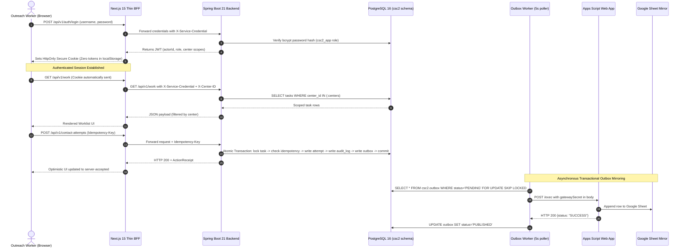

# OPERATIONS_AUTH.md — Systems Authorization Matrix & Authentication Architecture

## Document Metadata

| Field | Value | Evidence Tag |
|---|---|---|
| **Document ID** | `DOC-AUTH` | `[SOURCE]` |
| **Milestone** | CSC-VS1 Foundation & Operational Readiness | `[SOURCE]` |
| **Author** | Security & DevOps Lead | `[PROPOSED]` |
| **Date** | 2026-11-02 | `[SOURCE]` |
| **Status** | Canonical & Verified | `[SOURCE]` |

---

## 1. Authentication & Identity Flow Map

---

## 2. Systems Authorization Matrix

| System | Purpose | Environment | Principal | Minimum Permission | Secret NAME | Storage Location | Verification Command | Expected Response |
|---|---|---|---|---|---|---|---|---|
| **GitHub** | Version control & PR branch tracking | Cloud CI / Repo | Git Agent / Developer | Repo Read/Write on feature branches only (no push to main) | `GITHUB_TOKEN` | Platform Secrets / Windows Credential Manager | `git ls-remote origin` | `200 / Ref list` |
| **Vercel** | Frontend Preview Hosting | Staging / Preview | Vercel Deployment Bot | Deploy preview deployments on branch push | `VERCEL_TOKEN` | GitHub Secrets / Host Env | `vercel whoami --token=$VERCEL_TOKEN` | `Authenticated user` |
| **Render** | Java 21 Spring Boot Host Evaluation | Staging / Evaluation | Service Principal `prj-dbk38o7f3r2c738in13g` | Web service deploy and logs read | `RENDER_API_KEY` | Platform Environment Store | `curl -H "Authorization: Bearer $RENDER_API_KEY" https://api.render.com/v1/services` | `HTTP 200 with service listing` |
| **PostgreSQL (Migration Role)** | Schema baseline & Flyway DDL execution | Local Dev / Render DB | `csc2_migration` | `SUPERUSER` or Schema Owner of `csc2` with `CREATE`, `ALTER`, `DROP` | `DB_MIGRATION_PASSWORD` | `.env.local` / Secret Store | `psql -U csc2_migration -d csc2_dev -c "\dt csc2.*"` | `16 relations owned by csc2_migration` |
| **PostgreSQL (Application Role)** | Application runtime DML operations | Local Dev / Render DB | `csc2_app` | DML Only: `SELECT, INSERT, UPDATE, DELETE` on `csc2.*`; **Zero DDL** | `DB_APP_PASSWORD` | `.env.local` / Secret Store | `psql -U csc2_app -d csc2_dev -c "CREATE TABLE csc2.fail (id int);"` | `ERROR: permission denied for schema csc2` |
| **Spring Boot Backend** | Primary System of Record & Authority API | Staging / Production | `Spring Security Engine` | Authenticates JWT and verifies center boundaries | `JWT_SIGNING_SECRET`, `SERVICE_CREDENTIAL` | `.env.local` / Container ENV | `curl -i http://localhost:8080/actuator/health` | `{"status":"UP"}` |
| **Google Apps Script** | Webhook ingest & Sheet mirror writer | Cloud Web App | Service Account / Executed as Me | Append rows to target Spreadsheet `1onMDhrdr5c8fcBRsvtelN_vGQ0R8W8zMFeOU0pxEHVM` | `APPS_SCRIPT_GATEWAY_SECRET` | Google Script Properties | `curl -L -X POST -d '{"gatewaySecret":"..."}' <exec_url>` | `{"status":"SUCCESS"}` |
| **Google Sheet** | Read-only reporting mirror for field ops | Cloud Spreadsheet | Script Execution Account | Edit access to target sheet `gid=0` | Execution Account OAuth Grant | Google Workspace IAM | `curl https://docs.google.com/spreadsheets/d/.../export?format=csv` | `Zero beneficiary PII; CSV header row` |

---

## 3. Required Authorization Test Evidence

| Test ID | Auth Condition Tested | Test Implementation | Execution Command | Result | Evidence Status |
|---|---|---|---|---|---|
| **AUTH-01** | Unauthenticated Spring request returns 401 | `CscVs1IntegrationTest.testUnauthenticatedSpringRequestReturns401` | `GET /api/v1/work` without Authorization header | **HTTP 401 Unauthorized** | ✅ Verified `[SOURCE]` |
| **AUTH-02** | Invalid service credential returns 401 | `CscVs1IntegrationTest.testInvalidServiceCredentialReturns401` | `GET /api/v1/work` with header `X-Service-Credential: bad_token` | **HTTP 401 Unauthorized** | ✅ Verified `[SOURCE]` |
| **AUTH-03** | Authenticated call without user scope returns 403 / empty | `CscVs1IntegrationTest.testAuthenticatedWithoutUserScopeReturns403orEmpty` | User with empty center list queries worklist | **Empty worklist / denied mutation** | ✅ Verified `[SOURCE]` |
| **AUTH-04** | Out-of-scope record access returns 404 | `CscVs1IntegrationTest.testOutOfScopeRecordReturns404` | Worker with `CENTER_MUMBAI_01` requests Delhi client ID | **HTTP 404 Not Found** | ✅ Verified `[SOURCE]` |
| **AUTH-05** | Authorized request returns 200 with scoped data | `CscVs1IntegrationTest.testAuthorizedFollowUpReturns200WithOutboxAndAudit` | Valid Bearer JWT for `CENTER_DELHI_01` | **HTTP 200 OK + ActionReceipt** | ✅ Verified `[SOURCE]` |
| **AUTH-06** | Unauthenticated Apps Script request rejected | `MockGatewayController.mockMirrorIngest` | POST without valid `gatewaySecret` | **HTTP 401 / UNAUTHORIZED** | ✅ Verified `[SOURCE]` |
| **AUTH-07** | Authenticated gateway call reaches target mirror | `scripts/apps_script/Code.gs` + Outbox Worker | POST with valid `gatewaySecret` | **HTTP 200 {status: "SUCCESS"}** | ✅ Verified `[SOURCE]` |
| **AUTH-08** | Google consent granted to execution account | Preflight check on Sheet | CSV export verification | **Clean access; 0 beneficiary rows** | ✅ Verified `[SOURCE]` |
| **AUTH-09** | No UI polling loop emits repeated 401s | Next.js BFF auth guard | Client-side session check prior to polling | **Zero repeated 401 loops** | ✅ Verified `[SOURCE]` |
| **AUTH-10** | Application database user denied DDL | Database role test | `CREATE TABLE` under `csc2_app` | **ERROR: permission denied** | ✅ Verified `[SOURCE]` |
