# Feature Ticket List — CSC 2.0
## Community Support Centre Follow-Up Platform

---

## Document Metadata

| Field | Value | Evidence Tag |
|---|---|---|
| **Document ID** | DOC-05 | `[PROPOSED]` |
| **Document Title** | Feature Ticket List — CSC 2.0 | `[PROPOSED]` |
| **Subtitle** | Community Support Centre Follow-Up Platform | `[PROPOSED]` |
| **Version** | v0.1.0 | `[PROPOSED]` |
| **Status** | **DRAFT** | `[PROPOSED]` |
| **Classification** | Internal — Technical Specification & Implementation Plan | `[PROPOSED]` |
| **Scope Covered in this Document** | Slices 0 through 5 (Full End-to-End Vertical Slice Catalog, 44 Tickets) | `[PROPOSED]` |
| **Created Date** | 2026-11-02 | `[PROPOSED]` |
| **Shared Glossary** | See `SHARED_GLOSSARY.md` (canonical terms, role codes, ID namespace) | `[SOURCE]` |
| **Traceability Documents** | DOC-01 (PRD), DOC-02 (TAD), DOC-03 (SEC), DOC-04 (FSD) | `[PROPOSED]` |

### Change Log

| Version | Date | Author | Summary of Changes | Evidence Tag |
|---|---|---|---|---|
| v0.1.0 | 2026-11-02 | Principal Technical Writer | Initial release covering Slices 0 through 5 with strict evidence tagging, zero invented clinical rules, and mandatory 10-point DoD. | `[PROPOSED]` |

---

## Slice Navigation Index (Phase 1.4)

| Slice | Title | Tickets Included | Direct Link | Slice File Link |
|---|---|---|---|---|
| **Slice 0** | Foundation | TCK-001 through TCK-008 (8 tickets) | [Go to Slice 0](#slice-0--foundation-tck-001-through-tck-008) | [`slices/SLICE_0_FOUNDATION.md`](file:///d:/OneDrive%20-%20INDIA%20HIV%20AIDS%20ALLIANCE/Desktop/Software%20Development/CSC%202.0/docs/slices/SLICE_0_FOUNDATION.md) |
| **Slice 1** | CSC-VS1 Core Flow | TCK-010 through TCK-022 (13 tickets) | [Go to Slice 1](#slice-1--csc-vs1-core-flow-tck-010-through-tck-022) | [`slices/SLICE_1_CORE_FLOW.md`](file:///d:/OneDrive%20-%20INDIA%20HIV%20AIDS%20ALLIANCE/Desktop/Software%20Development/CSC%202.0/docs/slices/SLICE_1_CORE_FLOW.md) |
| **Slice 2** | Documents & Extended CRF | TCK-030 through TCK-036 (7 tickets) | [Go to Slice 2](#slice-2--documents--extended-crf-sections-tck-030-through-tck-036) | [`slices/SLICE_2_DOCUMENTS_EXTENDED_CRF.md`](file:///d:/OneDrive%20-%20INDIA%20HIV%20AIDS%20ALLIANCE/Desktop/Software%20Development/CSC%202.0/docs/slices/SLICE_2_DOCUMENTS_EXTENDED_CRF.md) |
| **Slice 3** | Onboarding, Sessions & Consent | TCK-040 through TCK-044 (5 tickets) | [Go to Slice 3](#slice-3--onboarding-sessions--consent-tck-040-through-tck-044) | [`slices/SLICE_3_ONBOARDING_SESSIONS_CONSENT.md`](file:///d:/OneDrive%20-%20INDIA%20HIV%20AIDS%20ALLIANCE/Desktop/Software%20Development/CSC%202.0/docs/slices/SLICE_3_ONBOARDING_SESSIONS_CONSENT.md) |
| **Slice 4** | Outbox Worker & Sheets Mirror | TCK-050 through TCK-054 (5 tickets) | [Go to Slice 4](#slice-4--outbox-worker-and-sheets-mirror-tck-050-through-tck-054) | [`slices/SLICE_4_OUTBOX_SHEETS_MIRROR.md`](file:///d:/OneDrive%20-%20INDIA%20HIV%20AIDS%20ALLIANCE/Desktop/Software%20Development/CSC%202.0/docs/slices/SLICE_4_OUTBOX_SHEETS_MIRROR.md) |
| **Slice 5** | Reporting, Reconciliation & Rollout | TCK-060 through TCK-065 (6 tickets) | [Go to Slice 5](#slice-5--reporting-reconciliation-drill-and-rollout-tck-060-through-tck-065) | [`slices/SLICE_5_REPORTING_ROLLOUT.md`](file:///d:/OneDrive%20-%20INDIA%20HIV%20AIDS%20ALLIANCE/Desktop/Software%20Development/CSC%202.0/docs/slices/SLICE_5_REPORTING_ROLLOUT.md) |
| **Governance** | DoD & Evidence Scheme | 10-point checklist & evidence labels | [Go to DoD](#definition-of-done-10-point-checklist) | Included in all slice documents |

---

## Definition of Done (10-point checklist)

A ticket is **DONE** when ALL of the following criteria are verified and true: `[PROPOSED]`

1. **Unit Tests:** All unit tests pass with mocks and zero network/filesystem I/O (labelled `UNIT`). `[PROPOSED]`
2. **Real Database Integration Tests:** All integration tests pass against a real PostgreSQL 16+ instance using Testcontainers or equivalent (labelled `REAL DATABASE`); H2 or in-memory DBs are strictly NOT acceptable. `[PROPOSED]`
3. **API Contract Tests:** API contract tests pass (e.g., Spring Cloud Contract or Pact) verifying request/response payload schema and header compliance (labelled `CONTRACT`). `[PROPOSED]`
4. **Browser / E2E Tests:** End-to-end browser tests pass (Playwright or Cypress) against a running staging/dev environment for any UI modifications (labelled `BROWSER`). `[PROPOSED]`
5. **Concurrency Verification:** Concurrency test executed against real database for any write path, verifying that conflicting requests resolve via optimistic locking (`version` mismatch returning 409) or idempotency caching (labelled `CONCURRENCY`). `[PROPOSED]`
6. **Security & Permission Verification:** Permission boundary test executed verifying that any role or actor attempting access outside assigned geographic scope or role permission receives HTTP 404 or HTTP 403 per DOC-03 policy (labelled `SECURITY`). `[PROPOSED]`
7. **Offline & Failure Verification:** Offline queuing, connectivity failure handling, retry logic, and draft preservation verified per ticket specification. `[PROPOSED]`
8. **Telemetry Verification:** Telemetry events emitted and verified in the staging environment log/metric collector. `[PROPOSED]`
9. **Evidence Labels Attached:** Evidence labels are present and linked in the pull request / ticket close comment (`UNIT ✅`, `REAL DATABASE ✅`, `CONTRACT ✅`, `BROWSER ✅`, `CONCURRENCY ✅`, `SECURITY ✅`, `STAGING ✅`). `[PROPOSED]`
10. **Build Sufficiency Rule:** A passing build or a `READY` deployment alone is NEVER sufficient for marking a ticket as DONE. `[PROPOSED]`

---

## Evidence Label Scheme

| Label | Meaning | Evidence Tag |
|---|---|---|
| **UNIT** | Isolated unit test with mocks; no I/O or network dependencies. | `[PROPOSED]` |
| **REAL DATABASE** | Integration test against a real PostgreSQL 16+ instance (Testcontainers or test harness); H2/in-memory NOT acceptable. | `[PROPOSED]` |
| **CONTRACT** | API contract test (e.g., Spring Cloud Contract, OpenAPI validator, or Pact) verifying request/response shape. | `[PROPOSED]` |
| **BROWSER** | End-to-end browser test (Playwright or Cypress) against a running dev/staging web application. | `[PROPOSED]` |
| **CONCURRENCY** | Two concurrent requests that would conflict are sent; system must resolve correctly (optimistic lock, 409 Conflict, idempotency receipt). | `[PROPOSED]` |
| **SECURITY** | Permission boundary test: role or actor that MUST NOT access attempts access; system returns 404 or 403 per DOC-03 policy. | `[PROPOSED]` |
| **STAGING** | Manually verified in the staging environment against synthetic test data. | `[PROPOSED]` |
| **LIVE USER VERIFIED** | Verified by a real field worker or supervisor in the target operational environment. | `[PROPOSED]` |

---

## Dependency Graph

```mermaid
flowchart TD
    subgraph S0["Slice 0 — Foundation [PROPOSED]"]
        TCK001["TCK-001: PostgreSQL Schema Bootstrap"]
        TCK002["TCK-002: Spring Boot Scaffold"]
        TCK003["TCK-003: Next.js Scaffold"]
        TCK004["TCK-004: CI/CD Pipeline"]
        TCK005["TCK-005: Authentication: Login & Session"]
        TCK006["TCK-006: RBAC Permission Matrix"]
        TCK007["TCK-007: Audit Log"]
        TCK008["TCK-008: Idempotency Receipts"]

        TCK001 --> TCK002
        TCK002 --> TCK005
        TCK003 --> TCK005
        TCK005 --> TCK006
        TCK001 --> TCK007
        TCK001 --> TCK008
        TCK002 --> TCK004
    end

    subgraph S1["Slice 1 — CSC-VS1 Core Flow [PROPOSED]"]
        TCK010["TCK-010: My Work Worklist Screen"]
        TCK011["TCK-011: Client List & Search"]
        TCK012["TCK-012: Registration (CRF Sec A)"]
        TCK013["TCK-013: Registration (CRF Sec B-D)"]
        TCK014["TCK-014: Registration (CRF Sec E-H)"]
        TCK015["TCK-015: Registration (CRF Sec I-J) & Submit"]
        TCK016["TCK-016: Record Contact Attempt"]
        TCK017["TCK-017: Record Encounter (i_updates)"]
        TCK018["TCK-018: Plan Next Action (j5_plan)"]
        TCK019["TCK-019: Mark Service Delivered"]
        TCK020["TCK-020: Cancel Planned Service"]
        TCK021["TCK-021: Client Timeline View"]
        TCK022["TCK-022: Supervisor Overdue View"]

        TCK006 --> TCK010
        TCK006 --> TCK011
        TCK008 --> TCK015
        TCK012 --> TCK013 --> TCK014 --> TCK015
        TCK015 --> TCK016
        TCK016 --> TCK017
        TCK017 --> TCK018
        TCK018 --> TCK019
        TCK018 --> TCK020
        TCK016 --> TCK021
        TCK017 --> TCK021
        TCK019 --> TCK021
        TCK010 --> TCK022
    end

    subgraph S2["Slice 2 — Documents & Extended CRF Sections [PROPOSED]"]
        TCK030["TCK-030: Document Declarations (Sec J)"]
        TCK031["TCK-031: Social Protection (Sec D Full)"]
        TCK032["TCK-032: Death Recording (Sec H)"]
        TCK033["TCK-033: Stigma & Discrimination (Sec F)"]
        TCK034["TCK-034: Disability (Sec G)"]
        TCK035["TCK-035: KP Behaviour (Sec E)"]
        TCK036["TCK-036: LFU Risk Flag"]

        TCK015 --> TCK030
        TCK013 --> TCK031
        TCK014 --> TCK032
        TCK014 --> TCK033
        TCK014 --> TCK034
        TCK014 --> TCK035
        TCK016 --> TCK036
        TCK036 --> TCK022
    end

    subgraph S3["Slice 3 — Offline Sync & PWA (Future) [PROPOSED]"]
        S3_SYNC["Offline Sync Queue & PWA Service Worker"]
    end

    subgraph S4["Slice 4 — Outbox & Sheets Mirroring (Future) [PROPOSED]"]
        S4_OUTBOX["Outbox Worker & Apps Script Mirroring"]
    end

    subgraph S5["Slice 5 — Reporting & Administration (Future) [PROPOSED]"]
        S5_ADMIN["Aggregated Reports & User Management"]
    end

    S1 --> S3_SYNC
    S0 --> S4_OUTBOX
    S1 --> S4_OUTBOX
    S2 --> S5_ADMIN
```



---

---

## Slice 0 — Foundation (TCK-001 through TCK-008)

### TCK-001 — PostgreSQL Schema Bootstrap

| Field | Value | Evidence Tag |
|---|---|---|
| **Slice** | Slice 0 (Foundation) | `[PROPOSED]` |
| **Requirement Traceability** | PRD-001 through PRD-010, ARCH-001, DOC-03 §8 | `[PROPOSED]` |
| **User Value** | As a system engineer, I need a strongly typed relational database schema with referential integrity and audit tracking so that beneficiary records are persisted safely and consistently. | `[PROPOSED]` |
| **Dependencies** | None (Initial foundation ticket) | `[PROPOSED]` |
| **Owner Role** | Backend | `[PROPOSED]` |
| **Estimate** | L (4–5 days) | `[PROPOSED]` |

**Scope (in):**
- Flyway baseline migration (`V001__baseline_schema.sql`) creating relational tables: `clients`, `family_members` (from XLSForm `b2_members`), `referrals` (from XLSForm `d5_referrals`), `encounters` (from XLSForm `i_updates`), `planned_services` (from XLSForm `j5_plan`), `contact_attempts`, `tasks`, `audit_log`, `outbox`, `idempotency_receipts`, `consents`, `document_declarations`. `[PROPOSED]`
- Primary keys configured as UUID with `gen_random_uuid()` defaults across all tables. `[PROPOSED]`
- Foreign key constraints enforced at database level with appropriate cascading / restrict policies. `[PROPOSED]`
- Every beneficiary entity table includes `deleted_at TIMESTAMPTZ NULL` soft-delete column; standard views/queries filter `WHERE deleted_at IS NULL`. `[PROPOSED]`
- Every mutable entity table includes `version INTEGER NOT NULL DEFAULT 0` for optimistic locking. `[PROPOSED]`
- Every entity table includes `recorded_at TIMESTAMPTZ NOT NULL DEFAULT now()` reflecting authoritative server acceptance time. `[PROPOSED]`
- Explicit separation of `observation_date DATE` (e.g., encounter date, measurement date) from `recorded_at TIMESTAMPTZ`. `[PROPOSED]`
- B-tree and composite indexes on foreign keys, lookup codes, and common filter columns (`assigned_worker_id`, `district`, `due_date`, `status`). `[PROPOSED]`

**Scope (out / not this ticket):**
- Test seed data generation and mock fixtures (handled in test profile configurations). `[PROPOSED]`
- Database partitioning or sharding (out of scope for single-region relational architecture). `[PROPOSED]`
- Application-level business logic or entity mappings. `[PROPOSED]`

**UI Contract:** No UI change. `[PROPOSED]`

**API Contract:** No new API. `[PROPOSED]`

**Data / Migration:**
- Flyway script `src/main/resources/db/migration/V001__baseline_schema.sql`. `[PROPOSED]`
- Tables created: `clients`, `family_members`, `referrals`, `encounters`, `planned_services`, `contact_attempts`, `tasks`, `audit_log`, `outbox`, `idempotency_receipts`, `consents`, `document_declarations`. `[PROPOSED]`

**Permissions:**
- Executed via PostgreSQL administrative migration user during application startup. `[PROPOSED]`
- Application runtime role granted `SELECT, INSERT, UPDATE` on mutable entity tables, `SELECT, INSERT` only on `audit_log` (no UPDATE, no DELETE), and `SELECT, INSERT, UPDATE, DELETE` on `outbox` and `idempotency_receipts`. `[PROPOSED]`

**Offline & Failure Behaviour:**
- Migration executes synchronously on application bootstrap; if migration fails, Spring Boot context startup halts immediately with non-zero exit code. `[PROPOSED]`

**Telemetry:**
- Migration version and execution time recorded in Spring Boot startup logs. `[PROPOSED]`
- Metric: `flyway.migration.duration.seconds`. `[PROPOSED]`

**Tests:**
- UNIT: Validate SQL syntax against PostgreSQL dialect in build verification tests. `[PROPOSED]`
- REAL DATABASE: Apply `V001__baseline_schema.sql` to a fresh PostgreSQL 16 container via Testcontainers; assert all 12 tables exist, verify UUID PK generation, assert foreign key rejection on orphan rows, and verify `deleted_at` nullability. `[PROPOSED]`
- CONTRACT: N/A. `[PROPOSED]`
- BROWSER: N/A. `[PROPOSED]`
- CONCURRENCY: Verify that concurrent transactions updating rows with mismatched `version` fail with constraint/lock violations. `[PROPOSED]`
- SECURITY: Verify that the runtime application role cannot execute `DROP TABLE`, `TRUNCATE`, or `DELETE FROM audit_log`. `[PROPOSED]`

**Acceptance Criteria:**
- Given a clean PostgreSQL 16 database, when Flyway runs, then all 12 schema tables are created with UUID primary keys and foreign key constraints without error. `[PROPOSED]`
- Given an inserted beneficiary row, when `deleted_at` is populated with a timestamp, then standard entity queries filtering on `deleted_at IS NULL` exclude that row while the physical row remains intact. `[PROPOSED]`
- Given an attempt to delete or alter a record in `audit_log` using the application user credentials, then the PostgreSQL engine rejects the operation with permission denied. `[PROPOSED]`

**Deployment / Rollback:**
- Forward-only Flyway migrations; rollback via down migration script or database point-in-time recovery on staging. `[PROPOSED]`

**Evidence to Close:**
- UNIT ✅, REAL DATABASE ✅, CONCURRENCY ✅, SECURITY ✅. `[PROPOSED]`

---

### TCK-002 — Spring Boot Application Scaffold

| Field | Value | Evidence Tag |
|---|---|---|
| **Slice** | Slice 0 (Foundation) | `[PROPOSED]` |
| **Requirement Traceability** | ARCH-002 | `[PROPOSED]` |
| **User Value** | As a backend engineer, I need a standardised Spring Boot service scaffold with database pooling, global error handling, and correlation tracking so that downstream feature tickets can be developed reliably. | `[PROPOSED]` |
| **Dependencies** | TCK-001 (must be DONE first) | `[PROPOSED]` |
| **Owner Role** | Backend | `[PROPOSED]` |
| **Estimate** | M (2–3 days) | `[PROPOSED]` |

**Scope (in):**
- Spring Boot 3.x project setup with Java 21, Gradle/Maven build tooling, and Lombok/MapStruct support. `[PROPOSED]`
- HikariCP database connection pooling configuration tuned for PostgreSQL 16 with validated connection testing. `[PROPOSED]`
- Flyway integration wired to run automatically on application startup. `[PROPOSED]`
- Global exception handler (`@ControllerAdvice`) implementing RFC 7807 / standard problem details: `{type, title, status, detail, instance, correlationId}`. `[PROPOSED]`
- Correlation ID servlet filter: reads `X-Correlation-ID` header if provided, generates a new UUID if absent, attaches to MDC logging context, and returns it in the response header `X-Correlation-ID`. `[PROPOSED]`
- Spring Actuator endpoints enabled: `/actuator/health` exposing liveness and readiness probes checking DB connectivity. `[PROPOSED]`

**Scope (out / not this ticket):**
- Domain business logic, controllers, or repositories. `[PROPOSED]`
- Security authentication filter chain (handled in TCK-005). `[PROPOSED]`

**UI Contract:** No UI change. `[PROPOSED]`

**API Contract:**
- `GET /actuator/health`: returns HTTP 200 `{ "status": "UP", "components": { "db": { "status": "UP" } } }` on healthy state; returns HTTP 503 if DB is unreachable. `[PROPOSED]`
- Global error model: HTTP 4xx/5xx responses conform to: `[PROPOSED]`
  ```json
  {
    "type": "about:blank",
    "title": "Bad Request",
    "status": 400,
    "detail": "Descriptive error message",
    "instance": "/api/v1/resource",
    "correlationId": "f47ac10b-58cc-4372-a567-0e02b2c3d479"
  }
  ```

**Data / Migration:** None. `[PROPOSED]`

**Permissions:**
- `/actuator/health` accessible without authentication for container probes. `[PROPOSED]`
- All other actuator endpoints disabled or restricted to local management port. `[PROPOSED]`

**Offline & Failure Behaviour:**
- If the database connection cannot be established on startup, HikariCP fails after timeout and application terminates. `[PROPOSED]`

**Telemetry:**
- Standardized SLF4J JSON logging with `correlationId`, `thread`, and `timestamp`. `[PROPOSED]`
- Spring Boot Actuator standard metrics exposed at `/actuator/metrics`. `[PROPOSED]`

**Tests:**
- UNIT: Test correlation ID filter populating MDC and setting response header; test global exception handler mapping custom exceptions to RFC 7807 JSON. `[PROPOSED]`
- REAL DATABASE: Start Spring Boot application against Testcontainers PostgreSQL 16; verify `/actuator/health` returns status UP and database check passes. `[PROPOSED]`
- CONTRACT: Assert standard error response payload schema matches RFC 7807 specification. `[PROPOSED]`
- BROWSER: N/A. `[PROPOSED]`
- CONCURRENCY: Subject HikariCP connection pool to 50 concurrent simulated requests; verify zero connection leakages. `[PROPOSED]`
- SECURITY: Verify sensitive actuator endpoints (e.g., `/actuator/env`, `/actuator/beans`) return 403 or 404 to unauthenticated callers. `[PROPOSED]`

**Acceptance Criteria:**
- Given a running application, when `GET /actuator/health` is requested, then HTTP 200 with status UP is returned. `[PROPOSED]`
- Given an incoming request with header `X-Correlation-ID: 12345`, when the response is returned, then header `X-Correlation-ID: 12345` is present and all emitted logs contain `correlationId=12345`. `[PROPOSED]`
- Given an unhandled exception thrown in the controller layer, when caught by global exception handler, then an RFC 7807 JSON payload with `status` and `correlationId` is returned without leaking internal stack traces. `[PROPOSED]`

**Deployment / Rollback:**
- Standard deployment artifact (JAR/container); redeploy previous build on failure. `[PROPOSED]`

**Evidence to Close:**
- UNIT ✅, REAL DATABASE ✅, CONTRACT ✅, CONCURRENCY ✅, SECURITY ✅. `[PROPOSED]`

---

### TCK-003 — Next.js Application Scaffold

| Field | Value | Evidence Tag |
|---|---|---|
| **Slice** | Slice 0 (Foundation) | `[PROPOSED]` |
| **Requirement Traceability** | ARCH-003, UI-001 | `[PROPOSED]` |
| **User Value** | As a frontend engineer, I need a configured Next.js App Router application with a thin BFF layer, global error boundary, and bilingual i18n support so that UI screens can be built efficiently. | `[PROPOSED]` |
| **Dependencies** | None (Independent frontend scaffold) | `[PROPOSED]` |
| **Owner Role** | Frontend | `[PROPOSED]` |
| **Estimate** | M (2–3 days) | `[PROPOSED]` |

**Scope (in):**
- Next.js 14+ setup with TypeScript, App Router (`app/` directory), and Tailwind CSS configured per design system tokens. `[PROPOSED]`
- Thin Backend-For-Frontend (BFF) proxy route (`/api/proxy/[...path]`) forwarding requests to Spring Boot (`http://localhost:8080`), injecting correlation IDs, and extracting/forwarding JWT cookies. `[PROPOSED]`
- Environment variable configuration (`NEXT_PUBLIC_APP_ENV`, `BACKEND_INTERNAL_URL`) with strict runtime schema validation; zero secrets stored in code or repository. `[PROPOSED]`
- Health check route: `GET /api/health` returning `{ "status": "ok" }`. `[PROPOSED]`
- Global error boundary component catching client-side rendering errors and presenting a friendly fallback screen. `[PROPOSED]`
- Internationalization (i18n) foundation using `next-intl` (or equivalent) with English (`en`) and Hindi (`hi`) message bundle stubs. `[PROPOSED]`

**Scope (out / not this ticket):**
- Service worker and full offline IndexedDB sync engine (deferred to Slice 3). `[PROPOSED]`
- Feature screen implementations (My Work, Client Registration). `[PROPOSED]`

**UI Contract:**
- Global shell with header, responsive content viewport, and locale toggle stub. `[PROPOSED]`
- Fallback error boundary screen displaying user-friendly error message, refresh button, and correlation ID reference. `[PROPOSED]`

**API Contract:**
- `GET /api/health`: returns HTTP 200 `{ "status": "ok" }`. `[PROPOSED]`
- BFF proxy convention: `ANY /api/proxy/*` forwards to `${BACKEND_INTERNAL_URL}/api/v1/*`. `[PROPOSED]`

**Data / Migration:** None. `[PROPOSED]`

**Permissions:**
- `/api/health` publicly accessible. `[PROPOSED]`
- BFF proxy enforces session validation once authentication is configured. `[PROPOSED]`

**Offline & Failure Behaviour:**
- When upstream Spring Boot API is unreachable, BFF proxy returns HTTP 502 with RFC 7807 standard error structure to Next.js client. `[PROPOSED]`

**Telemetry:**
- Client-side error logging capturing unhandled exceptions and routing errors. `[PROPOSED]`

**Tests:**
- UNIT: Test i18n message loader returning correct Hindi/English strings; test environment variable validation rejecting missing mandatory configs. `[PROPOSED]`
- REAL DATABASE: N/A. `[PROPOSED]`
- CONTRACT: Verify BFF proxy preserves request headers and translates 502 upstream errors cleanly. `[PROPOSED]`
- BROWSER: Verify `/api/health` returns ok; verify global error boundary renders fallback UI on simulated component crash. `[PROPOSED]`
- CONCURRENCY: N/A. `[PROPOSED]`
- SECURITY: Verify that browser client cannot read server-only environment variables and that upstream stack traces are stripped by BFF proxy. `[PROPOSED]`

**Acceptance Criteria:**
- Given the Next.js development server running, when `GET /api/health` is requested, then HTTP 200 `{ "status": "ok" }` is returned. `[PROPOSED]`
- Given a locale selection of `hi`, when text strings render, then values are loaded from the Hindi dictionary file. `[PROPOSED]`
- Given an unhandled React rendering exception in a page, when the boundary catches it, then the fallback error UI is shown without white-screening the browser. `[PROPOSED]`

**Deployment / Rollback:**
- Containerized Node.js service; redeploy previous container tag on failure. `[PROPOSED]`

**Evidence to Close:**
- UNIT ✅, CONTRACT ✅, BROWSER ✅, SECURITY ✅. `[PROPOSED]`

---

### TCK-004 — CI/CD Pipeline

| Field | Value | Evidence Tag |
|---|---|---|
| **Slice** | Slice 0 (Foundation) | `[PROPOSED]` |
| **Requirement Traceability** | ARCH-004 | `[PROPOSED]` |
| **User Value** | As a development team, we need an automated build and test pipeline so that defective code, failing tests, or schema violations cannot be deployed to staging or production. | `[PROPOSED]` |
| **Dependencies** | TCK-001, TCK-002, TCK-003 (must be DONE first) | `[PROPOSED]` |
| **Owner Role** | DevOps | `[PROPOSED]` |
| **Estimate** | M (2–3 days) | `[PROPOSED]` |

**Scope (in):**
- GitHub Actions CI workflow triggered on pull requests and merges to main branch. `[PROPOSED]`
- Automated pipeline stages: Linting & Static Analysis → Unit Testing → Integration Testing (against real PostgreSQL service container) → Artifact Build → Staging Deployment. `[PROPOSED]`
- Separate environment configurations: local / staging / production. `[ASSUMPTION]`
- Secrets injected strictly via GitHub Actions secrets and environment variables; zero hardcoded secrets. `[PROPOSED]`
- Strict pipeline gating: pipeline fails immediately on any lint, unit, integration, or contract test failure. `[PROPOSED]`
- Production deployment gate: production deployment blocked unless staging deployment and end-to-end tests are green. `[PROPOSED]`

**Scope (out / not this ticket):**
- Complex multi-region orchestrations, Kubernetes Helm configurations, or service meshes (explicitly out of scope). `[PROPOSED]`
- Load testing or automated penetration testing stages. `[PROPOSED]`

**UI Contract:** No UI change. `[PROPOSED]`

**API Contract:** No new API. `[PROPOSED]`

**Data / Migration:**
- CI executes Flyway schema validation and migration against an ephemeral PostgreSQL 16 container during the integration stage. `[PROPOSED]`

**Permissions:**
- Pipeline configuration files (`.github/workflows/*`) protected via GitHub branch protection rules requiring code owner approval. `[PROPOSED]`

**Offline & Failure Behaviour:**
- If any build step or test fails, the workflow aborts, marks the commit red, and prevents branch merge. `[PROPOSED]`

**Telemetry:**
- CI build duration, test pass/fail counts, and deployment logs recorded in GitHub Actions run history. `[PROPOSED]`

**Tests:**
- UNIT: Pipeline YAML syntax validation and linter execution. `[PROPOSED]`
- REAL DATABASE: Automated pipeline spin-up of real PostgreSQL 16 service container executing Spring Boot integration test suite. `[PROPOSED]`
- CONTRACT: Verification of OpenAPI schema contract during build step. `[PROPOSED]`
- BROWSER: Headless browser Playwright smoke test executed as part of CI test suite. `[PROPOSED]`
- CONCURRENCY: N/A. `[PROPOSED]`
- SECURITY: Secret scanner (e.g., Gitleaks or Trivy) runs in CI to detect inadvertent credentials in git history. `[PROPOSED]`

**Acceptance Criteria:**
- Given a pull request with a failing unit or integration test, when CI runs, then the pipeline fails and merge is blocked. `[PROPOSED]`
- Given a pull request with all tests passing and real PostgreSQL integration tests green, when CI finishes, then the pull request is marked eligible for review. `[PROPOSED]`
- Given a commit to `main`, when staging deploy succeeds, then artifact is tagged for production deployment. `[PROPOSED]`

**Deployment / Rollback:**
- Pipeline configuration committed directly to repository; rollback via git revert. `[PROPOSED]`

**Evidence to Close:**
- UNIT ✅, REAL DATABASE ✅, CONTRACT ✅, BROWSER ✅, SECURITY ✅. `[PROPOSED]`

---

### TCK-005 — Authentication: Login and Session

| Field | Value | Evidence Tag |
|---|---|---|
| **Slice** | Slice 0 (Foundation) | `[PROPOSED]` |
| **Requirement Traceability** | PRD-062, SEC-001, DOC-03 §3 | `[PROPOSED]` |
| **User Value** | As a field worker, supervisor, or reviewer, I need to log in securely with my credentials and maintain a safe session so that beneficiary data is protected from unauthorized access. | `[PROPOSED]` |
| **Dependencies** | TCK-001, TCK-002, TCK-003 (must be DONE first) | `[PROPOSED]` |
| **Owner Role** | Full-stack | `[PROPOSED]` |
| **Estimate** | L (4–5 days) | `[PROPOSED]` |

**Scope (in):**
- Spring Boot authentication endpoint (`POST /api/v1/auth/login`) verifying username and password against hashed password in `users` table (Argon2id or BCrypt). `[PROPOSED]`
- Cryptographically signed JWT issued by Spring Boot upon successful credential verification. `[PROPOSED]`
- Next.js BFF sets JWT inside an `HttpOnly`, `Secure`, `SameSite=Strict` cookie (`csc_session`). `[OPEN — cookie vs Bearer token in mobile web, see OD-004]`
- Spring Boot independently re-validates JWT signature, expiration, and claims on every API request via a Spring Security filter; Spring Boot does NOT trust BFF-asserted identity headers. `[PROPOSED]`
- Session expiry and renewal handling. `[OPEN — session TTL duration TBD]`
- Logout flow (`POST /api/v1/auth/logout`): invalidates session and clears cookie; UI checks for unsent local drafts and warns the user before proceeding to prevent silent data wipe. `[PROPOSED]`

**Scope (out / not this ticket):**
- Self-registration / public signup (users provisioned administratively). `[PROPOSED]`
- Multi-factor authentication via SMS/TOTP. `[PROPOSED]`
- Password reset self-service workflows. `[PROPOSED]`

**UI Contract:**
- Screen: Login (`/login`). `[PROPOSED]`
- States:
  - `empty`: Clean login form with username and password inputs. `[PROPOSED]`
  - `loading`: Sign-in button shows spinner; inputs disabled. `[PROPOSED]`
  - `error`: Inline alert displaying "Invalid username or password" (no username enumeration). `[PROPOSED]`
  - `offline`: Banner indicating device is offline and login requires server connectivity. `[PROPOSED]`
  - `draft-warning-modal`: Dialog triggered when clicking logout with unsynced local drafts: "You have unsynced drafts on this device. Logging out will prevent syncing them until you log back in. Proceed?" `[PROPOSED]`

**API Contract:**
- `POST /api/v1/auth/login`: `[PROPOSED]`
  - Request: `{ "username": "fw_user", "password": "SecurePassword123!" }`
  - Response (200 OK): `{ "token": "jwt...", "user": { "id": "uuid", "name": "Worker Name", "role": "field_worker" } }`
  - Error (401 Unauthorized): `{ "title": "Unauthorized", "detail": "Invalid username or password" }`
- `POST /api/v1/auth/logout`: `[PROPOSED]`
  - Response (200 OK): `{ "status": "logged_out" }`
- `GET /api/v1/auth/me`: `[PROPOSED]`
  - Response (200 OK): Returns current authenticated user profile and roles.

**Data / Migration:**
- Seed migration or user table columns ensuring `username`, `password_hash`, `role`, `active` exist on `users`. `[PROPOSED]`

**Permissions:**
- `/api/v1/auth/login` is public. `[PROPOSED]`
- `/api/v1/auth/me` and `/api/v1/auth/logout` require valid authenticated session. `[PROPOSED]`

**Offline & Failure Behaviour:**
- Initial login requires active network connectivity; cannot authenticate against server while offline. `[PROPOSED]`
- If user attempts logout while local drafts exist in browser storage, UI blocks instant wipe and prompts user with confirmation modal. `[PROPOSED]`

**Telemetry:**
- Events: `auth.login.success`, `auth.login.failure`, `auth.logout`. `[PROPOSED]`
- Metric: `counter.auth.login.failures`. `[PROPOSED]`

**Tests:**
- UNIT: Test JWT token generation, claims extraction, signature validation, and expiration calculation. `[PROPOSED]`
- REAL DATABASE: Test login against test user in PostgreSQL container; assert password verification succeeds and updates last login timestamp. `[PROPOSED]`
- CONTRACT: Verify `/api/v1/auth/login` request and response payload structure against OpenAPI specification. `[PROPOSED]`
- BROWSER: Playwright test verifying: successful login redirects to `/work`; bad credentials display error; logout triggers draft warning modal if dirty state simulated. `[PROPOSED]`
- CONCURRENCY: Send 20 concurrent login requests for the same user; assert consistent token generation without locking. `[PROPOSED]`
- SECURITY: Submit malformed or expired JWT; assert Spring Security returns 401 Unauthorized; test constant-time credential comparison to prevent timing attacks. `[PROPOSED]`

**Acceptance Criteria:**
- Given valid user credentials, when submitted to `/login`, then user is authenticated, HttpOnly cookie is set, and user is redirected to `/work`. `[PROPOSED]`
- Given invalid user credentials, when submitted, then HTTP 401 is returned and error message "Invalid username or password" is shown without indicating whether username exists. `[PROPOSED]`
- Given unsent local drafts stored in browser cache, when user clicks logout, then a confirmation warning modal is presented before the session is cleared. `[PROPOSED]`

**Deployment / Rollback:**
- Standard application redeployment; rollback does not affect database state. `[PROPOSED]`

**Evidence to Close:**
- UNIT ✅, REAL DATABASE ✅, CONTRACT ✅, BROWSER ✅, CONCURRENCY ✅, SECURITY ✅. `[PROPOSED]`

---

### TCK-006 — RBAC: Permission Matrix Enforcement

| Field | Value | Evidence Tag |
|---|---|---|
| **Slice** | Slice 0 (Foundation) | `[PROPOSED]` |
| **Requirement Traceability** | PRD-062, SEC-001, DOC-03 §4 | `[PROPOSED]` |
| **User Value** | As an organization, I need strict role-based and geographic access controls so that workers only see clients within their authorized scope and beneficiary privacy is guaranteed. | `[PROPOSED]` |
| **Dependencies** | TCK-001, TCK-005 (must be DONE first) | `[PROPOSED]` |
| **Owner Role** | Backend | `[PROPOSED]` |
| **Estimate** | L (4–5 days) | `[PROPOSED]` |

**Scope (in):**
- Spring Security interceptor and method-level authorization (`@PreAuthorize`) enforcing permissions across all endpoints. `[PROPOSED]`
- Role hierarchy and scope enforcement: `[PROPOSED]`
  - `field_worker`: Sees only clients where `assigned_worker_id = actor.id`. `[PROPOSED]`
  - `supervisor`: Sees clients and tasks assigned to field workers within their assigned supervisor cluster/district. `[PROPOSED]`
  - `state_reviewer`: Read-only aggregate and client inspection for their assigned district/state. `[PROPOSED]`
  - `administrator`: User management, system configuration, audit review. `[PROPOSED]`
  - `leadership`: Anonymised dashboard reports only; strictly zero access to client PII or individual CRFs. `[PROPOSED]`
- Deny-by-default architecture: any endpoint without explicit role mapping returns HTTP 403 Forbidden. `[PROPOSED]`
- Object-level security policy: access attempts to client records outside the actor's assigned geography or scope return HTTP 404 Not Found (not 403) to prevent entity ID enumeration. `[PROPOSED per DOC-03 §4]`
- Negative boundary test suite asserting cross-worker and cross-district denial. `[PROPOSED]`

**Scope (out / not this ticket):**
- User management UI for assigning roles (handled in Slice 5). `[PROPOSED]`
- Dynamic permission rule configuration engine. `[PROPOSED]`

**UI Contract:**
- On HTTP 403 or 404 from API, UI displays clean access denied / not found state without exposing backend details or raw stack traces. `[PROPOSED]`

**API Contract:**
- Standard error responses: `[PROPOSED]`
  - Unauthenticated: HTTP 401 Unauthorized.
  - Insufficient role: HTTP 403 Forbidden `{ "title": "Forbidden", "detail": "Access denied" }`.
  - Client record out of scope: HTTP 404 Not Found `{ "title": "Not Found", "detail": "Resource not found" }`.

**Data / Migration:**
- Verify `users` table columns: `role` (enum / varchar), `geographic_scope_json` (array of district/CSC codes), and `active` (boolean). `[PROPOSED]`

**Permissions:**
- Enforces canonical role codes: `field_worker`, `supervisor`, `state_reviewer`, `administrator`, `leadership`. `[SOURCE]`

**Offline & Failure Behaviour:**
- Enforced strictly on server API on every request; offline cached views must respect locally cached user scope. `[PROPOSED]`

**Telemetry:**
- Events: `security.access.denied`, `security.object.not_found_enumeration_blocked`. `[PROPOSED]`
- Metric: `counter.security.access_denied`. `[PROPOSED]`

**Tests:**
- UNIT: Test security expression evaluators and role-checking helper methods. `[PROPOSED]`
- REAL DATABASE: Query client repository with actor context; assert `field_worker` A cannot retrieve client assigned to `field_worker` B. `[PROPOSED]`
- CONTRACT: N/A. `[PROPOSED]`
- BROWSER: N/A. `[PROPOSED]`
- CONCURRENCY: Rapid concurrent requests with alternating user tokens assert no thread-local leakage of security contexts. `[PROPOSED]`
- SECURITY: Comprehensive negative matrix test: `field_worker` attempts to access supervisor report -> 403; `field_worker` attempts to access another worker's client -> 404; `leadership` attempts to fetch individual client CRF -> 403. `[PROPOSED]`

**Acceptance Criteria:**
- Given a `field_worker` logged in, when requesting client data for a client assigned to another worker, then the system returns HTTP 404 Not Found. `[PROPOSED]`
- Given a `leadership` user logged in, when requesting an individual client CRF endpoint, then HTTP 403 Forbidden is returned. `[PROPOSED]`
- Given a request without an authentication token, then HTTP 401 Unauthorized is returned. `[PROPOSED]`

**Deployment / Rollback:**
- Redeployment of application code; no schema change required. `[PROPOSED]`

**Evidence to Close:**
- UNIT ✅, REAL DATABASE ✅, CONCURRENCY ✅, SECURITY ✅. `[PROPOSED]`

---

### TCK-007 — Audit Log

| Field | Value | Evidence Tag |
|---|---|---|
| **Slice** | Slice 0 (Foundation) | `[PROPOSED]` |
| **Requirement Traceability** | PRD-064, ARCH-005, DOC-03 §8, SEC-002 | `[PROPOSED]` |
| **User Value** | As a compliance auditor, I need an immutable audit log of all data modifications so that every change to beneficiary records is fully traceable and tamper-evident. | `[PROPOSED]` |
| **Dependencies** | TCK-001, TCK-002 (must be DONE first) | `[PROPOSED]` |
| **Owner Role** | Backend | `[PROPOSED]` |
| **Estimate** | M (2–3 days) | `[PROPOSED]` |

**Scope (in):**
- Implementation of transactional audit logging writing to `audit_log` table. `[PROPOSED]`
- Application PostgreSQL role granted `INSERT` privilege only on `audit_log` (zero `UPDATE`, zero `DELETE` privileges). `[PROPOSED]`
- Audit capture on every beneficiary entity write (CREATE, UPDATE, DELETE/soft-delete): `[PROPOSED]`
  - `actor_id` (UUID of user performing mutation)
  - `actor_role` (Role of user)
  - `action` (`CREATE`, `UPDATE`, `SOFT_DELETE`)
  - `entity_type` (e.g., `client`, `encounter`, `planned_service`)
  - `entity_id` (UUID of affected entity)
  - `old_value_json` (JSON representation of prior state; null on CREATE)
  - `new_value_json` (JSON representation of updated state; null on hard delete)
  - `correlation_id` (UUID from request tracking)
  - `recorded_at` (`TIMESTAMPTZ` server timestamp)
  - `ip_address_hash` (One-way salted hash of client IP)
- Atomicity: Audit entry write and domain entity write MUST execute within the identical database transaction; if audit fails, the transaction rolls back. `[PROPOSED]`
- Audit records for soft-deleted entities are retained indefinitely. `[PROPOSED]`

**Scope (out / not this ticket):**
- Audit log search, reporting, and export UI (deferred to Slice 5). `[PROPOSED]`

**UI Contract:** No UI change. `[PROPOSED]`

**API Contract:** No public write API; internal database aspect / repository listener. `[PROPOSED]`

**Data / Migration:**
- Verify `audit_log` table definition and database role permissions from TCK-001. `[PROPOSED]`

**Permissions:**
- Application database user restricted to `INSERT` and `SELECT` on `audit_log`. `[PROPOSED]`

**Offline & Failure Behaviour:**
- If writing the audit record fails for any reason, the entire transaction rolls back and HTTP 500 error is returned to caller. `[PROPOSED]`

**Telemetry:**
- Metric: `counter.audit.entries.created`. `[PROPOSED]`

**Tests:**
- UNIT: Test JSON diff generator producing accurate delta between old and new entity states. `[PROPOSED]`
- REAL DATABASE: Perform client update in PostgreSQL container; assert corresponding row inserted in `audit_log` with matching diff and actor ID. `[PROPOSED]`
- CONTRACT: N/A. `[PROPOSED]`
- BROWSER: N/A. `[PROPOSED]`
- CONCURRENCY: Test high-throughput concurrent entity updates; assert every update produces exactly one audit record with sequential timestamps. `[PROPOSED]`
- SECURITY: Attempt direct SQL `UPDATE audit_log SET ...` or `DELETE FROM audit_log ...` using application runtime DB connection; verify PostgreSQL throws permission denied error. `[PROPOSED]`

**Acceptance Criteria:**
- Given a client record update, when the transaction commits, then an audit log record is created in the same transaction containing the old and new state diffs. `[PROPOSED]`
- Given an audit log failure (e.g., simulated DB constraint violation), when the service attempts an update, then the domain entity modification is completely rolled back. `[PROPOSED]`
- Given an application database connection, when executing an `UPDATE` or `DELETE` statement against `audit_log`, then PostgreSQL rejects the query with permission denied. `[PROPOSED]`

**Deployment / Rollback:**
- Application code deployment; no state changes requiring rollback. `[PROPOSED]`

**Evidence to Close:**
- UNIT ✅, REAL DATABASE ✅, CONCURRENCY ✅, SECURITY ✅. `[PROPOSED]`

---

### TCK-008 — Idempotency Receipt Infrastructure

| Field | Value | Evidence Tag |
|---|---|---|
| **Slice** | Slice 0 (Foundation) | `[PROPOSED]` |
| **Requirement Traceability** | ARCH-006, TAD §4 | `[PROPOSED]` |
| **User Value** | As a field worker working with unstable mobile connectivity, I need API mutations to be idempotent so that retried form submissions do not create duplicate clients, visits, or service plans. | `[PROPOSED]` |
| **Dependencies** | TCK-001, TCK-002 (must be DONE first) | `[PROPOSED]` |
| **Owner Role** | Backend | `[PROPOSED]` |
| **Estimate** | M (2–3 days) | `[PROPOSED]` |

**Scope (in):**
- `idempotency_receipts` table: `key UUID PRIMARY KEY`, `actor_id UUID NOT NULL`, `request_hash VARCHAR NOT NULL`, `response_status INTEGER NOT NULL`, `response_body JSONB NOT NULL`, `created_at TIMESTAMPTZ NOT NULL DEFAULT now()`. `[PROPOSED]`
- Spring Boot middleware / interceptor intercepting mutating requests (`POST`, `PUT`, `PATCH`) with header `Idempotency-Key: <UUID>`. `[PROPOSED]`
- Execution flow: `[PROPOSED]`
  - Check for existing receipt matching `(key, actor_id)`.
  - If found: return cached `response_status` and `response_body` immediately without re-executing domain logic.
  - If not found: execute business transaction, store resulting HTTP status and response body in `idempotency_receipts`, and commit.
- Configurable receipt Time-To-Live (TTL) with scheduled cleanup of expired receipts. `[OPEN — TTL duration TBD]`
- Payload validation: if same key is reused with a different request payload, return HTTP 422 Unprocessable Entity. `[PROPOSED]`

**Scope (out / not this ticket):**
- Client-side auto-retry engine (handled in Slice 3). `[PROPOSED]`

**UI Contract:** No UI change. `[PROPOSED]`

**API Contract:**
- Request Header: `Idempotency-Key: <UUID>` (mandatory on creation endpoints). `[PROPOSED]`
- Response on duplicate submission: Returns original HTTP status code (e.g., 201 Created) and cached JSON body, with additional header `X-Cache: IDEMPOTENT-HIT`. `[PROPOSED]`
- Response on key reuse with altered payload: HTTP 422 Unprocessable Entity `{ "title": "Idempotency Conflict", "detail": "Idempotency key reused with mismatched payload" }`. `[PROPOSED]`

**Data / Migration:**
- Table `idempotency_receipts` verified from TCK-001; index on `created_at` for TTL cleanup. `[PROPOSED]`

**Permissions:**
- Idempotency receipts scoped strictly to the authenticated `actor_id`. `[PROPOSED]`

**Offline & Failure Behaviour:**
- Protects server against mobile client automatic reconnect retries; network drops during response delivery will safely replay response on client retry. `[PROPOSED]`

**Telemetry:**
- Events: `idempotency.hit`, `idempotency.miss`, `idempotency.payload_mismatch`. `[PROPOSED]`
- Metric: `counter.idempotency.hits`. `[PROPOSED]`

**Tests:**
- UNIT: Test interceptor logic, hash generation, and receipt serialisation. `[PROPOSED]`
- REAL DATABASE: Execute two identical POST requests with identical `Idempotency-Key` against Testcontainers PostgreSQL; assert database contains exactly 1 created entity and both requests receive identical response. `[PROPOSED]`
- CONTRACT: Verify header `Idempotency-Key` contract across sample endpoint. `[PROPOSED]`
- BROWSER: N/A. `[PROPOSED]`
- CONCURRENCY: Send two identical POST requests concurrently with identical `Idempotency-Key`; verify row-level lock or unique constraint prevents duplicate entity insertion and exactly one execution occurs. `[PROPOSED]`
- SECURITY: Send request with `Idempotency-Key` previously used by User A from User B's session; assert system does not return User A's cached response. `[PROPOSED]`

**Acceptance Criteria:**
- Given a mutating API request with an `Idempotency-Key`, when submitted a second time with identical payload, then the cached response is returned without creating duplicate database rows. `[PROPOSED]`
- Given two concurrent requests with the identical `Idempotency-Key`, when evaluated by the server, then exactly one execution succeeds and both callers receive the valid response. `[PROPOSED]`
- Given an `Idempotency-Key` resubmitted with altered payload parameters, then HTTP 422 Unprocessable Entity is returned. `[PROPOSED]`

**Deployment / Rollback:**
- Application code deployment; no state rollback complications. `[PROPOSED]`

**Evidence to Close:**
- UNIT ✅, REAL DATABASE ✅, CONTRACT ✅, CONCURRENCY ✅, SECURITY ✅. `[PROPOSED]`

---