# Feature Ticket List — CSC 2.0
## Community Support Centre Follow-Up Platform

---

## Document Metadata

| Field | Value | Evidence Tag |
|---|---|---|
| **Document ID** | DOC-05 | `[PROPOSED]` |
| **Document Title** | Feature Ticket List — CSC 2.0 | `[PROPOSED]` |
| **Subtitle** | Community Support Centre Follow-Up Platform | `[PROPOSED]` |
| **Version** | v0.1.0 | `[PROPOSED]` |
| **Status** | **DRAFT** | `[PROPOSED]` |
| **Classification** | Internal — Technical Specification & Implementation Plan | `[PROPOSED]` |
| **Scope Covered in this Document** | Slices 0 through 5 (Full End-to-End Vertical Slice Catalog, 44 Tickets) | `[PROPOSED]` |
| **Created Date** | 2026-11-02 | `[PROPOSED]` |
| **Shared Glossary** | See `SHARED_GLOSSARY.md` (canonical terms, role codes, ID namespace) | `[SOURCE]` |
| **Traceability Documents** | DOC-01 (PRD), DOC-02 (TAD), DOC-03 (SEC), DOC-04 (FSD) | `[PROPOSED]` |

### Change Log

| Version | Date | Author | Summary of Changes | Evidence Tag |
|---|---|---|---|---|
| v0.1.0 | 2026-11-02 | Principal Technical Writer | Initial release covering Slices 0 through 5 with strict evidence tagging, zero invented clinical rules, and mandatory 10-point DoD. | `[PROPOSED]` |

---

## Slice Navigation Index (Phase 1.4)

| Slice | Title | Tickets Included | Direct Link | Slice File Link |
|---|---|---|---|---|
| **Slice 0** | Foundation | TCK-001 through TCK-008 (8 tickets) | [Go to Slice 0](#slice-0--foundation-tck-001-through-tck-008) | [`slices/SLICE_0_FOUNDATION.md`](file:///d:/OneDrive%20-%20INDIA%20HIV%20AIDS%20ALLIANCE/Desktop/Software%20Development/CSC%202.0/docs/slices/SLICE_0_FOUNDATION.md) |
| **Slice 1** | CSC-VS1 Core Flow | TCK-010 through TCK-022 (13 tickets) | [Go to Slice 1](#slice-1--csc-vs1-core-flow-tck-010-through-tck-022) | [`slices/SLICE_1_CORE_FLOW.md`](file:///d:/OneDrive%20-%20INDIA%20HIV%20AIDS%20ALLIANCE/Desktop/Software%20Development/CSC%202.0/docs/slices/SLICE_1_CORE_FLOW.md) |
| **Slice 2** | Documents & Extended CRF | TCK-030 through TCK-036 (7 tickets) | [Go to Slice 2](#slice-2--documents--extended-crf-sections-tck-030-through-tck-036) | [`slices/SLICE_2_DOCUMENTS_EXTENDED_CRF.md`](file:///d:/OneDrive%20-%20INDIA%20HIV%20AIDS%20ALLIANCE/Desktop/Software%20Development/CSC%202.0/docs/slices/SLICE_2_DOCUMENTS_EXTENDED_CRF.md) |
| **Slice 3** | Onboarding, Sessions & Consent | TCK-040 through TCK-044 (5 tickets) | [Go to Slice 3](#slice-3--onboarding-sessions--consent-tck-040-through-tck-044) | [`slices/SLICE_3_ONBOARDING_SESSIONS_CONSENT.md`](file:///d:/OneDrive%20-%20INDIA%20HIV%20AIDS%20ALLIANCE/Desktop/Software%20Development/CSC%202.0/docs/slices/SLICE_3_ONBOARDING_SESSIONS_CONSENT.md) |
| **Slice 4** | Outbox Worker & Sheets Mirror | TCK-050 through TCK-054 (5 tickets) | [Go to Slice 4](#slice-4--outbox-worker-and-sheets-mirror-tck-050-through-tck-054) | [`slices/SLICE_4_OUTBOX_SHEETS_MIRROR.md`](file:///d:/OneDrive%20-%20INDIA%20HIV%20AIDS%20ALLIANCE/Desktop/Software%20Development/CSC%202.0/docs/slices/SLICE_4_OUTBOX_SHEETS_MIRROR.md) |
| **Slice 5** | Reporting, Reconciliation & Rollout | TCK-060 through TCK-065 (6 tickets) | [Go to Slice 5](#slice-5--reporting-reconciliation-drill-and-rollout-tck-060-through-tck-065) | [`slices/SLICE_5_REPORTING_ROLLOUT.md`](file:///d:/OneDrive%20-%20INDIA%20HIV%20AIDS%20ALLIANCE/Desktop/Software%20Development/CSC%202.0/docs/slices/SLICE_5_REPORTING_ROLLOUT.md) |
| **Governance** | DoD & Evidence Scheme | 10-point checklist & evidence labels | [Go to DoD](#definition-of-done-10-point-checklist) | Included in all slice documents |

---

## Definition of Done (10-point checklist)

A ticket is **DONE** when ALL of the following criteria are verified and true: `[PROPOSED]`

1. **Unit Tests:** All unit tests pass with mocks and zero network/filesystem I/O (labelled `UNIT`). `[PROPOSED]`
2. **Real Database Integration Tests:** All integration tests pass against a real PostgreSQL 16+ instance using Testcontainers or equivalent (labelled `REAL DATABASE`); H2 or in-memory DBs are strictly NOT acceptable. `[PROPOSED]`
3. **API Contract Tests:** API contract tests pass (e.g., Spring Cloud Contract or Pact) verifying request/response payload schema and header compliance (labelled `CONTRACT`). `[PROPOSED]`
4. **Browser / E2E Tests:** End-to-end browser tests pass (Playwright or Cypress) against a running staging/dev environment for any UI modifications (labelled `BROWSER`). `[PROPOSED]`
5. **Concurrency Verification:** Concurrency test executed against real database for any write path, verifying that conflicting requests resolve via optimistic locking (`version` mismatch returning 409) or idempotency caching (labelled `CONCURRENCY`). `[PROPOSED]`
6. **Security & Permission Verification:** Permission boundary test executed verifying that any role or actor attempting access outside assigned geographic scope or role permission receives HTTP 404 or HTTP 403 per DOC-03 policy (labelled `SECURITY`). `[PROPOSED]`
7. **Offline & Failure Verification:** Offline queuing, connectivity failure handling, retry logic, and draft preservation verified per ticket specification. `[PROPOSED]`
8. **Telemetry Verification:** Telemetry events emitted and verified in the staging environment log/metric collector. `[PROPOSED]`
9. **Evidence Labels Attached:** Evidence labels are present and linked in the pull request / ticket close comment (`UNIT ✅`, `REAL DATABASE ✅`, `CONTRACT ✅`, `BROWSER ✅`, `CONCURRENCY ✅`, `SECURITY ✅`, `STAGING ✅`). `[PROPOSED]`
10. **Build Sufficiency Rule:** A passing build or a `READY` deployment alone is NEVER sufficient for marking a ticket as DONE. `[PROPOSED]`

---

## Evidence Label Scheme

| Label | Meaning | Evidence Tag |
|---|---|---|
| **UNIT** | Isolated unit test with mocks; no I/O or network dependencies. | `[PROPOSED]` |
| **REAL DATABASE** | Integration test against a real PostgreSQL 16+ instance (Testcontainers or test harness); H2/in-memory NOT acceptable. | `[PROPOSED]` |
| **CONTRACT** | API contract test (e.g., Spring Cloud Contract, OpenAPI validator, or Pact) verifying request/response shape. | `[PROPOSED]` |
| **BROWSER** | End-to-end browser test (Playwright or Cypress) against a running dev/staging web application. | `[PROPOSED]` |
| **CONCURRENCY** | Two concurrent requests that would conflict are sent; system must resolve correctly (optimistic lock, 409 Conflict, idempotency receipt). | `[PROPOSED]` |
| **SECURITY** | Permission boundary test: role or actor that MUST NOT access attempts access; system returns 404 or 403 per DOC-03 policy. | `[PROPOSED]` |
| **STAGING** | Manually verified in the staging environment against synthetic test data. | `[PROPOSED]` |
| **LIVE USER VERIFIED** | Verified by a real field worker or supervisor in the target operational environment. | `[PROPOSED]` |

---

## Dependency Graph

```mermaid
flowchart TD
    subgraph S0["Slice 0 — Foundation [PROPOSED]"]
        TCK001["TCK-001: PostgreSQL Schema Bootstrap"]
        TCK002["TCK-002: Spring Boot Scaffold"]
        TCK003["TCK-003: Next.js Scaffold"]
        TCK004["TCK-004: CI/CD Pipeline"]
        TCK005["TCK-005: Authentication: Login & Session"]
        TCK006["TCK-006: RBAC Permission Matrix"]
        TCK007["TCK-007: Audit Log"]
        TCK008["TCK-008: Idempotency Receipts"]

        TCK001 --> TCK002
        TCK002 --> TCK005
        TCK003 --> TCK005
        TCK005 --> TCK006
        TCK001 --> TCK007
        TCK001 --> TCK008
        TCK002 --> TCK004
    end

    subgraph S1["Slice 1 — CSC-VS1 Core Flow [PROPOSED]"]
        TCK010["TCK-010: My Work Worklist Screen"]
        TCK011["TCK-011: Client List & Search"]
        TCK012["TCK-012: Registration (CRF Sec A)"]
        TCK013["TCK-013: Registration (CRF Sec B-D)"]
        TCK014["TCK-014: Registration (CRF Sec E-H)"]
        TCK015["TCK-015: Registration (CRF Sec I-J) & Submit"]
        TCK016["TCK-016: Record Contact Attempt"]
        TCK017["TCK-017: Record Encounter (i_updates)"]
        TCK018["TCK-018: Plan Next Action (j5_plan)"]
        TCK019["TCK-019: Mark Service Delivered"]
        TCK020["TCK-020: Cancel Planned Service"]
        TCK021["TCK-021: Client Timeline View"]
        TCK022["TCK-022: Supervisor Overdue View"]

        TCK006 --> TCK010
        TCK006 --> TCK011
        TCK008 --> TCK015
        TCK012 --> TCK013 --> TCK014 --> TCK015
        TCK015 --> TCK016
        TCK016 --> TCK017
        TCK017 --> TCK018
        TCK018 --> TCK019
        TCK018 --> TCK020
        TCK016 --> TCK021
        TCK017 --> TCK021
        TCK019 --> TCK021
        TCK010 --> TCK022
    end

    subgraph S2["Slice 2 — Documents & Extended CRF Sections [PROPOSED]"]
        TCK030["TCK-030: Document Declarations (Sec J)"]
        TCK031["TCK-031: Social Protection (Sec D Full)"]
        TCK032["TCK-032: Death Recording (Sec H)"]
        TCK033["TCK-033: Stigma & Discrimination (Sec F)"]
        TCK034["TCK-034: Disability (Sec G)"]
        TCK035["TCK-035: KP Behaviour (Sec E)"]
        TCK036["TCK-036: LFU Risk Flag"]

        TCK015 --> TCK030
        TCK013 --> TCK031
        TCK014 --> TCK032
        TCK014 --> TCK033
        TCK014 --> TCK034
        TCK014 --> TCK035
        TCK016 --> TCK036
        TCK036 --> TCK022
    end

    subgraph S3["Slice 3 — Offline Sync & PWA (Future) [PROPOSED]"]
        S3_SYNC["Offline Sync Queue & PWA Service Worker"]
    end

    subgraph S4["Slice 4 — Outbox & Sheets Mirroring (Future) [PROPOSED]"]
        S4_OUTBOX["Outbox Worker & Apps Script Mirroring"]
    end

    subgraph S5["Slice 5 — Reporting & Administration (Future) [PROPOSED]"]
        S5_ADMIN["Aggregated Reports & User Management"]
    end

    S1 --> S3_SYNC
    S0 --> S4_OUTBOX
    S1 --> S4_OUTBOX
    S2 --> S5_ADMIN
```



---

---

## Slice 1 — CSC-VS1 Core Flow (TCK-010 through TCK-022)

### TCK-010 — My Work Worklist Screen

| Field | Value | Evidence Tag |
|---|---|---|
| **Slice** | Slice 1 (CSC-VS1 Core Flow) | `[PROPOSED]` |
| **Requirement Traceability** | PRD-001, PRD-042, UI-010 | `[PROPOSED]` |
| **User Value** | As a field worker, I need a prioritized daily worklist showing my assigned tasks grouped by urgency so that I know exactly which clients require contact or follow-up today. | `[PROPOSED]` |
| **Dependencies** | TCK-003, TCK-006 (must be DONE first) | `[PROPOSED]` |
| **Owner Role** | Full-stack | `[PROPOSED]` |
| **Estimate** | L (4–5 days) | `[PROPOSED]` |

**Scope (in):**
- Route: `/work` displaying prioritized tasks assigned to the authenticated user. `[PROPOSED]`
- Grouping and sort order: Overdue tasks (top) → Due Today → Upcoming. `[PROPOSED]`
- Task card attributes: Client name, CSC ID, task type (e.g., Follow-up Visit, Contact Attempt), due date, and days overdue badge (with warning colour token). `[PROPOSED]`
- Supervisor perspective: Supervisors accessing `/work` view tasks for all field workers in their assigned supervisory cluster with worker filter dropdown. `[PROPOSED]`
- Full screen state coverage: `loading`, `empty` (zero tasks), `filtered-empty`, `partial`, `offline` (displays cached tasks with persistent stale-data warning banner), and `denied` (role unauthorized). `[PROPOSED]`
- Quick-action buttons on task cards: "Record Attempt" (navigates to `/clients/:id/contact`) and "Record Visit" (navigates to `/clients/:id/encounter`). `[PROPOSED]`

**Scope (out / not this ticket):**
- Bulk reassignment of tasks (handled in TCK-022). `[PROPOSED]`
- Background offline sync queue processing (handled in Slice 3). `[PROPOSED]`

**UI Contract:**
- Route: `/work`. `[PROPOSED]`
- Visual specifications conform to `MOBILE_DESIGN_SYSTEM_CONTRACT.md` (touch targets ≥ 48px, 16px base font). `[SOURCE]`
- States: `loading` (skeleton task cards), `empty` (zero tasks illustration), `filtered-empty` ("No tasks match filter"), `offline` (top banner: "Offline — showing cached tasks"), `denied` (friendly 403 message). `[PROPOSED]`

**API Contract:**
- `GET /api/v1/worklist`: `[PROPOSED]`
  - Query parameters: `status` (default: `active`), `sort` (default: `urgency`), `worker_id` (optional for supervisor).
  - Response (200 OK): `[PROPOSED]`
    ```json
    {
      "items": [
        {
          "taskId": "uuid",
          "clientId": "uuid",
          "clientName": "Beneficiary Name",
          "cscId": "CSC-MH-00123",
          "taskType": "FOLLOW_UP_VISIT",
          "dueDate": "2026-11-02",
          "daysOverdue": 2,
          "urgency": "OVERDUE",
          "assignedWorkerName": "Worker Name"
        }
      ],
      "totalCount": 1
    }
    ```

**Data / Migration:**
- Composite index on `tasks(assigned_to_user_id, due_date, status)` to ensure sub-50ms worklist retrieval. `[PROPOSED]`

**Permissions:**
- `field_worker`: can only fetch tasks where `assigned_to_user_id = actor.id`. `[PROPOSED]`
- `supervisor`: can fetch tasks for field workers within their assigned district/cluster. `[PROPOSED]`
- Other roles receive HTTP 403 Forbidden. `[PROPOSED]`

**Offline & Failure Behaviour:**
- When offline, worklist loads from local IndexedDB cache; if cache is empty, renders offline empty state. `[PROPOSED]`
- Banner clearly alerts user that task data may not reflect recent server changes. `[PROPOSED]`

**Telemetry:**
- Events: `worklist.viewed`, `worklist.filter_changed`, `worklist.task_clicked`. `[PROPOSED]`
- Metric: `counter.worklist.views`. `[PROPOSED]`

**Tests:**
- UNIT: Worklist component rendering; task sorting logic (overdue first); days overdue calculation. `[PROPOSED]`
- REAL DATABASE: Query tasks table with Testcontainers; assert field worker retrieves only assigned active tasks sorted by due date ascending. `[PROPOSED]`
- CONTRACT: Verify `/api/v1/worklist` schema against OpenAPI contract. `[PROPOSED]`
- BROWSER: Playwright test: Log in as field worker; verify overdue section renders at top; click "Record Attempt" navigates to contact attempt form. `[PROPOSED]`
- CONCURRENCY: N/A. `[PROPOSED]`
- SECURITY: Field worker passes another worker's ID in `worker_id` query param; assert server ignores param and returns only actor's own tasks. `[PROPOSED]`

**Acceptance Criteria:**
- Given a field worker with 2 overdue tasks and 1 task due today, when navigating to `/work`, then the 2 overdue tasks appear first with overdue badges followed by today's task. `[PROPOSED]`
- Given zero assigned active tasks, when the page loads, then a clean empty state with "No pending tasks" is displayed. `[PROPOSED]`
- Given no internet connectivity, when `/work` loads, then cached tasks are displayed with an amber offline warning banner. `[PROPOSED]`

**Deployment / Rollback:**
- Application code deployment; rollback via container redeploy. `[PROPOSED]`

**Evidence to Close:**
- UNIT ✅, REAL DATABASE ✅, CONTRACT ✅, BROWSER ✅, SECURITY ✅. `[PROPOSED]`

---

### TCK-011 — Client List / Search Screen

| Field | Value | Evidence Tag |
|---|---|---|
| **Slice** | Slice 1 (CSC-VS1 Core Flow) | `[PROPOSED]` |
| **Requirement Traceability** | PRD-062, UI-011 | `[PROPOSED]` |
| **User Value** | As a field worker or supervisor, I need to search and filter clients so that I can quickly review a beneficiary's status, history, and scheduled actions. | `[PROPOSED]` |
| **Dependencies** | TCK-003, TCK-006 (must be DONE first) | `[PROPOSED]` |
| **Owner Role** | Full-stack | `[PROPOSED]` |
| **Estimate** | M (2–3 days) | `[PROPOSED]` |

**Scope (in):**
- Route: `/clients` with paginated list of accessible clients. `[PROPOSED]`
- Search functionality: Partial search on `client_id` (CSC ID), beneficiary name, or phone number. `[PROPOSED]`
- Filter controls: Filter by assigned worker (for supervisor), client status (`ACTIVE`, `DECEASED`, `TRANSFERRED`), and district. `[PROPOSED]`
- Client list card row attributes: CSC ID, beneficiary name, last contact date, next scheduled action / due date. `[PROPOSED]`
- Scroll position and filter state restoration: Back-navigation from `/clients/:id` preserves query string, scroll position, and active filters. `[PROPOSED]`
- States: `loading`, `empty`, `filtered-empty`, `stale` (offline), and `denied`. `[PROPOSED]`

**Scope (out / not this ticket):**
- CSV / Excel export of client list (Slice 5). `[PROPOSED]`
- Bulk editing or batch operations. `[PROPOSED]`

**UI Contract:**
- Route: `/clients`. `[PROPOSED]`
- States: `loading` (table/card skeletons), `empty` ("No clients registered"), `filtered-empty` ("No clients match current filters"), `stale` (offline banner). `[PROPOSED]`
- Mobile responsive layout: Card list on mobile viewport (< 640px); tabular layout on desktop. `[PROPOSED]`

**API Contract:**
- `GET /api/v1/clients`: `[PROPOSED]`
  - Query parameters: `page` (int, default 0), `size` (int, default 20), `q` (string), `status` (string), `worker_id` (uuid), `district` (string).
  - Response (200 OK): `[PROPOSED]`
    ```json
    {
      "items": [
        {
          "id": "uuid",
          "cscId": "CSC-MH-00123",
          "name": "Synthetic Client",
          "phone": "0000000000",
          "lastContactDate": "2026-10-25",
          "nextActionDate": "2026-11-05",
          "nextActionType": "FOLLOW_UP_VISIT",
          "status": "ACTIVE"
        }
      ],
      "page": 0,
      "size": 20,
      "totalElements": 1,
      "totalPages": 1
    }
    ```

**Data / Migration:**
- Trigram or B-tree indexes on `clients(csc_id)`, `clients(name)`, and `addresses(phone)`. `[PROPOSED]`

**Permissions:**
- `field_worker`: returns clients assigned to actor only. `[PROPOSED]`
- `supervisor`: returns clients in supervisor's assigned cluster. `[PROPOSED]`
- `state_reviewer`: returns read-only client list for designated district/state. `[PROPOSED]`

**Offline & Failure Behaviour:**
- In offline mode, search operates against locally cached client records in IndexedDB. `[PROPOSED]`

**Telemetry:**
- Events: `clients.search_performed`, `clients.filter_applied`, `clients.card_clicked`. `[PROPOSED]`

**Tests:**
- UNIT: Test search debounce logic and query parameter serialization. `[PROPOSED]`
- REAL DATABASE: Test paginated search query in PostgreSQL container; verify partial match on phone and name. `[PROPOSED]`
- CONTRACT: Verify paginated response structure matches OpenAPI spec. `[PROPOSED]`
- BROWSER: Playwright test: Search by name; verify matching card displays; click card, navigate back, assert scroll position and search input preserved. `[PROPOSED]`
- CONCURRENCY: N/A. `[PROPOSED]`
- SECURITY: Verify actor cannot retrieve clients outside geographic scope by manipulating query parameters. `[PROPOSED]`

**Acceptance Criteria:**
- Given a search query matching a client's partial phone number, when executed, then only matching accessible clients are listed. `[PROPOSED]`
- Given an active search and scroll position, when user navigates into a client record and clicks back, then the search terms, active page, and scroll offset are restored. `[PROPOSED]`

**Deployment / Rollback:**
- Application code deployment; redeploy previous version on error. `[PROPOSED]`

**Evidence to Close:**
- UNIT ✅, REAL DATABASE ✅, CONTRACT ✅, BROWSER ✅, SECURITY ✅. `[PROPOSED]`

---

### TCK-012 — Client Registration (CRF Section A)

| Field | Value | Evidence Tag |
|---|---|---|
| **Slice** | Slice 1 (CSC-VS1 Core Flow) | `[PROPOSED]` |
| **Requirement Traceability** | PRD-001, PRD-003, PRD-063, PRD-068, PRD-069, PRD-070, UI-012 | `[PROPOSED]` |
| **User Value** | As a field worker, I need to capture a client's baseline demographic and identity information in Section A with validation so that the beneficiary is enrolled accurately. | `[PROPOSED]` |
| **Dependencies** | TCK-003, TCK-006 (must be DONE first) | `[PROPOSED]` |
| **Owner Role** | Full-stack | `[PROPOSED]` |
| **Estimate** | L (4–5 days) | `[PROPOSED]` |

**Scope (in):**
- UI form and validation for CRF Section A fields: `[SOURCE]`
  - `a01_age` (integer, constraint: 0–120) `[SOURCE]`
  - `a02_sex` (choice: male, female, transgender) `[SOURCE]`
  - `a03_dob` (date, constraint: ≤ today) `[SOURCE]`
  - `a04_name` (text, required) `[SOURCE]`
  - Address fields: `a05_village`, `a06_district`, `a07_state` `[SOURCE]`
  - `a08_consent`: Client's recorded agreement for home visits; mandatory for registration; captured and immutable after submission. `[OPEN per OD-001]` `[SOURCE]`
  - Facility codes: `a09_artc_name`/`a09_artc_code`, `a10_csc_name`/`a10_csc_code`/`a10_clh_code`, `a11_asha_anm_name` `[SOURCE]`
  - Contact & identity: `a12_phone` (10 digits), `a13_client_type` ('1' = Registration, '2' = Follow-up) `[SOURCE]`
  - Identifiers: `a14_uid` (optional), `a15_abha` (14-digit numeric pattern validation) `[SOURCE]`
  - Demographics: `a16_marital`, `a17_education`, `a18_in_school` (conditional: displayed and required if and only if age between 5 and 17) `[SOURCE]`, `a19_occupation` (+ `a19_occupation_other` required if `a19_occupation = '14'`) `[SOURCE]`
- Server assigns authoritative `client_id` (CSC ID) on creation; client ID is immutable. `[PROPOSED per PRD-063]`
- Form draft saved locally in browser storage immediately on input change; restored on reload. `[PROPOSED per PRD-039]`

**Scope (out / not this ticket):**
- Sections B through J capture (handled in TCK-013, TCK-014, TCK-015). `[PROPOSED]`
- Government ABHA portal online verification API (out of scope). `[PROPOSED]`

**UI Contract:**
- Route: `/clients/new/section-a` (Wizard Step 1). `[PROPOSED]`
- Inline field validation with error messages on blur and submit. `[PROPOSED]`
- Conditional rendering: `a18_in_school` appears only when `a01_age` ∈ [5, 17]; `a19_occupation_other` appears only when occupation = '14'. `[SOURCE]`
- States: `editing`, `validating`, `local-saved` (indicator icon: "Draft saved on device"). `[PROPOSED]`

**API Contract:**
- Validated via client registration payload or section-level draft validation endpoint: `POST /api/v1/validation/section-a`. `[PROPOSED]`

**Data / Migration:**
- Database mapping into `clients` and `addresses` tables per schema. `[PROPOSED]`

**Permissions:**
- `field_worker` and `supervisor` can capture Section A registration. `[PROPOSED]`

**Offline & Failure Behaviour:**
- Field input changes are debounced and stored into IndexedDB draft storage; persists across browser restarts and offline periods. `[PROPOSED]`

**Telemetry:**
- Events: `registration.section_a.started`, `registration.section_a.completed`, `registration.draft_saved`. `[PROPOSED]`

**Tests:**
- UNIT: Test age validation (0–120); test future date rejection on `a03_dob`; test conditional requirement for `a18_in_school` when age is 12 vs 25; test ABHA regex. `[PROPOSED]`
- REAL DATABASE: Validate persistence of Section A fields into `clients` and `addresses` tables in PostgreSQL container. `[PROPOSED]`
- CONTRACT: Validate Section A JSON schema contract. `[PROPOSED]`
- BROWSER: Playwright test: Enter age 10 -> verify in-school question appears; enter age 30 -> verify in-school question disappears; enter invalid phone -> assert error message. `[PROPOSED]`
- CONCURRENCY: N/A. `[PROPOSED]`
- SECURITY: Attempt submission with missing mandatory consent `a08_consent`; assert validation rejection. `[PROPOSED]`

**Acceptance Criteria:**
- Given a beneficiary aged 12, when viewing Section A, then `a18_in_school` is visible and required. `[SOURCE]`
- Given a date of birth in the future, when submitted, then validation blocks submission with "Date of birth cannot be in the future". `[SOURCE]`
- Given registration data entered without internet, then draft state is saved to local storage with visual confirmation. `[PROPOSED]`

**Deployment / Rollback:**
- Application code deployment; redeploy previous tag on failure. `[PROPOSED]`

**Evidence to Close:**
- UNIT ✅, REAL DATABASE ✅, CONTRACT ✅, BROWSER ✅, SECURITY ✅. `[PROPOSED]`

---

### TCK-013 — Client Registration (CRF Sections B–D)

| Field | Value | Evidence Tag |
|---|---|---|
| **Slice** | Slice 1 (CSC-VS1 Core Flow) | `[PROPOSED]` |
| **Requirement Traceability** | PRD-045 through PRD-056, PRD-002, UI-013 | `[PROPOSED]` |
| **User Value** | As a field worker, I need to record family members, clinical baseline, and initial social scheme referrals so that the client's care and household context is established. | `[PROPOSED]` |
| **Dependencies** | TCK-012 (must be DONE first) | `[PROPOSED]` |
| **Owner Role** | Full-stack | `[PROPOSED]` |
| **Estimate** | L (4–5 days) | `[PROPOSED]` |

**Scope (in):**
- Section B (Family / Household): `[SOURCE]`
  - `b1_kp`: Key Population typology choice (`fsw`, `msm`, `tgh`, `pwid`, `general`, `other`). `[SOURCE]`
  - `b2_members` repeating group: Dynamic subform adding household members with `b2_name`, `b2_age`, `b2_sex`, `b2_relation`, `b2_hiv`, `b2_art_status`, `b2_art_date`, `b2_cd4` (range 0–5000), `b2_vl` (≥ 0). `[SOURCE]`
  - Architectural mandate: `b2_members` stored as child rows in `family_members` table, NEVER as flat columns on client row. `[SOURCE]`
- Section C (Clinical Baseline): `[SOURCE]`
  - `c1_hiv_confirmed`, `c2_confirm_date` (constraint: ≤ today, required if `c1_hiv_confirmed = yes`). `[SOURCE]`
  - `c7_preart_date` (constraint: ≤ today, ≥ `c2_confirm_date`). `[SOURCE]`
  - `c8_art_status`, `c9_art_date` (constraint: ≤ today, ≥ `c2_confirm_date` if `c8_art_status = 1`). `[SOURCE]`
  - Measurements: `c10_height` (30–230 cm), `c11_weight` (1–200 kg), `c_muac` (> 0 and ≤ 30 cm, visible if and only if client age < 5). `[SOURCE]`
  - Baseline tests: `c12b_cd4_count` (0–5000 for adults) / `c12b_cd4_pct` (0–100 for children < 18), `c13b_vl_count` (≥ 0). `[SOURCE]`
- Section D (Social Protection & Referrals): `[SOURCE]`
  - `d1_socialprot`, `d2_scheme_name`, `d3_enrolment_date`, `d4_benefit_amount`. `[SOURCE]`
  - `d5_referrals` repeating group: Dynamic subform capturing `d5_scheme` and `d5_entitlement`. `[SOURCE]`
  - Architectural mandate: `d5_referrals` stored as child rows in `referrals` table, NEVER as flat columns. `[SOURCE]`

**Scope (out / not this ticket):**
- Sections E through J (handled in TCK-014 and TCK-015). `[PROPOSED]`
- External lab information system integration. `[PROPOSED]`

**UI Contract:**
- Routes: `/clients/new/section-b`, `/clients/new/section-c`, `/clients/new/section-d` (Wizard Steps 2, 3, 4). `[PROPOSED]`
- Repeatable row components for `b2_members` and `d5_referrals` with "Add Member" / "Add Referral" and "Remove" controls. `[PROPOSED]`
- Dynamic validation: `c_muac` visible only when client age < 5; adult CD4 vs child CD4 percentage toggled by age. `[SOURCE]`

**API Contract:**
- Child entity structures embedded in registration payload or draft endpoints. `[PROPOSED]`

**Data / Migration:**
- Mapped to `family_members` and `referrals` child tables linked via foreign key `client_id`. `[PROPOSED]`

**Permissions:**
- `field_worker` and `supervisor`. `[PROPOSED]`

**Offline & Failure Behaviour:**
- Repeatable rows and clinical inputs persist in local IndexedDB draft storage. `[PROPOSED]`

**Telemetry:**
- Events: `registration.section_b.completed`, `registration.section_c.completed`, `registration.section_d.completed`. `[PROPOSED]`

**Tests:**
- UNIT: Test date cross-validation (`c7_preart_date` ≥ `c2_confirm_date`); test MUAC visibility condition (age < 5); test `b2_cd4` range (0–5000). `[PROPOSED]`
- REAL DATABASE: Persist registration containing 3 family members and 2 referrals into Testcontainers PostgreSQL; assert child rows exist in `family_members` and `referrals` tables linked by `client_id`. `[PROPOSED]`
- CONTRACT: Verify child repeat JSON schema matching array of objects. `[PROPOSED]`
- BROWSER: Playwright test: Add 2 family members in subform; enter age 3 for client and verify MUAC field renders; assert validation blocks `c9_art_date` earlier than `c2_confirm_date`. `[PROPOSED]`
- CONCURRENCY: N/A. `[PROPOSED]`
- SECURITY: Verify child entity creation inherits actor's organizational scope. `[PROPOSED]`

**Acceptance Criteria:**
- Given a client registration, when 2 family members are entered, then 2 distinct rows are persisted in `family_members` table with valid foreign keys. `[SOURCE]`
- Given an ART start date earlier than HIV confirmation date, when submitted, then validation fails with an explicit error. `[SOURCE]`
- Given a client aged 3 years, then MUAC input is displayed and validated between 0 and 30 cm. `[SOURCE]`

**Deployment / Rollback:**
- Application code deployment; redeploy previous tag on failure. `[PROPOSED]`

**Evidence to Close:**
- UNIT ✅, REAL DATABASE ✅, CONTRACT ✅, BROWSER ✅, SECURITY ✅. `[PROPOSED]`

---

### TCK-014 — Client Registration (CRF Sections E–H)

| Field | Value | Evidence Tag |
|---|---|---|
| **Slice** | Slice 1 (CSC-VS1 Core Flow) | `[PROPOSED]` |
| **Requirement Traceability** | PRD-055 through PRD-061, PRD-002, UI-014 | `[PROPOSED]` |
| **User Value** | As a field worker, I need to capture risk behaviour, stigma, disability, and death details with appropriate conditional rules so that vulnerable beneficiaries receive tailored support. | `[PROPOSED]` |
| **Dependencies** | TCK-013 (must be DONE first) | `[PROPOSED]` |
| **Owner Role** | Full-stack | `[PROPOSED]` |
| **Estimate** | L (4–5 days) | `[PROPOSED]` |

**Scope (in):**
- Section E (Behaviour / Risk Profile): `[SOURCE]`
  - `e1_sexwork`: Required if KP typology is `fsw`, `msm`, or `tgh`. `[SOURCE]`
  - `e2_ost` and `e3_nsep`: Required if KP typology is `pwid`. `[SOURCE]`
  - `e4_sti`: History of sexually transmitted infections. `[SOURCE]`
  - `e5_condom_know`, `e6_condom_use`, `e7_condom_source`: Shown and evaluated only when client age ≥ 15. `[SOURCE]`
  - `e8_fp`: Family planning services. `[SOURCE]`
  - `e9a`–`e9e`: Substance use indicators (smoking, oral, chewing, alcohol, injecting) shown and evaluated only when client age ≥ 10. `[SOURCE]`
- Section F (Stigma & Discrimination): `[SOURCE]`
  - `f1_discrimination`: Yes/No indicator. `[SOURCE]`
  - `f2_from`: Source of discrimination; mandatory if and only if `f1_discrimination = yes`. `[SOURCE]`
  - `f3_type`, `f4_support`. `[SOURCE]`
- Section G (Disability): `[SOURCE]`
  - `g1_disability`: Yes/No indicator. `[SOURCE]`
  - `g2_type`, `g3_certificate`, `g4_benefit`: Mandatory if and only if `g1_disability = yes`. `[SOURCE]`
  - `g4_scheme`: Free text name of scheme; required if and only if `g1_disability = yes` AND `g4_benefit = yes`. `[SOURCE]`
- Section H (Death Record): `[SOURCE]`
  - Baseline capture for clients registered deceased: `h1_death_date`, `h2_place`, `h3_cause`, `h4_informed`, `h5_cert_issued`, `h6_dsr_notified`, `h7_lfu`, `h8_notes`. `[SOURCE]`

**Scope (out / not this ticket):**
- Operational death notification events during ongoing follow-up (handled in TCK-032). `[PROPOSED]`

**UI Contract:**
- Routes: `/clients/new/section-e`, `/clients/new/section-f`, `/clients/new/section-g`, `/clients/new/section-h` (Wizard Steps 5–8). `[PROPOSED]`
- Conditional visibility triggers dynamically update form fields based on previously selected age and KP typology. `[PROPOSED]`

**API Contract:**
- Integrated into full CRF payload and draft validation endpoints. `[PROPOSED]`

**Data / Migration:**
- Database mapping into `risk_profile`, `stigma_records`, `disability_records`, and `death_records` tables. `[PROPOSED]`

**Permissions:**
- `field_worker` and `supervisor`. `[PROPOSED]`

**Offline & Failure Behaviour:**
- Local draft caching in IndexedDB persists all inputs offline. `[PROPOSED]`

**Telemetry:**
- Events: `registration.section_e.completed`, `registration.section_f.completed`, `registration.section_g.completed`. `[PROPOSED]`

**Tests:**
- UNIT: Test conditional display of substance questions (`age < 10` -> hidden, `age ≥ 10` -> visible); test `f2_from` required when `f1_discrimination = yes`; test `g4_scheme` required when `g4_benefit = yes`. `[PROPOSED]`
- REAL DATABASE: Persist Sections E–H entities into Testcontainers PostgreSQL; verify relational foreign keys to `clients`. `[PROPOSED]`
- CONTRACT: Validate JSON payload contract for Sections E–H. `[PROPOSED]`
- BROWSER: Playwright test: Register client with KP = `pwid`; verify OST and NSEP questions appear; toggle `f1_discrimination` to Yes -> verify source question appears and blocks next until answered. `[PROPOSED]`
- CONCURRENCY: N/A. `[PROPOSED]`
- SECURITY: Verify actor permissions enforced on data submission. `[PROPOSED]`

**Acceptance Criteria:**
- Given a client aged 8, when viewing Section E, then substance use questions (`e9a`–`e9e`) and condom questions (`e5`–`e7`) are hidden. `[SOURCE]`
- Given `f1_discrimination = yes`, when user attempts to proceed without selecting `f2_from`, then validation halts progression. `[SOURCE]`
- Given `g1_disability = yes` and `g4_benefit = yes`, then `g4_scheme` is required. `[SOURCE]`

**Deployment / Rollback:**
- Application code deployment; redeploy previous tag on failure. `[PROPOSED]`

**Evidence to Close:**
- UNIT ✅, REAL DATABASE ✅, CONTRACT ✅, BROWSER ✅, SECURITY ✅. `[PROPOSED]`

---

### TCK-015 — Client Registration (CRF Sections I–J) + Submit

| Field | Value | Evidence Tag |
|---|---|---|
| **Slice** | Slice 1 (CSC-VS1 Core Flow) | `[PROPOSED]` |
| **Requirement Traceability** | PRD-003, PRD-037, PRD-038, PRD-040, PRD-041, UI-015 | `[PROPOSED]` |
| **User Value** | As a field worker, I need to complete Sections I and J and submit the full Case Record Form with idempotency so that the beneficiary registration is finalized on the server without duplication. | `[PROPOSED]` |
| **Dependencies** | TCK-008, TCK-014 (must be DONE first) | `[PROPOSED]` |
| **Owner Role** | Full-stack | `[PROPOSED]` |
| **Estimate** | XL (> 5 days) | `[PROPOSED]` |

**Scope (in):**
- Section I (`i_updates` repeat subform): `[SOURCE]`
  - Displayed and unlocked IF AND ONLY IF `a13_client_type = '2'` (Follow-up Client). `[SOURCE]`
  - Fields per repeat entry: `ia_visit_date` (constraint: ≤ today) `[SOURCE]`, `ib_place`, `ic_art_status` (mandatory), `id_cd4`, `ie_vl`, `if_notes`, `ig_next_visit`. `[SOURCE]`
  - Stored as child rows in `encounters` table, NEVER as flat columns on client row. `[SOURCE]`
- Section J (Verification & Planning): `[SOURCE]`
  - Administrative verification: `j1_checked`, `j2_clh`, `j3_coord`, `j4_comments`. `[SOURCE]`
  - `j5_plan` repeating group: Planned service entries with `j5_planned_date`, `j5_purpose`, `j5_cat`, `j5_service`, `j5_done_date` (≤ today), `j5_done_purpose`. Stored as child rows in `planned_services` table. `[SOURCE]`
  - Document Declarations: `j_doc_hiv`, `j_doc_addr`, `j_doc_art` captured as yes/no boolean declarations indicating field worker sighted documents; strictly NOT file uploads. `[SOURCE]`
- Submission & Server Acceptance: `[PROPOSED]`
  - Endpoint: `POST /api/v1/clients` accepting full CRF payload.
  - Mandatory client-generated `Idempotency-Key: <UUID>` header.
  - Server assigns unique, immutable `client_id` (CSC ID).
  - Server sets authoritative `recorded_at` timestamp on acceptance (distinct from `observation_date` / `ia_visit_date`).
  - Entire CRF persisted in a single atomic database transaction across `clients`, `family_members`, `referrals`, `encounters`, `planned_services`, `document_declarations`, and `audit_log`.
  - On submission success, client-side draft is purged from IndexedDB.

**Scope (out / not this ticket):**
- File upload attachments (explicitly excluded by architecture). `[PROPOSED]`
- Offline sync engine automatic background drain (Slice 3). `[PROPOSED]`

**UI Contract:**
- Routes: `/clients/new/section-i`, `/clients/new/section-j`, `/clients/new/review` (Final Submission Screen). `[PROPOSED]`
- Review screen presents summary of all sections with edit links back to specific steps. `[PROPOSED]`
- States: `reviewing`, `submitting` (spinner, submit button disabled), `server-accepted` (success modal displaying generated CSC ID), `conflict` (409 version mismatch), `retry` (network error with retry button preserving draft). `[PROPOSED]`

**API Contract:**
- `POST /api/v1/clients`: `[PROPOSED]`
  - Header: `Idempotency-Key: <UUID>`
  - Request body: Full CRF JSON payload containing Sections A through J.
  - Response (201 Created): `[PROPOSED]`
    ```json
    {
      "id": "uuid",
      "cscId": "CSC-DL-2026-00042",
      "recordedAt": "2026-11-02T10:15:30.123Z",
      "version": 0,
      "status": "ACTIVE"
    }
    ```
  - Error (409 Conflict): Duplicate key with mismatched payload or concurrent registration conflict.

**Data / Migration:**
- Atomic inserts across all 10 domain entities and `audit_log`. `[PROPOSED]`

**Permissions:**
- `field_worker` and `supervisor`. `[PROPOSED]`

**Offline & Failure Behaviour:**
- If network fails during submit, draft remains intact in local storage; worker can retry when reconnected using the identical `Idempotency-Key` to avoid double creation. `[PROPOSED]`

**Telemetry:**
- Events: `registration.submitted`, `registration.server_accepted`, `registration.conflict`. `[PROPOSED]`
- Metric: `timer.registration.submit_duration`. `[PROPOSED]`

**Tests:**
- UNIT: Test full payload validator; test Section I locking when `a13_client_type = '1'`. `[PROPOSED]`
- REAL DATABASE: Send full CRF payload to Spring Boot service against Testcontainers PostgreSQL; assert client row created, family members inserted in `family_members`, encounters inserted in `encounters`, and audit log written in same transaction. `[PROPOSED]`
- CONTRACT: Verify full CRF submission request/response schema against OpenAPI spec. `[PROPOSED]`
- BROWSER: Playwright test: Complete wizard steps A through J; review on summary screen; submit; assert success modal shows assigned CSC ID and local draft is cleared. `[PROPOSED]`
- CONCURRENCY: Submit two identical POST requests concurrently with identical `Idempotency-Key`; assert exactly one client created in database and both requests receive 201 Created. `[PROPOSED]`
- SECURITY: Submit registration with an assigned worker ID from an outside district; assert server overrides or rejects per actor scope. `[PROPOSED]`

**Acceptance Criteria:**
- Given a client with `a13_client_type = '1'` (Registration Client), when viewing Section I, then Section I is locked and no `i_updates` rows can be submitted. `[SOURCE]`
- Given a valid full CRF submission with an `Idempotency-Key`, when the server accepts it, then HTTP 201 Created with a generated CSC ID and server `recorded_at` timestamp is returned. `[PROPOSED]`
- Given a network timeout on submission, when user clicks retry with the same idempotency key, then the server returns the previously created client without creating a second record. `[PROPOSED]`

**Deployment / Rollback:**
- Application code deployment; no state rollback complications. `[PROPOSED]`

**Evidence to Close:**
- UNIT ✅, REAL DATABASE ✅, CONTRACT ✅, BROWSER ✅, CONCURRENCY ✅, SECURITY ✅. `[PROPOSED]`

---

### TCK-016 — Record Contact Attempt

| Field | Value | Evidence Tag |
|---|---|---|
| **Slice** | Slice 1 (CSC-VS1 Core Flow) | `[PROPOSED]` |
| **Requirement Traceability** | PRD-004, PRD-005, UI-016 | `[PROPOSED]` |
| **User Value** | As a field worker, I need to log every contact attempt (whether successful, unsuccessful, or refused) so that client outreach history is transparent and LFU risk is monitored. | `[PROPOSED]` |
| **Dependencies** | TCK-011, TCK-006 (must be DONE first) | `[PROPOSED]` |
| **Owner Role** | Full-stack | `[PROPOSED]` |
| **Estimate** | M (2–3 days) | `[PROPOSED]` |

**Scope (in):**
- Screen and API for recording a contact attempt against an existing client. `[PROPOSED]`
- Fields: `[PROPOSED]`
  - `attempt_date` (date, constraint: ≤ today) `[SOURCE]`
  - `method` (choice: `visit`, `phone`, `proxy`) `[PROPOSED]`
  - `outcome` (choice: `reached`, `not_reached`, `refused`) `[PROPOSED]`
  - `notes` (text, optional) `[PROPOSED]`
- Domain rule: Contact Attempt ≠ Encounter. Recording a contact attempt creates a row in `contact_attempts`; it does NOT create an `encounters` row. `[PROPOSED per PRD-004]`
- A failed or refused contact attempt is a valid, authoritative record. `[PROPOSED]`
- Workflow progression: If `outcome = 'reached'`, UI displays a prompt asking the worker: "Client reached. Proceed to record encounter visit now?" with direct link to TCK-017. `[PROPOSED]`
- Offline support: Attempt saved locally in device queue if offline; synced on reconnection. `[PROPOSED]`

**Scope (out / not this ticket):**
- Automatic clinical encounter generation. `[PROPOSED]`
- Call logging integration with mobile telephony. `[PROPOSED]`

**UI Contract:**
- Route: `/clients/:id/contact`. `[PROPOSED]`
- States: `loading`, `form`, `submitting`, `offline-saved` (banner: "Attempt saved offline"), `success-prompt` (modal if reached: "Proceed to record encounter?"). `[PROPOSED]`

**API Contract:**
- `POST /api/v1/clients/{id}/contact-attempts`: `[PROPOSED]`
  - Header: `Idempotency-Key: <UUID>`
  - Request body: `[PROPOSED]`
    ```json
    {
      "attemptDate": "2026-11-02",
      "method": "PHONE",
      "outcome": "NOT_REACHED",
      "notes": "Phone rang, no response"
    }
    ```
  - Response (201 Created): `{ "id": "uuid", "clientId": "uuid", "recordedAt": "2026-11-02T10:30:00Z" }`

**Data / Migration:**
- Insert into `contact_attempts` table linked by `client_id` and `attempted_by` (actor ID). `[PROPOSED]`

**Permissions:**
- `field_worker` (assigned to client) and `supervisor` (assigned to cluster). `[PROPOSED]`

**Offline & Failure Behaviour:**
- Offline attempt saved to IndexedDB outbox; UI immediately marks task visually pending sync. `[PROPOSED]`

**Telemetry:**
- Events: `contact_attempt.recorded` (with attributes: `method`, `outcome`). `[PROPOSED]`
- Metric: `counter.contact_attempts`. `[PROPOSED]`

**Tests:**
- UNIT: Test validation blocking future attempt date; test outcome enum validation. `[PROPOSED]`
- REAL DATABASE: Insert contact attempt in Testcontainers PostgreSQL; assert row exists in `contact_attempts` and zero rows created in `encounters`. `[PROPOSED]`
- CONTRACT: Verify `/api/v1/clients/{id}/contact-attempts` schema. `[PROPOSED]`
- BROWSER: Playwright test: Record attempt with outcome "Reached" -> assert prompt to record encounter appears; record attempt with outcome "Not Reached" -> assert redirect to worklist. `[PROPOSED]`
- CONCURRENCY: Send two contact attempts for same client simultaneously; assert both persisted without collision. `[PROPOSED]`
- SECURITY: Field worker attempts to record attempt for client assigned to another worker; assert HTTP 404 returned. `[PROPOSED]`

**Acceptance Criteria:**
- Given an attempt date in the future, when submitted, then validation rejects the submission. `[SOURCE]`
- Given a recorded attempt with outcome `not_reached`, when saved, then a row is created in `contact_attempts` and no encounter is created. `[PROPOSED]`
- Given a recorded attempt with outcome `reached`, when saved, then the user is prompted to proceed directly to record an encounter. `[PROPOSED]`

**Deployment / Rollback:**
- Application code deployment; no state rollback complications. `[PROPOSED]`

**Evidence to Close:**
- UNIT ✅, REAL DATABASE ✅, CONTRACT ✅, BROWSER ✅, SECURITY ✅. `[PROPOSED]`

---

### TCK-017 — Record Encounter (i_updates Entry)

| Field | Value | Evidence Tag |
|---|---|---|
| **Slice** | Slice 1 (CSC-VS1 Core Flow) | `[PROPOSED]` |
| **Requirement Traceability** | PRD-006, PRD-040, PRD-041, UI-017 | `[PROPOSED]` |
| **User Value** | As a field worker, I need to record an encounter visit for a follow-up client so that health status, ART adherence, and vital observations are documented. | `[PROPOSED]` |
| **Dependencies** | TCK-016, TCK-008 (must be DONE first) | `[PROPOSED]` |
| **Owner Role** | Full-stack | `[PROPOSED]` |
| **Estimate** | L (4–5 days) | `[PROPOSED]` |

**Scope (in):**
- Screen and API for recording an encounter for Follow-up Clients (`a13_client_type = '2'`). `[SOURCE]`
- Fields mapped directly to XLSForm `i_updates`: `[SOURCE]`
  - `ia_visit_date`: Observation date (constraint: ≤ today). `[SOURCE]`
  - `ib_place`: Place of encounter (home, CSC, phone, clinic). `[SOURCE]`
  - `ic_art_status`: Current ART status (mandatory). `[SOURCE]`
  - `id_cd4`: CD4 count (range 0–5000 for adults). `[SOURCE]`
  - `ie_vl`: Viral load count (≥ 0). `[SOURCE]`
  - `if_notes`: Observation notes. `[SOURCE]`
  - `ig_next_visit`: Proposed next visit date. `[SOURCE]`
- Server assigns authoritative `recorded_at` timestamp on acceptance; server timestamp is distinct from `ia_visit_date`. `[PROPOSED per PRD-040]`
- Creates an `encounters` row linked to `client_id`, `worker_id`, and optional `task_id`. `[PROPOSED]`
- If encounter was preceded by an open contact attempt, marks that attempt outcome as `reached`. `[PROPOSED]`
- Optimistic locking: Client includes entity `version` in payload; if server detects version mismatch, returns HTTP 409 Conflict with server state. `[PROPOSED]`
- Offline support: Draft saved locally; on sync, version conflict is detected and presented to user. `[PROPOSED]`

**Scope (out / not this ticket):**
- Encounters for new registration clients (`a13_client_type = '1'`). `[SOURCE]`
- Direct prescription dispense recording. `[PROPOSED]`

**UI Contract:**
- Route: `/clients/:id/encounter` or `/clients/:id/followup/new`. `[PROPOSED]`
- States: `loading`, `form`, `submitting`, `conflict` (409 modal showing server vs local diff with resolution choices), `offline-saved`. `[PROPOSED]`

**API Contract:**
- `POST /api/v1/clients/{id}/encounters`: `[PROPOSED]`
  - Header: `Idempotency-Key: <UUID>`
  - Request body: `[PROPOSED]`
    ```json
    {
      "taskId": "uuid",
      "iaVisitDate": "2026-11-02",
      "ibPlace": "HOME",
      "icArtStatus": "ON_ART",
      "idCd4": 450,
      "ieVl": 0,
      "ifNotes": "Adherence verified, pill count accurate",
      "igNextVisit": "2026-12-02",
      "clientVersion": 3
    }
    ```
  - Response (201 Created): `{ "id": "uuid", "recordedAt": "2026-11-02T10:45:00Z", "version": 4 }`
  - Error (409 Conflict): `{ "title": "Conflict", "detail": "Client record updated by another transaction", "serverVersion": 4 }`

**Data / Migration:**
- Insert row into `encounters` table; increment `version` on `clients`. `[PROPOSED]`

**Permissions:**
- `field_worker` (assigned to client) and `supervisor`. `[PROPOSED]`

**Offline & Failure Behaviour:**
- Offline draft cached in IndexedDB; when syncing while offline draft has stale `clientVersion`, sync engine flags conflict for user review. `[PROPOSED]`

**Telemetry:**
- Events: `encounter.recorded`, `encounter.conflict_detected`. `[PROPOSED]`
- Metric: `counter.encounters.recorded`. `[PROPOSED]`

**Tests:**
- UNIT: Test `ia_visit_date` validation (must be ≤ today); test mandatory `ic_art_status`. `[PROPOSED]`
- REAL DATABASE: Persist encounter in PostgreSQL container; assert `encounters` row created, client version incremented, and audit log row written. `[PROPOSED]`
- CONTRACT: Verify `/api/v1/clients/{id}/encounters` schema. `[PROPOSED]`
- BROWSER: Playwright test: Fill encounter form; submit; verify redirect to timeline with new encounter rendered; test conflict modal on simulated version mismatch. `[PROPOSED]`
- CONCURRENCY: Two workers submit encounters for the same client with version 0 simultaneously; assert one succeeds (201) and the second receives HTTP 409 Conflict. `[PROPOSED]`
- SECURITY: Worker attempts to submit encounter for client in another district; assert HTTP 404 returned. `[PROPOSED]`

**Acceptance Criteria:**
- Given `ia_visit_date` set to a date in the future, when submitted, then validation halts submission. `[SOURCE]`
- Given an encounter submitted with a stale `clientVersion`, then the server rejects the write with HTTP 409 Conflict. `[PROPOSED]`
- Given a successful encounter submission, then `recorded_at` is set by the server to current timestamp and `encounters` row is persisted. `[PROPOSED]`

**Deployment / Rollback:**
- Application code deployment; no state rollback complications. `[PROPOSED]`

**Evidence to Close:**
- UNIT ✅, REAL DATABASE ✅, CONTRACT ✅, BROWSER ✅, CONCURRENCY ✅, SECURITY ✅. `[PROPOSED]`

---

### TCK-018 — Plan Next Action (j5_plan Entry)

| Field | Value | Evidence Tag |
|---|---|---|
| **Slice** | Slice 1 (CSC-VS1 Core Flow) | `[PROPOSED]` |
| **Requirement Traceability** | PRD-007, PRD-019, PRD-037, UI-018 | `[PROPOSED]` |
| **User Value** | As a field worker, I need to schedule future services for a client so that follow-up care is planned systematically and tracked against due dates. | `[PROPOSED]` |
| **Dependencies** | TCK-017 (must be DONE first) | `[PROPOSED]` |
| **Owner Role** | Full-stack | `[PROPOSED]` |
| **Estimate** | M (2–3 days) | `[PROPOSED]` |

**Scope (in):**
- Screen and API for creating a planned service entry mapped to XLSForm `j5_plan`. `[SOURCE]`
- Fields: `[SOURCE]`
  - `j5_planned_date`: Target date for the future service. `[SOURCE]`
  - `j5_purpose`: Stated reason/purpose for the planned service. `[SOURCE]`
  - `j5_cat`: Service category. `[SOURCE]`
  - `j5_service`: Specific service item. `[SOURCE]`
- Persistence: Stored as a row in `planned_services` table with initial status = `PLANNED`. `[PROPOSED]`
- Architectural mandate: `planned_services` entries are stored as relational entity rows, NEVER as flat columns on client record. `[SOURCE]`
- Auto-task creation: System generates a corresponding task in `tasks` table with `due_date = j5_planned_date` and `status = PENDING`. `[PROPOSED]`

**Scope (out / not this ticket):**
- Marking service as delivered (handled in TCK-019). `[PROPOSED]`
- Service cancellation (handled in TCK-020). `[PROPOSED]`

**UI Contract:**
- Route: `/clients/:id/plan/new`. `[PROPOSED]`
- Form inputs for planned date, purpose, category dropdown, and service dropdown. `[PROPOSED]`
- States: `form`, `submitting`, `offline-saved`, `server-accepted`. `[PROPOSED]`

**API Contract:**
- `POST /api/v1/clients/{id}/planned-services`: `[PROPOSED]`
  - Header: `Idempotency-Key: <UUID>`
  - Request body: `[PROPOSED]`
    ```json
    {
      "j5PlannedDate": "2026-11-20",
      "j5Purpose": "Viral Load Blood Draw",
      "j5Cat": "CLINICAL",
      "j5Service": "VL_COLLECTION"
    }
    ```
  - Response (201 Created): `{ "id": "uuid", "status": "PLANNED", "j5PlannedDate": "2026-11-20" }`

**Data / Migration:**
- Insert row into `planned_services` and insert linked row into `tasks`. `[PROPOSED]`

**Permissions:**
- `field_worker` (assigned) and `supervisor`. `[PROPOSED]`

**Offline & Failure Behaviour:**
- Stored in local draft queue if offline; synced to server on reconnection. `[PROPOSED]`

**Telemetry:**
- Events: `planned_service.created`. `[PROPOSED]`
- Metric: `counter.planned_services.created`. `[PROPOSED]`

**Tests:**
- UNIT: Test validation ensuring planned date is not null and category is valid. `[PROPOSED]`
- REAL DATABASE: Insert planned service in Testcontainers PostgreSQL; assert row created in `planned_services` with status `PLANNED` and corresponding row created in `tasks`. `[PROPOSED]`
- CONTRACT: Verify `/api/v1/clients/{id}/planned-services` schema. `[PROPOSED]`
- BROWSER: Playwright test: Submit new plan; verify redirect to timeline and new planned service displayed under upcoming tasks. `[PROPOSED]`
- CONCURRENCY: Rapid submission with same idempotency key produces exactly 1 planned service. `[PROPOSED]`
- SECURITY: Worker attempts to create planned service for client of another worker; assert HTTP 404 returned. `[PROPOSED]`

**Acceptance Criteria:**
- Given valid planned service parameters, when submitted, then a row is created in `planned_services` with status `PLANNED`. `[SOURCE]`
- Given a planned service created with date `2026-11-20`, then a task is created with due date `2026-11-20` assigned to the client's field worker. `[PROPOSED]`

**Deployment / Rollback:**
- Application code deployment; no state rollback complications. `[PROPOSED]`

**Evidence to Close:**
- UNIT ✅, REAL DATABASE ✅, CONTRACT ✅, BROWSER ✅, SECURITY ✅. `[PROPOSED]`

---

### TCK-019 — Mark Planned Service as Delivered

| Field | Value | Evidence Tag |
|---|---|---|
| **Slice** | Slice 1 (CSC-VS1 Core Flow) | `[PROPOSED]` |
| **Requirement Traceability** | PRD-008, UI-019 | `[PROPOSED]` |
| **User Value** | As a field worker, I need to record completion of a planned service so that delivery is confirmed and the associated task is closed. | `[PROPOSED]` |
| **Dependencies** | TCK-018 (must be DONE first) | `[PROPOSED]` |
| **Owner Role** | Full-stack | `[PROPOSED]` |
| **Estimate** | M (2–3 days) | `[PROPOSED]` |

**Scope (in):**
- UI action and API to record an explicit delivered-service record (`delivered_services`) confirming service completion. `[PROPOSED]`
- Explicit rule: A planned service becomes `DELIVERED` only through this explicit delivered-service record. `j5_done_date` alone NEVER changes service status. `[PROPOSED]`
- Capture completion fields: `[SOURCE]`
  - `delivery_date` / `j5_done_date` (date, constraint: ≤ today). `[SOURCE]`
  - `delivery_purpose` / `j5_done_purpose` (text, required description of service actually delivered). `[SOURCE]`
  - `planned_service_id` (UUID foreign key linking to `planned_services.id`). `[PROPOSED]`
- Database transition:
  - INSERT into `delivered_services` (`id`, `client_id`, `planned_service_id`, `actor_id`, `delivery_date`, `notes`, `recorded_at`). `[PROPOSED]`
  - Transition linked row in `planned_services` status: `PLANNED → DELIVERED`. `[PROPOSED]`
  - Updates associated task status in `tasks` to `COMPLETED`. `[PROPOSED]`
- Optimistic locking: Payload includes row `version`; updates fail with HTTP 409 if row was modified concurrently. `[PROPOSED]`

**Scope (out / not this ticket):**
- Modifying original planned date or service category during delivery. `[PROPOSED]`

**UI Contract:**
- Modal or route: `/clients/:id/plan/:planId/deliver`. `[PROPOSED]`
- Inputs: Done Date (date picker, capped at today), Done Purpose (text area). `[PROPOSED]`
- States: `form`, `submitting`, `conflict` (409 alert), `success`. `[PROPOSED]`

**API Contract:**
- `POST /api/v1/delivered-services`: `[PROPOSED]`
  - Request body: `[PROPOSED]`
    ```json
    {
      "clientId": "uuid",
      "plannedServiceId": "uuid",
      "deliveryDate": "2026-11-02",
      "deliveryPurpose": "Provided travel support and accompanied to ARTC",
      "version": 1
    }
    ```
  - Response (201 Created): `{ "id": "uuid", "plannedServiceId": "uuid", "status": "DELIVERED", "deliveryDate": "2026-11-02", "recordedAt": "2026-11-02T14:30:00Z" }`

**Data / Migration:**
- INSERT into `delivered_services` table. `[PROPOSED]`
- UPDATE `planned_services` SET `status = 'DELIVERED'`, `done_date = :deliveryDate`, `done_purpose = :deliveryPurpose`, `version = version + 1` WHERE `id = :plannedServiceId`. `[PROPOSED]`
- UPDATE linked `tasks` SET `status = 'COMPLETED'`. `[PROPOSED]`

**Permissions:**
- `field_worker` (assigned) and `supervisor`. `[PROPOSED]`

**Offline & Failure Behaviour:**
- Offline delivery action queued locally; synced when connection resumes. `[PROPOSED]`

**Telemetry:**
- Events: `planned_service.delivered`. `[PROPOSED]`
- Metric: `counter.planned_services.delivered`. `[PROPOSED]`

**Tests:**
- UNIT: Test validation rejecting `j5_done_date` in the future; test required `j5_done_purpose`. `[PROPOSED]`
- REAL DATABASE: Update planned service in Testcontainers PostgreSQL; verify status changes to `DELIVERED`, linked task changes to `COMPLETED`, and version increments. `[PROPOSED]`
- CONTRACT: Verify `/api/v1/planned-services/{id}/deliver` schema. `[PROPOSED]`
- BROWSER: Playwright test: Click "Mark Delivered" on planned service card; enter completion details; submit; assert badge changes to "Delivered" and task clears from worklist. `[PROPOSED]`
- CONCURRENCY: Two simultaneous delivery requests with version 1; assert one succeeds and other receives HTTP 409 Conflict. `[PROPOSED]`
- SECURITY: Unassigned worker attempts to deliver service; assert HTTP 404 returned. `[PROPOSED]`

**Acceptance Criteria:**
- Given `j5_done_date` set to tomorrow, when submitted, then validation rejects the submission. `[SOURCE]`
- Given an existing `PLANNED` service, when delivery details are recorded, then status transitions to `DELIVERED` on the same database row. `[SOURCE]`
- Given a successful delivery, then the associated pending task in `tasks` is marked `COMPLETED`. `[PROPOSED]`

**Deployment / Rollback:**
- Application code deployment; no state rollback complications. `[PROPOSED]`

**Evidence to Close:**
- UNIT ✅, REAL DATABASE ✅, CONTRACT ✅, BROWSER ✅, CONCURRENCY ✅, SECURITY ✅. `[PROPOSED]`

---

### TCK-020 — Cancel Planned Service

| Field | Value | Evidence Tag |
|---|---|---|
| **Slice** | Slice 1 (CSC-VS1 Core Flow) | `[PROPOSED]` |
| **Requirement Traceability** | PRD-019, UI-020 | `[PROPOSED]` |
| **User Value** | As a field worker or supervisor, I need to cancel a planned service that is no longer required with a recorded reason so that worklists remain clean and cancellation is auditable. | `[PROPOSED]` |
| **Dependencies** | TCK-018 (must be DONE first) | `[PROPOSED]` |
| **Owner Role** | Full-stack | `[PROPOSED]` |
| **Estimate** | S (≤ 1 day) | `[PROPOSED]` |

**Scope (in):**
- UI action and API to cancel an existing `PLANNED` service. `[PROPOSED]`
- Mandatory cancellation reason input (`cancel_reason` text). `[PROPOSED per PRD-019]`
- Status transition: `planned_services` row transitions status `PLANNED → CANCELLED`. `[PROPOSED]`
- Archival rule: Cancelled service rows are retained in the database for audit history; they are NEVER hard-deleted. `[PROPOSED per PRD-019]`
- Associated task in `tasks` table is marked `CANCELLED`. `[PROPOSED]`
- Optimistic locking check using entity `version`. `[PROPOSED]`

**Scope (out / not this ticket):**
- Hard deletion of planned service records. `[PROPOSED]`

**UI Contract:**
- Confirmation dialog: `/clients/:id/plan/:planId/cancel`. `[PROPOSED]`
- Mandatory text area for cancellation reason. `[PROPOSED]`
- States: `prompt`, `submitting`, `conflict`, `cancelled`. `[PROPOSED]`

**API Contract:**
- `PATCH /api/v1/planned-services/{id}/cancel`: `[PROPOSED]`
  - Request body: `[PROPOSED]`
    ```json
    {
      "cancelReason": "Client migrated to another district",
      "version": 1
    }
    ```
  - Response (200 OK): `{ "id": "uuid", "status": "CANCELLED", "cancelledAt": "2026-11-02T11:00:00Z" }`

**Data / Migration:**
- Update `planned_services` SET `status = 'CANCELLED'`, `cancel_reason = :reason`, `cancelled_at = now()`, `version = version + 1`. `[PROPOSED]`
- Update linked `tasks` SET `status = 'CANCELLED'`. `[PROPOSED]`

**Permissions:**
- `field_worker` (assigned) and `supervisor`. `[PROPOSED]`

**Offline & Failure Behaviour:**
- Cancellation queued in local offline store; processed when reconnected. `[PROPOSED]`

**Telemetry:**
- Events: `planned_service.cancelled`. `[PROPOSED]`
- Metric: `counter.planned_services.cancelled`. `[PROPOSED]`

**Tests:**
- UNIT: Test cancellation requires non-blank reason. `[PROPOSED]`
- REAL DATABASE: Cancel service in Testcontainers PostgreSQL; assert row status is `CANCELLED`, `cancel_reason` is stored, and row is NOT deleted. `[PROPOSED]`
- CONTRACT: Verify cancel endpoint schema. `[PROPOSED]`
- BROWSER: Playwright test: Cancel plan with reason; assert card updates to cancelled state and is removed from active task worklist. `[PROPOSED]`
- CONCURRENCY: Concurrent cancel and deliver on same service; assert optimistic lock handles conflict cleanly. `[PROPOSED]`
- SECURITY: Unassigned worker attempts cancellation; assert HTTP 404 returned. `[PROPOSED]`

**Acceptance Criteria:**
- Given an attempt to cancel a planned service without providing a reason, then validation blocks cancellation. `[PROPOSED]`
- Given a cancellation request with a reason, then the row status changes to `CANCELLED` and remains in the database. `[PROPOSED]`
- Given a cancelled service, then the associated task is marked `CANCELLED` and disappears from active worklists. `[PROPOSED]`

**Deployment / Rollback:**
- Application code deployment; no state rollback complications. `[PROPOSED]`

**Evidence to Close:**
- UNIT ✅, REAL DATABASE ✅, CONTRACT ✅, BROWSER ✅, SECURITY ✅. `[PROPOSED]`

---

### TCK-021 — Client Timeline View

| Field | Value | Evidence Tag |
|---|---|---|
| **Slice** | Slice 1 (CSC-VS1 Core Flow) | `[PROPOSED]` |
| **Requirement Traceability** | PRD-009, UI-021 | `[PROPOSED]` |
| **User Value** | As a field worker or supervisor, I need a consolidated chronological timeline of all client interactions so that I can review the complete care history at a glance. | `[PROPOSED]` |
| **Dependencies** | TCK-016, TCK-017, TCK-019 (must be DONE first) | `[PROPOSED]` |
| **Owner Role** | Full-stack | `[PROPOSED]` |
| **Estimate** | M (2–3 days) | `[PROPOSED]` |

**Scope (in):**
- Consolidated timeline tab on client case screen (`/clients/:id?tab=timeline`). `[PROPOSED]`
- Unified chronological feed aggregating events from multiple tables: `[PROPOSED]`
  - Contact attempts (`contact_attempts` table: date, method, outcome)
  - Encounters / visits (`encounters` table: observation date, place, ART status, CD4/VL)
  - Planned services (`planned_services` table: planned date, category, status)
  - Delivered services (`planned_services` table: done date, purpose)
  - Cancelled services (`planned_services` table: cancel date, reason)
- Each timeline entry card displays: Event date, event type badge, actor name, outcome/status, and key notes. `[PROPOSED]`
- States: `loading` (timeline skeleton), `empty` ("No history recorded"), `partial`, `stale` (offline banner), and `denied`. `[PROPOSED]`
- Scroll position and timeline pagination preserved on browser back-navigation. `[PROPOSED]`

**Scope (out / not this ticket):**
- In-timeline inline editing of past historical records. `[PROPOSED]`

**UI Contract:**
- Route: `/clients/:id` (Timeline tab). `[PROPOSED]`
- Visual feed with vertical line connecting chronological event cards. `[PROPOSED]`
- Color-coded badges for event types: Blue (Encounter), Amber (Contact Attempt), Green (Delivered Service), Gray (Planned/Cancelled). `[PROPOSED]`

**API Contract:**
- `GET /api/v1/clients/{id}/timeline`: `[PROPOSED]`
  - Query parameters: `page` (default 0), `size` (default 20).
  - Response (200 OK): `[PROPOSED]`
    ```json
    {
      "items": [
        {
          "eventId": "uuid",
          "eventType": "ENCOUNTER",
          "eventDate": "2026-11-02",
          "actorName": "Worker Name",
          "title": "Home Visit Encounter",
          "summary": "On ART; Adherence verified",
          "status": "COMPLETED"
        },
        {
          "eventId": "uuid",
          "eventType": "CONTACT_ATTEMPT",
          "eventDate": "2026-11-01",
          "actorName": "Worker Name",
          "title": "Phone Call Attempt",
          "summary": "Reached - Agreed to visit",
          "status": "REACHED"
        }
      ],
      "page": 0,
      "size": 20,
      "totalElements": 2
    }
    ```

**Data / Migration:**
- Efficient union query or database view joining `contact_attempts`, `encounters`, and `planned_services` ordered by event date descending. `[PROPOSED]`

**Permissions:**
- Read permissions scoped to actor's assigned geography and role. `[PROPOSED]`

**Offline & Failure Behaviour:**
- When offline, timeline renders from cached local database events; displays offline notification banner. `[PROPOSED]`

**Telemetry:**
- Events: `client_timeline.viewed`. `[PROPOSED]`

**Tests:**
- UNIT: Test timeline item mapping and sorting by date descending. `[PROPOSED]`
- REAL DATABASE: Seed contact attempt, encounter, and planned service for client in PostgreSQL container; call timeline repository; assert all 3 events returned in correct chronological order. `[PROPOSED]`
- CONTRACT: Verify `/api/v1/clients/{id}/timeline` schema against OpenAPI spec. `[PROPOSED]`
- BROWSER: Playwright test: Navigate to client timeline; verify cards render with appropriate icons and text; back-navigate and re-enter, assert scroll preserved. `[PROPOSED]`
- CONCURRENCY: N/A. `[PROPOSED]`
- SECURITY: Field worker requests timeline for client outside assigned scope; assert HTTP 404 returned. `[PROPOSED]`

**Acceptance Criteria:**
- Given a client with 1 contact attempt and 1 encounter, when viewing the timeline, then both events are displayed in reverse chronological order. `[PROPOSED]`
- Given an unauthorized worker requesting the timeline, then HTTP 404 is returned without leaking client existence. `[PROPOSED]`

**Deployment / Rollback:**
- Application code deployment; no state rollback complications. `[PROPOSED]`

**Evidence to Close:**
- UNIT ✅, REAL DATABASE ✅, CONTRACT ✅, BROWSER ✅, SECURITY ✅. `[PROPOSED]`

---

### TCK-022 — Supervisor Overdue View

| Field | Value | Evidence Tag |
|---|---|---|
| **Slice** | Slice 1 (CSC-VS1 Core Flow) | `[PROPOSED]` |
| **Requirement Traceability** | PRD-042, PRD-043, UI-022 | `[PROPOSED]` |
| **User Value** | As a supervisor, I need an overdue monitoring dashboard across all my assigned field workers so that I can intervene on delinquent tasks and reassign clients when necessary. | `[PROPOSED]` |
| **Dependencies** | TCK-010, TCK-006 (must be DONE first) | `[PROPOSED]` |
| **Owner Role** | Full-stack | `[PROPOSED]` |
| **Estimate** | L (4–5 days) | `[PROPOSED]` |

**Scope (in):**
- Supervisor dashboard route: `/reports/overdue`. `[PROPOSED]`
- Aggregated view of all overdue tasks across field workers assigned to the supervisor's cluster. `[PROPOSED per PRD-042]`
- Overdue list table/cards displaying: Beneficiary name, CSC ID, assigned field worker, task type, due date, and days overdue. `[PROPOSED]`
- LFU-risk flags and unconfirmed death indicators highlighted prominently. `[PROPOSED per PRD-042]`
- Reassignment capability: Supervisor can select a client and reassign to a different field worker in their cluster with a mandatory reassignment reason. `[PROPOSED per PRD-043]`
- Reassignment triggers: Updates `clients.assigned_worker_id`, reassigns pending tasks in `tasks`, and creates an immutable entry in `audit_log`. `[PROPOSED]`

**Scope (out / not this ticket):**
- Field worker self-reassignment (supervisors only). `[PROPOSED]`
- Cross-state or cross-district bulk migrations. `[PROPOSED]`

**UI Contract:**
- Route: `/reports/overdue`. `[PROPOSED]`
- Filters: By field worker, by task type, by days overdue threshold. `[PROPOSED]`
- Reassignment modal dialog: Worker selection dropdown, reassignment reason text area, confirm button. `[PROPOSED]`
- States: `loading`, `empty` ("Zero overdue tasks"), `filtered-empty`, `submitting-reassignment`, `denied`. `[PROPOSED]`

**API Contract:**
- `GET /api/v1/supervisor/overdue`: `[PROPOSED]`
  - Response (200 OK): Array of overdue task summaries with worker details.
- `PATCH /api/v1/clients/{id}/assign`: `[PROPOSED]`
  - Request body: `{ "assignedWorkerId": "uuid", "reason": "Staff on medical leave", "version": 2 }`
  - Response (200 OK): `{ "id": "uuid", "assignedWorkerId": "uuid", "version": 3 }`

**Data / Migration:**
- Updates `clients.assigned_worker_id` and `tasks.assigned_to_user_id`; writes to `audit_log`. `[PROPOSED]`

**Permissions:**
- Accessible strictly to `supervisor` and `administrator`. Field workers and state reviewers receive HTTP 403 Forbidden. `[PROPOSED]`

**Offline & Failure Behaviour:**
- Reassignment requires live server connectivity; disabled in offline mode. `[PROPOSED]`

**Telemetry:**
- Events: `supervisor.overdue_viewed`, `client.reassigned`. `[PROPOSED]`
- Metric: `counter.client.reassignments`. `[PROPOSED]`

**Tests:**
- UNIT: Test reassignment validation (new worker must be active and in same supervisory cluster). `[PROPOSED]`
- REAL DATABASE: Execute reassignment in PostgreSQL container; verify `clients` row updated, pending `tasks` updated to new worker, and `audit_log` row contains old and new worker IDs. `[PROPOSED]`
- CONTRACT: Verify `/api/v1/supervisor/overdue` and `/api/v1/clients/{id}/assign` schemas. `[PROPOSED]`
- BROWSER: Playwright test: Log in as supervisor; open overdue view; click reassign; select new worker and enter reason; submit; verify client updates in list. `[PROPOSED]`
- CONCURRENCY: Simultaneous reassignment of same client; assert optimistic locking via version. `[PROPOSED]`
- SECURITY: Field worker attempts `PATCH /api/v1/clients/{id}/assign`; assert HTTP 403 Forbidden returned. `[PROPOSED]`

**Acceptance Criteria:**
- Given an authenticated supervisor, when navigating to `/reports/overdue`, then all overdue tasks across their assigned workers are visible. `[PROPOSED]`
- Given a valid client reassignment, when submitted by a supervisor, then the client and their pending tasks are reassigned and an audit entry is created. `[PROPOSED]`
- Given an attempt to access `/reports/overdue` by a field worker, then HTTP 403 Forbidden is returned. `[PROPOSED]`

**Deployment / Rollback:**
- Application code deployment; no state rollback complications. `[PROPOSED]`

**Evidence to Close:**
- UNIT ✅, REAL DATABASE ✅, CONTRACT ✅, BROWSER ✅, CONCURRENCY ✅, SECURITY ✅. `[PROPOSED]`

---