# Feature Ticket List — CSC 2.0
## Community Support Centre Follow-Up Platform

---

## Document Metadata

| Field | Value | Evidence Tag |
|---|---|---|
| **Document ID** | DOC-05 | `[PROPOSED]` |
| **Document Title** | Feature Ticket List — CSC 2.0 | `[PROPOSED]` |
| **Subtitle** | Community Support Centre Follow-Up Platform | `[PROPOSED]` |
| **Version** | v0.1.0 | `[PROPOSED]` |
| **Status** | **DRAFT** | `[PROPOSED]` |
| **Classification** | Internal — Technical Specification & Implementation Plan | `[PROPOSED]` |
| **Scope Covered in this Document** | Slices 0 through 5 (Full End-to-End Vertical Slice Catalog, 44 Tickets) | `[PROPOSED]` |
| **Created Date** | 2026-11-02 | `[PROPOSED]` |
| **Shared Glossary** | See `SHARED_GLOSSARY.md` (canonical terms, role codes, ID namespace) | `[SOURCE]` |
| **Traceability Documents** | DOC-01 (PRD), DOC-02 (TAD), DOC-03 (SEC), DOC-04 (FSD) | `[PROPOSED]` |

### Change Log

| Version | Date | Author | Summary of Changes | Evidence Tag |
|---|---|---|---|---|
| v0.1.0 | 2026-11-02 | Principal Technical Writer | Initial release covering Slices 0 through 5 with strict evidence tagging, zero invented clinical rules, and mandatory 10-point DoD. | `[PROPOSED]` |

---

## Slice Navigation Index (Phase 1.4)

| Slice | Title | Tickets Included | Direct Link | Slice File Link |
|---|---|---|---|---|
| **Slice 0** | Foundation | TCK-001 through TCK-008 (8 tickets) | [Go to Slice 0](#slice-0--foundation-tck-001-through-tck-008) | [`slices/SLICE_0_FOUNDATION.md`](file:///d:/OneDrive%20-%20INDIA%20HIV%20AIDS%20ALLIANCE/Desktop/Software%20Development/CSC%202.0/docs/slices/SLICE_0_FOUNDATION.md) |
| **Slice 1** | CSC-VS1 Core Flow | TCK-010 through TCK-022 (13 tickets) | [Go to Slice 1](#slice-1--csc-vs1-core-flow-tck-010-through-tck-022) | [`slices/SLICE_1_CORE_FLOW.md`](file:///d:/OneDrive%20-%20INDIA%20HIV%20AIDS%20ALLIANCE/Desktop/Software%20Development/CSC%202.0/docs/slices/SLICE_1_CORE_FLOW.md) |
| **Slice 2** | Documents & Extended CRF | TCK-030 through TCK-036 (7 tickets) | [Go to Slice 2](#slice-2--documents--extended-crf-sections-tck-030-through-tck-036) | [`slices/SLICE_2_DOCUMENTS_EXTENDED_CRF.md`](file:///d:/OneDrive%20-%20INDIA%20HIV%20AIDS%20ALLIANCE/Desktop/Software%20Development/CSC%202.0/docs/slices/SLICE_2_DOCUMENTS_EXTENDED_CRF.md) |
| **Slice 3** | Onboarding, Sessions & Consent | TCK-040 through TCK-044 (5 tickets) | [Go to Slice 3](#slice-3--onboarding-sessions--consent-tck-040-through-tck-044) | [`slices/SLICE_3_ONBOARDING_SESSIONS_CONSENT.md`](file:///d:/OneDrive%20-%20INDIA%20HIV%20AIDS%20ALLIANCE/Desktop/Software%20Development/CSC%202.0/docs/slices/SLICE_3_ONBOARDING_SESSIONS_CONSENT.md) |
| **Slice 4** | Outbox Worker & Sheets Mirror | TCK-050 through TCK-054 (5 tickets) | [Go to Slice 4](#slice-4--outbox-worker-and-sheets-mirror-tck-050-through-tck-054) | [`slices/SLICE_4_OUTBOX_SHEETS_MIRROR.md`](file:///d:/OneDrive%20-%20INDIA%20HIV%20AIDS%20ALLIANCE/Desktop/Software%20Development/CSC%202.0/docs/slices/SLICE_4_OUTBOX_SHEETS_MIRROR.md) |
| **Slice 5** | Reporting, Reconciliation & Rollout | TCK-060 through TCK-065 (6 tickets) | [Go to Slice 5](#slice-5--reporting-reconciliation-drill-and-rollout-tck-060-through-tck-065) | [`slices/SLICE_5_REPORTING_ROLLOUT.md`](file:///d:/OneDrive%20-%20INDIA%20HIV%20AIDS%20ALLIANCE/Desktop/Software%20Development/CSC%202.0/docs/slices/SLICE_5_REPORTING_ROLLOUT.md) |
| **Governance** | DoD & Evidence Scheme | 10-point checklist & evidence labels | [Go to DoD](#definition-of-done-10-point-checklist) | Included in all slice documents |

---

## Definition of Done (10-point checklist)

A ticket is **DONE** when ALL of the following criteria are verified and true: `[PROPOSED]`

1. **Unit Tests:** All unit tests pass with mocks and zero network/filesystem I/O (labelled `UNIT`). `[PROPOSED]`
2. **Real Database Integration Tests:** All integration tests pass against a real PostgreSQL 16+ instance using Testcontainers or equivalent (labelled `REAL DATABASE`); H2 or in-memory DBs are strictly NOT acceptable. `[PROPOSED]`
3. **API Contract Tests:** API contract tests pass (e.g., Spring Cloud Contract or Pact) verifying request/response payload schema and header compliance (labelled `CONTRACT`). `[PROPOSED]`
4. **Browser / E2E Tests:** End-to-end browser tests pass (Playwright or Cypress) against a running staging/dev environment for any UI modifications (labelled `BROWSER`). `[PROPOSED]`
5. **Concurrency Verification:** Concurrency test executed against real database for any write path, verifying that conflicting requests resolve via optimistic locking (`version` mismatch returning 409) or idempotency caching (labelled `CONCURRENCY`). `[PROPOSED]`
6. **Security & Permission Verification:** Permission boundary test executed verifying that any role or actor attempting access outside assigned geographic scope or role permission receives HTTP 404 or HTTP 403 per DOC-03 policy (labelled `SECURITY`). `[PROPOSED]`
7. **Offline & Failure Verification:** Offline queuing, connectivity failure handling, retry logic, and draft preservation verified per ticket specification. `[PROPOSED]`
8. **Telemetry Verification:** Telemetry events emitted and verified in the staging environment log/metric collector. `[PROPOSED]`
9. **Evidence Labels Attached:** Evidence labels are present and linked in the pull request / ticket close comment (`UNIT ✅`, `REAL DATABASE ✅`, `CONTRACT ✅`, `BROWSER ✅`, `CONCURRENCY ✅`, `SECURITY ✅`, `STAGING ✅`). `[PROPOSED]`
10. **Build Sufficiency Rule:** A passing build or a `READY` deployment alone is NEVER sufficient for marking a ticket as DONE. `[PROPOSED]`

---

## Evidence Label Scheme

| Label | Meaning | Evidence Tag |
|---|---|---|
| **UNIT** | Isolated unit test with mocks; no I/O or network dependencies. | `[PROPOSED]` |
| **REAL DATABASE** | Integration test against a real PostgreSQL 16+ instance (Testcontainers or test harness); H2/in-memory NOT acceptable. | `[PROPOSED]` |
| **CONTRACT** | API contract test (e.g., Spring Cloud Contract, OpenAPI validator, or Pact) verifying request/response shape. | `[PROPOSED]` |
| **BROWSER** | End-to-end browser test (Playwright or Cypress) against a running dev/staging web application. | `[PROPOSED]` |
| **CONCURRENCY** | Two concurrent requests that would conflict are sent; system must resolve correctly (optimistic lock, 409 Conflict, idempotency receipt). | `[PROPOSED]` |
| **SECURITY** | Permission boundary test: role or actor that MUST NOT access attempts access; system returns 404 or 403 per DOC-03 policy. | `[PROPOSED]` |
| **STAGING** | Manually verified in the staging environment against synthetic test data. | `[PROPOSED]` |
| **LIVE USER VERIFIED** | Verified by a real field worker or supervisor in the target operational environment. | `[PROPOSED]` |

---

## Dependency Graph

```mermaid
flowchart TD
    subgraph S0["Slice 0 — Foundation [PROPOSED]"]
        TCK001["TCK-001: PostgreSQL Schema Bootstrap"]
        TCK002["TCK-002: Spring Boot Scaffold"]
        TCK003["TCK-003: Next.js Scaffold"]
        TCK004["TCK-004: CI/CD Pipeline"]
        TCK005["TCK-005: Authentication: Login & Session"]
        TCK006["TCK-006: RBAC Permission Matrix"]
        TCK007["TCK-007: Audit Log"]
        TCK008["TCK-008: Idempotency Receipts"]

        TCK001 --> TCK002
        TCK002 --> TCK005
        TCK003 --> TCK005
        TCK005 --> TCK006
        TCK001 --> TCK007
        TCK001 --> TCK008
        TCK002 --> TCK004
    end

    subgraph S1["Slice 1 — CSC-VS1 Core Flow [PROPOSED]"]
        TCK010["TCK-010: My Work Worklist Screen"]
        TCK011["TCK-011: Client List & Search"]
        TCK012["TCK-012: Registration (CRF Sec A)"]
        TCK013["TCK-013: Registration (CRF Sec B-D)"]
        TCK014["TCK-014: Registration (CRF Sec E-H)"]
        TCK015["TCK-015: Registration (CRF Sec I-J) & Submit"]
        TCK016["TCK-016: Record Contact Attempt"]
        TCK017["TCK-017: Record Encounter (i_updates)"]
        TCK018["TCK-018: Plan Next Action (j5_plan)"]
        TCK019["TCK-019: Mark Service Delivered"]
        TCK020["TCK-020: Cancel Planned Service"]
        TCK021["TCK-021: Client Timeline View"]
        TCK022["TCK-022: Supervisor Overdue View"]

        TCK006 --> TCK010
        TCK006 --> TCK011
        TCK008 --> TCK015
        TCK012 --> TCK013 --> TCK014 --> TCK015
        TCK015 --> TCK016
        TCK016 --> TCK017
        TCK017 --> TCK018
        TCK018 --> TCK019
        TCK018 --> TCK020
        TCK016 --> TCK021
        TCK017 --> TCK021
        TCK019 --> TCK021
        TCK010 --> TCK022
    end

    subgraph S2["Slice 2 — Documents & Extended CRF Sections [PROPOSED]"]
        TCK030["TCK-030: Document Declarations (Sec J)"]
        TCK031["TCK-031: Social Protection (Sec D Full)"]
        TCK032["TCK-032: Death Recording (Sec H)"]
        TCK033["TCK-033: Stigma & Discrimination (Sec F)"]
        TCK034["TCK-034: Disability (Sec G)"]
        TCK035["TCK-035: KP Behaviour (Sec E)"]
        TCK036["TCK-036: LFU Risk Flag"]

        TCK015 --> TCK030
        TCK013 --> TCK031
        TCK014 --> TCK032
        TCK014 --> TCK033
        TCK014 --> TCK034
        TCK014 --> TCK035
        TCK016 --> TCK036
        TCK036 --> TCK022
    end

    subgraph S3["Slice 3 — Offline Sync & PWA (Future) [PROPOSED]"]
        S3_SYNC["Offline Sync Queue & PWA Service Worker"]
    end

    subgraph S4["Slice 4 — Outbox & Sheets Mirroring (Future) [PROPOSED]"]
        S4_OUTBOX["Outbox Worker & Apps Script Mirroring"]
    end

    subgraph S5["Slice 5 — Reporting & Administration (Future) [PROPOSED]"]
        S5_ADMIN["Aggregated Reports & User Management"]
    end

    S1 --> S3_SYNC
    S0 --> S4_OUTBOX
    S1 --> S4_OUTBOX
    S2 --> S5_ADMIN
```



---

---

## Slice 2 — Documents & Extended CRF Sections (TCK-030 through TCK-036)

### TCK-030 — Document Declarations (Section J)

| Field | Value | Evidence Tag |
|---|---|---|
| **Slice** | Slice 2 (Documents & Extended CRF) | `[PROPOSED]` |
| **Requirement Traceability** | PRD-010, DOC-03 §1, UI-030 | `[PROPOSED]` |
| **User Value** | As a field worker, I need to record that I have sighted mandatory beneficiary documents without uploading image files so that document verification is declared legally while preserving beneficiary data minimization. | `[PROPOSED]` |
| **Dependencies** | TCK-015 (must be DONE first) | `[PROPOSED]` |
| **Owner Role** | Full-stack | `[PROPOSED]` |
| **Estimate** | M (2–3 days) | `[PROPOSED]` |

**Scope (in):**
- Implementation of Document Declarations mapping to XLSForm Section J fields: `[SOURCE]`
  - `j_doc_hiv`: Declaration that HIV diagnostic report was sighted (Yes/No). `[SOURCE]`
  - `j_doc_addr`: Declaration that address proof document was sighted (Yes/No). `[SOURCE]`
  - `j_doc_art`: Declaration that ART prescription / green card was sighted (Yes/No). `[SOURCE]`
- Domain constraint: Document Declarations are yes/no boolean attestations by the field worker that they sighted a physical document; they are strictly NOT file uploads and NOT verified copies. `[SOURCE]`
- Stored in relational table `document_declarations`: `client_id`, `doc_type` (`HIV_REPORT`, `ADDRESS_PROOF`, `ART_CARD`), `declared` (boolean), `declared_by` (actor UUID), `declared_at` (server timestamp). `[PROPOSED]`
- UI presentation: Toggle switches or Yes/No radio groups with clear legal disclaimer: "I declare that I have physically sighted this document." `[PROPOSED]`

**Scope (out / not this ticket):**
- File upload, camera capture, or image storage (explicitly excluded by system architecture). `[PROPOSED]`
- Third-party document verification APIs (e.g., DigiLocker). `[PROPOSED]`

**UI Contract:**
- Screen: Documents tab on client case `/clients/:id?tab=documents` and Section J wizard step. `[PROPOSED]`
- Document declaration card list with status indicators: Green checkmark ("Declared sighted"), Gray cross ("Not sighted"). `[PROPOSED]`
- States: `form`, `saving`, `server-accepted`. `[PROPOSED]`

**API Contract:**
- `POST /api/v1/clients/{id}/document-declarations`: `[PROPOSED]`
  - Header: `Idempotency-Key: <UUID>`
  - Request body: `[PROPOSED]`
    ```json
    {
      "declarations": [
        { "docType": "HIV_REPORT", "declared": true },
        { "docType": "ADDRESS_PROOF", "declared": true },
        { "docType": "ART_CARD", "declared": false }
      ]
    }
    ```
  - Response (200 OK): `{ "clientId": "uuid", "updatedCount": 3 }`

**Data / Migration:**
- Insert/update rows in `document_declarations` table; record entry in `audit_log`. `[PROPOSED]`

**Permissions:**
- `field_worker` (assigned) and `supervisor`. `[PROPOSED]`

**Offline & Failure Behaviour:**
- Declarations cached locally in draft store; synced when connection restored. `[PROPOSED]`

**Telemetry:**
- Events: `document_declaration.updated`. `[PROPOSED]`
- Metric: `counter.document_declarations`. `[PROPOSED]`

**Tests:**
- UNIT: Test validation ensuring valid `docType` enum and non-null declaration boolean. `[PROPOSED]`
- REAL DATABASE: Persist document declarations in Testcontainers PostgreSQL; assert rows created in `document_declarations` and audit log generated. `[PROPOSED]`
- CONTRACT: Verify `/api/v1/clients/{id}/document-declarations` schema. `[PROPOSED]`
- BROWSER: Playwright test: Toggle document declarations; submit; assert green checkmark badges render and no file upload inputs exist. `[PROPOSED]`
- CONCURRENCY: Concurrent declaration updates for same client; assert sequential versioning. `[PROPOSED]`
- SECURITY: Verify actor cannot declare documents for out-of-district client (returns 404). `[PROPOSED]`

**Acceptance Criteria:**
- Given a field worker viewing Section J, then document verification options are presented as Yes/No declaration toggles with zero file upload prompts. `[SOURCE]`
- Given valid declarations submitted, then records are persisted in `document_declarations` table with the declaring actor's ID and server timestamp. `[PROPOSED]`

**Deployment / Rollback:**
- Application code deployment; no state rollback complications. `[PROPOSED]`

**Evidence to Close:**
- UNIT ✅, REAL DATABASE ✅, CONTRACT ✅, BROWSER ✅, SECURITY ✅. `[PROPOSED]`

---

### TCK-031 — Social Protection (Section D Full)

| Field | Value | Evidence Tag |
|---|---|---|
| **Slice** | Slice 2 (Documents & Extended CRF) | `[PROPOSED]` |
| **Requirement Traceability** | PRD-011, UI-031 | `[PROPOSED]` |
| **User Value** | As a field worker, I need to record comprehensive social welfare scheme enrolment and referrals so that vulnerable beneficiaries are connected to economic and nutritional safety nets. | `[PROPOSED]` |
| **Dependencies** | TCK-013 (must be DONE first) | `[PROPOSED]` |
| **Owner Role** | Full-stack | `[PROPOSED]` |
| **Estimate** | M (2–3 days) | `[PROPOSED]` |

**Scope (in):**
- Full Section D capture on existing client profile (`/clients/:id?tab=social`): `[SOURCE]`
  - Baseline status: `d1_socialprot` (Yes/No), `d2_scheme_name` (text/choice), `d3_enrolment_date` (date, ≤ today), `d4_benefit_amount` (numeric). `[SOURCE]`
  - Scheme Referrals repeat table (`d5_referrals`): Child entity capture recording `d5_scheme` (scheme identifier) and `d5_entitlement` (description of benefit). `[SOURCE]`
  - Architectural mandate: `d5_referrals` stored as rows in `referrals` table, NEVER as flat columns on client record. `[SOURCE]`
  - Domain rule: Referral record represents intent/linkage initiation only; uptake confirmation is an open decision for post-MVP. `[OPEN per OD-003]` `[SOURCE]`
- Updates persisted with optimistic locking (`version`). `[PROPOSED]`

**Scope (out / not this ticket):**
- Integration with external government social welfare databases. `[PROPOSED]`
- Direct cash transfer disbursement processing. `[PROPOSED]`

**UI Contract:**
- Route: `/clients/:id` (Social Tab). `[PROPOSED]`
- Section D detail card with "Add Referral" repeatable dynamic subform. `[PROPOSED]`
- States: `view`, `editing`, `submitting`, `server-accepted`. `[PROPOSED]`

**API Contract:**
- `PUT /api/v1/clients/{id}/social-protection`: `[PROPOSED]`
  - Header: `Idempotency-Key: <UUID>`
  - Request body: `[PROPOSED]`
    ```json
    {
      "d1Socialprot": true,
      "d2SchemeName": "Antyodaya Anna Yojana",
      "d3EnrolmentDate": "2026-05-10",
      "d4BenefitAmount": 500.0,
      "referrals": [
        { "d5Scheme": "TRANSPORT_CONCESSION", "d5Entitlement": "Bus pass concession" }
      ],
      "version": 2
    }
    ```
  - Response (200 OK): `{ "clientId": "uuid", "version": 3 }`

**Data / Migration:**
- Updates `social_protection` table; inserts child rows into `referrals` table; records audit log. `[PROPOSED]`

**Permissions:**
- `field_worker` (assigned) and `supervisor`. `[PROPOSED]`

**Offline & Failure Behaviour:**
- Queued in IndexedDB offline storage if offline; synced on reconnect. `[PROPOSED]`

**Telemetry:**
- Events: `social_protection.updated`, `referral.added`. `[PROPOSED]`

**Tests:**
- UNIT: Test date validation on `d3_enrolment_date` (cannot be future date); test numeric range on `d4_benefit_amount`. `[PROPOSED]`
- REAL DATABASE: Persist social protection update with 2 referrals in PostgreSQL container; assert rows created in `referrals` table with valid `client_id`. `[PROPOSED]`
- CONTRACT: Verify `/api/v1/clients/{id}/social-protection` schema. `[PROPOSED]`
- BROWSER: Playwright test: Navigate to client social tab; add a referral scheme; submit; assert referral renders in table. `[PROPOSED]`
- CONCURRENCY: Concurrent edits handled via optimistic version checking. `[PROPOSED]`
- SECURITY: Assert out-of-district worker cannot access or update client social data (HTTP 404). `[PROPOSED]`

**Acceptance Criteria:**
- Given a social protection enrolment date in the future, when submitted, then validation halts the write. `[SOURCE]`
- Given multiple referrals added, then each referral is persisted as an independent row in `referrals` table. `[SOURCE]`

**Deployment / Rollback:**
- Application code deployment; no state rollback complications. `[PROPOSED]`

**Evidence to Close:**
- UNIT ✅, REAL DATABASE ✅, CONTRACT ✅, BROWSER ✅, SECURITY ✅. `[PROPOSED]`

---

### TCK-032 — Death Recording (Section H)

| Field | Value | Evidence Tag |
|---|---|---|
| **Slice** | Slice 2 (Documents & Extended CRF) | `[PROPOSED]` |
| **Requirement Traceability** | PRD-012, UI-032 | `[PROPOSED]` |
| **User Value** | As a field worker or supervisor, I need to record the verified death of a client so that care tasks are halted respectfully, active follow-ups cease, and mortality tracking is accurate. | `[PROPOSED]` |
| **Dependencies** | TCK-014, TCK-006 (must be DONE first) | `[PROPOSED]` |
| **Owner Role** | Full-stack | `[PROPOSED]` |
| **Estimate** | M (2–3 days) | `[PROPOSED]` |

**Scope (in):**
- Dedicated workflow and modal dialog for recording client death mapping to XLSForm Section H: `[SOURCE]`
  - `h1_death_date`: Date of death (constraint: ≤ today). `[SOURCE]`
  - `h2_place`: Place of death (hospital, home, transit, other). `[SOURCE]`
  - `h3_cause`: Cause of death (TB, opportunistic infection, non-AIDS, unknown). `[SOURCE]`
  - `h4_informed`: Date information received (constraint: ≤ today, ≥ `h1_death_date`). `[SOURCE]`
  - `h5_cert_issued`: Death certificate sighted declaration (Yes/No). `[SOURCE]`
  - `h6_dsr_notified`: Daily surveillance report notified (Yes/No). `[SOURCE]`
  - `h7_lfu`: Whether client was on LFU list prior to death. `[SOURCE]`
  - `h8_notes`: Narrative notes. `[SOURCE]`
- System lifecycle transitions on submission: `[PROPOSED]`
  - Client status transitions to `DECEASED`. `[PROPOSED]`
  - All pending and upcoming tasks for this client in `tasks` table are automatically cancelled with cancellation reason = `"Client deceased"`. `[PROPOSED]`
  - In-app notification generated for the assigned supervisor alerting them of the death record. `[PROPOSED]`
  - Mandatory audit log entry created. `[PROPOSED]`

**Scope (out / not this ticket):**
- Scanning or uploading death certificate image files. `[PROPOSED]`
- Automated SMS/email alerts to external stakeholders. `[PROPOSED]`

**UI Contract:**
- Modal triggered from client header: "Record Client Death". `[PROPOSED]`
- High-visibility warning banner: "Recording a death marks this beneficiary as DECEASED and closes all active follow-up tasks." `[PROPOSED]`
- Confirmation step requiring user to type "CONFIRM". `[PROPOSED]`
- States: `form`, `confirmation`, `submitting`, `success`. `[PROPOSED]`

**API Contract:**
- `POST /api/v1/clients/{id}/death-record`: `[PROPOSED]`
  - Header: `Idempotency-Key: <UUID>`
  - Request body: `[PROPOSED]`
    ```json
    {
      "h1DeathDate": "2026-10-28",
      "h2Place": "HOSPITAL",
      "h3Cause": "TUBERCULOSIS",
      "h4Informed": "2026-11-01",
      "h5CertIssued": true,
      "h6DsrNotified": true,
      "h7Lfu": false,
      "h8Notes": "Confirmed with family at home",
      "version": 4
    }
    ```
  - Response (201 Created): `{ "clientId": "uuid", "status": "DECEASED", "tasksCancelled": 3 }`

**Data / Migration:**
- Insert into `death_records`; update `clients` SET `status = 'DECEASED'`, `version = version + 1`; update `tasks` SET `status = 'CANCELLED'` WHERE `client_id = :id AND status = 'PENDING'`. `[PROPOSED]`

**Permissions:**
- `field_worker` (assigned) and `supervisor`. `[PROPOSED]`

**Offline & Failure Behaviour:**
- Offline submission cached in device queue; executed synchronously on reconnect. `[PROPOSED]`

**Telemetry:**
- Events: `client.death_recorded`, `tasks.auto_cancelled_by_death`. `[PROPOSED]`
- Metric: `counter.client.deaths`. `[PROPOSED]`

**Tests:**
- UNIT: Test date cross-validation (`h4_informed` ≥ `h1_death_date`); test future death date rejection. `[PROPOSED]`
- REAL DATABASE: Submit death record in PostgreSQL container; assert `death_records` row created, `clients.status` is `DECEASED`, and all open tasks in `tasks` transition to `CANCELLED`. `[PROPOSED]`
- CONTRACT: Verify `/api/v1/clients/{id}/death-record` schema. `[PROPOSED]`
- BROWSER: Playwright test: Open death modal; fill form; confirm; assert client banner reflects "DECEASED" and no active tasks remain on worklist. `[PROPOSED]`
- CONCURRENCY: Simultaneous death record and task update; assert transaction serializes and tasks cancel cleanly. `[PROPOSED]`
- SECURITY: Unassigned worker attempts death submission; assert HTTP 404 returned. `[PROPOSED]`

**Acceptance Criteria:**
- Given `h1_death_date` set to a date in the future, when submitted, then validation blocks submission. `[SOURCE]`
- Given a confirmed death submission, then client status changes to `DECEASED` and all pending tasks for that client are cancelled. `[PROPOSED]`
- Given a deceased client, then an audit entry recording the transition is persisted in `audit_log`. `[PROPOSED]`

**Deployment / Rollback:**
- Application code deployment; no state rollback complications. `[PROPOSED]`

**Evidence to Close:**
- UNIT ✅, REAL DATABASE ✅, CONTRACT ✅, BROWSER ✅, CONCURRENCY ✅, SECURITY ✅. `[PROPOSED]`

---

### TCK-033 — Stigma & Discrimination (Section F)

| Field | Value | Evidence Tag |
|---|---|---|
| **Slice** | Slice 2 (Documents & Extended CRF) | `[PROPOSED]` |
| **Requirement Traceability** | PRD-059, UI-033 | `[PROPOSED]` |
| **User Value** | As a field worker, I need to document stigma and discrimination incidents so that psychosocial support and community redress can be provided. | `[PROPOSED]` |
| **Dependencies** | TCK-014 (must be DONE first) | `[PROPOSED]` |
| **Owner Role** | Full-stack | `[PROPOSED]` |
| **Estimate** | S (≤ 1 day) | `[PROPOSED]` |

**Scope (in):**
- Profile screen tab and API for capturing/updating Section F (Stigma & Discrimination): `[SOURCE]`
  - `f1_discrimination`: Faced discrimination indicator (Yes/No). `[SOURCE]`
  - `f2_from`: Source of discrimination (family, healthcare, community, workplace); required if and only if `f1_discrimination = yes`. `[SOURCE]`
  - `f3_type`: Form/nature of discrimination experienced. `[SOURCE]`
  - `f4_support`: Psychosocial support provided or requested. `[SOURCE]`
- Validation: When `f1_discrimination = no`, `f2_from`, `f3_type`, and `f4_support` are cleared and disabled. `[SOURCE]`
- Persisted in `stigma_records` table linked by `client_id`. `[PROPOSED]`

**Scope (out / not this ticket):**
- Legal litigation case management. `[PROPOSED]`

**UI Contract:**
- Route: `/clients/:id` (Stigma Tab). `[PROPOSED]`
- Toggle switch for `f1_discrimination`; conditional accordion for `f2_from`–`f4_support`. `[PROPOSED]`
- States: `view`, `editing`, `saving`, `server-accepted`. `[PROPOSED]`

**API Contract:**
- `PUT /api/v1/clients/{id}/stigma-records`: `[PROPOSED]`
  - Request body: `{ "f1Discrimination": true, "f2From": "HEALTHCARE", "f3Type": "Denial of service", "f4Support": "Counselling provided", "version": 1 }`
  - Response (200 OK): `{ "clientId": "uuid", "version": 2 }`

**Data / Migration:**
- Upsert into `stigma_records` table; write to `audit_log`. `[PROPOSED]`

**Permissions:**
- `field_worker` (assigned) and `supervisor`. `[PROPOSED]`

**Offline & Failure Behaviour:**
- Cached in IndexedDB draft store when offline; synced on reconnect. `[PROPOSED]`

**Telemetry:**
- Events: `stigma_record.updated`. `[PROPOSED]`

**Tests:**
- UNIT: Test validation enforcing `f2_from` when `f1_discrimination = true`; test nullification when false. `[PROPOSED]`
- REAL DATABASE: Upsert stigma record in PostgreSQL container; verify relational persistence and audit entry. `[PROPOSED]`
- CONTRACT: Verify `/api/v1/clients/{id}/stigma-records` schema. `[PROPOSED]`
- BROWSER: Playwright test: Toggle discrimination to Yes -> select source -> submit; toggle to No -> verify source resets and clears. `[PROPOSED]`
- CONCURRENCY: Versioned update handling. `[PROPOSED]`
- SECURITY: Unassigned worker access returns 404. `[PROPOSED]`

**Acceptance Criteria:**
- Given `f1_discrimination = yes`, then `f2_from` is mandatory. `[SOURCE]`
- Given `f1_discrimination = no`, then secondary stigma fields are disabled and cleared. `[SOURCE]`

**Deployment / Rollback:**
- Application code deployment; no state rollback complications. `[PROPOSED]`

**Evidence to Close:**
- UNIT ✅, REAL DATABASE ✅, CONTRACT ✅, BROWSER ✅, SECURITY ✅. `[PROPOSED]`

---

### TCK-034 — Disability (Section G)

| Field | Value | Evidence Tag |
|---|---|---|
| **Slice** | Slice 2 (Documents & Extended CRF) | `[PROPOSED]` |
| **Requirement Traceability** | PRD-060, PRD-061, UI-034 | `[PROPOSED]` |
| **User Value** | As a field worker, I need to record beneficiary disability status and scheme linkages so that clients receive assistive entitlements. | `[PROPOSED]` |
| **Dependencies** | TCK-014 (must be DONE first) | `[PROPOSED]` |
| **Owner Role** | Full-stack | `[PROPOSED]` |
| **Estimate** | S (≤ 1 day) | `[PROPOSED]` |

**Scope (in):**
- Profile tab and API for capturing Section G (Disability): `[SOURCE]`
  - `g1_disability`: Client has disability (Yes/No). `[SOURCE]`
  - Conditional requirements if `g1_disability = yes`: `[SOURCE]`
    - `g2_type`: Type of disability (physical, sensory, cognitive, multiple). `[SOURCE]`
    - `g3_certificate`: Disability certificate available (Yes/No). `[SOURCE]`
    - `g4_benefit`: Receiving disability benefit / pension (Yes/No). `[SOURCE]`
  - Conditional requirement if `g1_disability = yes` AND `g4_benefit = yes`: `[SOURCE]`
    - `g4_scheme`: Free text name of disability benefit scheme. `[SOURCE]`
- Persisted in `disability_records` table linked by `client_id`. `[PROPOSED]`

**Scope (out / not this ticket):**
- Uploading disability certificates or medical scans. `[PROPOSED]`

**UI Contract:**
- Route: `/clients/:id` (Disability Tab). `[PROPOSED]`
- Dynamic field reveal: `g1_disability = yes` expands type and certificate fields; `g4_benefit = yes` reveals scheme name input. `[PROPOSED]`
- States: `view`, `editing`, `saving`, `server-accepted`. `[PROPOSED]`

**API Contract:**
- `PUT /api/v1/clients/{id}/disability-records`: `[PROPOSED]`
  - Request body: `{ "g1Disability": true, "g2Type": "PHYSICAL", "g3Certificate": true, "g4Benefit": true, "g4Scheme": "Disability Pension", "version": 1 }`
  - Response (200 OK): `{ "clientId": "uuid", "version": 2 }`

**Data / Migration:**
- Upsert into `disability_records` table; write to `audit_log`. `[PROPOSED]`

**Permissions:**
- `field_worker` (assigned) and `supervisor`. `[PROPOSED]`

**Offline & Failure Behaviour:**
- Cached locally when offline; synced on reconnect. `[PROPOSED]`

**Telemetry:**
- Events: `disability_record.updated`. `[PROPOSED]`

**Tests:**
- UNIT: Test conditional validation rules for `g2_type`, `g3_certificate`, `g4_benefit`, and `g4_scheme`. `[PROPOSED]`
- REAL DATABASE: Upsert disability record in PostgreSQL container; assert fields correctly stored. `[PROPOSED]`
- CONTRACT: Verify `/api/v1/clients/{id}/disability-records` schema. `[PROPOSED]`
- BROWSER: Playwright test: Select disability Yes -> select benefit Yes -> verify scheme input appears and requires entry. `[PROPOSED]`
- CONCURRENCY: Versioned update verification. `[PROPOSED]`
- SECURITY: Unassigned worker access returns 404. `[PROPOSED]`

**Acceptance Criteria:**
- Given `g1_disability = yes`, then `g2_type`, `g3_certificate`, and `g4_benefit` are mandatory. `[SOURCE]`
- Given `g1_disability = yes` and `g4_benefit = yes`, then `g4_scheme` is mandatory. `[SOURCE]`

**Deployment / Rollback:**
- Application code deployment; no state rollback complications. `[PROPOSED]`

**Evidence to Close:**
- UNIT ✅, REAL DATABASE ✅, CONTRACT ✅, BROWSER ✅, SECURITY ✅. `[PROPOSED]`

---

### TCK-035 — Key Population Behaviour (Section E)

| Field | Value | Evidence Tag |
|---|---|---|
| **Slice** | Slice 2 (Documents & Extended CRF) | `[PROPOSED]` |
| **Requirement Traceability** | PRD-055, PRD-056, PRD-057, PRD-058, UI-035 | `[PROPOSED]` |
| **User Value** | As a field worker, I need to record KP-specific behaviours, harm reduction, and substance use with strict age conditional gates so that sensitive personal data is collected appropriately. | `[PROPOSED]` |
| **Dependencies** | TCK-014 (must be DONE first) | `[PROPOSED]` |
| **Owner Role** | Full-stack | `[PROPOSED]` |
| **Estimate** | M (2–3 days) | `[PROPOSED]` |

**Scope (in):**
- Client profile tab and API for capturing Section E (Behaviour / Risk Profile): `[SOURCE]`
  - `e1_sexwork`: Mandatory if and only if KP typology is `fsw`, `msm`, or `tgh`. `[SOURCE]`
  - `e2_ost` and `e3_nsep`: Mandatory if and only if KP typology is `pwid`. `[SOURCE]`
  - `e4_sti`: History of sexually transmitted infections (Yes/No). `[SOURCE]`
  - `e5_condom_know`, `e6_condom_use`, `e7_condom_source`: Displayed and captured if and only if client age ≥ 15. `[SOURCE]`
  - `e8_fp`: Family planning services. `[SOURCE]`
  - `e9a`–`e9e`: Substance use indicators (smoking, oral, chewing, alcohol, injecting) displayed and captured if and only if client age ≥ 10. `[SOURCE]`
- Persisted in `risk_profile` table linked by `client_id`. `[PROPOSED]`

**Scope (out / not this ticket):**
- Partner contact tracing or external surveillance logging. `[PROPOSED]`

**UI Contract:**
- Route: `/clients/:id` (Risk Profile Tab). `[PROPOSED]`
- Conditional rendering: Sections hidden dynamically if age or KP conditions are not met. `[PROPOSED]`
- States: `view`, `editing`, `saving`, `server-accepted`. `[PROPOSED]`

**API Contract:**
- `PUT /api/v1/clients/{id}/risk-profile`: `[PROPOSED]`
  - Request body: Payload with Section E fields and entity `version`.
  - Response (200 OK): `{ "clientId": "uuid", "version": 2 }`

**Data / Migration:**
- Upsert into `risk_profile` table; write to `audit_log`. `[PROPOSED]`

**Permissions:**
- `field_worker` (assigned) and `supervisor`. `[PROPOSED]`

**Offline & Failure Behaviour:**
- Cached in IndexedDB draft storage when offline; synced on reconnect. `[PROPOSED]`

**Telemetry:**
- Events: `risk_profile.updated`. `[PROPOSED]`

**Tests:**
- UNIT: Test conditional age gates (age 9 blocks substance questions; age 14 blocks condom questions); test KP conditional gates (`pwid` requires OST/NSEP). `[PROPOSED]`
- REAL DATABASE: Upsert risk profile in PostgreSQL container; assert rows persisted with matching client ID. `[PROPOSED]`
- CONTRACT: Verify `/api/v1/clients/{id}/risk-profile` schema. `[PROPOSED]`
- BROWSER: Playwright test: Load risk tab for client aged 12; verify substance questions render but condom questions are hidden; submit update. `[PROPOSED]`
- CONCURRENCY: Optimistic lock handling via version check. `[PROPOSED]`
- SECURITY: Unassigned worker access returns 404. `[PROPOSED]`

**Acceptance Criteria:**
- Given a client with KP typology `pwid`, then `e2_ost` and `e3_nsep` are mandatory. `[SOURCE]`
- Given a client under age 15, then condom knowledge and source questions (`e5`–`e7`) are hidden and omitted from validation. `[SOURCE]`
- Given a client under age 10, then substance use questions (`e9a`–`e9e`) are hidden and omitted from validation. `[SOURCE]`

**Deployment / Rollback:**
- Application code deployment; no state rollback complications. `[PROPOSED]`

**Evidence to Close:**
- UNIT ✅, REAL DATABASE ✅, CONTRACT ✅, BROWSER ✅, SECURITY ✅. `[PROPOSED]`

---

### TCK-036 — LFU Risk Flag

| Field | Value | Evidence Tag |
|---|---|---|
| **Slice** | Slice 2 (Documents & Extended CRF) | `[PROPOSED]` |
| **Requirement Traceability** | PRD-044, UI-036 | `[PROPOSED]` |
| **User Value** | As a supervisor or field worker, I need the system to flag clients at risk of Becoming Lost to Follow-Up (LFU) so that intensive retention outreach can be initiated before the client drops out of care. | `[PROPOSED]` |
| **Dependencies** | TCK-016, TCK-017 (must be DONE first) | `[PROPOSED]` |
| **Owner Role** | Backend | `[PROPOSED]` |
| **Estimate** | M (2–3 days) | `[PROPOSED]` |

**Scope (in):**
- Automated evaluation flagging a client as "At Risk of LFU". `[PROPOSED]`
- Trigger condition: Client flagged when [X] consecutive failed contact attempts (`outcome = 'not_reached'` or `'refused'`) occur within [Y] days without an intervening successful encounter. `[OPEN per OD-002 — threshold values X and Y TBD by programme leadership]` `[PROPOSED]`
- Clearance condition: Flag is automatically cleared immediately upon the recording of a successful encounter (`encounters` row recorded with `outcome = 'reached'`). `[PROPOSED]`
- Flag presentation: `[PROPOSED]`
  - Prominent badge on `/work` worklist task cards. `[PROPOSED]`
  - Amber banner on `/clients/:id` client case header. `[PROPOSED]`
  - Dedicated filter and highlighted rows on `/reports/overdue` supervisor view. `[PROPOSED]`

**Scope (out / not this ticket):**
- Automated SMS outreach to client (out of scope). `[PROPOSED]`
- Escalation to external NACO/state surveillance portals. `[PROPOSED]`

**UI Contract:**
- Client case banner: "⚠️ At Risk of LFU: Multiple consecutive failed contact attempts recorded." `[PROPOSED]`
- Worklist card tag: Red/Amber badge `LFU Risk`. `[PROPOSED]`

**API Contract:**
- Calculated attribute `isLfuRisk: true/false` returned in client summary, worklist, and overdue endpoints: `[PROPOSED]`
  ```json
  {
    "clientId": "uuid",
    "name": "Beneficiary Name",
    "isLfuRisk": true,
    "consecutiveFailedAttempts": 3,
    "lastAttemptDate": "2026-11-01"
  }
  ```

**Data / Migration:**
- Calculated dynamically via query / CTE on `contact_attempts` and `encounters`; or persisted in `clients.is_lfu_risk` flag updated via transaction event listener. `[PROPOSED]`

**Permissions:**
- Visible to all roles with client read access (`field_worker`, `supervisor`, `state_reviewer`). `[PROPOSED]`

**Offline & Failure Behaviour:**
- Evaluated during worklist generation; cached alongside client summary in local IndexedDB. `[PROPOSED]`

**Telemetry:**
- Events: `client.lfu_risk_triggered`, `client.lfu_risk_cleared`. `[PROPOSED]`
- Metric: `gauge.clients.lfu_risk_active`. `[PROPOSED]`

**Tests:**
- UNIT: Test LFU risk evaluator with test sequence of attempts (3 failed attempts -> true; 3 failed attempts followed by 1 encounter -> false). `[PROPOSED]`
- REAL DATABASE: Insert 3 failed contact attempts in Testcontainers PostgreSQL; assert client summary returns `isLfuRisk = true`; insert encounter visit; assert client summary returns `isLfuRisk = false`. `[PROPOSED]`
- CONTRACT: Verify `isLfuRisk` boolean field in client summary schema. `[PROPOSED]`
- BROWSER: Playwright test: Verify LFU risk badge displays on worklist card and disappears after submitting an encounter. `[PROPOSED]`
- CONCURRENCY: N/A. `[PROPOSED]`
- SECURITY: Assert out-of-scope callers cannot inspect LFU risk status of client (returns 404). `[PROPOSED]`

**Acceptance Criteria:**
- Given a client with the threshold number of consecutive failed contact attempts, then the system displays the "LFU Risk" flag across the worklist, client case, and supervisor overdue views. `[PROPOSED]`
- Given a client flagged with LFU risk, when a successful encounter visit is recorded, then the LFU risk flag is automatically cleared. `[PROPOSED]`

**Deployment / Rollback:**
- Application code deployment; no state rollback complications. `[PROPOSED]`

**Evidence to Close:**
- UNIT ✅, REAL DATABASE ✅, CONTRACT ✅, BROWSER ✅, SECURITY ✅. `[PROPOSED]`

---

## Retired Tickets

| Ticket ID | Former Title | Reason for Retirement | Evidence Tag |
|---|---|---|---|
| (none from prior version — this is the initial ticket list) | — | — | `[PROPOSED]` |

---

---