# Feature Ticket List — CSC 2.0
## Community Support Centre Follow-Up Platform

---

## Document Metadata

| Field | Value | Evidence Tag |
|---|---|---|
| **Document ID** | DOC-05 | `[PROPOSED]` |
| **Document Title** | Feature Ticket List — CSC 2.0 | `[PROPOSED]` |
| **Subtitle** | Community Support Centre Follow-Up Platform | `[PROPOSED]` |
| **Version** | v0.1.0 | `[PROPOSED]` |
| **Status** | **DRAFT** | `[PROPOSED]` |
| **Classification** | Internal — Technical Specification & Implementation Plan | `[PROPOSED]` |
| **Scope Covered in this Document** | Slices 0 through 5 (Full End-to-End Vertical Slice Catalog, 44 Tickets) | `[PROPOSED]` |
| **Created Date** | 2026-11-02 | `[PROPOSED]` |
| **Shared Glossary** | See `SHARED_GLOSSARY.md` (canonical terms, role codes, ID namespace) | `[SOURCE]` |
| **Traceability Documents** | DOC-01 (PRD), DOC-02 (TAD), DOC-03 (SEC), DOC-04 (FSD) | `[PROPOSED]` |

### Change Log

| Version | Date | Author | Summary of Changes | Evidence Tag |
|---|---|---|---|---|
| v0.1.0 | 2026-11-02 | Principal Technical Writer | Initial release covering Slices 0 through 5 with strict evidence tagging, zero invented clinical rules, and mandatory 10-point DoD. | `[PROPOSED]` |

---

## Slice Navigation Index (Phase 1.4)

| Slice | Title | Tickets Included | Direct Link | Slice File Link |
|---|---|---|---|---|
| **Slice 0** | Foundation | TCK-001 through TCK-008 (8 tickets) | [Go to Slice 0](#slice-0--foundation-tck-001-through-tck-008) | [`slices/SLICE_0_FOUNDATION.md`](file:///d:/OneDrive%20-%20INDIA%20HIV%20AIDS%20ALLIANCE/Desktop/Software%20Development/CSC%202.0/docs/slices/SLICE_0_FOUNDATION.md) |
| **Slice 1** | CSC-VS1 Core Flow | TCK-010 through TCK-022 (13 tickets) | [Go to Slice 1](#slice-1--csc-vs1-core-flow-tck-010-through-tck-022) | [`slices/SLICE_1_CORE_FLOW.md`](file:///d:/OneDrive%20-%20INDIA%20HIV%20AIDS%20ALLIANCE/Desktop/Software%20Development/CSC%202.0/docs/slices/SLICE_1_CORE_FLOW.md) |
| **Slice 2** | Documents & Extended CRF | TCK-030 through TCK-036 (7 tickets) | [Go to Slice 2](#slice-2--documents--extended-crf-sections-tck-030-through-tck-036) | [`slices/SLICE_2_DOCUMENTS_EXTENDED_CRF.md`](file:///d:/OneDrive%20-%20INDIA%20HIV%20AIDS%20ALLIANCE/Desktop/Software%20Development/CSC%202.0/docs/slices/SLICE_2_DOCUMENTS_EXTENDED_CRF.md) |
| **Slice 3** | Onboarding, Sessions & Consent | TCK-040 through TCK-044 (5 tickets) | [Go to Slice 3](#slice-3--onboarding-sessions--consent-tck-040-through-tck-044) | [`slices/SLICE_3_ONBOARDING_SESSIONS_CONSENT.md`](file:///d:/OneDrive%20-%20INDIA%20HIV%20AIDS%20ALLIANCE/Desktop/Software%20Development/CSC%202.0/docs/slices/SLICE_3_ONBOARDING_SESSIONS_CONSENT.md) |
| **Slice 4** | Outbox Worker & Sheets Mirror | TCK-050 through TCK-054 (5 tickets) | [Go to Slice 4](#slice-4--outbox-worker-and-sheets-mirror-tck-050-through-tck-054) | [`slices/SLICE_4_OUTBOX_SHEETS_MIRROR.md`](file:///d:/OneDrive%20-%20INDIA%20HIV%20AIDS%20ALLIANCE/Desktop/Software%20Development/CSC%202.0/docs/slices/SLICE_4_OUTBOX_SHEETS_MIRROR.md) |
| **Slice 5** | Reporting, Reconciliation & Rollout | TCK-060 through TCK-065 (6 tickets) | [Go to Slice 5](#slice-5--reporting-reconciliation-drill-and-rollout-tck-060-through-tck-065) | [`slices/SLICE_5_REPORTING_ROLLOUT.md`](file:///d:/OneDrive%20-%20INDIA%20HIV%20AIDS%20ALLIANCE/Desktop/Software%20Development/CSC%202.0/docs/slices/SLICE_5_REPORTING_ROLLOUT.md) |
| **Governance** | DoD & Evidence Scheme | 10-point checklist & evidence labels | [Go to DoD](#definition-of-done-10-point-checklist) | Included in all slice documents |

---

## Definition of Done (10-point checklist)

A ticket is **DONE** when ALL of the following criteria are verified and true: `[PROPOSED]`

1. **Unit Tests:** All unit tests pass with mocks and zero network/filesystem I/O (labelled `UNIT`). `[PROPOSED]`
2. **Real Database Integration Tests:** All integration tests pass against a real PostgreSQL 16+ instance using Testcontainers or equivalent (labelled `REAL DATABASE`); H2 or in-memory DBs are strictly NOT acceptable. `[PROPOSED]`
3. **API Contract Tests:** API contract tests pass (e.g., Spring Cloud Contract or Pact) verifying request/response payload schema and header compliance (labelled `CONTRACT`). `[PROPOSED]`
4. **Browser / E2E Tests:** End-to-end browser tests pass (Playwright or Cypress) against a running staging/dev environment for any UI modifications (labelled `BROWSER`). `[PROPOSED]`
5. **Concurrency Verification:** Concurrency test executed against real database for any write path, verifying that conflicting requests resolve via optimistic locking (`version` mismatch returning 409) or idempotency caching (labelled `CONCURRENCY`). `[PROPOSED]`
6. **Security & Permission Verification:** Permission boundary test executed verifying that any role or actor attempting access outside assigned geographic scope or role permission receives HTTP 404 or HTTP 403 per DOC-03 policy (labelled `SECURITY`). `[PROPOSED]`
7. **Offline & Failure Verification:** Offline queuing, connectivity failure handling, retry logic, and draft preservation verified per ticket specification. `[PROPOSED]`
8. **Telemetry Verification:** Telemetry events emitted and verified in the staging environment log/metric collector. `[PROPOSED]`
9. **Evidence Labels Attached:** Evidence labels are present and linked in the pull request / ticket close comment (`UNIT ✅`, `REAL DATABASE ✅`, `CONTRACT ✅`, `BROWSER ✅`, `CONCURRENCY ✅`, `SECURITY ✅`, `STAGING ✅`). `[PROPOSED]`
10. **Build Sufficiency Rule:** A passing build or a `READY` deployment alone is NEVER sufficient for marking a ticket as DONE. `[PROPOSED]`

---

## Evidence Label Scheme

| Label | Meaning | Evidence Tag |
|---|---|---|
| **UNIT** | Isolated unit test with mocks; no I/O or network dependencies. | `[PROPOSED]` |
| **REAL DATABASE** | Integration test against a real PostgreSQL 16+ instance (Testcontainers or test harness); H2/in-memory NOT acceptable. | `[PROPOSED]` |
| **CONTRACT** | API contract test (e.g., Spring Cloud Contract, OpenAPI validator, or Pact) verifying request/response shape. | `[PROPOSED]` |
| **BROWSER** | End-to-end browser test (Playwright or Cypress) against a running dev/staging web application. | `[PROPOSED]` |
| **CONCURRENCY** | Two concurrent requests that would conflict are sent; system must resolve correctly (optimistic lock, 409 Conflict, idempotency receipt). | `[PROPOSED]` |
| **SECURITY** | Permission boundary test: role or actor that MUST NOT access attempts access; system returns 404 or 403 per DOC-03 policy. | `[PROPOSED]` |
| **STAGING** | Manually verified in the staging environment against synthetic test data. | `[PROPOSED]` |
| **LIVE USER VERIFIED** | Verified by a real field worker or supervisor in the target operational environment. | `[PROPOSED]` |

---

## Dependency Graph

```mermaid
flowchart TD
    subgraph S0["Slice 0 — Foundation [PROPOSED]"]
        TCK001["TCK-001: PostgreSQL Schema Bootstrap"]
        TCK002["TCK-002: Spring Boot Scaffold"]
        TCK003["TCK-003: Next.js Scaffold"]
        TCK004["TCK-004: CI/CD Pipeline"]
        TCK005["TCK-005: Authentication: Login & Session"]
        TCK006["TCK-006: RBAC Permission Matrix"]
        TCK007["TCK-007: Audit Log"]
        TCK008["TCK-008: Idempotency Receipts"]

        TCK001 --> TCK002
        TCK002 --> TCK005
        TCK003 --> TCK005
        TCK005 --> TCK006
        TCK001 --> TCK007
        TCK001 --> TCK008
        TCK002 --> TCK004
    end

    subgraph S1["Slice 1 — CSC-VS1 Core Flow [PROPOSED]"]
        TCK010["TCK-010: My Work Worklist Screen"]
        TCK011["TCK-011: Client List & Search"]
        TCK012["TCK-012: Registration (CRF Sec A)"]
        TCK013["TCK-013: Registration (CRF Sec B-D)"]
        TCK014["TCK-014: Registration (CRF Sec E-H)"]
        TCK015["TCK-015: Registration (CRF Sec I-J) & Submit"]
        TCK016["TCK-016: Record Contact Attempt"]
        TCK017["TCK-017: Record Encounter (i_updates)"]
        TCK018["TCK-018: Plan Next Action (j5_plan)"]
        TCK019["TCK-019: Mark Service Delivered"]
        TCK020["TCK-020: Cancel Planned Service"]
        TCK021["TCK-021: Client Timeline View"]
        TCK022["TCK-022: Supervisor Overdue View"]

        TCK006 --> TCK010
        TCK006 --> TCK011
        TCK008 --> TCK015
        TCK012 --> TCK013 --> TCK014 --> TCK015
        TCK015 --> TCK016
        TCK016 --> TCK017
        TCK017 --> TCK018
        TCK018 --> TCK019
        TCK018 --> TCK020
        TCK016 --> TCK021
        TCK017 --> TCK021
        TCK019 --> TCK021
        TCK010 --> TCK022
    end

    subgraph S2["Slice 2 — Documents & Extended CRF Sections [PROPOSED]"]
        TCK030["TCK-030: Document Declarations (Sec J)"]
        TCK031["TCK-031: Social Protection (Sec D Full)"]
        TCK032["TCK-032: Death Recording (Sec H)"]
        TCK033["TCK-033: Stigma & Discrimination (Sec F)"]
        TCK034["TCK-034: Disability (Sec G)"]
        TCK035["TCK-035: KP Behaviour (Sec E)"]
        TCK036["TCK-036: LFU Risk Flag"]

        TCK015 --> TCK030
        TCK013 --> TCK031
        TCK014 --> TCK032
        TCK014 --> TCK033
        TCK014 --> TCK034
        TCK014 --> TCK035
        TCK016 --> TCK036
        TCK036 --> TCK022
    end

    subgraph S3["Slice 3 — Offline Sync & PWA (Future) [PROPOSED]"]
        S3_SYNC["Offline Sync Queue & PWA Service Worker"]
    end

    subgraph S4["Slice 4 — Outbox & Sheets Mirroring (Future) [PROPOSED]"]
        S4_OUTBOX["Outbox Worker & Apps Script Mirroring"]
    end

    subgraph S5["Slice 5 — Reporting & Administration (Future) [PROPOSED]"]
        S5_ADMIN["Aggregated Reports & User Management"]
    end

    S1 --> S3_SYNC
    S0 --> S4_OUTBOX
    S1 --> S4_OUTBOX
    S2 --> S5_ADMIN
```



---

---

## Slice 3 — Onboarding, Sessions & Consent (TCK-040 through TCK-044)

### TCK-040 — User Onboarding and Account Creation

| Field | Value | Evidence Tag |
|---|---|---|
| **Slice** | Slice 3 (Onboarding, Sessions & Consent) | `[PROPOSED]` |
| **Requirement Traceability** | PRD-062, PRD-064, SEC-001, UI-040, DOC-03 §2 | `[PROPOSED]` |
| **User Value** | As an administrator, I need to create user accounts for field workers, supervisors, and state reviewers with assigned geographic boundaries so that users can access only their authorized clients and facilities. | `[PROPOSED]` |
| **Dependencies** | TCK-005 (Auth), TCK-006 (RBAC), TCK-007 (Audit) | `[PROPOSED]` |
| **Owner Role** | Full-stack | `[PROPOSED]` |
| **Estimate** | M (2–3 days) | `[PROPOSED]` |

**Scope (in):**
- Administrator user creation web interface at `/admin/users/new`. `[PROPOSED]`
- Form inputs: username (unique email or system handle), full display name, phone number, role selector, assigned geographic jurisdiction (state, district, CSC center code), and supervisor-to-worker assignments. `[PROPOSED]`
- Role validation: Selected role must strictly match one of the canonical role enum values defined in `SHARED_GLOSSARY.md §3` (`field_worker`, `supervisor`, `state_reviewer`, `administrator`, `leadership`). `[PROPOSED]`
- Spring Boot REST endpoint `POST /api/v1/admin/users`. `[PROPOSED]`
- Initial credential provisioning: Administrator generates a temporary password; the `must_change_password` flag is set to `true` in the database; user is forced to choose a new password upon first successful login. `[PROPOSED]`
- Supervisor linkage: When provisioning a `supervisor`, administrator assigns field workers within the same CSC center; stored in `supervisor_assignments` relational table. `[PROPOSED]`
- Audit logging: System emits a mandatory audit log entry in `audit_log` on user creation capturing actor ID, new user ID, assigned role, and geographic jurisdiction. `[PROPOSED per PRD-064]`

**Scope (out / not this ticket):**
- Public self-registration (CSC 2.0 operates strictly on closed, administrator-provisioned accounts). `[PROPOSED]`
- OAuth2, OIDC, or external SAML SSO identity providers (deferred to future ADR). `[PROPOSED]`
- Bulk CSV/Excel user onboarding import (deferred post-MVP). `[PROPOSED]`

**UI Contract:**
- Admin routes: `/admin/users` (user table view) and `/admin/users/new` (creation form modal or page). `[PROPOSED]`
- Form components: Username input, Full Name input, Mobile Phone input, Role dropdown, State dropdown, District dropdown, CSC Center Code input/select, Supervisor assignment multi-select (visible when role is `supervisor`). `[PROPOSED]`
- Password generator utility with 'Copy Temporary Password' action. `[PROPOSED]`
- Validation: Inline error messages for invalid formats, missing mandatory fields, or duplicate username. `[PROPOSED]`
- States: `idle`, `submitting`, `created_success` (modal showing temporary credentials and copy button), `error`. `[PROPOSED]`

**API Contract:**
- `POST /api/v1/admin/users`: `[PROPOSED]`
  - Request Headers: `Content-Type: application/json`
  - Request Body:
    ```json
    {
      "username": "worker01@csc.org",
      "displayName": "Field Worker 01",
      "phoneNumber": "+910000000000",
      "role": "field_worker",
      "stateCode": "MH",
      "districtCode": "MH_PUN",
      "cscCode": "CSC_PUN_01",
      "temporaryPassword": "MOCK_TEMP_PASSWORD_2026",
      "assignedSupervisorId": "d3b07384-d113-4662-8178-0123456789ab"
    }
    ```
  - Response (201 Created):
    ```json
    {
      "id": "e4a18295-e224-4773-9289-123456789abc",
      "username": "rajesh.kumar@csc.org",
      "displayName": "Rajesh Kumar",
      "role": "field_worker",
      "stateCode": "MH",
      "districtCode": "MH_PUN",
      "cscCode": "CSC_PUN_01",
      "mustChangePassword": true,
      "isActive": true,
      "createdAt": "2026-11-02T10:00:00Z"
    }
    ```
  - Error Responses:
    - 400 Bad Request: `{ "code": "INVALID_ROLE", "message": "Role must be one of: field_worker, supervisor, state_reviewer, administrator, leadership" }`
    - 409 Conflict: `{ "code": "USERNAME_EXISTS", "message": "User with username already exists" }`
    - 403 Forbidden: `{ "code": "FORBIDDEN", "message": "Administrator privileges required" }`

**Data / Migration:**
- Relational table `users`: `id UUID PK DEFAULT gen_random_uuid()`, `username VARCHAR(100) NOT NULL UNIQUE`, `display_name VARCHAR(150) NOT NULL`, `phone_number VARCHAR(20)`, `password_hash VARCHAR(255) NOT NULL`, `role VARCHAR(30) NOT NULL`, `state_code VARCHAR(10) NOT NULL`, `district_code VARCHAR(20) NOT NULL`, `csc_code VARCHAR(20) NOT NULL`, `must_change_password BOOLEAN NOT NULL DEFAULT TRUE`, `is_active BOOLEAN NOT NULL DEFAULT TRUE`, `created_at TIMESTAMPTZ NOT NULL DEFAULT CURRENT_TIMESTAMP`, `updated_at TIMESTAMPTZ NOT NULL DEFAULT CURRENT_TIMESTAMP`. `[PROPOSED]`
- Relational table `supervisor_assignments`: `supervisor_id UUID NOT NULL REFERENCES users(id)`, `field_worker_id UUID NOT NULL REFERENCES users(id)`, `assigned_at TIMESTAMPTZ NOT NULL DEFAULT CURRENT_TIMESTAMP`, `PRIMARY KEY (supervisor_id, field_worker_id)`. `[PROPOSED]`
- Audit log entry stored in `audit_log`: `entity_type = 'USER'`, `entity_id = user.id`, `action = 'USER_CREATE'`. `[PROPOSED]`
- Flyway Migration: `V009__create_users_and_assignments.sql`. `[PROPOSED]`

**Permissions:**
- Only users with role `administrator` can access `/admin/users/new` and execute `POST /api/v1/admin/users`. `[PROPOSED]`
- Non-administrators (`field_worker`, `supervisor`, `state_reviewer`, `leadership`) receive HTTP 403 Forbidden. `[PROPOSED]`

**Offline & Failure Behaviour:**
- User provisioning is an online-only administrative function. The administrative UI does not store offline drafts; network failure displays an error toast with retry guidance. `[PROPOSED]`

**Telemetry:**
- Events: `admin.user.created`. `[PROPOSED]`
- Metric: `counter.admin.users_created` tagged by role and district. No passwords or PII emitted. `[PROPOSED]`

**Tests:**
- UNIT: Test role enum validator; test temporary password complexity validator; test boundary validator for geographic jurisdiction. `[PROPOSED]`
- REAL DATABASE: Create user in Testcontainers PostgreSQL; assert password is saved as BCrypt hash; assert `users` and `audit_log` records exist; assert `must_change_password = true`. `[PROPOSED]`
- CONTRACT: Verify OpenAPI contract schema for `POST /api/v1/admin/users`. `[PROPOSED]`
- BROWSER: Playwright test: Admin logs in, opens `/admin/users/new`, creates field worker with temporary password; logs out; logs in as new field worker; verifies system forces password change screen. `[PROPOSED]`
- CONCURRENCY: Two admin requests simultaneously creating user with identical username; assert exactly one succeeds and second returns 409 Conflict. `[PROPOSED]`
- SECURITY: Authenticated `field_worker` or `supervisor` calls `POST /api/v1/admin/users` → receives 403 Forbidden. `[PROPOSED]`

**Acceptance Criteria:**
- Given an authenticated administrator, when they submit valid user information, then a user account is created with `must_change_password = true`, an audit log entry is persisted, and HTTP 201 is returned. `[PROPOSED]`
- Given an authenticated non-administrator user, when they attempt to invoke user creation API or UI, then the system returns HTTP 403 Forbidden. `[PROPOSED]`
- Given a newly created user logging in for the first time, when they authenticate with their temporary password, then they are redirected to a mandatory password change screen before accessing any platform feature. `[PROPOSED]`

**Deployment / Rollback:**
- Flyway migration reversible; application code rollback via standard deployment pipeline. `[PROPOSED]`

**Evidence to Close:**
- UNIT ✅, REAL DATABASE ✅, CONTRACT ✅, BROWSER ✅, CONCURRENCY ✅, SECURITY ✅. `[PROPOSED]`

---

### TCK-041 — Shared Device Logout Safety

| Field | Value | Evidence Tag |
|---|---|---|
| **Slice** | Slice 3 (Onboarding, Sessions & Consent) | `[PROPOSED]` |
| **Requirement Traceability** | PRD-062, SEC-001, DOC-03 §3, UI-041 | `[PROPOSED]` |
| **User Value** | As a field worker sharing a tablet at a CSC center, I need logout to safely terminate my session, clear sensitive tokens, and warn me if I have unsynced drafts so that no beneficiary data leaks to the next worker and no offline work is silently lost. | `[PROPOSED]` |
| **Dependencies** | TCK-005 (Auth), TCK-042 (Offline queue UI) | `[PROPOSED]` |
| **Owner Role** | Full-stack | `[PROPOSED]` |
| **Estimate** | S (≤ 1 day) | `[PROPOSED]` |

**Scope (in):**
- Session termination clears the HttpOnly session cookie and server-side session token in `sessions` table. `[PROPOSED per DOC-03 §3]`
- Pre-logout draft check: Client checks local IndexedDB draft store for unsent records. If pending drafts > 0, system displays a warning modal: "You have N unsent record(s). Logging out will not delete them — they will remain securely on this device and sync when you next log in on this device. Do you want to proceed with logout?" `[PROPOSED]`
- Explicit rule from DOC-03: Strictly NO silent wipe of local drafts on logout. Local drafts are preserved in device storage. `[SOURCE: DOC-03 §3]`
- Post-logout boundary: Invalidate all client-side in-memory state, user context, and cached queries; redirect to `/login`. Subsequent requests with old session cookie return HTTP 401 Unauthorized. `[PROPOSED]`
- Shared device partitioning: Local IndexedDB drafts are scoped by `userId`. When user B logs in after user A, user B sees only user B's drafts. User A's drafts remain dormant and encrypted until user A logs in again. `[PROPOSED]`

**Scope out:**
- Remote wipe / MDM device wiping (managed by OS / organizational MDM policies). `[PROPOSED]`
- Hardware-level multi-user OS account switching. `[PROPOSED]`

**UI Contract:**
- Application top bar: User menu with explicit 'Logout' action. `[PROPOSED]`
- Modal `UnsyncedDraftsLogoutWarningModal`: Displayed if pending unsent draft count > 0. `[PROPOSED]`
  - Modal text: "You have N unsaved record(s). Logging out will not delete them — they will sync when you next log in on this device. Proceed?" `[PROPOSED]`
  - Action buttons: 'Cancel' (aborts logout, returns to current view), 'Proceed to Logout' (executes logout). `[PROPOSED]`
- Destination route: `/login?reason=logged_out`. `[PROPOSED]`

**API Contract:**
- `POST /api/v1/auth/logout`: `[PROPOSED]`
  - Request Headers: Session cookie or `Authorization: Bearer <token>`
  - Request Body: `{}` (empty)
  - Response (200 OK):
    ```json
    {
      "status": "LOGGED_OUT",
      "message": "Session terminated successfully"
    }
    ```
  - Response Header: `Set-Cookie: csc_session=; Path=/; Expires=Thu, 01 Jan 1970 00:00:00 GMT; HttpOnly; SameSite=Strict; Secure`. `[PROPOSED]`

**Data / Migration:**
- Update `sessions` table: `UPDATE sessions SET invalidated_at = CURRENT_TIMESTAMP, termination_reason = 'USER_LOGOUT' WHERE id = :sessionId`. `[PROPOSED]`
- Audit log entry: `action = 'USER_LOGOUT'`, `actor_id = user.id`. `[PROPOSED]`

**Permissions:**
- Any authenticated user can terminate their own session. `[PROPOSED]`

**Offline & Failure Behaviour:**
- If client is offline when logout is clicked: Client clears local auth token / cookie state immediately, purges in-memory caches, navigates to `/login`, and queues an asynchronous logout event to invalidate server session when connectivity is restored. `[PROPOSED]`

**Telemetry:**
- Event: `session.logout` with properties `{ durationSeconds, unsentDraftsCount }`. `[PROPOSED]`
- Metric: `counter.sessions.logout_total`. `[PROPOSED]`

**Tests:**
- UNIT: Test draft check counter logic before logout trigger; test cookie clearing header generation. `[PROPOSED]`
- REAL DATABASE: Invalidate session in PostgreSQL; assert session status is marked invalidated; assert subsequent API query fails with HTTP 401. `[PROPOSED]`
- CONTRACT: Verify schema and response headers for `POST /api/v1/auth/logout`. `[PROPOSED]`
- BROWSER: Playwright test: Field worker creates an offline registration draft, clicks Logout; asserts warning modal renders draft count; clicks Proceed; verifies redirect to `/login` and verifies draft remains in IndexedDB for that user. `[PROPOSED]`
- CONCURRENCY: Multiple rapid logout invocations resolve idempotently without throwing errors. `[PROPOSED]`
- SECURITY: Send request with invalidated session cookie after logout → returns HTTP 401 Unauthorized. `[PROPOSED]`

**Acceptance Criteria:**
- Given a field worker with 2 unsent local drafts, when they click Logout, then a warning modal shows the draft count and lets them cancel or proceed. `[PROPOSED]`
- Given the worker proceeds with logout, then the session cookie is cleared, the session is invalidated server-side, and subsequent API calls return HTTP 401. `[PROPOSED]`
- Given a field worker with zero unsent drafts, when they click Logout, then logout proceeds immediately without warning modal. `[PROPOSED]`
- Given user B logs in on the same shared device after user A, then user B sees only their own data and drafts, with zero leakage of user A's beneficiary data. `[PROPOSED]`

**Deployment / Rollback:**
- No database migration state change; redeploy application to rollback. `[PROPOSED]`

**Evidence to Close:**
- UNIT ✅, REAL DATABASE ✅, CONTRACT ✅, BROWSER ✅, SECURITY ✅. `[PROPOSED]`

---

### TCK-042 — Offline Queue UI and Sync Status

| Field | Value | Evidence Tag |
|---|---|---|
| **Slice** | Slice 3 (Onboarding, Sessions & Consent) | `[PROPOSED]` |
| **Requirement Traceability** | PRD-039, PRD-041, UI-042, DOC-02 §6 | `[PROPOSED]` |
| **User Value** | As a field worker operating in remote areas with poor network coverage, I need to see the status of my offline draft queue, view sync progress, and manually trigger sync so that I have certainty about which beneficiary records have reached the server. | `[PROPOSED]` |
| **Dependencies** | TCK-005 (Auth), TCK-008 (Idempotency), TCK-015 (Registration submit), TCK-016 (Contact Attempt), TCK-017 (Encounter) | `[PROPOSED]` |
| **Owner Role** | Frontend | `[PROPOSED]` |
| **Estimate** | M (2–3 days) | `[PROPOSED]` |

**Scope (in):**
- Header offline sync status indicator: Displays real-time count of pending offline records (e.g., '🔄 3 pending'). `[PROPOSED]`
- Dedicated Sync Management screen at route `/sync`: Displays list of all queued items, entity types (`registration`, `contact_attempt`, `encounter`, `planned_service`), temporary local IDs, creation timestamps, and current sync state. `[PROPOSED]`
- Status lifecycle for queued items: `QUEUED`, `SYNCING`, `SYNCED`, `FAILED_RETRYING`, `CONFLICT_NEEDS_REVIEW`. `[PROPOSED]`
- Manual 'Sync Now' action button: Flushes queued drafts immediately when online; disabled when offline. `[PROPOSED]`
- Automated background sync: Listens to browser `online` events and flushes queue with exponential backoff on network failures. `[PROPOSED]`
- Conflict handling: If server returns HTTP 409 Conflict (optimistic locking version mismatch), the item transitions to `CONFLICT_NEEDS_REVIEW`. Field worker can click the record to inspect differences between local draft and server version. `[PROPOSED]`
- Successful sync clearance: Upon HTTP 200/201 response with valid server ID, item is removed from the local IndexedDB queue and confirmation toast is displayed. `[PROPOSED]`

**Scope out:**
- Automatic peer-to-peer device mesh synchronization. `[PROPOSED]`
- Server push synchronization (server-to-device push; sync is client-initiated). `[PROPOSED]`

**UI Contract:**
- Header sync badge: Neutral grey ('All synced'), Amber pulsating ('3 pending sync'), Red warning ('Sync error - action required'). `[PROPOSED]`
- Screen route: `/sync`. `[PROPOSED]`
- Queue table/card components: Entity icon, Client Reference ID / Local Draft ID, Operation type, Queued timestamp, Retry attempts counter, Status pill, Action button ('Retry', 'Review Conflict', 'Discard Draft'). `[PROPOSED]`
- Conflict Modal: Side-by-side comparison of local draft values vs server accepted values with option 'Keep Server Version' or 'Resubmit as New Update'. `[PROPOSED]`
- States: `idle`, `syncing_progress`, `offline_disabled`, `conflict_review`. `[PROPOSED]`

**API Contract:**
- Client sync engine utilizes standard domain endpoints with mandatory `Idempotency-Key` header: `[PROPOSED]`
  - `POST /api/v1/clients` (Client Registration)
  - `POST /api/v1/clients/{id}/contact-attempts`
  - `POST /api/v1/clients/{id}/encounters`
  - `POST /api/v1/clients/{id}/planned-services`
- Error response handling:
  - HTTP 409 Conflict: `{ "code": "VERSION_CONFLICT", "message": "Record has been updated by another user.", "serverVersion": 3 }`
  - HTTP 503 / Timeout: Queued item stays in queue; retry counter increments with exponential backoff.

**Data / Migration:**
- Client-side IndexedDB object store `offline_drafts`: `id` (UUID), `user_id` (UUID), `entity_type` (VARCHAR), `client_id` (UUID nullable), `payload` (JSON), `idempotency_key` (UUID), `status` (VARCHAR), `attempts` (INT), `last_error` (TEXT), `created_at` (ISO8601). `[PROPOSED]`
- No backend database schema migration required. `[PROPOSED]`

**Permissions:**
- Accessible to `field_worker` and `supervisor`. Users can view and manage only their own queued drafts. `[PROPOSED]`

**Offline & Failure Behaviour:**
- The `/sync` screen renders completely offline from local IndexedDB state. If user clicks 'Sync Now' while offline, UI displays non-intrusive notification: 'Device is offline. Queued items will sync automatically when connection is restored.' `[PROPOSED]`

**Telemetry:**
- Events: `sync.started`, `sync.completed_success`, `sync.item_failed`, `sync.conflict_detected`. `[PROPOSED]`
- Metrics: `counter.sync.success_items`, `counter.sync.failed_items`. `[PROPOSED]`

**Tests:**
- UNIT: Test queue state machine; test exponential backoff interval computation; test payload serialization. `[PROPOSED]`
- REAL DATABASE: Submit batch of queued records with idempotency keys; verify all records saved and duplicate requests do not create duplicate rows. `[PROPOSED]`
- CONTRACT: Verify request schemas generated by offline queue match API contracts. `[PROPOSED]`
- BROWSER: Playwright test: Simulate browser offline mode; record contact attempt; verify badge indicates '1 pending'; navigate to `/sync`; restore online mode; click 'Sync Now'; verify item clears from queue and badge returns to 'All synced'. `[PROPOSED]`
- CONCURRENCY: Two rapid sync triggers do not fire duplicate network calls for the same queue item (mutex locking). `[PROPOSED]`
- SECURITY: Verify user B cannot access or flush user A's queued records in local storage. `[PROPOSED]`

**Acceptance Criteria:**
- Given a field worker with 3 pending drafts when connectivity is restored, when sync runs, then all 3 are submitted with idempotency keys and cleared from the queue on success. `[PROPOSED]`
- Given a draft that conflicts with a server version (HTTP 409), when sync attempts the draft, then the item is flagged `CONFLICT_NEEDS_REVIEW` and the worker is presented with conflict resolution options. `[PROPOSED]`
- Given the device is offline, when the field worker opens `/sync`, then they see their pending queue from local state and the 'Sync Now' button is disabled with an 'Offline' badge. `[PROPOSED]`

**Deployment / Rollback:**
- Frontend bundle release; no state rollback. `[PROPOSED]`

**Evidence to Close:**
- UNIT ✅, REAL DATABASE ✅, CONTRACT ✅, BROWSER ✅, CONCURRENCY ✅, SECURITY ✅. `[PROPOSED]`

---

### TCK-043 — Consent Capture and Immutability

| Field | Value | Evidence Tag |
|---|---|---|
| **Slice** | Slice 3 (Onboarding, Sessions & Consent) | `[PROPOSED]` |
| **Requirement Traceability** | PRD-070, SEC-002, DOC-03 §6, UI-043, OD-001 | `[PROPOSED]` |
| **User Value** | As a field worker, I need to record mandatory beneficiary consent for home visits (`a08_consent`) at registration, and ensure it is immutable after submission, so that visits are legally compliant and beneficiary declarations cannot be altered retroactively. | `[PROPOSED]` |
| **Dependencies** | TCK-001 (schema), TCK-007 (audit), TCK-012 (CRF Sec A) | `[PROPOSED]` |
| **Owner Role** | Full-stack | `[PROPOSED]` |
| **Estimate** | S (≤ 1 day) | `[PROPOSED]` |

**Scope (in):**
- Field worker captures declaration `a08_consent` (consent for home visit) as a mandatory boolean declaration in Section A of the registration CRF. `[SOURCE per PRD-070]`
- Relational persistence in dedicated `consents` table: `client_id`, `consent_type = 'HOME_VISIT'`, `declared` (boolean), `declared_by` (actor UUID), `declared_at` (server timestamp). `[PROPOSED]`
- Immutability enforcement: After initial submission, `a08_consent` cannot be modified via any API endpoint. Any `PUT`, `PATCH`, or update attempt returns HTTP 422 Unprocessable Entity (`CONSENT_IMMUTABLE`). `[PROPOSED]`
- UI presentation: Consent is captured as an active declaration radio/toggle during registration; in all post-registration views (client case header, timeline, profile), it is rendered strictly as a read-only badge. `[PROPOSED]`
- Audit logging: Mandatory audit log entry recorded upon initial consent capture with actor ID and timestamp. `[PROPOSED per PRD-064]`

**Scope out:**
- SMS/WhatsApp electronic messaging consent (no field exists in current XLSForm; deferred to future OD/ADR). `[PROPOSED]`
- Beneficiary right-to-erasure / data purge workflow (governed by programme data retention policy; out of MVP scope). `[PROPOSED]`

**UI Contract:**
- Registration wizard Section A: Mandatory toggle/radio group: 'Beneficiary has declared consent for home visits (`a08_consent`)' (Yes/No). `[SOURCE]`
- Client case header `/clients/:id`: Permanent read-only badge: Green checkmark 'Home Visit Consent: Declared' or Amber cross 'Home Visit Consent: Refused'. `[PROPOSED]`
- States: `declaration_form` (during registration), `read_only_badge` (in all client views). `[PROPOSED]`

**API Contract:**
- Creation: Part of registration payload `POST /api/v1/clients`:
  ```json
  {
    "consentHomeVisit": true,
    "consentDeclaredDate": "2026-11-02"
  }
  ```
- Read endpoint: `GET /api/v1/clients/{id}/consent`: `[PROPOSED]`
  - Response (200 OK):
    ```json
    {
      "clientId": "a1b2c3d4-e5f6-7890-abcd-ef1234567890",
      "consentType": "HOME_VISIT",
      "declared": true,
      "declaredBy": "e4a18295-e224-4773-9289-123456789abc",
      "declaredAt": "2026-11-02T10:15:30Z"
    }
    ```
- Mutation rejection: `PATCH /api/v1/clients/{id}/consent` or `PATCH /api/v1/clients/{id}` modifying consent returns HTTP 422 Unprocessable Entity: `[PROPOSED]`
  ```json
  {
    "code": "CONSENT_IMMUTABLE",
    "message": "Consent records are immutable and cannot be modified after initial submission."
  }
  ```

**Data / Migration:**
- Relational table `consents`: `id UUID PK DEFAULT gen_random_uuid()`, `client_id UUID NOT NULL REFERENCES clients(id) ON DELETE RESTRICT`, `consent_type VARCHAR(50) NOT NULL`, `declared BOOLEAN NOT NULL`, `declared_by UUID NOT NULL REFERENCES users(id)`, `declared_at TIMESTAMPTZ NOT NULL DEFAULT CURRENT_TIMESTAMP`, `CONSTRAINT uq_client_consent_type UNIQUE (client_id, consent_type)`. `[PROPOSED]`
- Flyway Migration: `V010__create_consents_table.sql`. `[PROPOSED]`

**Permissions:**
- `field_worker` and `supervisor` can capture consent during initial client registration. Read-only for all authorized roles. No role (including administrator) is permitted to mutate existing consent records. `[PROPOSED]`

**Offline & Failure Behaviour:**
- Consent declaration is bundled directly inside the local registration draft in IndexedDB and syncs atomically with the client record. `[PROPOSED]`

**Telemetry:**
- Event: `consent.recorded` with properties `{ consentType: 'HOME_VISIT', declared: boolean }`. `[PROPOSED]`
- Metric: `counter.consents.recorded_total`. `[PROPOSED]`

**Tests:**
- UNIT: Test consent immutability validator in service layer; assert second modification returns 422. `[PROPOSED]`
- REAL DATABASE: Insert client and consent row in Testcontainers PostgreSQL; attempt SQL update or API patch; verify failure and verify audit log record created. `[PROPOSED]`
- CONTRACT: Verify schema contract for `GET /api/v1/clients/{id}/consent`. `[PROPOSED]`
- BROWSER: Playwright test: Complete client registration with consent; open client case view; verify consent renders as read-only badge without editable controls. `[PROPOSED]`
- CONCURRENCY: N/A. `[PROPOSED]`
- SECURITY: Out-of-district user querying client consent receives 404; unauthorized role receives 403. `[PROPOSED]`

**Acceptance Criteria:**
- Given a field worker registering a new client with `a08_consent = true`, when submitted, then a record is created in `consents` table with `declared = true`, `declared_by = actor.id`, and `declared_at = server timestamp`. `[PROPOSED]`
- Given an existing client record, when any user or role attempts to modify `a08_consent` via API, then the server rejects the request with HTTP 422 Unprocessable Entity. `[PROPOSED per OD-001]`
- Given an authorized user viewing the client record, then `a08_consent` is rendered strictly as a read-only declaration. `[PROPOSED]`

**Deployment / Rollback:**
- Flyway migration reversible; application code redeploy. `[PROPOSED]`

**Evidence to Close:**
- UNIT ✅, REAL DATABASE ✅, CONTRACT ✅, BROWSER ✅, SECURITY ✅. `[PROPOSED]`

---

### TCK-044 — Supervisor Approvals (Conditional)

| Field | Value | Evidence Tag |
|---|---|---|
| **Slice** | Slice 3 (Onboarding, Sessions & Consent) | `[PROPOSED]` |
| **Requirement Traceability** | PRD-062, UI-044, OD-007, DOC-03 §2 | `[PROPOSED]` |
| **User Value** | As a supervisor, I need to review and approve newly registered client records before they become visible to state reviewers so that data entry mistakes or verification gaps are caught locally. | `[PROPOSED]` |
| **Dependencies** | TCK-006 (RBAC), TCK-007 (Audit), TCK-010 (Worklist), TCK-015 (Registration submit) | `[PROPOSED]` |
| **Owner Role** | Full-stack | `[PROPOSED]` |
| **Estimate** | M (2–3 days) `[OPEN — conditional on OD-007]` | `[PROPOSED]` |

**Scope (in):**
- **Conditional Requirement:** This ticket is conditional on Open Decision OD-007 being resolved as 'approval required'. If resolved as 'no approval step', this ticket is CANCELLED and new clients transition directly to `ACTIVE`. `[OPEN per OD-007]`
- If approval required: Newly submitted client registrations are assigned status `PENDING_APPROVAL`. `[PROPOSED]`
- Supervisor Approvals tab at route `/approvals`: Lists pending registrations for field workers assigned to that supervisor's CSC center. `[PROPOSED]`
- Approval actions:
  - 'Approve': Transitions status `PENDING_APPROVAL` → `ACTIVE`. Record becomes immediately visible to state reviewers. `[PROPOSED]`
  - 'Return for Correction': Transitions status `PENDING_APPROVAL` → `NEEDS_CORRECTION` with mandatory supervisor correction comments. Client record appears in the registering field worker's worklist with correction tag. `[PROPOSED]`
- State reviewer boundary: State reviewer queries filter `approval_status = 'ACTIVE'`; pending records remain invisible. `[PROPOSED]`
- Administrator override: Administrators can review, approve, or reassign pending records across any district. `[PROPOSED]`
- Audit logging: System records a mandatory audit log entry for every approval or correction request. `[PROPOSED per PRD-064]`

**Scope out:**
- Multi-tier sequential approval hierarchies (e.g., district + state dual approvals). `[PROPOSED]`
- Automated machine-learning approval decisions. `[PROPOSED]`

**UI Contract:**
- Route: `/approvals` (accessible only to `supervisor` and `administrator`). `[PROPOSED]`
- Approvals table: Client Ref ID, Registration Date, Registering Field Worker Name, CSC Center, Action buttons ('Review & Approve', 'Return for Correction'). `[PROPOSED]`
- Review modal: Complete Section A-J summary, mandatory text input for correction comments, 'Approve Record' button, 'Return for Correction' button. `[PROPOSED]`
- States: `list_loading`, `list_empty`, `reviewing_record`, `submitting_decision`. `[PROPOSED]`

**API Contract:**
- `GET /api/v1/supervisor/approvals`: Returns paginated list of pending clients for supervisor's jurisdiction. `[PROPOSED]`
- `POST /api/v1/clients/{id}/approve`: `[PROPOSED]`
  - Request Body: `{ "notes": "Verified registration against physical register." }`
  - Response (200 OK):
    ```json
    {
      "clientId": "a1b2c3d4-e5f6-7890-abcd-ef1234567890",
      "approvalStatus": "ACTIVE",
      "approvedBy": "d3b07384-d113-4662-8178-0123456789ab",
      "approvedAt": "2026-11-02T11:00:00Z"
    }
    ```
- `POST /api/v1/clients/{id}/request-correction`: `[PROPOSED]`
  - Request Body: `{ "correctionNotes": "Please verify spelling of mother name and ART number in Section B." }`
  - Response (200 OK):
    ```json
    {
      "clientId": "a1b2c3d4-e5f6-7890-abcd-ef1234567890",
      "approvalStatus": "NEEDS_CORRECTION",
      "correctionNotes": "Please verify spelling of mother name and ART number in Section B.",
      "reviewedBy": "d3b07384-d113-4662-8178-0123456789ab"
    }
    ```

**Data / Migration:**
- Columns added to `clients` table: `approval_status VARCHAR(30) NOT NULL DEFAULT 'ACTIVE'`, `approved_by UUID REFERENCES users(id)`, `approved_at TIMESTAMPTZ`, `correction_notes TEXT`. `[PROPOSED]`
- Flyway Migration: `V011__add_client_approval_fields.sql`. `[PROPOSED]`

**Permissions:**
- Approvals can only be executed by `supervisor` (for assigned field workers) and `administrator`. `field_worker` CANNOT approve submissions (returns 403). `state_reviewer` CANNOT see `PENDING_APPROVAL` records. `[PROPOSED]`

**Offline & Failure Behaviour:**
- Supervisor approval is an online-only operation; approvals cannot be executed while offline. `[PROPOSED]`

**Telemetry:**
- Events: `approval.record_approved`, `approval.record_returned`. `[PROPOSED]`
- Metric: `counter.approvals.actions_total` tagged by decision (`approved` / `returned`). `[PROPOSED]`

**Tests:**
- UNIT: Test state machine transitions between `PENDING_APPROVAL`, `ACTIVE`, and `NEEDS_CORRECTION`. `[PROPOSED]`
- REAL DATABASE: Insert client with `PENDING_APPROVAL`; execute query as state reviewer; assert record excluded; execute approval as supervisor; assert state reviewer query now includes client. `[PROPOSED]`
- CONTRACT: Verify OpenAPI schema for approval and correction endpoints. `[PROPOSED]`
- BROWSER: Playwright test: Field worker registers client; supervisor logs in, navigates to `/approvals`, approves client; state reviewer logs in and verifies client appears in report. `[PROPOSED]`
- CONCURRENCY: Two supervisors simultaneously approving same client; optimistic lock ensures single approval record written. `[PROPOSED]`
- SECURITY: Authenticated field worker attempts `POST /api/v1/clients/{id}/approve` → returns HTTP 403 Forbidden. `[PROPOSED]`

**Acceptance Criteria:**
- Given OD-007 is resolved as 'approval required', when a field worker submits a registration, then client status is `PENDING_APPROVAL` and is NOT visible to state reviewers. `[PROPOSED]`
- Given a supervisor approves a pending client, then client status transitions to `ACTIVE`, an audit log entry is written, and client becomes visible to state reviewers. `[PROPOSED]`
- Given a supervisor returns a record for correction, then client status transitions to `NEEDS_CORRECTION` and appears in the registering field worker's worklist. `[PROPOSED]`

**Deployment / Rollback:**
- Gated behind application configuration property `app.features.supervisor-approval.enabled=false`. If disabled, all new registrations default to `ACTIVE`. `[PROPOSED]`

**Evidence to Close:**
- UNIT ✅, REAL DATABASE ✅, CONTRACT ✅, BROWSER ✅, CONCURRENCY ✅, SECURITY ✅. `[PROPOSED]`