# Feature Ticket List — CSC 2.0
## Community Support Centre Follow-Up Platform

---

## Document Metadata

| Field | Value | Evidence Tag |
|---|---|---|
| **Document ID** | DOC-05 | `[PROPOSED]` |
| **Document Title** | Feature Ticket List — CSC 2.0 | `[PROPOSED]` |
| **Subtitle** | Community Support Centre Follow-Up Platform | `[PROPOSED]` |
| **Version** | v0.1.0 | `[PROPOSED]` |
| **Status** | **DRAFT** | `[PROPOSED]` |
| **Classification** | Internal — Technical Specification & Implementation Plan | `[PROPOSED]` |
| **Scope Covered in this Document** | Slices 0 through 5 (Full End-to-End Vertical Slice Catalog, 44 Tickets) | `[PROPOSED]` |
| **Created Date** | 2026-11-02 | `[PROPOSED]` |
| **Shared Glossary** | See `SHARED_GLOSSARY.md` (canonical terms, role codes, ID namespace) | `[SOURCE]` |
| **Traceability Documents** | DOC-01 (PRD), DOC-02 (TAD), DOC-03 (SEC), DOC-04 (FSD) | `[PROPOSED]` |

### Change Log

| Version | Date | Author | Summary of Changes | Evidence Tag |
|---|---|---|---|---|
| v0.1.0 | 2026-11-02 | Principal Technical Writer | Initial release covering Slices 0 through 5 with strict evidence tagging, zero invented clinical rules, and mandatory 10-point DoD. | `[PROPOSED]` |

---

## Slice Navigation Index (Phase 1.4)

| Slice | Title | Tickets Included | Direct Link | Slice File Link |
|---|---|---|---|---|
| **Slice 0** | Foundation | TCK-001 through TCK-008 (8 tickets) | [Go to Slice 0](#slice-0--foundation-tck-001-through-tck-008) | [`slices/SLICE_0_FOUNDATION.md`](file:///d:/OneDrive%20-%20INDIA%20HIV%20AIDS%20ALLIANCE/Desktop/Software%20Development/CSC%202.0/docs/slices/SLICE_0_FOUNDATION.md) |
| **Slice 1** | CSC-VS1 Core Flow | TCK-010 through TCK-022 (13 tickets) | [Go to Slice 1](#slice-1--csc-vs1-core-flow-tck-010-through-tck-022) | [`slices/SLICE_1_CORE_FLOW.md`](file:///d:/OneDrive%20-%20INDIA%20HIV%20AIDS%20ALLIANCE/Desktop/Software%20Development/CSC%202.0/docs/slices/SLICE_1_CORE_FLOW.md) |
| **Slice 2** | Documents & Extended CRF | TCK-030 through TCK-036 (7 tickets) | [Go to Slice 2](#slice-2--documents--extended-crf-sections-tck-030-through-tck-036) | [`slices/SLICE_2_DOCUMENTS_EXTENDED_CRF.md`](file:///d:/OneDrive%20-%20INDIA%20HIV%20AIDS%20ALLIANCE/Desktop/Software%20Development/CSC%202.0/docs/slices/SLICE_2_DOCUMENTS_EXTENDED_CRF.md) |
| **Slice 3** | Onboarding, Sessions & Consent | TCK-040 through TCK-044 (5 tickets) | [Go to Slice 3](#slice-3--onboarding-sessions--consent-tck-040-through-tck-044) | [`slices/SLICE_3_ONBOARDING_SESSIONS_CONSENT.md`](file:///d:/OneDrive%20-%20INDIA%20HIV%20AIDS%20ALLIANCE/Desktop/Software%20Development/CSC%202.0/docs/slices/SLICE_3_ONBOARDING_SESSIONS_CONSENT.md) |
| **Slice 4** | Outbox Worker & Sheets Mirror | TCK-050 through TCK-054 (5 tickets) | [Go to Slice 4](#slice-4--outbox-worker-and-sheets-mirror-tck-050-through-tck-054) | [`slices/SLICE_4_OUTBOX_SHEETS_MIRROR.md`](file:///d:/OneDrive%20-%20INDIA%20HIV%20AIDS%20ALLIANCE/Desktop/Software%20Development/CSC%202.0/docs/slices/SLICE_4_OUTBOX_SHEETS_MIRROR.md) |
| **Slice 5** | Reporting, Reconciliation & Rollout | TCK-060 through TCK-065 (6 tickets) | [Go to Slice 5](#slice-5--reporting-reconciliation-drill-and-rollout-tck-060-through-tck-065) | [`slices/SLICE_5_REPORTING_ROLLOUT.md`](file:///d:/OneDrive%20-%20INDIA%20HIV%20AIDS%20ALLIANCE/Desktop/Software%20Development/CSC%202.0/docs/slices/SLICE_5_REPORTING_ROLLOUT.md) |
| **Governance** | DoD & Evidence Scheme | 10-point checklist & evidence labels | [Go to DoD](#definition-of-done-10-point-checklist) | Included in all slice documents |

---

## Definition of Done (10-point checklist)

A ticket is **DONE** when ALL of the following criteria are verified and true: `[PROPOSED]`

1. **Unit Tests:** All unit tests pass with mocks and zero network/filesystem I/O (labelled `UNIT`). `[PROPOSED]`
2. **Real Database Integration Tests:** All integration tests pass against a real PostgreSQL 16+ instance using Testcontainers or equivalent (labelled `REAL DATABASE`); H2 or in-memory DBs are strictly NOT acceptable. `[PROPOSED]`
3. **API Contract Tests:** API contract tests pass (e.g., Spring Cloud Contract or Pact) verifying request/response payload schema and header compliance (labelled `CONTRACT`). `[PROPOSED]`
4. **Browser / E2E Tests:** End-to-end browser tests pass (Playwright or Cypress) against a running staging/dev environment for any UI modifications (labelled `BROWSER`). `[PROPOSED]`
5. **Concurrency Verification:** Concurrency test executed against real database for any write path, verifying that conflicting requests resolve via optimistic locking (`version` mismatch returning 409) or idempotency caching (labelled `CONCURRENCY`). `[PROPOSED]`
6. **Security & Permission Verification:** Permission boundary test executed verifying that any role or actor attempting access outside assigned geographic scope or role permission receives HTTP 404 or HTTP 403 per DOC-03 policy (labelled `SECURITY`). `[PROPOSED]`
7. **Offline & Failure Verification:** Offline queuing, connectivity failure handling, retry logic, and draft preservation verified per ticket specification. `[PROPOSED]`
8. **Telemetry Verification:** Telemetry events emitted and verified in the staging environment log/metric collector. `[PROPOSED]`
9. **Evidence Labels Attached:** Evidence labels are present and linked in the pull request / ticket close comment (`UNIT ✅`, `REAL DATABASE ✅`, `CONTRACT ✅`, `BROWSER ✅`, `CONCURRENCY ✅`, `SECURITY ✅`, `STAGING ✅`). `[PROPOSED]`
10. **Build Sufficiency Rule:** A passing build or a `READY` deployment alone is NEVER sufficient for marking a ticket as DONE. `[PROPOSED]`

---

## Evidence Label Scheme

| Label | Meaning | Evidence Tag |
|---|---|---|
| **UNIT** | Isolated unit test with mocks; no I/O or network dependencies. | `[PROPOSED]` |
| **REAL DATABASE** | Integration test against a real PostgreSQL 16+ instance (Testcontainers or test harness); H2/in-memory NOT acceptable. | `[PROPOSED]` |
| **CONTRACT** | API contract test (e.g., Spring Cloud Contract, OpenAPI validator, or Pact) verifying request/response shape. | `[PROPOSED]` |
| **BROWSER** | End-to-end browser test (Playwright or Cypress) against a running dev/staging web application. | `[PROPOSED]` |
| **CONCURRENCY** | Two concurrent requests that would conflict are sent; system must resolve correctly (optimistic lock, 409 Conflict, idempotency receipt). | `[PROPOSED]` |
| **SECURITY** | Permission boundary test: role or actor that MUST NOT access attempts access; system returns 404 or 403 per DOC-03 policy. | `[PROPOSED]` |
| **STAGING** | Manually verified in the staging environment against synthetic test data. | `[PROPOSED]` |
| **LIVE USER VERIFIED** | Verified by a real field worker or supervisor in the target operational environment. | `[PROPOSED]` |

---

## Dependency Graph

```mermaid
flowchart TD
    subgraph S0["Slice 0 — Foundation [PROPOSED]"]
        TCK001["TCK-001: PostgreSQL Schema Bootstrap"]
        TCK002["TCK-002: Spring Boot Scaffold"]
        TCK003["TCK-003: Next.js Scaffold"]
        TCK004["TCK-004: CI/CD Pipeline"]
        TCK005["TCK-005: Authentication: Login & Session"]
        TCK006["TCK-006: RBAC Permission Matrix"]
        TCK007["TCK-007: Audit Log"]
        TCK008["TCK-008: Idempotency Receipts"]

        TCK001 --> TCK002
        TCK002 --> TCK005
        TCK003 --> TCK005
        TCK005 --> TCK006
        TCK001 --> TCK007
        TCK001 --> TCK008
        TCK002 --> TCK004
    end

    subgraph S1["Slice 1 — CSC-VS1 Core Flow [PROPOSED]"]
        TCK010["TCK-010: My Work Worklist Screen"]
        TCK011["TCK-011: Client List & Search"]
        TCK012["TCK-012: Registration (CRF Sec A)"]
        TCK013["TCK-013: Registration (CRF Sec B-D)"]
        TCK014["TCK-014: Registration (CRF Sec E-H)"]
        TCK015["TCK-015: Registration (CRF Sec I-J) & Submit"]
        TCK016["TCK-016: Record Contact Attempt"]
        TCK017["TCK-017: Record Encounter (i_updates)"]
        TCK018["TCK-018: Plan Next Action (j5_plan)"]
        TCK019["TCK-019: Mark Service Delivered"]
        TCK020["TCK-020: Cancel Planned Service"]
        TCK021["TCK-021: Client Timeline View"]
        TCK022["TCK-022: Supervisor Overdue View"]

        TCK006 --> TCK010
        TCK006 --> TCK011
        TCK008 --> TCK015
        TCK012 --> TCK013 --> TCK014 --> TCK015
        TCK015 --> TCK016
        TCK016 --> TCK017
        TCK017 --> TCK018
        TCK018 --> TCK019
        TCK018 --> TCK020
        TCK016 --> TCK021
        TCK017 --> TCK021
        TCK019 --> TCK021
        TCK010 --> TCK022
    end

    subgraph S2["Slice 2 — Documents & Extended CRF Sections [PROPOSED]"]
        TCK030["TCK-030: Document Declarations (Sec J)"]
        TCK031["TCK-031: Social Protection (Sec D Full)"]
        TCK032["TCK-032: Death Recording (Sec H)"]
        TCK033["TCK-033: Stigma & Discrimination (Sec F)"]
        TCK034["TCK-034: Disability (Sec G)"]
        TCK035["TCK-035: KP Behaviour (Sec E)"]
        TCK036["TCK-036: LFU Risk Flag"]

        TCK015 --> TCK030
        TCK013 --> TCK031
        TCK014 --> TCK032
        TCK014 --> TCK033
        TCK014 --> TCK034
        TCK014 --> TCK035
        TCK016 --> TCK036
        TCK036 --> TCK022
    end

    subgraph S3["Slice 3 — Offline Sync & PWA (Future) [PROPOSED]"]
        S3_SYNC["Offline Sync Queue & PWA Service Worker"]
    end

    subgraph S4["Slice 4 — Outbox & Sheets Mirroring (Future) [PROPOSED]"]
        S4_OUTBOX["Outbox Worker & Apps Script Mirroring"]
    end

    subgraph S5["Slice 5 — Reporting & Administration (Future) [PROPOSED]"]
        S5_ADMIN["Aggregated Reports & User Management"]
    end

    S1 --> S3_SYNC
    S0 --> S4_OUTBOX
    S1 --> S4_OUTBOX
    S2 --> S5_ADMIN
```



---

---

## Slice 4 — Outbox Worker and Sheets Mirror (TCK-050 through TCK-054)

### TCK-050 — Outbox Worker: Core Relay Loop

| Field | Value | Evidence Tag |
|---|---|---|
| **Slice** | Slice 4 (Outbox Worker & Sheets Mirror) | `[PROPOSED]` |
| **Requirement Traceability** | PRD-065, ARCH-007, DOC-02 §4, DOC-02 §7 | `[PROPOSED]` |
| **User Value** | As a programme administrator, I need database modifications to be reliably mirrored to Google Sheets asynchronously via an outbox relay loop so that reporting spreadsheets stay in sync without risking primary transactional performance. | `[PROPOSED]` |
| **Dependencies** | TCK-001 (outbox table), TCK-002 (Spring Boot), TCK-007 (Audit) | `[PROPOSED]` |
| **Owner Role** | Backend | `[PROPOSED]` |
| **Estimate** | M (2–3 days) | `[PROPOSED]` |

**Scope (in):**
- Scheduled background polling job executing directly inside the monolithic Spring Boot application (`@Scheduled` with fixed delay, e.g., 5 seconds). The Outbox Worker is NOT a microservice, NOT Kafka, and NOT an external message broker. `[PROPOSED per ARCH-007]`
- Concurrency-safe database polling: Queries `outbox` table using `SELECT ... FOR UPDATE SKIP LOCKED` to allow multiple application instances to execute concurrently without double-processing or race conditions. `[PROPOSED]`
- Polling criteria: `WHERE status = 'PENDING' OR (status = 'FAILED' AND attempts < max_attempts AND next_retry_at <= CURRENT_TIMESTAMP) ORDER BY created_at ASC LIMIT 50`. `[PROPOSED]`
- HTTP relay client: Dispatches JSON payload to the configured Google Apps Script Web App endpoint (`APPS_SCRIPT_ADAPTER_URL`). `[PROPOSED]`
- Success transition: Upon receiving HTTP 200 with `{ "status": "ok" }`, marks record status as `SENT`, sets `processed_at = CURRENT_TIMESTAMP`, and clears any error message. `[PROPOSED]`
- Failure handling: On network timeout, connection refusal, or HTTP non-200 response, increments `attempts`, sets `last_error`, applies exponential backoff with jitter (`next_retry_at = CURRENT_TIMESTAMP + (2 ^ attempts * 30 seconds)`), and sets status to `FAILED`. `[PROPOSED per DOC-02 §4]`
- Dead-letter handling: When `attempts >= max_attempts` (default: 5), marks record status as `DEAD`, logs a high-severity alert, and increments the dead-letter metric. Dead records are preserved in the table for manual inspection and are NEVER dropped. `[PROPOSED]`
- Strict domain isolation: Outbox relay failure NEVER affects or rolls back core primary database transactions (beneficiary registration, encounters, plans). `[PROPOSED]`

**Scope out:**
- Message queues or message brokers (Kafka, RabbitMQ, SQS, Celery). `[PROPOSED]`
- Reverse synchronization (Sheets writing back to PostgreSQL is strictly prohibited; Sheets is a mirror only). `[PROPOSED]`
- Direct database connections from Apps Script. `[PROPOSED]`

**UI Contract:**
- No user-facing UI change. Operational status monitored via Spring Boot Actuator health and metrics endpoints. `[PROPOSED]`

**API Contract:**
- Internal relay client invokes Apps Script web app endpoint: `[PROPOSED]`
  - `POST ${APPS_SCRIPT_ADAPTER_URL}`
  - Request Headers: `Content-Type: application/json`, `X-Adapter-Secret: ${APPS_SCRIPT_SECRET}`
  - Request Body:
    ```json
    {
      "outboxId": "e4a18295-e224-4773-9289-123456789abc",
      "entityType": "CLIENT",
      "entityId": "a1b2c3d4-e5f6-7890-abcd-ef1234567890",
      "operation": "CREATE",
      "idempotencyKey": "uuid-v4-string",
      "createdAt": "2026-11-02T10:00:00Z",
      "payload": {
        "uid": "UID-100234",
        "registrationDate": "2026-11-02",
        "cscCode": "CSC_PUN_01",
        "districtCode": "MH_PUN",
        "stateCode": "MH",
        "gender": "FEMALE",
        "consentGiven": true
      }
    }
    ```
  - Expected Response: `HTTP 200 OK` with `{ "status": "ok", "outboxId": "e4a18295-e224-4773-9289-123456789abc" }`.

**Data / Migration:**
- Relational table `outbox`: `id UUID PK DEFAULT gen_random_uuid()`, `entity_type VARCHAR(50) NOT NULL`, `entity_id UUID NOT NULL`, `operation VARCHAR(20) NOT NULL`, `payload JSONB NOT NULL`, `status VARCHAR(20) NOT NULL DEFAULT 'PENDING'`, `attempts INT NOT NULL DEFAULT 0`, `max_attempts INT NOT NULL DEFAULT 5`, `last_error TEXT`, `next_retry_at TIMESTAMPTZ`, `created_at TIMESTAMPTZ NOT NULL DEFAULT CURRENT_TIMESTAMP`, `processed_at TIMESTAMPTZ`. `[PROPOSED]`
- Index: `CREATE INDEX idx_outbox_queue ON outbox (status, next_retry_at, created_at) WHERE status IN ('PENDING', 'FAILED');`. `[PROPOSED]`
- Flyway Migration: `V012__create_outbox_table.sql`. `[PROPOSED]`

**Permissions:**
- Job runs under the internal system application context with database service credentials. No public HTTP endpoint exposes the runner. `[PROPOSED]`

**Offline & Failure Behaviour:**
- If the Apps Script endpoint or Google Workspace service is down, outbox records remain safe in PostgreSQL and retry with exponential backoff. The system operates indefinitely without Google Sheets connectivity. `[PROPOSED]`

**Telemetry:**
- Events: `outbox.batch_processed`, `outbox.record_sent`, `outbox.record_failed`, `outbox.record_dead`. `[PROPOSED]`
- Metrics: `counter.outbox.relayed_total`, `counter.outbox.failed_total`, `gauge.outbox.pending_depth`, `gauge.outbox.dead_letter_total`. `[PROPOSED]`

**Tests:**
- UNIT: Test exponential backoff calculation algorithm; test JSON serialization of outbox payload; test status state transitions. `[PROPOSED]`
- REAL DATABASE: Insert pending outbox record in Testcontainers PostgreSQL; execute relay runner with WireMock HTTP server; verify record transitions to `SENT` and `processed_at` is populated. `[PROPOSED]`
- CONTRACT: Verify HTTP request dispatched by Outbox Worker matches Apps Script adapter specification. `[PROPOSED]`
- BROWSER: N/A. `[PROPOSED]`
- CONCURRENCY: Two runner threads concurrently execute polling loop using `SKIP LOCKED`; verify neither processes the other's locked rows and each row is dispatched exactly once. `[PROPOSED]`
- SECURITY: Verify outbox runner endpoint cannot be triggered by external HTTP requests; internal task execution only. `[PROPOSED]`

**Acceptance Criteria:**
- Given a newly created or updated domain entity, when the database transaction commits, then a corresponding outbox record is inserted in the same transaction. `[PROPOSED]`
- Given a pending outbox record and healthy Apps Script adapter, when the relay job runs, then a POST request is sent and the record is marked `SENT`. `[PROPOSED]`
- Given the Apps Script adapter returns an error or times out, when the relay job runs, then `attempts` is incremented, backoff timestamp is calculated, and status remains `FAILED`. `[PROPOSED]`
- Given an outbox record reaches `max_attempts`, when the relay runs, then status transitions to `DEAD` and an alert is triggered without dropping the record. `[PROPOSED]`

**Deployment / Rollback:**
- Gated by application configuration `app.outbox.worker.enabled=true`. If set to `false`, entries accumulate in `outbox` table without active dispatch, enabling zero-loss maintenance. `[PROPOSED]`

**Evidence to Close:**
- UNIT ✅, REAL DATABASE ✅, CONTRACT ✅, CONCURRENCY ✅, SECURITY ✅. `[PROPOSED]`

---

### TCK-051 — Apps Script Adapter: doPost Handler

| Field | Value | Evidence Tag |
|---|---|---|
| **Slice** | Slice 4 (Outbox Worker & Sheets Mirror) | `[PROPOSED]` |
| **Requirement Traceability** | PRD-065, DOC-02 §7, DOC-03 §7, OD-006 | `[PROPOSED]` |
| **User Value** | As a programme reporting officer, I need a Google Apps Script web app endpoint that receives JSON outbox events and appends them to corresponding Google Sheets tabs so that spreadsheet data mirrors the system in near real-time. | `[PROPOSED]` |
| **Dependencies** | TCK-050 (Outbox Worker), TCK-052 (Sheets Schema) | `[PROPOSED]` |
| **Owner Role** | Backend | `[PROPOSED]` |
| **Estimate** | M (2–3 days) | `[PROPOSED]` |

**Scope (in):**
- Google Apps Script web app deploying a robust `doPost(e)` function receiving POST payload from the Spring Boot Outbox Worker. `[SOURCE per PRD-065]`
- Authentication verification: Request body contains shared secret token or HMAC signature (`adapterSecret` or header) verified against Apps Script project properties (`ScriptProperties.getProperty('ADAPTER_SECRET')`). `[PROPOSED per OD-006]`
- Payload routing by entity type:
  - `CLIENT` → Appends row to "Clients" tab
  - `FAMILY_MEMBER` → Appends row to "Family_Members" tab
  - `CONTACT_ATTEMPT` → Appends row to "Contact_Attempts" tab
  - `ENCOUNTER` → Appends row to "Encounters" tab
  - `PLANNED_SERVICE` → Appends row to "Planned_Services" tab
  - `REFERRAL` → Appends row to "Referrals" tab. `[PROPOSED]`
- Row serialization: Transforms JSON entity attributes to flat array ordered according to the canonical schema headers defined in TCK-052. `[PROPOSED]`
- Idempotency guard: Script maintains a sliding window of recent `idempotencyKey` strings in a lightweight `_idempotency_log` sheet tab; duplicate requests return `{ "status": "ok", "duplicate": true }` without writing duplicate data rows. `[PROPOSED]`
- Response contract: Returns `{ "status": "ok", "outboxId": "...", "rowNumber": 142 }` on success; returns JSON error details on validation or script failure. `[PROPOSED]`
- Zero direct database access: Apps Script has NO direct connection, credentials, or network route to the PostgreSQL database. `[SOURCE per ARCH-007]`

**Scope out:**
- Bidirectional synchronization (Apps Script NEVER reads from Sheets to modify PostgreSQL). `[PROPOSED]`
- Custom visual styling, formatting, or graph generation inside Google Sheets. `[PROPOSED]`

**UI Contract:**
- No application UI change. Google Apps Script execution dashboard in Google Cloud provides script execution logging and error tracing. `[PROPOSED]`

**API Contract:**
- `POST <APPS_SCRIPT_DEPLOYMENT_URL>`: `[PROPOSED]`
  - Request Headers: `Content-Type: application/json`
  - Request Body:
    ```json
    {
      "adapterSecret": "env-configured-shared-secret",
      "outboxId": "e4a18295-e224-4773-9289-123456789abc",
      "entityType": "CLIENT",
      "entityId": "a1b2c3d4-e5f6-7890-abcd-ef1234567890",
      "idempotencyKey": "uuid-v4-string",
      "operation": "CREATE",
      "payload": {
        "uid": "UID-100234",
        "registrationDate": "2026-11-02",
        "stateCode": "MH",
        "districtCode": "MH_PUN",
        "cscCode": "CSC_PUN_01",
        "gender": "FEMALE",
        "consentGiven": true
      }
    }
    ```
  - Response (200 OK):
    ```json
    {
      "status": "ok",
      "outboxId": "e4a18295-e224-4773-9289-123456789abc",
      "rowNumber": 142
    }
    ```
  - Error Response (401/500 equivalent JSON):
    ```json
    {
      "status": "error",
      "code": "UNAUTHORIZED",
      "message": "Invalid adapter secret"
    }
    ```

**Data / Migration:**
- Versioned deployment of Google Apps Script web app. Deployment URL stored as environment variable `APPS_SCRIPT_ADAPTER_URL`. `[PROPOSED]`

**Permissions:**
- Gateway credential verification. Unauthenticated requests are rejected immediately without executing any Sheet modifications. `[PROPOSED per OD-006]`

**Offline & Failure Behaviour:**
- If Google Workspace API quotas are exhausted (daily execution quota ~6 min/user runtime), Apps Script fails with error response; Outbox Worker handles retry via exponential backoff. `[PROPOSED per DOC-02 §7]`

**Telemetry:**
- Execution count, error rate, and execution duration monitored via Google Apps Script Cloud Dashboard. `[PROPOSED]`

**Tests:**
- UNIT: Test Apps Script row mapping logic using mock event objects; verify column mapping order matches header specification. `[PROPOSED]`
- REAL DATABASE: N/A (Apps Script has no database access). `[PROPOSED]`
- CONTRACT: Integration test: Outbox Worker sends payload to deployed test Apps Script endpoint; verify row successfully written to test sheet. `[PROPOSED]`
- BROWSER: N/A. `[PROPOSED]`
- CONCURRENCY: Simultaneous concurrent `doPost` invocations verify LockService prevents row collision or sheet corruption. `[PROPOSED]`
- SECURITY: Invoking `doPost` without valid `adapterSecret` returns unauthorized error and appends zero rows. `[PROPOSED]`

**Acceptance Criteria:**
- Given a valid outbox payload for a new client entity, when `doPost` executes, then a new row is appended to the "Clients" tab under correct headers and `{ "status": "ok" }` is returned. `[PROPOSED]`
- Given a request with an invalid or missing secret, when `doPost` executes, then an error is returned and no spreadsheet modification occurs. `[PROPOSED]`
- Given the same payload dispatched twice with identical `idempotencyKey`, when `doPost` executes the second time, then it detects the duplicate and returns success without appending a redundant row. `[PROPOSED]`

**Deployment / Rollback:**
- Deployed as versioned Google Apps Script web app; rollback consists of reverting to the prior deployment version in the Apps Script project editor. `[PROPOSED]`

**Evidence to Close:**
- UNIT ✅, CONTRACT ✅, CONCURRENCY ✅, SECURITY ✅. `[PROPOSED]`

---

### TCK-052 — Google Sheets Mirror Schema

| Field | Value | Evidence Tag |
|---|---|---|
| **Slice** | Slice 4 (Outbox Worker & Sheets Mirror) | `[PROPOSED]` |
| **Requirement Traceability** | PRD-065, DOC-02 §7 | `[PROPOSED]` |
| **User Value** | As a programme data analyst, I need a standardized, well-structured Google Sheets workbook schema with explicit tabs and column headers so that mirrored CSC 2.0 data is transparent, readable, and ready for reporting. | `[PROPOSED]` |
| **Dependencies** | TCK-051 (Apps Script Adapter) | `[PROPOSED]` |
| **Owner Role** | Backend | `[PROPOSED]` |
| **Estimate** | S (≤ 1 day) | `[PROPOSED]` |

**Scope (in):**
- Setup and definition of canonical Google Sheets workbook structure for programme mirroring. `[PROPOSED]`
- Dedicated workbook tabs with fixed canonical header rows matching domain entity definitions:
  1. `Clients`: `client_id`, `uid`, `registration_date`, `csc_code`, `district_code`, `state_code`, `gender`, `consent_home_visit`, `created_at` `[PROPOSED]`
  2. `Family_Members`: `member_id`, `client_id`, `relationship`, `age`, `hiv_status`, `on_art`, `created_at` `[PROPOSED]`
  3. `Contact_Attempts`: `attempt_id`, `client_id`, `attempt_date`, `method`, `reached`, `reason_not_reached`, `worker_id`, `created_at` `[PROPOSED]`
  4. `Encounters`: `encounter_id`, `client_id`, `encounter_date`, `location`, `clinical_updates`, `schemes_linked`, `worker_id`, `created_at` `[PROPOSED]`
  5. `Planned_Services`: `plan_id`, `client_id`, `service_category`, `service_name`, `due_date`, `status`, `delivered_date`, `worker_id`, `created_at` `[PROPOSED]`
  6. `Referrals`: `referral_id`, `client_id`, `facility_type`, `service_requested`, `referral_date`, `status`, `created_at` `[PROPOSED]`
- Stability constraint: Tab names and header ordering are fixed; any column order modification requires a coordinated new deployment of the Apps Script adapter. `[PROPOSED]`
- Documentation: Complete schema definition documented in `docs/SHEETS_MIRROR_SCHEMA.md`. `[PROPOSED]`
- Access control: Workbook write permissions restricted exclusively to the Apps Script service account; read-only access granted to designated programme reviewers. `[PROPOSED]`

**Scope out:**
- Formulas, macro scripts, or automated charts inside Google Sheets (managed by reporting team). `[PROPOSED]`
- Excel `.xlsx` macro generation. `[PROPOSED]`

**UI Contract:**
- No application UI change. Google Sheets web interface accessed by authorized programme staff. `[PROPOSED]`

**API Contract:**
- No REST API. Accessed via Google Sheets API v4 or Apps Script `SpreadsheetApp`. `[PROPOSED]`

**Data / Migration:**
- Target Google Spreadsheet created. Spreadsheet ID stored in environment variable `SHEETS_WORKBOOK_ID`. `[PROPOSED]`

**Permissions:**
- Write permissions restricted to Apps Script service identity. Reviewers granted Google Drive View-Only access. `[PROPOSED]`

**Offline & Failure Behaviour:**
- Core system operations are completely decoupled from Google Sheets availability; sheet downtime does not impede field data collection. `[PROPOSED]`

**Telemetry:**
- N/A. `[PROPOSED]`

**Tests:**
- UNIT: Validate that header column definitions in Apps Script adapter match schema documentation. `[PROPOSED]`
- REAL DATABASE: N/A. `[PROPOSED]`
- CONTRACT: Verify Apps Script append operations populate rows corresponding 1:1 with tab header column counts. `[PROPOSED]`
- BROWSER: Inspect Google Spreadsheet in web browser; verify all 6 tabs exist and header row strings match schema specification. `[PROPOSED]`
- CONCURRENCY: N/A. `[PROPOSED]`
- SECURITY: Verify anonymous or non-authorized Google accounts cannot write to the spreadsheet. `[PROPOSED]`

**Acceptance Criteria:**
- Given the target Google Sheets workbook, then tabs `Clients`, `Family_Members`, `Contact_Attempts`, `Encounters`, `Planned_Services`, and `Referrals` are initialized with canonical headers. `[PROPOSED]`
- Given an append operation from the Apps Script adapter, then data values align perfectly under the designated column headers. `[PROPOSED]`

**Deployment / Rollback:**
- Google Workspace resource configuration; rollback consists of reverting spreadsheet structure via Google Drive version history. `[PROPOSED]`

**Evidence to Close:**
- BROWSER ✅, SECURITY ✅. `[PROPOSED]`

---

### TCK-053 — Reconciliation: Outbox vs Sheets Audit

| Field | Value | Evidence Tag |
|---|---|---|
| **Slice** | Slice 4 (Outbox Worker & Sheets Mirror) | `[PROPOSED]` |
| **Requirement Traceability** | PRD-065, DOC-02 §7, DOC-03 §7 | `[PROPOSED]` |
| **User Value** | As an IT administrator, I need a scheduled reconciliation verification job that compares SENT outbox entries against Google Sheets row IDs so that any silent drop or drift between the database and the mirror is detected and alerted. | `[PROPOSED]` |
| **Dependencies** | TCK-050 (Outbox Worker), TCK-051 (Apps Script Adapter), TCK-052 (Sheets Schema) | `[PROPOSED]` |
| **Owner Role** | Backend | `[PROPOSED]` |
| **Estimate** | M (2–3 days) | `[PROPOSED]` |

**Scope (in):**
- Scheduled reconciliation job running inside Spring Boot (weekly or on-demand administrator trigger via REST). `[PROPOSED]`
- Sliding audit window: Queries `outbox` records where `status = 'SENT'` created within the last N days (configurable, default: 7 days). `[PROPOSED]`
- Sheet mirror sampling: Calls read-only Apps Script function `doGet()` or Google Sheets API to fetch mirrored `entity_id` values from target tabs. `[PROPOSED]`
- Discrepancy comparison: Compares the set of PostgreSQL `entity_id` values against the set of mirrored spreadsheet row IDs. `[PROPOSED]`
- Discrepancy Register: If a `SENT` record is missing from Google Sheets, the job logs an entry in `reconciliation_discrepancies` and triggers an alert. `[PROPOSED]`
- Strict safety rule: The reconciliation job NEVER automatically overwrites or rewrites data. Discrepancies require manual administrative investigation. `[PROPOSED]`
- Admin audit endpoint `GET /api/v1/admin/reconciliation/outbox` to inspect latest audit results and unresolved discrepancies. `[PROPOSED]`

**Scope out:**
- Automated self-healing / blind re-injection without administrative review. `[PROPOSED]`
- Continuous real-time reconciliation (prohibited due to Google Sheets API quota consumption). `[PROPOSED]`

**UI Contract:**
- Admin portal view at `/admin/reconciliation`: Summary showing Last Audit Date, Total Audited, Discrepancies Count, Status badge (`GREEN` / `AMBER` / `RED`), and button 'Run Reconciliation Now'. `[PROPOSED]`

**API Contract:**
- `GET /api/v1/admin/reconciliation/outbox`: `[PROPOSED]`
  - Response (200 OK):
    ```json
    {
      "lastRunAt": "2026-11-02T03:00:00Z",
      "windowDays": 7,
      "totalAudited": 1420,
      "matchedCount": 1419,
      "discrepancyCount": 1,
      "discrepancies": [
        {
          "outboxId": "e4a18295-e224-4773-9289-123456789abc",
          "entityType": "CLIENT",
          "entityId": "a1b2c3d4-e5f6-7890-abcd-ef1234567890",
          "sentAt": "2026-11-01T14:20:00Z",
          "missingFromTab": "Clients"
        }
      ]
    }
    ```
- `POST /api/v1/admin/reconciliation/run`: Triggers background audit run (returns 202 Accepted). `[PROPOSED]`

**Data / Migration:**
- Relational table `reconciliation_runs`: `id UUID PK DEFAULT gen_random_uuid()`, `started_at TIMESTAMPTZ NOT NULL`, `completed_at TIMESTAMPTZ`, `records_audited INT NOT NULL DEFAULT 0`, `discrepancies_found INT NOT NULL DEFAULT 0`, `status VARCHAR(20) NOT NULL`. `[PROPOSED]`
- Relational table `reconciliation_discrepancies`: `id UUID PK DEFAULT gen_random_uuid()`, `run_id UUID NOT NULL REFERENCES reconciliation_runs(id)`, `outbox_id UUID NOT NULL`, `entity_type VARCHAR(50) NOT NULL`, `entity_id UUID NOT NULL`, `missing_location VARCHAR(100) NOT NULL`, `resolved BOOLEAN NOT NULL DEFAULT FALSE`, `created_at TIMESTAMPTZ NOT NULL DEFAULT CURRENT_TIMESTAMP`. `[PROPOSED]`
- Flyway Migration: `V013__create_reconciliation_tables.sql`. `[PROPOSED]`

**Permissions:**
- Accessible exclusively to role `administrator`. Non-administrators (`field_worker`, `supervisor`, `state_reviewer`) receive HTTP 403 Forbidden. `[PROPOSED]`

**Offline & Failure Behaviour:**
- Server-side execution only. Failure of reconciliation job logs an alert and has zero impact on core beneficiary data collection. `[PROPOSED]`

**Telemetry:**
- Events: `reconciliation.completed`, `reconciliation.discrepancy_flagged`. `[PROPOSED]`
- Metric: `gauge.reconciliation.discrepancy_count`. `[PROPOSED]`

**Tests:**
- UNIT: Test comparison algorithm with synthetic missing ID sets; verify correct discrepancy extraction. `[PROPOSED]`
- REAL DATABASE: Populate `outbox` with 10 `SENT` rows in Testcontainers; mock Sheets return missing 1 ID; verify discrepancy recorded in `reconciliation_discrepancies`. `[PROPOSED]`
- CONTRACT: Verify schema contract for `GET /api/v1/admin/reconciliation/outbox`. `[PROPOSED]`
- BROWSER: Playwright test: Admin logs in, navigates to `/admin/reconciliation`, triggers audit, verifies status updates. `[PROPOSED]`
- CONCURRENCY: Multiple rapid clicks on 'Run Reconciliation' do not trigger concurrent overlapping runs (mutex lock). `[PROPOSED]`
- SECURITY: Field worker or supervisor calling reconciliation endpoints receives HTTP 403 Forbidden. `[PROPOSED]`

**Acceptance Criteria:**
- Given all SENT outbox entries have matching rows in Google Sheets, when reconciliation runs, then 0 discrepancies are recorded and status is `GREEN`. `[PROPOSED]`
- Given an outbox record marked SENT that is missing from Sheets, when reconciliation runs, then 1 discrepancy is logged in `reconciliation_discrepancies` and an alert is raised. `[PROPOSED]`
- Given a non-admin user, when they attempt to query reconciliation endpoints, then HTTP 403 Forbidden is returned. `[PROPOSED]`

**Deployment / Rollback:**
- Flyway migration reversible; application code redeploy. `[PROPOSED]`

**Evidence to Close:**
- UNIT ✅, REAL DATABASE ✅, CONTRACT ✅, BROWSER ✅, SECURITY ✅. `[PROPOSED]`

---

### TCK-054 — Outbox and Sheets Monitoring

| Field | Value | Evidence Tag |
|---|---|---|
| **Slice** | Slice 4 (Outbox Worker & Sheets Mirror) | `[PROPOSED]` |
| **Requirement Traceability** | ARCH-008, DOC-02 §10, DOC-03 §8 | `[PROPOSED]` |
| **User Value** | As a DevOps engineer, I need production telemetry and alerts for outbox worker backlog depth, dead-letter accumulation, relay latency, and Google Sheets API errors so that mirror lags are detected before reporting users notice. | `[PROPOSED]` |
| **Dependencies** | TCK-050 (Outbox Worker), TCK-002 (Spring Boot Actuator) | `[PROPOSED]` |
| **Owner Role** | DevOps / Backend | `[PROPOSED]` |
| **Estimate** | S (≤ 1 day) | `[PROPOSED]` |

**Scope (in):**
- Spring Boot Actuator custom metrics exposed on `/actuator/prometheus`:
  - `csc_outbox_pending_total`: Current gauge of `PENDING` outbox entries. `[PROPOSED]`
  - `csc_outbox_failed_total`: Counter of records experiencing retry failures. `[PROPOSED]`
  - `csc_outbox_dead_letter_total`: Gauge of records in `DEAD` state. `[PROPOSED]`
  - `csc_outbox_relay_latency_seconds`: Summary/timer measuring latency from outbox row creation to `SENT` state. `[PROPOSED]`
- Operational Alert Rules:
  - **P1 Severity:** `csc_outbox_dead_letter_total > 0` (immediate operational incident). `[PROPOSED]`
  - **P2 Severity:** `csc_outbox_pending_total > 500` for > 15 minutes (relay backlog buildup). `[PROPOSED]`
  - **P2 Severity:** `rate(csc_outbox_failed_total[5m]) > 0.1` (abnormal failure rate contacting Apps Script). `[PROPOSED]`
- Spring Actuator health check: `OutboxHealthIndicator` registered with `/actuator/health` marking outbox component `DOWN` if dead letters exist or outbox table is unreachable. `[PROPOSED]`

**Scope out:**
- Commercial APM SaaS licensing (Datadog/New Relic configuration). `[PROPOSED]`
- Distributed tracing across Google Cloud Apps Script infrastructure. `[PROPOSED]`

**UI Contract:**
- System Actuator endpoints `/actuator/health` and `/actuator/prometheus`. `[PROPOSED]`

**API Contract:**
- `GET /actuator/health`: `[PROPOSED]`
  - Response (200 OK):
    ```json
    {
      "status": "UP",
      "components": {
        "outbox": {
          "status": "UP",
          "details": {
            "pendingCount": 14,
            "deadCount": 0,
            "oldestPendingAgeSeconds": 6
          }
        }
      }
    }
    ```

**Data / Migration:**
- No database migration required; queries existing `outbox` table. `[PROPOSED]`

**Permissions:**
- `/actuator/**` endpoints protected by network security boundary and admin credentials; completely blocked from public access. `[PROPOSED]`

**Offline & Failure Behaviour:**
- Health check evaluates local PostgreSQL state; responds appropriately even during internet disconnection. `[PROPOSED]`

**Telemetry:**
- Metrics registered with Micrometer `MeterRegistry`. `[PROPOSED]`

**Tests:**
- UNIT: Test `OutboxHealthIndicator` returns `DOWN` when mock dead count > 0. `[PROPOSED]`
- REAL DATABASE: Insert 1 dead-letter row in Testcontainers; assert `/actuator/health` reports status `DOWN` or warnings. `[PROPOSED]`
- CONTRACT: Verify Prometheus metrics scrape format contains `csc_outbox_pending_total`. `[PROPOSED]`
- BROWSER: N/A. `[PROPOSED]`
- CONCURRENCY: N/A. `[PROPOSED]`
- SECURITY: Verify unauthenticated external request to `/actuator/prometheus` returns HTTP 401 or 403. `[PROPOSED]`

**Acceptance Criteria:**
- Given normal operations, when `/actuator/health` is polled, then outbox status reports `UP` with current pending counts. `[PROPOSED]`
- Given an outbox record transitions to `DEAD` status, when `/actuator/health` is polled, then health status reports `DOWN` and a P1 alert is fired. `[PROPOSED]`
- Given an unauthenticated client, when they attempt to query `/actuator/prometheus`, then access is denied. `[PROPOSED]`

**Deployment / Rollback:**
- Application code update; no state rollback. `[PROPOSED]`

**Evidence to Close:**
- UNIT ✅, REAL DATABASE ✅, CONTRACT ✅, SECURITY ✅. `[PROPOSED]`