# Feature Ticket List — CSC 2.0
## Community Support Centre Follow-Up Platform

---

## Document Metadata

| Field | Value | Evidence Tag |
|---|---|---|
| **Document ID** | DOC-05 | `[PROPOSED]` |
| **Document Title** | Feature Ticket List — CSC 2.0 | `[PROPOSED]` |
| **Subtitle** | Community Support Centre Follow-Up Platform | `[PROPOSED]` |
| **Version** | v0.1.0 | `[PROPOSED]` |
| **Status** | **DRAFT** | `[PROPOSED]` |
| **Classification** | Internal — Technical Specification & Implementation Plan | `[PROPOSED]` |
| **Scope Covered in this Document** | Slices 0 through 5 (Full End-to-End Vertical Slice Catalog, 44 Tickets) | `[PROPOSED]` |
| **Created Date** | 2026-11-02 | `[PROPOSED]` |
| **Shared Glossary** | See `SHARED_GLOSSARY.md` (canonical terms, role codes, ID namespace) | `[SOURCE]` |
| **Traceability Documents** | DOC-01 (PRD), DOC-02 (TAD), DOC-03 (SEC), DOC-04 (FSD) | `[PROPOSED]` |

### Change Log

| Version | Date | Author | Summary of Changes | Evidence Tag |
|---|---|---|---|---|
| v0.1.0 | 2026-11-02 | Principal Technical Writer | Initial release covering Slices 0 through 5 with strict evidence tagging, zero invented clinical rules, and mandatory 10-point DoD. | `[PROPOSED]` |

---

## Slice Navigation Index (Phase 1.4)

| Slice | Title | Tickets Included | Direct Link | Slice File Link |
|---|---|---|---|---|
| **Slice 0** | Foundation | TCK-001 through TCK-008 (8 tickets) | [Go to Slice 0](#slice-0--foundation-tck-001-through-tck-008) | [`slices/SLICE_0_FOUNDATION.md`](file:///d:/OneDrive%20-%20INDIA%20HIV%20AIDS%20ALLIANCE/Desktop/Software%20Development/CSC%202.0/docs/slices/SLICE_0_FOUNDATION.md) |
| **Slice 1** | CSC-VS1 Core Flow | TCK-010 through TCK-022 (13 tickets) | [Go to Slice 1](#slice-1--csc-vs1-core-flow-tck-010-through-tck-022) | [`slices/SLICE_1_CORE_FLOW.md`](file:///d:/OneDrive%20-%20INDIA%20HIV%20AIDS%20ALLIANCE/Desktop/Software%20Development/CSC%202.0/docs/slices/SLICE_1_CORE_FLOW.md) |
| **Slice 2** | Documents & Extended CRF | TCK-030 through TCK-036 (7 tickets) | [Go to Slice 2](#slice-2--documents--extended-crf-sections-tck-030-through-tck-036) | [`slices/SLICE_2_DOCUMENTS_EXTENDED_CRF.md`](file:///d:/OneDrive%20-%20INDIA%20HIV%20AIDS%20ALLIANCE/Desktop/Software%20Development/CSC%202.0/docs/slices/SLICE_2_DOCUMENTS_EXTENDED_CRF.md) |
| **Slice 3** | Onboarding, Sessions & Consent | TCK-040 through TCK-044 (5 tickets) | [Go to Slice 3](#slice-3--onboarding-sessions--consent-tck-040-through-tck-044) | [`slices/SLICE_3_ONBOARDING_SESSIONS_CONSENT.md`](file:///d:/OneDrive%20-%20INDIA%20HIV%20AIDS%20ALLIANCE/Desktop/Software%20Development/CSC%202.0/docs/slices/SLICE_3_ONBOARDING_SESSIONS_CONSENT.md) |
| **Slice 4** | Outbox Worker & Sheets Mirror | TCK-050 through TCK-054 (5 tickets) | [Go to Slice 4](#slice-4--outbox-worker-and-sheets-mirror-tck-050-through-tck-054) | [`slices/SLICE_4_OUTBOX_SHEETS_MIRROR.md`](file:///d:/OneDrive%20-%20INDIA%20HIV%20AIDS%20ALLIANCE/Desktop/Software%20Development/CSC%202.0/docs/slices/SLICE_4_OUTBOX_SHEETS_MIRROR.md) |
| **Slice 5** | Reporting, Reconciliation & Rollout | TCK-060 through TCK-065 (6 tickets) | [Go to Slice 5](#slice-5--reporting-reconciliation-drill-and-rollout-tck-060-through-tck-065) | [`slices/SLICE_5_REPORTING_ROLLOUT.md`](file:///d:/OneDrive%20-%20INDIA%20HIV%20AIDS%20ALLIANCE/Desktop/Software%20Development/CSC%202.0/docs/slices/SLICE_5_REPORTING_ROLLOUT.md) |
| **Governance** | DoD & Evidence Scheme | 10-point checklist & evidence labels | [Go to DoD](#definition-of-done-10-point-checklist) | Included in all slice documents |

---

## Definition of Done (10-point checklist)

A ticket is **DONE** when ALL of the following criteria are verified and true: `[PROPOSED]`

1. **Unit Tests:** All unit tests pass with mocks and zero network/filesystem I/O (labelled `UNIT`). `[PROPOSED]`
2. **Real Database Integration Tests:** All integration tests pass against a real PostgreSQL 16+ instance using Testcontainers or equivalent (labelled `REAL DATABASE`); H2 or in-memory DBs are strictly NOT acceptable. `[PROPOSED]`
3. **API Contract Tests:** API contract tests pass (e.g., Spring Cloud Contract or Pact) verifying request/response payload schema and header compliance (labelled `CONTRACT`). `[PROPOSED]`
4. **Browser / E2E Tests:** End-to-end browser tests pass (Playwright or Cypress) against a running staging/dev environment for any UI modifications (labelled `BROWSER`). `[PROPOSED]`
5. **Concurrency Verification:** Concurrency test executed against real database for any write path, verifying that conflicting requests resolve via optimistic locking (`version` mismatch returning 409) or idempotency caching (labelled `CONCURRENCY`). `[PROPOSED]`
6. **Security & Permission Verification:** Permission boundary test executed verifying that any role or actor attempting access outside assigned geographic scope or role permission receives HTTP 404 or HTTP 403 per DOC-03 policy (labelled `SECURITY`). `[PROPOSED]`
7. **Offline & Failure Verification:** Offline queuing, connectivity failure handling, retry logic, and draft preservation verified per ticket specification. `[PROPOSED]`
8. **Telemetry Verification:** Telemetry events emitted and verified in the staging environment log/metric collector. `[PROPOSED]`
9. **Evidence Labels Attached:** Evidence labels are present and linked in the pull request / ticket close comment (`UNIT ✅`, `REAL DATABASE ✅`, `CONTRACT ✅`, `BROWSER ✅`, `CONCURRENCY ✅`, `SECURITY ✅`, `STAGING ✅`). `[PROPOSED]`
10. **Build Sufficiency Rule:** A passing build or a `READY` deployment alone is NEVER sufficient for marking a ticket as DONE. `[PROPOSED]`

---

## Evidence Label Scheme

| Label | Meaning | Evidence Tag |
|---|---|---|
| **UNIT** | Isolated unit test with mocks; no I/O or network dependencies. | `[PROPOSED]` |
| **REAL DATABASE** | Integration test against a real PostgreSQL 16+ instance (Testcontainers or test harness); H2/in-memory NOT acceptable. | `[PROPOSED]` |
| **CONTRACT** | API contract test (e.g., Spring Cloud Contract, OpenAPI validator, or Pact) verifying request/response shape. | `[PROPOSED]` |
| **BROWSER** | End-to-end browser test (Playwright or Cypress) against a running dev/staging web application. | `[PROPOSED]` |
| **CONCURRENCY** | Two concurrent requests that would conflict are sent; system must resolve correctly (optimistic lock, 409 Conflict, idempotency receipt). | `[PROPOSED]` |
| **SECURITY** | Permission boundary test: role or actor that MUST NOT access attempts access; system returns 404 or 403 per DOC-03 policy. | `[PROPOSED]` |
| **STAGING** | Manually verified in the staging environment against synthetic test data. | `[PROPOSED]` |
| **LIVE USER VERIFIED** | Verified by a real field worker or supervisor in the target operational environment. | `[PROPOSED]` |

---

## Dependency Graph

```mermaid
flowchart TD
    subgraph S0["Slice 0 — Foundation [PROPOSED]"]
        TCK001["TCK-001: PostgreSQL Schema Bootstrap"]
        TCK002["TCK-002: Spring Boot Scaffold"]
        TCK003["TCK-003: Next.js Scaffold"]
        TCK004["TCK-004: CI/CD Pipeline"]
        TCK005["TCK-005: Authentication: Login & Session"]
        TCK006["TCK-006: RBAC Permission Matrix"]
        TCK007["TCK-007: Audit Log"]
        TCK008["TCK-008: Idempotency Receipts"]

        TCK001 --> TCK002
        TCK002 --> TCK005
        TCK003 --> TCK005
        TCK005 --> TCK006
        TCK001 --> TCK007
        TCK001 --> TCK008
        TCK002 --> TCK004
    end

    subgraph S1["Slice 1 — CSC-VS1 Core Flow [PROPOSED]"]
        TCK010["TCK-010: My Work Worklist Screen"]
        TCK011["TCK-011: Client List & Search"]
        TCK012["TCK-012: Registration (CRF Sec A)"]
        TCK013["TCK-013: Registration (CRF Sec B-D)"]
        TCK014["TCK-014: Registration (CRF Sec E-H)"]
        TCK015["TCK-015: Registration (CRF Sec I-J) & Submit"]
        TCK016["TCK-016: Record Contact Attempt"]
        TCK017["TCK-017: Record Encounter (i_updates)"]
        TCK018["TCK-018: Plan Next Action (j5_plan)"]
        TCK019["TCK-019: Mark Service Delivered"]
        TCK020["TCK-020: Cancel Planned Service"]
        TCK021["TCK-021: Client Timeline View"]
        TCK022["TCK-022: Supervisor Overdue View"]

        TCK006 --> TCK010
        TCK006 --> TCK011
        TCK008 --> TCK015
        TCK012 --> TCK013 --> TCK014 --> TCK015
        TCK015 --> TCK016
        TCK016 --> TCK017
        TCK017 --> TCK018
        TCK018 --> TCK019
        TCK018 --> TCK020
        TCK016 --> TCK021
        TCK017 --> TCK021
        TCK019 --> TCK021
        TCK010 --> TCK022
    end

    subgraph S2["Slice 2 — Documents & Extended CRF Sections [PROPOSED]"]
        TCK030["TCK-030: Document Declarations (Sec J)"]
        TCK031["TCK-031: Social Protection (Sec D Full)"]
        TCK032["TCK-032: Death Recording (Sec H)"]
        TCK033["TCK-033: Stigma & Discrimination (Sec F)"]
        TCK034["TCK-034: Disability (Sec G)"]
        TCK035["TCK-035: KP Behaviour (Sec E)"]
        TCK036["TCK-036: LFU Risk Flag"]

        TCK015 --> TCK030
        TCK013 --> TCK031
        TCK014 --> TCK032
        TCK014 --> TCK033
        TCK014 --> TCK034
        TCK014 --> TCK035
        TCK016 --> TCK036
        TCK036 --> TCK022
    end

    subgraph S3["Slice 3 — Offline Sync & PWA (Future) [PROPOSED]"]
        S3_SYNC["Offline Sync Queue & PWA Service Worker"]
    end

    subgraph S4["Slice 4 — Outbox & Sheets Mirroring (Future) [PROPOSED]"]
        S4_OUTBOX["Outbox Worker & Apps Script Mirroring"]
    end

    subgraph S5["Slice 5 — Reporting & Administration (Future) [PROPOSED]"]
        S5_ADMIN["Aggregated Reports & User Management"]
    end

    S1 --> S3_SYNC
    S0 --> S4_OUTBOX
    S1 --> S4_OUTBOX
    S2 --> S5_ADMIN
```



---

---

## Slice 5 — Reporting, Reconciliation Drill and Rollout (TCK-060 through TCK-065)

### TCK-060 — State Reviewer Dashboard and Exports

| Field | Value | Evidence Tag |
|---|---|---|
| **Slice** | Slice 5 (Reporting & Rollout) | `[PROPOSED]` |
| **Requirement Traceability** | PRD-066, PRD-067, SEC-003, DOC-03 §6, UI-060 | `[PROPOSED]` |
| **User Value** | As a state reviewer, I need a read-only district aggregate dashboard and export capability strictly scoped to my assigned district with zero individual PII so that I can review programme trends without privacy violations. | `[PROPOSED]` |
| **Dependencies** | TCK-001 (schema), TCK-006 (RBAC), TCK-007 (Audit) | `[PROPOSED]` |
| **Owner Role** | Full-stack | `[PROPOSED]` |
| **Estimate** | L (4–5 days) | `[PROPOSED]` |

**Scope (in):**
- District Reviewer Dashboard at route `/reports/district`: Displays aggregated programme metrics for the reviewer's assigned district across selectable monthly or custom date ranges. `[PROPOSED per PRD-066]`
- Aggregated KPIs: Total registrations, active client cohort, follow-up encounters conducted, services delivered grouped by domain category (clinical support, scheme linkage, social protection, document assistance), document declarations recorded, and deceased client count. `[PROPOSED]`
- Strict privacy boundary: ZERO individual PII visible to `state_reviewer`. No individual client names, phone numbers, addresses, UID tokens, or health card identifiers are rendered or returned by API. `[SOURCE per PRD-067]`
- Geographic scoping enforcement: State reviewer can query and view data ONLY within their authorized district (`user.district_code`). Any attempt to pass or access another district code returns an empty result set or HTTP 404 (silent boundary defense, zero data leakage). `[PROPOSED per DOC-03 §6]`
- Aggregate export: Button to export the district summary table as a downloadable CSV file. Export scope MUST NOT exceed the actor's authorized geographic jurisdiction. `[PROPOSED per PRD-066, DOC-03 §6]`
- Audit logging: Every report view and export generation is recorded in `audit_log` with actor ID, timestamp, district code, date range parameters, and record count. `[SOURCE per PRD-064, DOC-03 §6]`
- Pagination and query limits on all aggregate list endpoints to prevent unbounded database queries. `[PROPOSED per DOC-02 §5]`

**Scope out:**
- Individual client case exports (strictly prohibited for `state_reviewer`). `[PROPOSED]`
- Real-time streaming or WebSocket data feeds. `[PROPOSED]`
- PDF export in MVP (CSV aggregate export only). `[PROPOSED]`

**UI Contract:**
- Route: `/reports/district`. `[PROPOSED]`
- Header: District summary selector (fixed and read-only for `state_reviewer`; selectable for `administrator`), Month/Year date range filter, 'Export Aggregate CSV' primary action button. `[PROPOSED]`
- KPI Cards: Total Registrations, Completed Encounters, Services Delivered, Deceased Beneficiaries. `[PROPOSED]`
- Aggregation Table: Breakdown by CSC center and service category with column sorting and pagination controls. `[PROPOSED]`
- States: `loading`, `data_rendered`, `empty_district`, `exporting_download`, `unauthorized_denied`. `[PROPOSED]`

**API Contract:**
- `GET /api/v1/reports/district-summary?from=YYYY-MM-DD&to=YYYY-MM-DD&districtCode=xxx`: `[PROPOSED]`
  - Request Headers: Session cookie or `Authorization: Bearer <token>`
  - Response (200 OK):
    ```json
    {
      "districtCode": "MH_PUN",
      "dateFrom": "2026-10-01",
      "dateTo": "2026-10-31",
      "totalRegistrations": 52,
      "totalEncounters": 146,
      "totalDeathsRecorded": 1,
      "servicesByCategory": {
        "CLINICAL_SUPPORT": 92,
        "SOCIAL_PROTECTION": 34,
        "DOCUMENT_ASSISTANCE": 20
      },
      "centerBreakdown": [
        { "cscCode": "CSC_PUN_01", "registrations": 30, "encounters": 86 },
        { "cscCode": "CSC_PUN_02", "registrations": 22, "encounters": 60 }
      ]
    }
    ```
- `GET /api/v1/reports/district-summary/export?from=YYYY-MM-DD&to=YYYY-MM-DD&districtCode=xxx&format=csv`: `[PROPOSED]`
  - Response Headers: `Content-Type: text/csv; charset=utf-8`, `Content-Disposition: attachment; filename="district_summary_MH_PUN_202610.csv"`
  - Body: CSV text of aggregate totals.

**Data / Migration:**
- Optimized SQL aggregation views or CTE queries utilizing composite indexes on `clients(district_code, created_at)` and `encounters(district_code, encounter_date)`. `[PROPOSED]`
- Audit logging integration via existing `audit_log` table. `[PROPOSED]`

**Permissions:**
- Roles: `state_reviewer` (scoped strictly to own district), `supervisor` (scoped to own CSC/district), `administrator` (all districts). Roles `field_worker` and `leadership` receive HTTP 403 Forbidden. `[PROPOSED]`

**Offline & Failure Behaviour:**
- Reporting dashboards and exports are online-only features. If client is offline, an informational banner is displayed: 'Reporting features require an active network connection.' `[PROPOSED]`

**Telemetry:**
- Events: `report.district_viewed`, `report.district_exported` with `{ districtCode, dateRange, recordCount }`. `[PROPOSED]`
- Metric: `counter.reports.exported_total`. `[PROPOSED]`

**Tests:**
- UNIT: Test aggregate query builder; assert geographic filtering rejects cross-district queries. `[PROPOSED]`
- REAL DATABASE: Seed synthetic clients in districts A and B in Testcontainers PostgreSQL; query as state reviewer of district A; verify district B data is completely absent; verify `audit_log` row is created upon export. `[PROPOSED]`
- CONTRACT: Verify OpenAPI schema contract for `GET /api/v1/reports/district-summary`. `[PROPOSED]`
- BROWSER: Playwright test: Log in as state reviewer; open `/reports/district`; verify summary cards and breakdown table render; assert zero beneficiary names exist in DOM; click export button and verify CSV download. `[PROPOSED]`
- CONCURRENCY: Multiple simultaneous export requests execute without connection pool exhaustion. `[PROPOSED]`
- SECURITY: State reviewer of District A attempts to call API passing `districtCode=DISTRICT_B` → returns empty dataset or HTTP 404 with zero data leakage. `[PROPOSED]`

**Acceptance Criteria:**
- Given an authenticated state reviewer for District A, when they view the district dashboard, then they see counts only for District A with zero individual PII fields. `[PROPOSED]`
- Given a state reviewer requests an export, when generated, then a CSV containing only District A aggregate data is downloaded and an audit log entry is written. `[PROPOSED]`
- Given an actor attempting to access aggregate data for an unauthorized district, then the API returns an empty dataset or HTTP 404 without exposing any cross-district information. `[PROPOSED]`

**Deployment / Rollback:**
- Application code deployment; no state rollback complications. `[PROPOSED]`

**Evidence to Close:**
- UNIT ✅, REAL DATABASE ✅, CONTRACT ✅, BROWSER ✅, SECURITY ✅. `[PROPOSED]`

---

### TCK-061 — Leadership Dashboard (Anonymised Aggregates)

| Field | Value | Evidence Tag |
|---|---|---|
| **Slice** | Slice 5 (Reporting & Rollout) | `[PROPOSED]` |
| **Requirement Traceability** | PRD-067, SEC-003, UI-061, DOC-03 §2 | `[PROPOSED]` |
| **User Value** | As programme leadership, I need high-level anonymised aggregate indicators across states and districts so that I can evaluate programme impact and resource allocation without accessing beneficiary-identifying data. | `[PROPOSED]` |
| **Dependencies** | TCK-006 (RBAC), TCK-060 (Reporting infrastructure) | `[PROPOSED]` |
| **Owner Role** | Full-stack | `[PROPOSED]` |
| **Estimate** | M (2–3 days) | `[PROPOSED]` |

**Scope (in):**
- Executive Leadership Dashboard route `/dashboard/leadership`: National and state-level high-level aggregate summary. `[PROPOSED per PRD-067]`
- Programme-wide aggregated indicators:
  - Total cumulative enrolled clients programme-wide
  - Monthly registration velocity (last 12 calendar months)
  - Cumulative follow-up encounters conducted
  - Total deceased beneficiaries recorded
  - Current count of beneficiaries flagged with active LFU risk
  - Distribution of delivered services across categories (Clinical support, Social protection, Nutrition/Hygiene, Document support). `[PROPOSED]`
  - Complete PII exclusion: Strictly NO individual client records, NO beneficiary names, NO phone numbers, NO street addresses, and NO individual health records. `[SOURCE per PRD-067]`
  - Visual summary format: Read-only KPI cards, trend charts, and distribution breakdowns. `[PROPOSED]`
  - Zero exports: The `leadership` role is strictly read-only with NO CSV/Excel download capabilities in MVP to minimize data exfiltration risks. `[PROPOSED]`

**Scope out:**
- Drill-down to individual client records or case timelines. `[PROPOSED]`
- Data export or file download actions for `leadership` role. `[PROPOSED]`
- Raw SQL query console. `[PROPOSED]`

**UI Contract:**
- Route: `/dashboard/leadership`. `[PROPOSED]`
- Header: 'CSC 2.0 Programme Overview — Executive Summary' with period selector (Quarterly, Year-to-Date). `[PROPOSED]`
- KPI Cards: Total Enrolled Beneficiaries, Monthly Encounters Conducted, Services Delivered, Active LFU Risk Cases. `[PROPOSED]`
- Graphical Charts: Registration trend line chart; service delivery distribution donut chart. `[PROPOSED]`
- States: `loading`, `data_rendered`, `unauthorized_denied`. `[PROPOSED]`

**API Contract:**
- `GET /api/v1/reports/leadership-summary`: `[PROPOSED]`
  - Response (200 OK):
    ```json
    {
      "asOf": "2026-11-02T12:00:00Z",
      "totalClientsEnrolled": 15420,
      "totalEncountersConducted": 41200,
      "totalDeceasedReported": 128,
      "activeLfuRiskCount": 380,
      "monthlyRegistrations": [
        { "month": "2026-08", "count": 1150 },
        { "month": "2026-09", "count": 1280 },
        { "month": "2026-10", "count": 1210 }
      ],
      "serviceDistribution": {
        "CLINICAL": 19400,
        "SOCIAL_PROTECTION": 10200,
        "DOCUMENT_SUPPORT": 6500,
        "COUNSELLING": 5100
      }
    }
    ```

**Data / Migration:**
- Read-only SQL aggregation query; results cached in application memory (e.g., Caffeine cache with 1-hour TTL) to prevent load spikes on primary database. `[PROPOSED]`

**Permissions:**
- Accessible exclusively to roles `leadership` and `administrator`. All other roles (`field_worker`, `supervisor`, `state_reviewer`) receive HTTP 403 Forbidden. `[PROPOSED]`

**Offline & Failure Behaviour:**
- Online-only dashboard. Offline state displays an informational banner. `[PROPOSED]`

**Telemetry:**
- Events: `dashboard.leadership_viewed` with `{ timePeriod }`. `[PROPOSED]`
- Metric: `counter.dashboards.leadership_views_total`. `[PROPOSED]`

**Tests:**
- UNIT: Validate that response DTO contains zero client identification fields and strictly matches aggregate schema. `[PROPOSED]`
- REAL DATABASE: Execute summary query against Testcontainers PostgreSQL seeded with synthetic data; assert aggregated sums match exact table counts. `[PROPOSED]`
- CONTRACT: Verify schema contract for `/api/v1/reports/leadership-summary`. `[PROPOSED]`
- BROWSER: Playwright test: Log in as leadership role; verify dashboard renders KPI cards and charts; verify no client names or export buttons exist in DOM. `[PROPOSED]`
- CONCURRENCY: Multiple simultaneous queries against leadership endpoint serve from cache without database performance degradation. `[PROPOSED]`
- SECURITY: Field worker, supervisor, or state reviewer attempting `GET /api/v1/reports/leadership-summary` receives HTTP 403 Forbidden. `[PROPOSED]`

**Acceptance Criteria:**
- Given an authenticated leadership user, when they open `/dashboard/leadership`, then anonymised programme-wide aggregates are rendered with zero individual PII. `[PROPOSED]`
- Given any other role attempting to access the leadership dashboard, then HTTP 403 Forbidden is returned. `[PROPOSED]`
- Given the leadership UI, then zero export or file download controls are provided. `[PROPOSED]`

**Deployment / Rollback:**
- Application code deployment; no state rollback complications. `[PROPOSED]`

**Evidence to Close:**
- UNIT ✅, REAL DATABASE ✅, CONTRACT ✅, BROWSER ✅, SECURITY ✅. `[PROPOSED]`

---

### TCK-062 — Restore Drill: Backup and Recovery Test

| Field | Value | Evidence Tag |
|---|---|---|
| **Slice** | Slice 5 (Reporting & Rollout) | `[PROPOSED]` |
| **Requirement Traceability** | ARCH-009, DOC-02 §10, DOC-03 §9 | `[PROPOSED]` |
| **User Value** | As an operations lead, I need a documented, executed, and verified database backup and restore drill in the staging environment so that we prove recovery from data corruption or disaster within our target RTO and with zero data loss. | `[PROPOSED]` |
| **Dependencies** | TCK-001 (schema), TCK-007 (audit_log) | `[PROPOSED]` |
| **Owner Role** | DevOps | `[PROPOSED]` |
| **Estimate** | M (2–3 days) | `[PROPOSED]` |

**Scope (in):**
- Documented operational runbook `docs/runbooks/BACKUP_AND_RESTORE.md`: Standard operational instructions for executing full PostgreSQL physical and logical (`pg_dump` / WAL archiving) backups, and executing complete restoration to a clean database host. `[PROPOSED]`
- Staging environment disaster recovery drill execution:
  1. Populate staging database with complete synthetic dataset (5,000 clients, 20,000 encounters, 10,000 planned services, audit logs). `[PROPOSED]`
  2. Compute pre-drill checksums and row counts across all database tables. `[PROPOSED]`
  3. Execute automated backup snapshot. `[PROPOSED]`
  4. Simulate disaster: terminate database service and drop entire PostgreSQL schema. `[PROPOSED]`
  5. Provision fresh database target and restore from backup snapshot. `[PROPOSED]`
  6. Execute verification suite comparing pre- and post-restore table row counts, primary key sequences, foreign key constraints, and audit log continuity. `[PROPOSED]`
- Target Recovery Time Objective (RTO) hypothesis: Database restore completes within [OPEN — RTO target TBD, hypothesis: 60 minutes per DOC-02 §10]. `[OPEN per OD-008, ASSUMPTION per DOC-02 §10]`
- Target Recovery Point Objective (RPO): Zero data loss relative to backup snapshot point (`row_count_delta == 0`). `[PROPOSED]`
- Operational evidence artifact generated: Restore drill execution log with timestamps, duration, and row count verification matrix. `[PROPOSED]`

**Scope out:**
- Production restore (drills are strictly executed in isolated staging/pre-production environments). `[PROPOSED]`
- Multi-region automated failover (single-region architecture per ARCH-009). `[PROPOSED]`

**UI Contract:**
- No user-facing UI change. DevOps command-line tooling and CI/CD automated drill execution. `[PROPOSED]`

**API Contract:**
- No public API.

**Data / Migration:**
- Database backup snapshot file created, verified, and safely archived with AES-256 encryption. `[PROPOSED]`

**Permissions:**
- Restricted strictly to DevOps and Database Administrator operational credentials. `[PROPOSED]`

**Offline & Failure Behaviour:**
- Operational procedure; drill failure is logged in Discrepancy Register and requires runbook revision. `[PROPOSED]`

**Telemetry:**
- Metric: `gauge.backup.restore_drill_duration_minutes`. `[PROPOSED]`
- Event: `backup.restore_drill_completed` with `{ durationMinutes, rowCountDelta, status }`. `[PROPOSED]`

**Tests:**
- UNIT: Test verification script comparing table row counts and schema checksums. `[PROPOSED]`
- REAL DATABASE: Full staging drill: create backup → drop schema → restore from backup → verify all table row counts match exactly. `[PROPOSED]`
- CONTRACT: N/A. `[PROPOSED]`
- BROWSER: N/A. `[PROPOSED]`
- CONCURRENCY: N/A. `[PROPOSED]`
- SECURITY: Verify backup files are encrypted at rest with AES-256 and contain zero plaintext credentials. `[PROPOSED]`

**Acceptance Criteria:**
- Given the staging database contains synthetic test data, when a backup is taken and the schema is dropped, then restoration recovers 100% of rows and the audit log is fully intact. `[PROPOSED]`
- Given the restoration execution, when duration is measured, then restore completes within the target RTO window. `[PROPOSED]`
- Given the restored database, when post-restore integration test suite runs against it, then all tests pass with zero schema or reference errors. `[PROPOSED]`

**Deployment / Rollback:**
- Runbook documentation artifact stored in repository; no application state rollback. `[PROPOSED]`

**Evidence to Close:**
- REAL DATABASE ✅, SECURITY ✅, STAGING ✅. `[PROPOSED]`

---

### TCK-063 — Performance Baseline and Budget Verification

| Field | Value | Evidence Tag |
|---|---|---|
| **Slice** | Slice 5 (Reporting & Rollout) | `[PROPOSED]` |
| **Requirement Traceability** | ARCH-010, DOC-02 §10 | `[PROPOSED]` |
| **User Value** | As an engineering lead, I need measured performance baseline benchmarks against our non-functional budgets before production rollout so that field workers experience fast, responsive page loads and API response times even under poor network conditions. | `[PROPOSED]` |
| **Dependencies** | TCK-010 (Worklist), TCK-017 (Encounter), TCK-060 (Reporting) | `[PROPOSED]` |
| **Owner Role** | DevOps / Backend | `[PROPOSED]` |
| **Estimate** | M (2–3 days) | `[PROPOSED]` |

**Scope (in):**
- Performance load test execution against staging environment populated with realistic scale dataset (15,000 clients, 60,000 encounters, 30,000 planned services). `[ASSUMPTION: 15,000 clients per DOC-02 §10]`
- Concurrency simulation: 50 concurrent simulated field workers executing realistic operational workloads (worklist polling, search, encounter submissions, offline queue flushes). `[PROPOSED]`
- Non-functional budget verification:
  - Worklist API response time: p95 < 500ms under 50 concurrent users. `[PROPOSED per DOC-02 §10]`
  - Client case detail fetch: p95 < 500ms. `[PROPOSED per DOC-02 §10]`
  - Encounter submission transaction: p95 < 800ms. `[PROPOSED per DOC-02 §10]`
  - District summary report query: p95 < 2,000ms. `[PROPOSED per DOC-02 §10]`
- Frontend performance audit (Lighthouse / Chrome DevTools):
  - 'My Work' worklist screen Time to First Meaningful Paint (TtFMP) < 3.0 seconds on simulated 3G network (1.6 Mbps down, 750 Kbps up, 150ms RTT). `[PROPOSED per DOC-02 §10]`
  - Initial JavaScript bundle size < 350 KB gzipped. `[PROPOSED]`
- Documentation: Results documented as an official Performance Baseline Report artifact. `[PROPOSED]`

**Scope out:**
- Extreme stress testing beyond 10x expected operational capacity. `[PROPOSED]`
- Multi-datacenter CDN edge tuning (deferred post-MVP). `[PROPOSED]`

**UI Contract:**
- Lighthouse audit execution on `/worklist` and `/clients/:id`. `[PROPOSED]`

**API Contract:**
- Benchmarked against standard production endpoints.

**Data / Migration:**
- Automated synthetic load data seeding script creating 15,000 clients and associated records. `[PROPOSED]`

**Permissions:**
- Load testing executed using dedicated synthetic user accounts with `field_worker` roles. `[PROPOSED]`

**Offline & Failure Behaviour:**
- System must sustain peak simulated load without returning HTTP 5xx errors or connection timeouts. `[PROPOSED]`

**Telemetry:**
- Load test metrics published to Prometheus and summarized in load test report. `[PROPOSED]`

**Tests:**
- UNIT: N/A. `[PROPOSED]`
- REAL DATABASE: Load test execution using k6, Locust, or Gatling against PostgreSQL staging instance. `[PROPOSED]`
- CONTRACT: N/A. `[PROPOSED]`
- BROWSER: Automated Lighthouse CI execution on mobile view with simulated 3G throttling; assert performance score ≥ 85 and TtFMP < 3s. `[PROPOSED]`
- CONCURRENCY: 50 concurrent users submitting encounters simultaneously; zero 500 Internal Server Errors, zero transaction deadlocks. `[PROPOSED]`
- SECURITY: Load test script uses 100% synthetic data with zero real beneficiary information. `[PROPOSED]`

**Acceptance Criteria:**
- Given 50 concurrent simulated field workers querying the worklist, when load testing runs for 30 minutes, then p95 API response latency is < 500ms and zero 5xx errors are returned. `[PROPOSED per DOC-02 §10]`
- Given the My Work screen is audited with Lighthouse on simulated 3G, when the audit completes, then TtFMP is < 3.0 seconds. `[PROPOSED per DOC-02 §10]`
- Given concurrent encounter writes, then PostgreSQL CPU utilization remains below 70% and memory remains stable. `[PROPOSED]`

**Deployment / Rollback:**
- Baseline documentation artifact; no production state rollback. `[PROPOSED]`

**Evidence to Close:**
- REAL DATABASE ✅, BROWSER ✅, CONCURRENCY ✅, STAGING ✅. `[PROPOSED]`

---

### TCK-064 — Rollout Runbook and Go-Live Checklist

| Field | Value | Evidence Tag |
|---|---|---|
| **Slice** | Slice 5 (Reporting & Rollout) | `[PROPOSED]` |
| **Requirement Traceability** | ARCH-011, DOC-03 §9 | `[PROPOSED]` |
| **User Value** | As the technical lead, I need a comprehensive, phased production rollout runbook and go-live gate checklist so that CSC 2.0 launches safely with zero data corruption and proven rollback readiness. | `[PROPOSED]` |
| **Dependencies** | All Slice 0–5 tickets DONE, TCK-062 (Restore drill), TCK-063 (Performance baseline) | `[PROPOSED]` |
| **Owner Role** | DevOps / Technical Lead | `[PROPOSED]` |
| **Estimate** | M (2–3 days) | `[PROPOSED]` |

**Scope (in):**
- Production Go-Live Gate Checklist verifying all 10 release gates from DOC-03 §9:
  1. Schema migrations applied and validated. `[PROPOSED]`
  2. Zero unhandled high/critical security vulnerabilities. `[PROPOSED]`
  3. 100% SEC-TEST test suites passing green. `[PROPOSED]`
  4. Restore drill successfully completed and signed off (TCK-062). `[PROPOSED]`
  5. Performance budgets verified under load (TCK-063). `[PROPOSED]`
  6. Outbox worker and Google Sheets mirror verified end-to-end (TCK-050–052). `[PROPOSED]`
  7. Offline queue and sync conflict handling verified on mobile devices. `[PROPOSED]`
  8. RBAC and geographic boundary access control verified (zero cross-district leakage). `[PROPOSED]`
  9. Audit logging verified for all sensitive operations. `[PROPOSED]`
  10. Operational alerting and P1 incident escalation paths active. `[PROPOSED]`
- Step-by-step phased rollout procedure:
  - Phase 1: Production infrastructure provisioning and database migration execution. `[PROPOSED]`
  - Phase 2: Administrator account bootstrap (TCK-040) and initial CSC center configuration. `[PROPOSED]`
  - Phase 3: Pilot rollout to single designated CSC center with active monitoring. `[PROPOSED]`
  - Phase 4: Full operational rollout to remaining authorized centers. `[PROPOSED]`
- Step-by-step rollback procedure: Explicit instructions for reverting application deployment, locking ingress, and rolling back database migrations without data loss if abort criteria are met. `[PROPOSED]`
- Communication escalation plan: Roles, on-call contacts, and communication channels for go-live stakeholders. `[PROPOSED]`

**Scope out:**
- Automated continuous delivery blue-green deployment pipelines (manual gated deployment for initial production go-live). `[PROPOSED]`

**UI Contract:**
- Operational runbook documentation `docs/runbooks/GO_LIVE_RUNBOOK.md`. `[PROPOSED]`

**API Contract:**
- Health check endpoint `/actuator/health` verification during deployment gates.

**Data / Migration:**
- Production database initialization script and baseline migration run. `[PROPOSED]`

**Permissions:**
- Production deployment keys restricted to authorized release managers and lead DevOps engineer. `[PROPOSED]`

**Offline & Failure Behaviour:**
- If deployment fails during migration or sanity check, rollback procedure is triggered immediately within 30-minute rollback window. `[PROPOSED]`

**Telemetry:**
- Event: `deployment.go_live_initiated`, `deployment.go_live_completed`, `deployment.rollback_triggered`. `[PROPOSED]`

**Tests:**
- UNIT: Runbook checklist validation script. `[PROPOSED]`
- REAL DATABASE: Dry-run execution of entire deployment and migration sequence against clean staging replica. `[PROPOSED]`
- CONTRACT: Smoke test validating critical API paths post-deployment. `[PROPOSED]`
- BROWSER: Post-deployment smoke test suite executing core login and worklist fetch. `[PROPOSED]`
- CONCURRENCY: N/A. `[PROPOSED]`
- SECURITY: Production environment audit: default passwords disabled, SSL enforced, debug endpoints disabled. `[PROPOSED]`

**Acceptance Criteria:**
- Given the go-live checklist, then all 10 release gates from DOC-03 §9 are verified and documented with evidence. `[PROPOSED]`
- Given a dry-run deployment on staging, then all deployment steps execute cleanly within the allocated maintenance window. `[PROPOSED]`
- Given a simulated deployment failure, when the rollback procedure is executed, then the system reverts to prior stable state within 30 minutes with zero database corruption. `[PROPOSED]`

**Deployment / Rollback:**
- Runbook defines the rollback procedure for the entire platform. `[PROPOSED]`

**Evidence to Close:**
- REAL DATABASE ✅, BROWSER ✅, SECURITY ✅, STAGING ✅. `[PROPOSED]`

---

### TCK-065 — Post-Rollout Monitoring and SLO Review

| Field | Value | Evidence Tag |
|---|---|---|
| **Slice** | Slice 5 (Reporting & Rollout) | `[PROPOSED]` |
| **Requirement Traceability** | ARCH-012, DOC-02 §10 | `[PROPOSED]` |
| **User Value** | As an engineering manager, I need continuous post-rollout monitoring of our operational Service Level Objectives (SLOs) and a structured 30-day review so that we validate our architecture hypotheses against real-world production data. | `[PROPOSED]` |
| **Dependencies** | TCK-054 (Monitoring), TCK-064 (Rollout runbook) | `[PROPOSED]` |
| **Owner Role** | DevOps | `[PROPOSED]` |
| **Estimate** | S (≤ 1 day) | `[PROPOSED]` |

**Scope (in):**
- Active production monitoring of SLO targets defined in DOC-02 §10:
  - System Availability: Target ≥ 99.5% uptime during operational hours (08:00–20:00 IST). `[PROPOSED per DOC-02 §10]`
  - API Latency: p95 API response time < 500ms for core interactive endpoints. `[PROPOSED per DOC-02 §10]`
  - Outbox Mirror Lag: p95 delay from database write to Google Sheets row append < 60 seconds. `[PROPOSED per DOC-02 §10]`
  - Dead Letter Threshold: `outbox.dead.count == 0`. Any dead letter generates an immediate P1 operational incident. `[PROPOSED per DOC-02 §10]`
  - Error Budget: API 5xx error rate < 0.1% of total requests. `[PROPOSED per DOC-02 §10]`
- 30-day post-launch SLO Review schedule: Structured template for engineering and programme leadership to review observed production metrics vs initial hypotheses. `[PROPOSED]`
- Review outputs: Confirmation or calibrated adjustment of SLO thresholds, identification of performance bottlenecks, and prioritized tickets for optimization. `[PROPOSED]`

**Scope out:**
- Contractual Service Level Agreements (SLAs) with financial penalties. `[PROPOSED]`
- Automated auto-remediation scripts (managed by operational on-call engineers). `[PROPOSED]`

**UI Contract:**
- Operational Grafana / CloudWatch dashboards. `[PROPOSED]`

**API Contract:**
- Monitored via standard Prometheus metrics from `/actuator/prometheus`.

**Data / Migration:**
- No database migration.

**Permissions:**
- Monitoring dashboards accessible to DevOps, backend engineers, and engineering leadership. `[PROPOSED]`

**Offline & Failure Behaviour:**
- If monitoring collector experiences brief downtime, local application metrics buffer in memory. `[PROPOSED]`

**Telemetry:**
- Prometheus metrics: `csc_api_requests_total`, `csc_api_request_duration_seconds`, `csc_api_errors_total`. `[PROPOSED]`

**Tests:**
- UNIT: SLO metric calculation validator. `[PROPOSED]`
- REAL DATABASE: Verify metric collection under test load. `[PROPOSED]`
- CONTRACT: N/A. `[PROPOSED]`
- BROWSER: N/A. `[PROPOSED]`
- CONCURRENCY: N/A. `[PROPOSED]`
- SECURITY: Ensure operational monitoring dashboards do not expose beneficiary PII in request traces or log samples. `[PROPOSED]`

**Acceptance Criteria:**
- Given production operation, when API availability is measured over the initial 30 days, then total uptime meets or exceeds 99.5%. `[PROPOSED]`
- Given an outbox record reaching DEAD status in production, then a P1 incident is raised automatically within 2 minutes. `[PROPOSED]`
- Given the 30-day post-launch mark, when the SLO review meeting convenes, then an SLO Review Report is produced comparing observed p95 latencies and availability against initial hypotheses. `[PROPOSED]`

**Deployment / Rollback:**
- Operational review procedure; no code rollback. `[PROPOSED]`

**Evidence to Close:**
- REAL DATABASE ✅, SECURITY ✅, STAGING ✅. `[PROPOSED]`